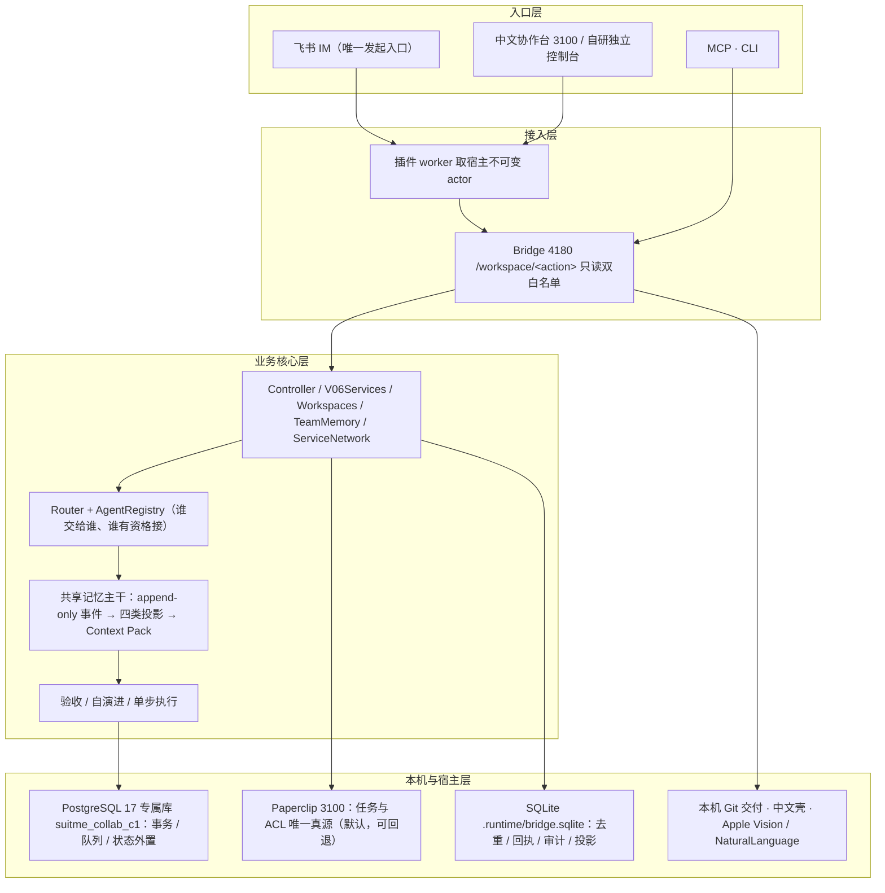

# SuitMe 协作台 · 项目总结

> 日期：2026-11-08（北京时间）｜仓库：`/Users/gong.zhe/Developer/ai-native-collab`｜远端：`github.com/zhegong-996/suitme-collab`（`main`）
> 代码基线以 `git rev-parse HEAD` 为准；本文成稿时 `HEAD = origin/main = 834b268`（第二十二轮 P-1）、工作区干净；本文提交后 `HEAD` 会前进，仍应与 `origin/main` 一致。
> 本文是**总览**，不是设计定稿、也不是实现清单的替代品。权威口径见文末第 8 节。

---

## 1. 一页总览

**产品定位**：小规模、高信任、以知识与软件产出为主的团队，需求从飞书 IM 发起，按用途授权专业资料、连续交接，成果交付到本机 Git 或专业知识空间，**由人验收**。系统要回答的不只是「这单跑完没有」，还有「谁对什么负责、凭什么算做对了、AI 依据什么做的」。

**当前阶段**：A 收敛整合 → B1 记忆主干 → B2 读取链 → C-0 ~ C-6 分步方案 → 生产项 P-1 长程循环单步化，**全部完成并收口**，严格分步不并行。共 22 轮迭代，代码与文档随 `main` 同步推送。

**最后一轮验证**：单测 413/413、`tsc`、两个构建、425px 响应式（393/393 无溢出）、真实浏览器走查 11/11、`console:smoke`、`router:smoke` 31/31、`agents:smoke` 43/43、`shapes:smoke` 36/36、`evolution:smoke` 45/45、`steps:smoke` 40/40、`host:pg` 21/21、记忆重放与 checkpoint、上游审计 clean、`git diff --check`。2026-11-08 交接时再次单独复跑 `npm test` **413/413、0 fail**。

**最需要注意的三条边界**（不要因为「系统全绿」而误读）：
1. 默认底座仍是 `paperclip`、默认执行模式仍是 `loop`；`local-pg` 与 `step` 都真跑过但**未成为默认**，主链路随时可逐字回退。
2. 真人在真实业务单「确认验收」从未发生（SUI-129 未核可）；报告、模型判定、CI、合并审批都不替代它。
3. 外部模型调用、远端沙箱、多机切换、Redis、金额成本账本、生产发布与全员 SSO 均未发生；相关能力有的是契约、有的是隔离真跑，不要当成生产已启用。

---

## 2. 系统架构

### 2.1 四层分层与数据流

**不可绕过的两条**：
- **身份链**：插件 worker 从宿主取 `context.actor`，带 token 打 Bridge；UI 参数不能指定操作人。控制台只开放 16 项只读 action，写动作一律 403，密钥不出服务端。
- **数据与任务不双写**：Paperclip + PG 是唯一任务 / ACL 真源；本地 SQLite 只做事件去重、回执、审计与投影，`.runtime/` 全部不入库。

### 2.2 核心子系统

| 子系统 | 组成 | 作用 |
|---|---|---|
| 统一路由 | `RoutingDecision` 五维契约 + `RoutingTrace` + `src/router.ts` | 五个派活点共 9 处调用收敛到单一入口；`config.router` 决定 `legacy / flat / layered`，扁平 1 跳、分层按业务域最多 2 跳；配置 revision 写进每条证据，历史决策不回溯 |
| 组织与编制 | `src/agent-registry.ts` + `src/roles.ts` + A2A 交接 | Agent 实例与「职责绑定 / 生效范围 / 内容哈希版本」分离；职责槽位可扩展（个人助手 / 主管 / 执行 / 验收 / 标准起草 / 周期巡检 / 自定义）；同一 Task 自派自验自环被拦并留 `rejected` 痕 |
| 共享现场 | `src/memory-log.ts` → `memory-projections.ts` → `memory-recall.ts` → `memory-checkpoint.ts` | append-only 事件主干重放出 **L1 证据图 / L2 组织图 / BM25 向量 / Context Pack** 四类投影；原 Cognee / Ladybug / SQLite / Paperclip 仍是主读取源，投影是权限重评后的**第三路叠加信号**，不是替换底座；`grant-revoked` 按主体精确排除、`source-revoked` 全局阻断；撤权 / 乱序 / 失效祖先一律回退全量重放并逐字节对照 checksum |
| 验收链 | `acceptance-plan / round / report / interop` + `independent-review` | 开工前锁定清单（标准由职能 owner 起草）、逐项判定、部分打回、证据可回溯到 L1 原文、独立评审者 ≠ 产出模型、打回原因沉淀为自查标准 |
| 自演进 | `src/evolution.ts` + `src/evolution-ledger.ts` | 交付前强制自查接在 `Controller.publish()` 之前，五种情况全阻断；候选改进状态机 `proposed → gate-passed → approved → canary → active → rolled-back`；工程闸门复用 `memoryReplayReport()` 且 `modelCalls=0`；人审只认组织级真人；台账**独立于 B1 主干**，避免改变已验收的 checksum |
| 平台端口 | `src/platform-port.ts` + `paperclip.ts` / `LocalHostPlatform` / `PgHostPlatform` | `HostPlatformPort` 收拢任务 / 文档 / 身份 / 健康检查 / UI 承载；`config.host.provider` 默认 `paperclip`，`local` 是最小非 Paperclip 实现，`local-pg` 在本机 PG 真跑事务、ACL、cost-ledger、heartbeat、`FOR UPDATE SKIP LOCKED` 步进队列与崩溃恢复（21/21） |
| 长程执行 | `src/step-execution.ts` + `loop-pump.ts` + `step-runner.ts` | 循环 / 会话状态 / 执行环境三者分离；`StepQueue`（内存 / PG）、`executeOneStep()` 一次进程只跑一步、`checkpoint` 与 `modelCalls` 外置、`runToken` 崩溃回收且旧凭据失效、步间按当前主体重评权限；`config.execution.mode` 默认 `loop` 与改造前逐字等价，`step` 必须配 `local-pg`（配置层直接拒绝假单步） |
| 两套前端 | `console/`（自研） + `plugins/knowledge-workspaces/`（可回退） | `console/` 六视图、明暗主题、425px、统一中文语言层，只读代理 4180；旧插件工作台保留。中文壳 `shell-locale.ts` 在构建期用 Babel AST 只替换展示文案，`shell-domestic.ts` 精确收敛侧栏并隐藏未连接海外卡片 |

### 2.3 关键运行约束

- 本机可信模式只监听回环地址；`assertLocalPgDsn()` 拒绝非回环 DSN，DSN 只从 `COLLAB_PG_DSN` 环境变量读。
- `step:once` 的本机工具白名单只有 `sha256`；模型步无端点时明确拒绝且不编造模型调用；人工确认步不得由执行进程自行放行。
- 确定性链路 `modelCalls=0`：Apple NaturalLanguage 词向量与 L2 确定性抽取不调用模型；`assertDeterministic()` 非零即拒绝，不静默降级。
- Trace 写入是 advisory，失败不得改变任务、回执或验收结果；测试动作由 `COLLAB_TEST_TRACE` / `COLLAB_TEST_MEMORY` 隔离到内存 sink。

---

## 3. 产品功能架构

### 3.1 产品主模型（用户拍板，口径不可跑歪）

| # | 决策 | 落地 |
|---|---|---|
| 1 | 产品化的是「织」不是「组」：主职能稳定、领域上下文流动、邻接能力可正式派单 | Role Registry + Transfer 责任链；Transfer 默认 L0「仅本 Task」 |
| 2 | 主职能名单不预设、可配置；跨空间默认隔离但可申请授权 | 配置驱动，不写死职能表；FR-10 申请授权、目标空间 owner 审批、只开最小可见子集 |
| 3 | 组织形态按业务域 / 组织单元配置，**层不是产品骨架** | `config.router`：10 人可扁平、上百人可按业务域分层；项目只引用不覆写，变更留快照不回溯 |
| 4 | 同一 Agent 可兼多职责，但同一 Task 禁止自派自验自环 | `agent-registry` 职责槽位 + `planRoute()` 在岗 / 职责 / 范围校验 + 自环拦截留痕 |
| 5 | 核心决策点仍由人 | 目标与边界、跨空间授权、高风险联签、原会话「确认验收 任务编号」 |
| 6 | 判断是工程能力 + AI 能力组合，不能全交给模型 | 工程层 `modelCalls=0` 规则过滤 / 权限重评 / 清单校验 → AI 层只接判不准的少数 → 人层核可；人必达消息不受过滤 |
| 7 | 验收本身是一等公民 Agent，可与产品 / 技术 / 运营协作 | `reviewCrew()` 把验收、标准起草、周期巡检与业务 Agent 编成同一份共享现场上的协作组 |
| 8 | 系统沉淀上下文、自我改进，但 Agent 不能自己让改进生效 | 打回 → 自查标准 → 交付前强制比对 → 候选改进 → 工程闸门 + 人审 → 版本 / 灰度 / 可回滚 → 四项效果对比 |
| 9 | 飞书唯一发起入口，用户可见层国内化 | 控制台只读；未接通服务不放可点入口；文案不出现海外品牌 / 工程命令 / 英文协议词 |
| 10 | 「织」的地基是共享现场，不是消息转发 | 三层换的是可见范围与责任主体，读的是同一份 append-only 主干；交接靠 A2A 带 `sourceIds / scope / causedBy` |

### 3.2 角色与职责（三级 owner 口径不能混）

| 角色 | 管什么 | 不可下放 |
|---|---|---|
| 组织级 owner | 职能注册表、转移授权策略、组织形态与 Agent 编制 | 职能 ID 稳定性、责任链、人签红线 |
| Workspace owner（数据归属方） | 验证等级、跨空间授权审批 | 系统安全底线、高风险签字 |
| 职能 owner | 起草验收标准、联签、兜底责任 | 标准不得由承接人自定 |
| 发起人 / 承接人 | 设目标与边界 / 执行 | 验收在原会话由发起人做 |
| 独立评审者 / 验收 Agent | 逐项判定，支持截图等视觉输入 | 不得是产出模型、不替代真人核可 |
| 资料负责人 | 某条知识的采用与撤回 | 私有资料不得自动进共享 Wiki |

### 3.3 功能地图（按域）

| 域 | 已具备的能力 | 主要代码 |
|---|---|---|
| 发起与入口 | 飞书中文自然语言指令（7 条）、Thread → Task/Ticket、发起通知回写 | `src/user-language.ts`、`collaboration-intake.ts`、`src/feishu-sources.ts` |
| 组织与派单 | 职能注册表、业务域配置、单一 Router、扁平 / 分层 / legacy、A2A 在岗交接、自环拦截 | `src/router.ts`、`agent-registry.ts`、`service-network.ts` |
| 上下文与知识 | 知识空间、结构化事实 + 非结构化正文 + 来源 + 版本、L1 证据图、L2 组织图只读抽取（零模型）、Context Pack 裁剪、检索记忆与语义加权、按主体撤权 | `src/knowledge*.ts`、`graph.ts`、`org-extraction.ts`、`context.ts`、`memory-*.ts`、`semantic-recall.ts` |
| 验收 | 开工前锁定 Acceptance Plan、逐项判定 / 部分打回、独立视觉评审、中文报告、证据导出、沉淀自查标准 | `src/acceptance-*.ts`、`independent-review.ts`、`visual-review.ts` |
| 交付 | 本机 Git 交付台、自动合并与预览发布（默认 `delivery.provider=local`，只绑回环）、GitHub 适配器可回退 | `src/controller.ts`、`local-git.ts`、`github.ts` |
| 治理与自演进 | 交付前强制自查、独立治理台账、工程回放闸门、人审 / 灰度 / 回滚、四项效果指标 | `src/evolution*.ts` |
| 观察与控制台 | 六视图（我的工作 / 协作 / 知识 / Agent / 设置等）、组织形态、Agent 编制、沉淀与自演进、长程执行只读卡片 | `console/`、`scripts/console-server.ts`、`src/v06.ts` |
| 适配与国内化 | 中文壳、侧栏收敛、未连接服务隐藏、国内服务实时探测、飞书组织映射只读草案 | `src/shell-*.ts`、`service-status.ts`、`feishu-org.ts` |

### 3.4 功能成熟度三档（决定「能不能对外说已支持」）

- **已跑通且有回归证据**：上述「发起与入口 / 组织与派单 / 上下文与知识 / 验收 / 交付 / 治理」主干能力 + B1/B2 记忆 + 11 步真实浏览器走查 + 全套隔离真跑脚本。
- **预备配置 / 不等于启用**：模型三档策略（不存 Key）、L2 组织图草稿（人审后生效）、飞书部门 scope 授权命令（需本人确认）、Cognee 原生 LLM / embedding / cognify、组织映射草案（未导入职能注册表、不参与派单）、`step` 模式与 `local-pg` 底座。
- **未接通 / 未发生**：企业微信 / 腾讯文档 / 钉钉 / 国内代码托管 / 公有云 CI / 海外 SaaS（按约定没有可点入口）、全员 SSO 与真实员工入驻、生产发布、真人在真实业务单「确认验收」、外部模型调用、远端沙箱与金额成本账本。

---

## 4. 业务流程设计

### 4.1 端到端主闭环（8 步，4 个人工决策点）

`*` 为人工决策点。**报告、模型判定、CI 通过、合并审批都不替代最后一步**；SUI-129 至今未核可。

### 4.2 PRD 的 13 步细化流程

1. 飞书 / 后台进入 Workspace → 生成 Thread，结构化成 Task/Ticket，附 Mandate。
2. 人只面对一个入口（Personal Agent 或项目主管 Agent）。
3. **按主职能定组 → 领域定人**；引用其他 Workspace 资料先申请授权（目标空间 owner 审批，只开最小可见子集）。
4. 邻接能力承接时生成 Transfer（默认仅本 Task），由目标职能起草验收标准。
5. 从知识底座裁剪 Context Pack，只纳入已验收的边。
6. 接收方 Agent 可行性分析、反向追问若干轮。
7. **开工前锁定 Acceptance Plan**，验证等级按 owner 策略确定，对外类强制 L4。
8. 执行；环境事件由订阅直通唤醒对应 Agent。
9. 触及数据库变更等动作 → Gate 真人签字；跨职能高风险动作 → 联签。
10. Agent 在真实产品里逐项跑检查，采集截图 / 录屏 / 日志，生成在线验收报告。
11. 人看报告：整体通过或部分打回；打回项在原上下文修正；**打回原因沉淀为下次自查标准，并在下次交付前逐条强制先自查**。
12. 核可后发 preview / 合并主干 / 发布；全过程写 Trace；成本归集到 Task。
13. Artifact 转「已验收」，连同证据、责任链、打回原因回流知识底座，图谱边升为「可复用」。

### 4.3 三条关键子流程

**跨空间授权与撤权**：申请 → 目标空间 owner 真人审批 → 最小可见子集 + 限时 Grant → 每次读写前后双重权限重评 → 到期 / 撤回登记 `grant-revoked`（按主体精确排除）或 `source-revoked`（沿 lineage 全局阻断派生记忆）→ 投影召回与 checkpoint 立即反映。撤权是状态写入，不是物理删除，不宣称已实现远程缓存清理。

**责任转移（Transfer）**：由 `Router` 读当前组织形态配置决定下一跳；每跳带 `causedBy` 与 Router 配置 revision；`AgentRegistry` 校验主管真实在岗 / 职责匹配 / 范围覆盖，否则降级 1 跳并标注 `degraded`；A2A handoff 只传 `sourceIds / scope / causedBy`，校验在岗与版本；**人签红线只在最后一跳**，历史决策不回溯改写。

**自我改进生效**：打回 / 异常 → 沉淀自查标准 → 下次交付前 `assertDeliverySelfCheck()` 逐条比对（无记录 / 缺条 / 未通过 / 空证据 / 旧快照五种全阻断）→ 候选改进登记 → 工程闸门用 `memoryReplayReport()` 确定性回放验证（`modelCalls=0`）→ **组织级真人批准** → 版本 / 20% 灰度 / 生效 / 可回滚 → 四项效果对比（通过率、返工率、单任务成本、人被打断次数），缺观测即 `comparable=false`。Agent 自批、跳闸门、无人审灰度、触碰已锁定清单 / 权限规则 / 人签红线 / 历史任务全部记违规痕且不前进。

### 4.4 人在链条上的位置与判断分层

**人**：设目标与边界、被追问补充、跨空间授权审批、跨职能授权、高风险签字（联签）、看验收报告核可、例外介入、批准改进生效。

| 层 | 处理什么 | 约束 |
|---|---|---|
| 确定性工程层 | 规则过滤、权限重评、注意力预算、周期巡检、清单校验、回放验证 | `modelCalls=0`，`assertDeterministic()` 非零即拒绝 |
| AI 层 | 只接工程层判不准的少数（语义、抽取、评审） | 记证据与成本，能本机不外部；未配端点如实报错，不静默降级 |
| 人层 | 目标、边界、高风险联签、最终核可、改进批准 | 必达消息不受任何过滤影响 |

**验收口径**：单元测试 ≠ 真实 journey；模拟成员 ≠ 真实员工；本地预览 ≠ 生产部署；CI 通过 ≠ 业务验收。

---

## 5. 对其他项目的依赖和引用情况

### 5.1 三类关系（先分清，再谈协议）

| 类别 | 含义 | 数量 |
|---|---|---|
| A 已引入源码 / 固定版本依赖 | 7 个 git submodule + npm 直接依赖 + 1 处代码移植；可闭源集成 | 7 + 15 + 1 |
| B 仅设计参考 | 只借产品思想 / 数据模型 / 交互观感，**0 处代码引用** | 10 余个 |
| C 明确未引入 | 服务 / 中间件 / 未来候选，代码与运行实例都不存在 | 若干 |

### 5.2 A 类 · 七个固定 submodule（协议逐一）

版本全部锁在 `sources.lock.json` 与 gitlink，`npm run audit:upstream` 机器化校验；**上游源码一律不改**。

| 项目 | 协议 | 固定 commit / 版本 | 引用方式 | 实际复用 | 明确没用 / 边界 |
|---|---|---|---|---|---|
| Paperclip（`paperclipai/paperclip`） | **MIT** | `0eaabe5c…` | submodule + 平台底座 + Plugin SDK | 原 server / ui / db、任务文档、签出、ACL、修订、审计、成员与邀请、插件页 UI | 不修改上游源码；LLM Wiki 与 Plugin SDK 同提交随 Paperclip 声明；Paperclip 是 MIT，不是「不纯开源」 |
| DSH Super-agent（`dsh-superagent-prototype`） | **MIT** | `8c32a9dc…` | 运行时动态 import | 飞书触发解析、线程键、出站幂等、`settingsPolicy` / `assessmentOutcome` 准入与范围判断 | Router/Worker 双层、订阅直通、Watchdog 均未落地；不启动第二个任务库或调度器 |
| Agent Autoloop（`KKKKhazix/agent-autoloop`） | **MIT** | `ba8cf6d8…` | 动态 import + 子进程（复用最深） | `createWorker`、Codex / Claude / command / ACP 适配器、执行循环、CLI 适配器、回执恢复 | 不启动 Autoloop hub；不照搬其自动合并策略；不负责跨 Agent 路由；业务 prompt / 工具 / 权限规则自研 |
| DeepSeek Harness（`deepseek-ai/deepseek-harness`） | **MIT** | `fcc0ad46…` | 静态 import + esbuild 打包 13 模块 | output-retention、session-reference、Cordis `Context/scope`、`SystemPrompt`、`ToolsService`、`NativeExecutor`、`Persona`、`createScope` | 未启动完整 Harness host / AgentLoop / 动态模块装载器 / 第二套调度器；LLM 客户端换成自研；vendored `cordis` / `cosmokit` / `schemastery` 的 MIT 声明保留在 `licenses/harness-vendor-MIT.txt` |
| Prime Agent（`PrimeIntellect-ai/prime-agent`） | **MIT** | `74591cdd…` | submodule + **代码移植**（`src/vendor/prime-query.ts`） | `harness.py` 检索词 / query runs/terms、`harness_digest.rs` 近期目标与上下文权重 | 未启动其 daemon 或全局 refinement；移植文件必须保留 Mario Zechner 原始 MIT 版权头 |
| Cognee（`topoteretes/cognee`） | **Apache-2.0** | `525b1d11…`（1.6.6） | 前端工具 import + Python 子进程 RPC | `LadybugAdapter`、`DataPoint` / provenance、`BM25ChunksRetriever`、GraphVisualization、GraphSchema reducer 与 JSON Schema serializer；L2 组织图确定性只读抽取 | 固定子模块不改源码；无常驻图服务；原生 LLM / embedding / cognify 管线已实现但**真实调用从未发生**；Apache-2.0 须保留 NOTICE 与修改标注 |
| `lobehub/acceptance` | **Apache-2.0** | `f720feb…`（v0.10.0） | submodule，**只读文件**（`src/acceptance-interop.ts`） | 开工前锁定计划、证据来源分类、逐项判定、报告 / 产物 `result.json` / `report.md` / assets 的**契约与文件布局** | 不启动其 CLI 或云端报告服务；第六轮的本机中文报告服务是自研只读实现，不是上游 CLI 封装；与 LobeHub 主仓库协议**不同**，不受 Community License 约束 |

### 5.3 A 类 · npm 直接依赖（协议逐一，取自各发行包 `license` 字段）

| 包 | 版本 | 协议 | 用途 |
|---|---|---|---|
| `@a2a-js/sdk` | 1.3.0 | **Apache-2.0** | `DefaultRequestHandler` / `JsonRpcTransportHandler` / 原生 `TaskStore` / `AgentCard` / `TaskState`，只用于服务委派，未承载三层汇报；LICENSE 原文 `licenses/a2a-js-APACHE-2.0.txt` |
| `@modelcontextprotocol/sdk` | 1.31.0 | MIT | MCP 接入 |
| `classnames` | 2.5.1 | MIT | 前端 className 组合 |
| `culori` | 4.0.2 | MIT | 颜色处理 |
| `d3-force-3d` | 3.0.6 | MIT | 图谱力导向布局 |
| `esbuild` | 0.28.2 | MIT | 打包上游固定源码 |
| `pg` | 8.23.1 | MIT | 仅作 PostgreSQL 客户端驱动：`src/pg-host.ts` 的事务 / 并发领取 / 步进队列 / 状态外置；`licenses/pg-MIT.txt` 已按 R7 登记 |
| `react-force-graph-2d` | 1.29.2 | MIT | 图谱渲染 |
| `tsx` | 4.23.15 | MIT | 直跑 TypeScript |
| `uuid` | 13.0.0 | MIT | 标识生成 |
| `zod` | 4.4.3 | MIT | 配置与契约校验（含 `configSchema.superRefine`） |
| `@babel/parser`（dev） | 8.1.0 | MIT | 中文壳构建期 AST 文案替换 |
| `@types/node`（dev） | 24.0.0 | MIT | 类型 |
| `@types/pg`（dev） | 8.23.1 | MIT | 类型 |
| `typescript`（dev） | 7.0.2 | **Apache-2.0** | 类型检查 |

精确版本与 integrity 见 `package-lock.json`。`THIRD_PARTY_NOTICES.md` 明确声明：**本清单不是全部传递依赖的法律审计**，发行前需单独做一次依赖扫描。

### 5.4 B 类 · 仅设计参考（0 处代码引用，协议逐一）

| 项目 | 协议 | 参考了什么 | 为什么不能当代码复用 / 当前状态 |
|---|---|---|---|
| `lobehub/lobehub` 主仓库 | **Community License = Apache-2.0 + 附加条件**（GitHub 标 `Other`，非 OSI 开源） | Workspace+Task、Manager/Worker 三层汇报、L1–L5 自主度、两级事件过滤、运行时三层分离、Agent Vent、harness 自优化 | **开发并分发衍生作品须取得商业授权**；禁止复制 / fork / 打包其源码。本项目只借思想，`console/` 全部自研；设计溯源已留在 `ARCHITECTURE-v0.6.md` 与本文 |
| `@lobehub/ui` / `lobehub/lobe-ui` | **MIT** | 组件观感 | 组件库虽为 MIT，但 v6 强绑 React 19 + ESM + 多个 peer；**本项目未引入依赖、未复制组件源码、未打包资源** |
| Graphiti（`getzep`） | Apache-2.0 | Episode、边 `valid_at` / `invalid_at` 双时间有效性、supersession 语义 | 协议允许，但需 Neo4j/FalkorDB 与 LLM 服务；只借模型，不部署整套 |
| OpenHands Software Agent SDK | MIT | 执行服务与协作控制平面的边界 | 协议允许，但会引入第二套执行服务与 Python 运行时；第一版不引入 |
| Outline | **BSL 1.1**（source-available，非 OSI 开源） | collection/group、文档权限模型 | **明确禁止引入代码**，仅作权限设计参照 |
| Onyx / OpenFGA | **本仓库未核实**（仅核读官方资料） | ReBAC、文档权限 | 未引入代码；引入前必须先核实协议与商业条款，不得凭印象按 Apache-2.0 处理 |
| LightRAG / KAG (OpenSPG) | MIT / Apache-2.0（PRD 记载） | GraphRAG 编辑与合并、概念 / Schema / 词典 | 仅参考，不叠加第二套索引与运行服务 |
| Octop（TencentCloud）/ DeerFlow 2.0（ByteDance）/ CoPaw / Pi | MIT / MIT / Apache-2.0 / MIT core | 去 Paperclip 化的宿主与执行层候选 | **均未引入**：用户第十七轮定调 (a) 不引入第 8 个上游、加速去宿主化，而不是换宿主 |
| n8n | Sustainable Use License（非纯 OSI） | 自动化编排参照 | 已在既有文档排除 |
| 用户自有本体论原型 `ai_bridge.py` / `knowledge.py` | 用户授权迁移 | 引用核验、快照与撤回投影 → `src/evidence.ts` | 未迁移原型数据库、模型环境或业务数据；权属已在 notices 标注 |
| Alice 研究包 | manifest 标 MIT，**完整许可未核实** | 架构与失效机制设计参考 | 不复制代码、不宣称已授权；静态恢复不等于原厂授权证明 |

### 5.5 C 类 · 明确未引入 / 未接通

Redis（用 PG `FOR UPDATE SKIP LOCKED` 等价，切换点为 `claimStep / completeStep / recoverStaleSteps`）、远端工具沙箱与多机 Remote Tool Calling、金额成本账本、企业微信 / 腾讯文档 / 钉钉 / 国内代码托管 / 公有云 CI / 海外 SaaS、全员 SSO、生产发布、真实外部 PR/CI、Cognee 原生 cognify 真实调用。

### 5.6 协议差异与工程红线 R7

- **MIT**：保留版权声明与许可全文即可，允许修改 / 闭源 / 再分发。
- **Apache-2.0**：除 LICENSE 外须保留 NOTICE（如有）、对被修改文件作显著标注、保留专利授权；触发专利诉讼会导致授权终止。Cognee、`@a2a-js/sdk`、`lobehub/acceptance` 属此类。
- 二者都**不要求**公开本仓库源码，但都要求分发时随附声明。本仓库 `package.json` 标 `private: true`，当前不对外分发；**一旦产品化交付或对外发布**，LobeHub 衍生分发限制与 Outline BSL 会立刻生效，需重新评估。
- **已引入源码全部是 MIT 或 Apache-2.0，没有 GPL / AGPL / SSPL 等传染性协议**。
- 新增依赖六步（R7）：查官方 SPDX（`Other` / BSL / 附加条件一律先人工评审）→ 固定版本 → LICENSE 原文入 `licenses/`（Apache-2.0 另查 NOTICE）→ `THIRD_PARTY_NOTICES.md` 写版权 / commit / 复用内容 / **明确没启用什么** → 更新 lock → `docs/SOURCES.md` 补一行。`pg@8.23.1` 与 `lobehub/acceptance` 均按此登记，`audit:upstream` 纳入检查。
- 合规材料位置：`THIRD_PARTY_NOTICES.md`、`licenses/`、`sources.lock.json`、`.gitmodules`、`docs/SOURCES.md`、`docs/UPSTREAM-ADAPTERS.md`、`docs/OPEN-SOURCE-COMPLIANCE.md`。已知缺口：根目录无主 `LICENSE`（私有阶段不影响，发行前需定）、npm 传递依赖未做全量法律审计。

### 5.7 本机与服务依赖（不是代码依赖，但影响运行）

| 依赖 | 状态 / 约束 |
|---|---|
| Node.js | 声明 `>=24.11.0`，实测 22.22.2 可跑；npm + `package-lock.json` |
| PostgreSQL 17 | 用户既有实例 `127.0.0.1:5432`，专属库 `suitme_collab_c1`；`host:pg` 21/21、`steps:smoke` 的跨进程接力真跑；不得触碰其它库 |
| Apple Vision / NaturalLanguage | macOS 设备端能力，只绑 `127.0.0.1`，不需要 API Key 或下载模型，业务材料不外发；4190 视觉端点当前停机 |
| 飞书 `lark-cli` | 专用命名 profile；`allowedSenders` 默认空，未配置禁止启动派单监听 |
| Paperclip 3100 / Bridge 4180 | 运行中；改服务端代码后需 `restart:bridge` |
| 本机 Git 交付台 4194 / git daemon 9418 / 报告服务 4192 | **用户主动取消，保持停机，不得重启** |
| Chrome | 仅真实浏览器走查 11/11 使用，需禁用缓存 |

---

## 6. 验证与证据

| 类别 | 命令 | 结果 |
|---|---|---|
| 单元 / 契约 | `npm test` | 413/413，0 fail（交接时复跑确认） |
| 类型与构建 | `npm run typecheck`、`build:workspaces`、`build:chinese-shell` | 全部 pass |
| 前端 | `npm run test:responsive`、`npm run test:walkthrough` | 425px 393/393 无溢出；真实浏览器 11/11 |
| 独立控制台 | `npm run console:smoke` | 6 视图、主题、425px、写动作 403、`errorCards:0` |
| 组织与路由 | `router:smoke` / `agents:smoke` / `shapes:smoke` | 31/31、43/43、36/36（隔离内存 Trace，不写真实日志） |
| 自演进 | `evolution:smoke` | 45/45（隔离临时台账，真实台账与 B1 主干行数不变） |
| 长程执行 | `steps:smoke` | 40/40（隔离队列 + 本机 PG 专属库 + 真实子进程，第二棒由「另一台机器」领走） |
| PG 宿主 | `npm run host:pg` | 21/21（事务 / 并发领取 / 步进链 / 崩溃恢复 / token 轮换） |
| 共享记忆 | `memory:replay` / `memory:smoke` / `memory:journey` / `memory:checkpoint` | 重放一致、`checksumEqual:true`、真实一单端到端撤权 |
| 上游与提交 | `npm run audit:upstream`、`git diff --check` | clean / pass |

所有真跑报告落在 `.runtime/*.json` 与 `.runtime/console/collaboration-*.png`，**均不入库**；测试事件靠 `COLLAB_TEST_TRACE` / `COLLAB_TEST_MEMORY` 隔离。完整预期输出与排障见 `HANDOFF/05-VALIDATION-AND-COMMANDS.md` 与 `docs/VALIDATION.md`。

---

## 7. 边界与后续

**已实现但默认未启用**：`config.host.provider=local-pg`、`config.execution.mode=step`（默认 `paperclip` + `loop`，可逐字回退）、Cognee 原生管线（缺端点与凭据）、组织映射草案（未导入职能注册表）。

**剩余生产项**：切换默认底座并把真实业务单切到 step 模式验证；autoloop worker 内部子调用逐次拆分（当前 tick 级单步）；真实外部模型端点 / 远端工具沙箱 / 多机切换 / Redis；金额成本账本接入效果看板。~~控制台 `view` 快照的服务端分页裁剪~~ 已于**第二十三轮 P-5 完成**：新增只读 `view-summary`（分页 + 字段白名单），控制台改拉摘要，真实服务端 509,283 bytes / 4.02 秒 → 5,678 bytes / 0.076 秒，原 `view` 逐字保留给插件工作台。**第二十四轮 P-6 已完成**：Runner（`yicheng47/runner`，固定 MIT 提交 `a42d1331`）的两块协议语义用 TypeScript 重写落地 —— `src/step-hitl.ts` 的 `ask_human/human_question/human_response` 成对留痕、`src/step-delivery.ts` 的累计确认 / 至少一次通知 / 投递就绪与送达证据；四项借思想（六态派生、运行时能力声明、配置库与追加写日志分层、编制快照不回溯）落在 `src/mission-state.ts`。R7 六步登记完成，**未引入 submodule / gitlink / Rust 源码，7 个上游不变**；`npm test` 445/445、`steps:smoke` 54/54。红线：人工回答不等于验收，执行进程不得自行放行人工确认步。**第二十五轮 P-7 已完成**：完整阅读 Anthropic《The components of agent memory》（2026-11-06，网页研究文章、无开源代码许可证，只借思想、登记 `conceptReferences`、不是第 8 个上游），逐层对照后把五条规则做成 `src/memory-hierarchy.ts` 纯函数守门 —— 知识必须挂靠原始事件、知识地图链接完整且不比原始语料大、注入顶层 200 行 / 25 KB 只留索引与指针、离线整理只产出待真人复核的建议、外部参考本身按候选沉淀；`tests/memory-hierarchy.test.ts` 20 例与 `npm run memory:hierarchy` 16/16 真跑，`npm test` 465/465。守门尚未接入真实 `Knowledge` / `Context Pack` / wiki 落盘，待拍板见 `HANDOFF/08` 第 13 条。

**需用户拍板**：外部模型端点与凭据、SUI-129 真人验收、飞书部门 scope 授权、国内 / 海外外部服务是否接通、已取消服务长期状态、「pi」的指代；以及「何时切换默认 `config.host.provider`」。

**红线**：`Agent 完成 ≠ 业务验收`；4190 / 4192 / 4194 / 9418 不重启；上游源码不改且 `audit:upstream` 保持 clean；`.runtime` 证据不入库；工作台 / 控制台只读、飞书唯一发起入口；不为凑评估转绿逼扁平团队硬造管理层；Agent 不能自己让改进生效。

---

## 8. 文档索引与权威口径

| 需求 | 文档 |
|---|---|
| 接手另一个 Agent | `HANDOFF.md`（根目录速览）、`HANDOFF/` 详细包（`README.md` / `00` / `06` / `07` / `08`） |
| 系统架构现状 | `docs/SYSTEM-ARCHITECTURE.md`、`HANDOFF/02-ARCHITECTURE.md` |
| 产品架构定稿（不等于全部实现） | `docs/ARCHITECTURE-v0.6.md` |
| 产品需求与可验收条款 | `docs/PRD-v0.6.md`（§5 FR、§6 主流程、§10C C-P1~C-P8） |
| 方案与缺口 | `docs/ARCHITECTURE-OPTIONS-v0.7.md`、`docs/ROUTING-AND-HOST-v0.7.md`、`docs/MEMORY-ARCHITECTURE-v0.7.md` |
| 最新边界与轮次 | `docs/ADAPTATION-v0.6.md`（`0.00000000000000000000000` 节为最新） |
| 验证 | `docs/VALIDATION.md` |
| 复用来源与协议 | `docs/SOURCES.md`、`docs/UPSTREAM-ADAPTERS.md`、`docs/OPEN-SOURCE-COMPLIANCE.md`、`THIRD_PARTY_NOTICES.md` |
| 机器可读交接元数据 | `HANDOFF/handoff-manifest.json`、`sources.lock.json` |

**冲突时优先级**：`docs/ADAPTATION-v0.6.md` 最新边界声明 → `docs/VALIDATION.md` 最新验证 → `docs/PRD-v0.6.md` §10C → `HANDOFF/06` → 其余历史轮次文档。本文与 `HANDOFF.md` 是总览入口，不替代上述权威文档。
