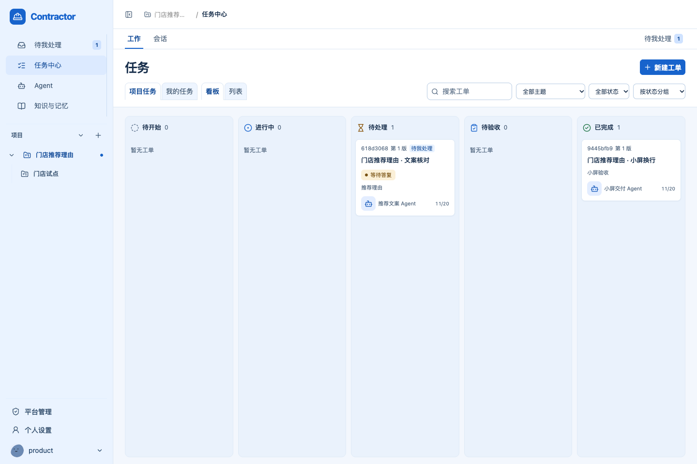

# Contractor

**把一句 IM 反馈，送到能接单的 Agent，再用提交、CI 和人工验收收口。**

[](https://github.com/zhegong-996/suitme-collab/actions/workflows/ci.yml)
[](LICENSE)
[](package.json)

Contractor 是给团队使用的自托管 Agent 协作工作台。讨论可以来自飞书、钉钉、企业微信或 Web；系统把内容归到项目和主题，由平台 Router 派给个人 Agent 或 Worker。执行结束后，结果还要经过提交、CI、部署和人工验收，确认有效的做法才会进入知识库。

[它解决什么](#它解决什么问题) · [怎么运转](#一条工作怎样走完) · [三类角色](#三类执行角色) · [插件边界](#稳定核心可插拔边缘) · [上手](#上手) · [文档](docs/README.md)


## 解决的问题

群里的反馈很快，真正麻烦的是之后：谁负责？Agent 该读哪些资料？在哪台电脑执行？交付对应哪个版本？验收通过后，经验又怎样留给下一次任务？

Contractor 把这些问题收在同一条链路里：

- **消息有原位置。** 重复投递只处理一次；回复、待办和处理结果能回到原群话题或工作台会话。
- **执行有边界。** 项目权限、资料范围、Agent、模型、Worker 和积分在接单时一起核对，聊天内容不能自行改写执行目录或授权。
- **交付有版本。** 代码工单绑定提交、PR、对应 SHA 的 CI 和可选部署证据；打回后在原单进入下一版，旧版不能冒充新版验收。
- **中断可接续。** 旧执行确认停止后才可以换设备或执行端；迟到的回执会补齐账目，重复回执不会重复派工或扣分。
- **知识有出处。** 验收后生成知识候选，负责人采用后才进入现行版本。来源被撤权时，原资料、派生知识和使用关系一起受影响。

## 拿来就能做什么

| 从一个真实场景开始 | Contractor 最终交付什么 |
| --- | --- |
| 飞书群里有人反馈“小屏推荐卡文字挤在一起” | 原消息进入对应项目主题，重复消息只建一张工单；处理结果回到原话题 |
| 产品需要一名 Agent 修改页面并交付审查 | Router 选择个人 Agent 和执行设备，Worker 返回成果、Token 与积分；代码单继续绑定 PR 和 CI |
| 某个子单执行中被撤权，已有结果失效 | 主单停止汇总；重新授权后只接续受影响的子单，事实结果齐了再汇总 |
| 成员按当前版本验收并采用一条规则 | 生成有来源的知识版本；下一张只读咨询可以引用它，并追溯到原工单、子单和验收证据 |

工作台中的待办、看板、工单详情和项目会话使用同一份业务状态。从任一入口打开同一张工单，都能看到当前负责人、讨论、执行记录、交付证据和验收版本。

## 一条工作怎样走完

编号与上方架构图中的主要路径对应：

1. **消息先入库。** IM、Web、GitHub、Figma 和文档事件先持久化，再校验、去重并保留原会话地址。
2. **归到正确的工作。** 系统根据引用、身份、项目和主题，把新内容关联到原工单或创建新工单；归属不确定时交给维护人处理。
3. **选定谁来干。** Router 在已授权的候选中选择个人 Agent、执行设备、模型和额度策略。多个候选或资料不足时进入人的待办。
4. **执行并处理等待。** 本机或远程 Worker 领取任务。需要确认、补充资料或授权时，卡片回到原会话；答完后继续原工单，不另开一份工作。
5. **用证据交付。** 一轮执行可以产生多轮尝试。代码工单继续核对仓库、分支、提交、PR、同一提交的 CI、部署和逐项检查。
6. **人验收，知识再回流。** 人确认的是当前版本。可复用做法先成为知识候选，采用后才生效；下一项任务按当前权限加载这些知识和原始出处。

Agent 完成不等于验收完成，聊天里说“可以”也不会自动变成验收；版本、证据和责任人都由业务核心统一记录。

## 三类执行角色

| 角色 | 属于谁 | 负责什么 | 由谁配置 |
| --- | --- | --- | --- |
| **平台 Router** | 平台 | 根据规则、职责和当前授权分配任务，整理摘要与等待事项；不直接占用成员设备 | 平台管理员配置模型与提示词，项目维护人配置职责和路由 |
| **个人 Agent** | 成员 | 保留个人工作方法与经验，在个人会话中咨询、整理或提出委托建议 | 成员维护名称、指引、技能和轻量模型 |
| **Worker** | 一台电脑或云主机 | 真正领取并执行任务，加载当轮授权资料、模型、技能和会话 | 设备所有者登记并授权项目；项目维护人设置主备 |

Router 属于平台，个人 Agent 属于成员，Worker 属于设备。三者可以协作，但身份、权限、用量和审计不会混在一起。

## 稳定核心，可插拔边缘

项目、成员、权限、工单状态、版本、积分、验收和知识采用始终由业务核心管理。变化较快的接入与执行能力从插件边界进入：

| 边界 | 可配置的实现 |
| --- | --- |
| 消息入口 | 飞书、钉钉、企业微信、Web、GitHub；统一持久入站、身份绑定、过滤和原会话回传 |
| 资料与检索 | 项目文档、Figma、GitHub、授权知识与 Octop Memory |
| Agent 与模型 | 平台 Router、个人 Agent、共享专家、主备模型和额度路由 |
| 执行设备 | 本机 Worker、远程 Worker、Codex、Claude Code 和命令行适配器 |
| 交付 | GitHub PR、Actions、部署证据和项目自定义验收模板 |

同一实例只启用一个调度器。现有部署默认使用 AutoLoop 兼容路径，也可以在独立状态目录迁移到 Contractor 自研调度器。

完整入口与业务规则见 [功能与模块手册](docs/PRODUCT-CAPABILITY-MAP.md) · [系统架构](docs/ARCHITECTURE.md) · [业务流程](docs/BUSINESS-FLOWS.md) · [数据模型](docs/DATA-MODEL.md) · [插件边界](docs/PLUGIN-ARCHITECTURE.md)

## 工作台



待办、看板、列表、项目会话和工单详情指向同一张工单。成员可以在自己的待办中接单、答复、查看执行和按版本验收；只读成员能查看被授权的讨论与成果，直接访问未授权接口仍会被拒绝。

## 快速开始

环境要求：Git、Node.js 24.11+、npm。如果仓库尚未公开，需要对应的 GitHub 访问权限。

```sh
git clone --recurse-submodules https://github.com/zhegong-996/suitme-collab.git contractor
cd contractor
npm ci

export COLLAB_STATE_DIR="$PWD/.runtime/workbench"
mkdir -p "$COLLAB_STATE_DIR"
cp -n fixtures/workbench.example.json "$COLLAB_STATE_DIR/workbench.json"

node --import tsx src/workbench/server.ts init-owner product
npm start
```

初始化时输入独立口令，然后在 [http://127.0.0.1:4280/](http://127.0.0.1:4280/) 使用 `product` 登录。示例项目中的 Agent 默认停用；按需配置模型凭据和执行端。

[执行端接单指南](docs/QUICKSTART-RUNNER.md) · [配置说明](docs/CONFIGURATION.md) · [远程 Worker](docs/WORKBENCH-REMOTE-RUNNER.md)

## 仓库结构

<details>
<summary><strong>展开目录说明</strong></summary>

| 位置 | 放什么 |
| --- | --- |
| `src/workbench/` | 项目、权限、路由、调度、交付、验收、知识和恢复 |
| `workbench/src/` | React 工作台、任务中心、会话和平台管理 |
| `upstream/` | 固定提交的第三方源码子模块与许可 |
| `integrations/` | GitHub 交付与自动验收示例 |
| `fixtures/` | 不含真实凭据的配置样例 |
| `scripts/` | 打包、来源审计和运维工具 |
| `tests/` | 单元、集成和真实链路回归 |
| `docs/` | 产品、架构、操作、运维与历史记录 |

</details>

## 开源来源

当前代码级复用均有固定版本和许可记录。只在产品分析中比较过思路、没有复制源码或资产的项目不进入许可清单。

| 来源 | Contractor 中的用途 | 许可 |
| --- | --- | --- |
| Super-agent | 工单、委托与效果队列内核，以及部分飞书接入 | MIT |
| Agent AutoLoop | 兼容调度器、CLI Worker 和回滚账本 | MIT |
| Octop Gateway | 可选的多渠道连接与消息传输 | MIT |
| Octop Memory | 可选的授权候选检索与排序 | MIT |
| Octop Web | 2 个工作台组件适配 | MIT |

npm 依赖由 `package-lock.json` 固定版本和完整性；浏览器构建随包列出实际打入的模块许可。

[完整来源清单](docs/SOURCES.md) · [第三方声明](THIRD_PARTY_NOTICES.md) · [来源锁定](sources.lock.json)

## 开发与验证

```sh
npm run check:docs
npm run audit:upstream -- --browser
npm test
npm run typecheck
npm run build:ui
```

提交代码前还应核对当前 CI 中的 Linux 执行隔离、两个调度器回归、Python 原生适配器和制品打包。真实账号、企业消息、运行数据库、令牌和项目私有附件不得进入仓库。

[贡献指南](CONTRIBUTING.md) · [安全策略](SECURITY.md) · [完整文档索引](docs/README.md) · [CI](.github/workflows/ci.yml)

## 状态

Contractor 当前为 `0.1.x`，核心链路和本地/远程执行已经过集成验证，公开接口和部署方式仍会继续迭代。生产使用前请在独立状态目录、测试仓库和测试账号中完成自己的权限、模型、渠道与验收配置。

## License

Contractor 原创代码使用 [MIT](LICENSE)。随附上游源码、适配组件、浏览器构建和可选执行工具继续适用各自的许可证。
