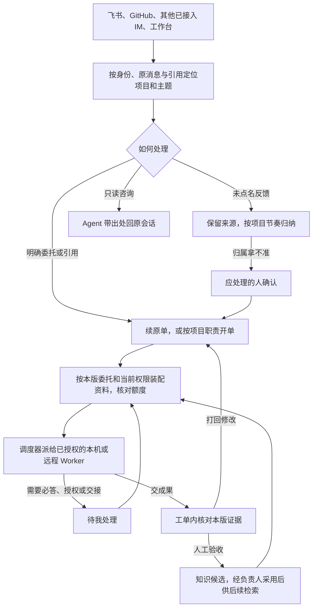

# Contractor

Contractor 是一个自托管的团队 Agent 协作工作台。团队把 IM、GitHub、Figma 和文档接到项目，在会话里讨论，在工单里推进交付。Agent 负责整理反馈、查资料和执行已获准的任务。需要定范围、授予访问权或验收时，系统把决定交给对应的人。

[快速开始](#快速开始) · [功能与模块手册](docs/PRODUCT-CAPABILITY-MAP.md) · [各模块业务流程](docs/BUSINESS-FLOWS.md) · [系统架构](docs/ARCHITECTURE.md) · [数据模型](docs/DATA-MODEL.md) · [截图与操作手册](docs/WORKBENCH-FRONTEND-WORKSPACE.md) · [实现来源与分发](docs/SOURCES.md)


## 一件工作怎样走完



**以门店推荐理由为例**。门店在群里反馈「推荐理由看不懂」，相关反馈先归入项目主题。文案核对和小屏换行分别跟进，同一问题的引用回复续回对应工单。小屏工单由产品确认验收范围、研发接单，Agent 在允许的代码范围内工作。发起人核对本版提交、CI 和逐项检查，通过后由知识负责人采用可复用的三档视口规则。以后遇到类似问题，Agent 可以在当前授权下查到现行规则，并引用它通过验收的那一版。

## 产品功能

| 能力 | 在哪里使用 |
| --- | --- |
| **身份、项目和资料** | 绑定经验证的渠道账号。在「项目」组织子项目、主题、参与成员、仓库、原型与资料。平台权限与源站访问分别判定。 [配置手册](docs/CONFIGURATION.md) |
| **消息过滤和派工** | 飞书、GitHub 与已配置的 IM 使用统一入站记录。项目主题可关联多个渠道会话，项目维护人设置职责和牵头人，引用冲突进入待办。 [项目与 IM 映射](docs/WORKBENCH-IM-PROJECTS.md) |
| **任务中心和会话** | 「工作」用看板或列表跟进工单。「会话」搜索项目、主题与工单并续聊。「待我处理」聚合当前账号可以处理的决定。 [界面与操作](docs/WORKBENCH-FRONTEND-WORKSPACE.md) |
| **Router、个人 Agent 和执行端** | 配置路由建议与知识提炼的提示词，编辑个人 Agent 的名称、模型、经验及技能，登记 Worker 的执行设备。已确认的委托可以断线续跑，旧执行停止后可交接。 [Agent 配置](docs/PLUGIN-ARCHITECTURE.md#agent-配置和运行) · [执行端手册](docs/WORKBENCH-REMOTE-RUNNER.md) |
| **版本交付和验收** | 查看每轮成果，核对本版提交、PR、CI 和可选部署。支持逐项检查、打回下一版和回归比较。 [交付模板](docs/WORKBENCH-DELIVERY-TEMPLATE.md) |
| **知识与记忆** | 查看候选、现行版本、历史、来源和使用记录。知识负责人确认采用、替代和失效。 [知识管理](docs/KNOWLEDGE-VERSIONS.md) |
| **平台管理与积分** | 管角色、主登录渠道、模型服务和系统状态。后台按 Token 与模型倍率结算，前台按积分池管理。 [配置手册](docs/CONFIGURATION.md) |

新成员使用团队选定的飞书、钉钉、企业微信、微信、Telegram、Discord 或 QQ 扫码或授权。平台同步渠道资料并提交开通申请，管理员审批平台角色，项目维护人单独授予项目权限。 [企业登录接入](docs/WORKBENCH-IM-LOGIN.md)

**实现来源**。源码依赖包含 4 个固定提交的 MIT 子模块和 2 个适配自 Octop 的前端组件。Super-agent 提供工单和委托内核，AutoLoop 用于兼容运行与回滚，Octop Gateway 和 Memory 按部署选用。Contractor 实现业务路由、权限、上下文、验收与知识账本，并提供自研调度器。 [源码复用清单](docs/SOURCES.md)

## 快速开始

需要 Git、Node.js 24.11+ 和 npm。下载私有仓库时请使用已有仓库访问权限的 Git 账号。

```sh
git clone --recurse-submodules https://github.com/zhegong-996/suitme-collab.git contractor
cd contractor
npm ci
export COLLAB_STATE_DIR="$PWD/.runtime/workbench"
mkdir -p "$COLLAB_STATE_DIR"
cp -n fixtures/workbench.example.json "$COLLAB_STATE_DIR/workbench.json"
node --import tsx src/workbench/server.ts init-owner product
npm start
```

初始化时输入独立口令，按 Ctrl+D 提交。打开 [本机工作台](http://127.0.0.1:4280/) 后以 `product` 登录。这个样例提供示例项目，Agent 初始为停用。使用源码包时，从解包目录的 `npm ci` 开始。想实际完成一次领取、回传和验收，可用 Claude Code 只读接单样例。 [第一次接单](docs/QUICKSTART-RUNNER.md)

既有工作台默认使用 AutoLoop。新建的独立实例可选 `executionRuntime: "contractor"` 使用自研调度器。同一实例只配置一种调度器，两者使用不同的执行账本。 [能力对照、迁移与回滚](docs/RUNTIME-MIGRATION.md) · [调度兼容和插件](docs/PLUGIN-ARCHITECTURE.md)

## 开发、验证与分发

```sh
npm test
npm run typecheck
npm run build:ui
npm run audit:upstream -- --browser
npm run package:runner
npm run package:source -- --committed
```

自动化检查覆盖权限、回执重试、执行接续、撤权、版本验收、渠道和索引适配。操作系统隔离测试需要独立配置沙箱。 [CI](.github/workflows/ci.yml) · [隔离配置](docs/WORKBENCH-REMOTE-RUNNER.md#安装-codex-隔离提供者) · [贡献指南](CONTRIBUTING.md)

Contractor 原创代码使用 MIT 许可。源码包、浏览器构建和两个执行端包分别保留随包材料对应的第三方声明。 [MIT](LICENSE) · [第三方声明](THIRD_PARTY_NOTICES.md) · [分发清单](docs/SOURCES.md)
