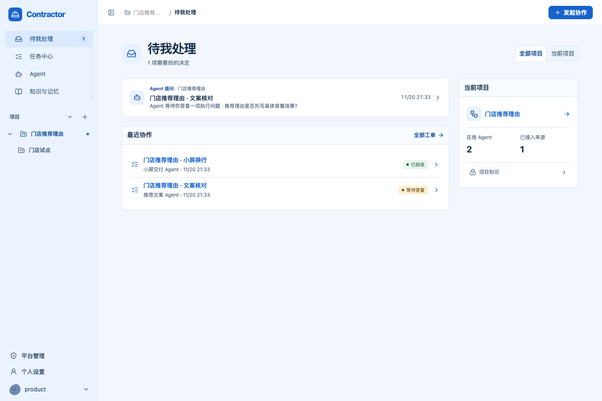
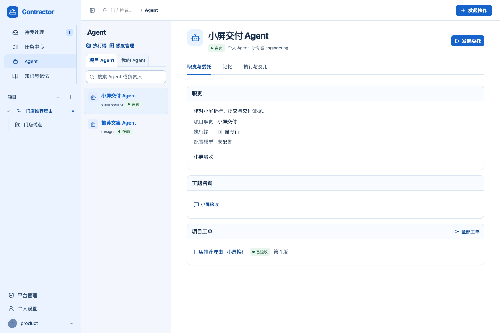

<div align="center">

<a href="#quick-start"></a>

# Contractor

### 让团队的一句话，变成有负责人、有预算、可验收的 Agent 交付。

**飞书、钉钉、企业微信或 Web 发起，Super Agent 过滤与派工，本机和云端 Worker 执行，<br>
结果绑定 PR、CI 和人工验收，确认有效的做法再进入知识库。**

[](https://github.com/zhegong-996/Contractor/actions/workflows/ci.yml)
[](LICENSE)
[](package.json)
[](#quick-start)

**[快速开始](#quick-start)** &nbsp;·&nbsp; **[能做什么](#能做什么)** &nbsp;·&nbsp; **[如何工作](#如何工作)** &nbsp;·&nbsp; **[文档](docs/README.md)** &nbsp;·&nbsp; **[参与开发](CONTRIBUTING.md)**

<br>

<a href="docs/images/workflow-board.png"></a>

<sub>项目、主题、工单、会话、执行和验收使用同一份业务状态。</sub>

</div>

<br>

Contractor 是面向软件研发团队的自托管 Agent 协作工作台。产品经理可以在项目主题里提出改动，研发确认仓库和修改范围，Worker 提交 PR，验收人按同一提交的 CI 和产品用例验收。

它把 DeepSeek 开源的 [dsh-superagent](https://github.com/deepseek-ai/dsh-superagent-prototype/tree/8c32a9dc5d72c033816c6a8110b37f40cf94fba4) 所表达的 Super Agent 工作方式落到真实组织：消息先成为可审计事件，经过准入、过滤和研判后才形成带授权范围的工单；Router、个人 Agent 和 Worker 分工执行；结果回到原会话，由人按版本验收。

核心原则只有一句：**尽可能少占用人的注意力，尽可能给出有效价值。**

## Contractor 适合你吗？

| 适合 | 可能不需要 |
| --- | --- |
| 团队在 IM 里提问题、交办工作，希望 Agent 能持续接单 | 只需要一个临时问答机器人，不关心任务、权限和历史 |
| 同时使用多个 Agent、模型、执行端或电脑 | 只用一个 Agent，而且不需要跨设备接续 |
| 需要项目权限、资料隔离、Token 与积分账本 | 所有参与者天然拥有同一份资料和同一套权限 |
| 交付要经过提交、CI、部署或人工验收 | 只要能生成一段回复，没有交付验收要求 |
| 希望经验能被下一次工作复用，并且可以追溯和撤权 | 讨论结束后不需要沉淀知识 |

## 能做什么

| 能力 | Contractor 如何完成 |
| --- | --- |
| **统一入口** | 飞书、钉钉、企业微信、Web、GitHub 和资料事件先持久入站，保留原会话并幂等去重 |
| **Super Agent 过滤** | 先核对身份、项目、引用和准入范围，再由模型研判是继续原单、建立新单、纳入主题，还是交人确认 |
| **多 Agent 协作** | 平台 Router 负责组织与派工，个人 Agent 保存成员的判断和经验，Worker 在获准设备上执行 |
| **本地与远程执行** | 本机或远端 Worker 领取任务；断线可续原单，换执行端前要求旧执行停止证明 |
| **交付与验收** | 代码交付绑定提交、PR、对应 SHA 的 CI、部署证据和人工验收；旧版本不能冒充新版 |
| **知识与记忆** | 验收后生成知识候选，负责人采用后生效；来源、适用范围、版本和授权都能追溯 |
| **治理与账本** | 项目、成员、菜单、数据和资料权限统一校验；模型、Token、积分和渠道回执分别留痕 |

## 真实场景

| 从一个真实场景开始 | Contractor 最终交付什么 |
| --- | --- |
| 飞书群里有人反馈“小屏推荐卡文字挤在一起” | 原消息进入对应项目主题，重复消息只建一张工单；处理结果回到原话题 |
| 产品需要一名 Agent 修改页面并交付审查 | Router 选择个人 Agent 和执行设备，Worker 返回成果、Token 与积分；代码单继续绑定 PR 和 CI |
| 某个子单执行中被撤权 | 主单停止汇总；重新授权后只接续受影响的子单，事实结果齐了再汇总 |
| 成员按当前版本验收并采用规则 | 生成有来源的知识版本；下一张咨询可以引用它，并追溯到原工单、子单和验收证据 |

## 接入范围

| 类型 | 当前适配 |
| --- | --- |
| 消息入口 | 飞书、钉钉、企业微信、Web、GitHub；其他 IM 可通过已配置的 Octop Gateway 适配 |
| 资料与连接 | 飞书文档与话题、GitHub 仓库与 Issue、Figma 节点、本地文档和项目知识 |
| Agent | 平台 Router、个人 Agent、项目 Agent、共享专家和可固定版本的技能 |
| 执行端 | 本机 Worker、远程 Worker、Codex、Claude Code 和通用 CLI 适配器 |
| 交付 | GitHub PR、Actions、部署证据、自动检查、人工检查与项目验收模板 |

各渠道最终以部署配置、账号权限和对应平台的真实联调范围为准。 [渠道与项目映射](docs/WORKBENCH-IM-PROJECTS.md) · [远程 Worker](docs/WORKBENCH-REMOTE-RUNNER.md)

## Quick start

要从零创建项目、连接 Worker 并验收第一张工单，可直接按[首张工单教程](docs/QUICKSTART-RUNNER.md)操作。下面的命令用于先启动空工作台。

环境要求：Git、Node.js 24.11+、npm。如果仓库尚未公开，需要对应的 GitHub 访问权限。

```sh
git clone --recurse-submodules https://github.com/zhegong-996/Contractor.git contractor
cd contractor
npm ci

export COLLAB_STATE_DIR="$PWD/.runtime/workbench"
mkdir -p "$COLLAB_STATE_DIR"
cp -n fixtures/workbench.example.json "$COLLAB_STATE_DIR/workbench.json"

# 按终端提示设置口令
node --import tsx src/workbench/server.ts init-owner product
npm start
```

打开 [http://127.0.0.1:4280/](http://127.0.0.1:4280/)，使用初始化时创建的账号登录。首次进入是空工作台，创建项目后再配置主题、成员、Agent 和 Worker；仓库不会替你预置业务项目。

想先与自己的 Agent 对话，可用管理员账号打开 **平台管理 → 模型服务 → 连接 DeepSeek**，验证后进入 **配置个人 Agent**，选择轻量模型并保存。 普通成员可在 **个人设置 → 个人 Agent** 选用团队已连接的模型。管理员可在模型服务中编辑模型列表、断开连接，或按供应商增删执行策略。在 **平台管理 → 平台 Router** 新建、编辑或删除方案，点击 **应用到平台** 后，后续路由建议和知识提炼才使用该方案。

**[第一次用执行端接单](docs/QUICKSTART-RUNNER.md)** · **[配置 Contractor](docs/CONFIGURATION.md)** · **[独立工作台说明](docs/WORKBENCH.md)**

## 界面

<table>
<tr>
<td width="50%">
<a href="docs/images/workflow-inbox.png"></a><br>
<strong>待我处理</strong><br>
冲突、立项、接单、必答、授权、恢复和验收集中到当前成员。
</td>
<td width="50%">
<a href="docs/images/workflow-conversation.png"></a><br>
<strong>项目会话</strong><br>
成员和多个 Agent 在主题内讨论，回复可以点回工单与原消息。
</td>
</tr>
<tr>
<td width="50%">
<a href="docs/images/workflow-agents.png"></a><br>
<strong>Agent、技能与 Worker</strong><br>
区分平台 Router、个人 Agent 和可插拔执行设备，分别配置权限与能力。
</td>
<td width="50%">
<a href="docs/images/workflow-delivery.png"></a><br>
<strong>版本交付与验收</strong><br>
提交、PR、CI、逐项检查和人工决定保持在同一个版本上。
</td>
</tr>
<tr>
<td width="50%">
<a href="docs/images/workflow-knowledge.png"></a><br>
<strong>知识与记忆</strong><br>
当前版本、来源关系、采用和撤权进入同一套知识权限。
</td>
<td width="50%">
<a href="docs/images/workflow-platform.png"></a><br>
<strong>平台治理</strong><br>
成员、登录渠道、模型、积分、服务状态和审计由管理员统一管理。
</td>
</tr>
</table>

## 如何工作

<div align="center">

</div>

1. **消息先入库。** IM、Web、GitHub、Figma 和文档事件先持久化，再校验、去重并保留原会话地址。
2. **归到正确的工作。** 系统根据引用、身份、项目和主题，把新内容关联到原工单或创建新工单；归属不确定时交给维护人处理。
3. **Super Agent 决定是否接单。** 确定性 Gate 先核对谁在什么范围发起请求，模型再评估是否命中团队启用的工作规则。
4. **Router 选定谁来干。** 在已授权的候选中选择个人 Agent、执行设备、模型和额度策略。
5. **Worker 执行并处理等待。** 本机或远程 Worker 领取任务。需要确认、补充资料或授权时，卡片回到原会话；答完后继续原工单。
6. **用证据交付。** 代码工单继续核对仓库、分支、提交、PR、同一提交的 CI、部署和逐项检查。
7. **人验收，知识再回流。** 人确认的是当前版本；可复用做法先成为候选，采用后才供下一项任务在当前权限内引用。

Agent 完成不等于验收完成，聊天里说“可以”也不会自动变成验收；版本、证据和责任人都由业务核心统一记录。

[完整 Super Agent 运行模型](docs/SUPER-AGENT-OPERATING-MODEL.md) · [业务流程与各模块时序](docs/BUSINESS-FLOWS.md) · [数据模型](docs/DATA-MODEL.md)

## 三组核心角色

| 角色 | 属于谁 | 负责什么 | 由谁配置 |
| --- | --- | --- | --- |
| **平台 Router** | 平台 | 根据规则、职责和当前授权分配任务，整理摘要与等待事项；不直接占用成员设备 | 平台管理员配置模型与提示词，项目维护人配置职责和路由 |
| **个人 Agent** | 成员 | 保留个人工作方法与经验，在个人会话中咨询、整理或提出委托建议 | 成员维护名称、指引、技能和轻量模型 |
| **Worker** | 一台电脑或云主机 | 真正领取并执行任务，加载当轮授权资料、模型、技能和会话 | 设备所有者登记并授权项目；项目维护人设置主备 |

Router 属于平台，个人 Agent 属于成员，Worker 属于设备。三者可以协作，但身份、权限、用量和审计不会混在一起。

## 稳定核心，可插拔边缘

项目、成员、权限、工单状态、版本、积分、验收和知识采用始终由业务核心管理。变化较快的接入与执行能力从插件边界进入：

| 边界 | 可替换实现 |
| --- | --- |
| 消息入口 | 各 IM Gateway、Web、GitHub 事件源 |
| 资料与检索 | 项目文档、Figma、GitHub、授权知识与 Octop Memory |
| Agent 与模型 | Router、个人 Agent、共享专家、主备模型和额度路由 |
| 执行设备 | 本机 Worker、远程 Worker、Codex、Claude Code 和命令行适配器 |
| 交付 | GitHub PR、Actions、部署证据和项目验收模板 |

同一实例只启用一个调度器。现有部署默认使用 AutoLoop 兼容路径，也可以在独立状态目录迁移到 Contractor 自研调度器。 [插件边界](docs/PLUGIN-ARCHITECTURE.md) · [调度器迁移与回滚](docs/RUNTIME-MIGRATION.md)

## 为什么叫 Contractor

正式产品名是 **Contractor**，中文可以直白地理解为“包工头”。这个名字对应它在系统中的位置：

- 听懂要交付什么，确认范围和边界；
- 安排合适的 Agent、模型和执行设备；
- 管住资料、权限、额度和先后顺序；
- 记录谁接单、做到哪一步、为什么中断；
- 核对交付证据，组织人验收并留下可追溯凭证；
- 把有效做法变成下一次可以复用的知识。

Router 像调度与工头，个人 Agent 像带着经验的专业人员，Worker 像不同电脑或云端的施工队，业务核心像合同、项目台账和验收办公室。Contractor 不替业务负责人发明需求，也不替人签字验收。

## 可信边界

- **消息有原位置。** 重复投递只处理一次；回复、待办和结果能回到原群话题或工作台会话。
- **执行有边界。** 项目权限、资料范围、Agent、模型、Worker 和积分在接单时一起核对，聊天内容不能自行改写执行目录或授权。
- **中断可接续。** 旧执行确认停止后才可以换设备或执行端；迟到回执会补齐账目，重复回执不会重复派工或扣分。
- **知识有出处。** 来源被撤权时，原资料、派生知识和使用关系一起受影响。
- **外部权限仍归源站。** 工作台登录、群卡共享、GitHub 和 Figma 原页分别鉴权。

[安全策略](SECURITY.md) · [成员执行隔离](docs/MEMBER-EXECUTION-ISOLATION.md) · [知识与撤权](docs/KNOWLEDGE-VERSIONS.md)

## 仓库结构

<details>
<summary><strong>展开目录说明</strong></summary>

| 位置 | 放什么 |
| --- | --- |
| `src/workbench/` | 项目、权限、路由、调度、交付、验收、知识和恢复 |
| `workbench/src/` | React 工作台、任务中心、会话和平台管理 |
| `upstream/` | 固定提交的第三方源码子模块与许可 |
| `integrations/` | GitHub 交付与自动验收示例 |
| `fixtures/` | 不含真实凭据的配置样例 |
| `scripts/` | 打包、来源审计和运维工具 |
| `tests/` | 单元、集成和真实链路回归 |
| `docs/` | 产品、架构、操作、运维与历史记录 |

</details>

## 开发与验证

```sh
npm run check:docs
npm run audit:upstream -- --browser
npm test
npm run typecheck
npm run build:ui
```

提交前还应核对 CI 中的 Linux 执行隔离、两个调度器回归、Python 原生适配器和制品打包。真实账号、企业消息、运行数据库、令牌和项目私有附件不得进入仓库。

[贡献指南](CONTRIBUTING.md) · [分支与协作方式](docs/BRANCHING.md) · [完整文档](docs/README.md) · [CI](.github/workflows/ci.yml)

## 开放共建

Contractor 采用 MIT 全仓开源和单一 `main` 主干。外部 Pull Request 可以直接提交连接器、插件、Worker、模型适配器、场景模板、测试、文档和核心改进；共享协议、权限、验收、版本和知识模型的改动需要维护者复核与兼容说明。

扩展优先落在稳定的插件边界内。核心业务状态由 Contractor 统一掌管，第三方 Agent、IM、模型和 Worker 通过注册接口接入，不要求修改整套业务代码。外部实现可以独立发布，并为自己的仓库添加 `contractor-plugin` 或 `contractor-connector` 话题。

[参与贡献](CONTRIBUTING.md) · [治理与决策](GOVERNANCE.md) · [商标与官方发行](TRADEMARKS.md) · [插件架构](docs/PLUGIN-ARCHITECTURE.md)

## 开源与分发

当前代码级复用均有固定提交和许可记录。只在产品分析中比较过思路、没有复制源码或资产的项目不进入许可清单。

| 来源 | Contractor 中的用途 | 许可 |
| --- | --- | --- |
| Super-agent | 工单、委托与效果队列内核，以及部分飞书接入 | MIT |
| Agent AutoLoop | 兼容调度器、CLI Worker 和回滚账本 | MIT |
| Octop Gateway | 可选的多渠道连接与消息传输 | MIT |
| Octop Memory | 可选的授权候选检索与排序 | MIT |
| Octop Web | 2 个工作台组件适配 | MIT |

npm 依赖由 `package-lock.json` 固定版本和完整性；浏览器构建随包列出实际打入的模块许可。

[完整来源清单](docs/SOURCES.md) · [第三方声明](THIRD_PARTY_NOTICES.md) · [来源锁定](sources.lock.json)

## 状态

Contractor 当前为 `0.1.x`，核心链路和本地/远程执行已经过集成验证，公开接口和部署方式仍会继续迭代。生产使用前请在独立状态目录、测试仓库和测试账号中完成自己的权限、模型、渠道与验收配置。

如果 Contractor 帮你少追过一次进度、少漏过一次验收，欢迎 **Star** 关注后续迭代。

## License

Contractor 原创代码使用 [MIT](LICENSE)，可自由使用、修改、分发和商业使用。随附上游源码、适配组件、浏览器构建和可选执行工具继续适用各自的许可证。`Contractor` 名称、Logo 和官方发行身份的边界见 [商标与官方发行规范](TRADEMARKS.md)。
