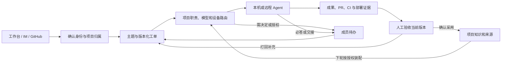

# Contractor

**把团队讨论变成可追溯的 Agent 交付。**

Contractor 是一个可以自托管的 AI 协作工作台。团队用飞书、钉钉、GitHub 或网页发起协作。任务归到项目、主题和工单，按项目职责交给 Agent，遇到范围、授权或验收决策就交回对应成员。人确认的结论可以沉淀为项目知识，并保留出处。

[快速开始](#快速开始) · [架构](docs/ARCHITECTURE.md) · [连接执行端](docs/WORKBENCH-REMOTE-RUNNER.md) · [参与贡献](CONTRIBUTING.md) · [MIT](LICENSE)

## 协作流程



| 能力 | 怎么用 |
| --- | --- |
| 项目、主题与工单 | 维护子项目、主题、资料和任务。重复反馈可挂回原工单，独立交付可拆子单。 |
| 人与 Agent | 个人 Agent 可接代办，项目维护人可设牵头、决定人、可用模型及主备设备。执行记录可查委托人、实际模型和用量。 |
| 权限与上下文 | 工作台按角色和项目授权。读取受限资料时还要核对工单、Agent 和资料版本。 |
| 按版本交付 | GitHub PR、提交、CI 和部署证据关联到具体交付版本。发起人可验收或打回原单。 |
| 团队知识 | 从已验收成果提出候选，经确认后进入现行知识。新咨询可回到当时的工单、版本和证据。 |

## 快速开始

需要 Git 和 Node.js 24.11+。本机启动可先使用独立目录和示例项目。

```sh
git clone --recurse-submodules https://github.com/zhegong-996/suitme-collab.git contractor
cd contractor
npm ci
export COLLAB_STATE_DIR="$PWD/.runtime/workbench"
mkdir -p "$COLLAB_STATE_DIR"
cp -n fixtures/workbench.example.json "$COLLAB_STATE_DIR/workbench.json"
npm run workbench -- init-owner product
npm start
```

初始化时在终端输入独立口令，按 Ctrl+D 提交输入。打开 [本机工作台](http://127.0.0.1:4280/)，用 `product` 登录可查看示例项目、任务、Agent 和设置。示例里的 Agent 初始为停用。实际执行前，在此实例的 `workbench.json` 配置成员、职责、模型与授权，再登记自己的执行端。

想直接体验接单，可以使用单独的执行端样例，完成安装、浏览器授权和首张只读工单。 [第一次用执行端接单](docs/QUICKSTART-RUNNER.md)

使用源码包时，从解包目录的 `npm ci` 开始。企业 IM 登录、成员激活和渠道接入见 [IM 登录配置](docs/WORKBENCH-IM-LOGIN.md)。远程设备连接、服务商凭据和主备路由见 [执行端手册](docs/WORKBENCH-REMOTE-RUNNER.md)。

## 模块与当前运行方式

Contractor 业务核心掌管项目、授权、额度、版本、验收和知识。Super-agent 提供工单及委托引擎。模型、IM、资料、检索、GitHub 证据和 Worker 通过适配接口接入。可选的 Octop Gateway 和 Memory 提供渠道接入与全文检索。

AutoLoop 是默认调度器。新建独立工作台可配置 `executionRuntime: "contractor"` 验证自研调度器。每个工作台使用一种调度器，运行目录包含对应版本的调度账本。切换已有工作台前需要验证账本迁移和回退。

[系统架构和模块职责](docs/ARCHITECTURE.md) · [插件接口](docs/PLUGIN-ARCHITECTURE.md) · [交付证据](docs/WORKBENCH-DELIVERY-TEMPLATE.md)

## 测试与构建

```sh
npm test
npm run typecheck
npm run build:ui
npm run audit:upstream
```

`npm run package:runner` 生成执行端安装包。在 Git 检出中运行来源审计和 `npm run package:source -- --committed` 可生成基于当前提交的源码包。浏览器构建、Linux 沙箱、原生 Python 适配器及打包的验证入口见 [GitHub Actions](.github/workflows/ci.yml)。本机与远程执行、项目权限和资料撤权等联调需另配测试账号、设备和资料。

## 许可

Contractor 原创代码采用 MIT 许可。固定的第三方源码和产物保留各自许可及著作权声明。配置样例、源码与安装包的分发边界见 [第三方声明](THIRD_PARTY_NOTICES.md) 和 [实现来源](docs/SOURCES.md)。
