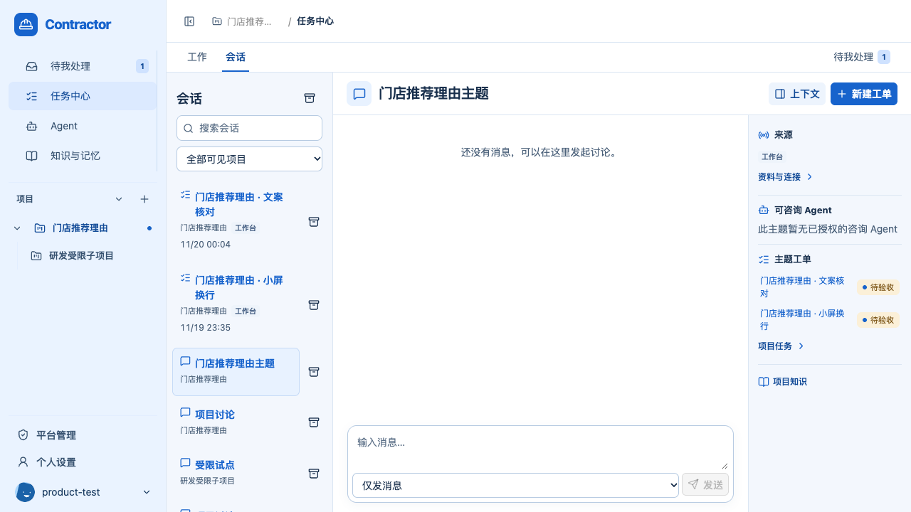
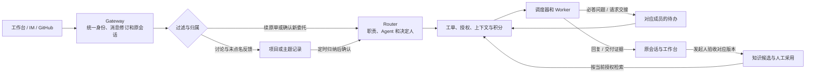

# Contractor

Contractor 是面向团队的自托管 Agent 协作工作台。飞书、钉钉、GitHub 和网页的讨论可以汇入同一项目。成员确认范围、资料和验收标准，Agent 在获准的机器上执行。工单保留讨论、每轮执行、交付版本和验收依据。

[快速开始](#快速开始) · [系统架构](docs/ARCHITECTURE.md) · [配置手册](docs/CONFIGURATION.md) · [执行端](docs/WORKBENCH-REMOTE-RUNNER.md) · [实现来源与分发](docs/SOURCES.md)



## 一件工作怎样走完



以门店推荐理由为例。群里重复反馈可以合在同一个主题下归纳，每条原消息、发送人和修订仍可追踪。明确指向小屏工单的补充回到原单，独立的文案修改另开工单。研发 Agent 拿到经确认的要求和获准的文件后执行。发起人核对本版提交、CI 和验收项，再决定是否把可复用规则沉淀到项目知识。

## 产品功能

| 能力 | 在哪里使用 |
| --- | --- |
| **统一渠道和身份** | 飞书可用原话题和卡片接续。可选网关提供钉钉、企业微信、Telegram、Discord、QQ 和微信连接，回传能力按渠道区分。GitHub Issue、评论和 PR 依据明确的引用归属。 [渠道与业务架构](docs/ARCHITECTURE.md) |
| **任务中心和项目层级** | 「工作」查看项目任务、我的任务、看板和列表。「会话」搜索有权访问的项目、主题与工单讨论。项目、子项目、主题、父子工单可以互相跳转。 [工作台页面](docs/WORKBENCH-FRONTEND-WORKSPACE.md) |
| **按职责派工** | 项目维护人配置主题牵头、解答人、主备模型和执行端。个人 Agent、只读专家与开发 Agent 按不同授权运行。范围冲突、必答问题和交接等交给对应成员。 [配置手册](docs/CONFIGURATION.md) |
| **后台执行和恢复** | 本机或配对设备领取。等待人工决定时暂停执行，有答复后接续。断线重报按原尝试补写，旧执行确认停止后才能换人或换端。 [执行端手册](docs/WORKBENCH-REMOTE-RUNNER.md) |
| **按版本交付和验收** | 绑定本工单的提交、PR、CI 尝试和可选部署。可以冻结交付模板并分阶段核对。发起人可验收或打回，历史证据保留在原版。 [交付模板](docs/WORKBENCH-DELIVERY-TEMPLATE.md) |
| **回归评估与知识** | 从执行记录对照两版成果，也可把验收形成的候选采用为项目知识。正文、适用范围、来源版本、替代关系和 Agent 使用记录可追溯。 [回归评估](docs/WORKBENCH-DELIVERY-TEMPLATE.md#过程核对和回归评估) · [知识管理](docs/KNOWLEDGE-VERSIONS.md) |
| **权限与积分** | 平台角色、项目身份、资料授权分层。按任务类型、项目和 Agent 约束执行，用 Token 和模型倍率结算积分。 [权限和积分配置](docs/CONFIGURATION.md) |

## 快速开始

需要 Git、Node.js 24.11+ 和 npm。将当前仓库「Code」中的 HTTPS 地址填到下列 `REPOSITORY_URL`。

```sh
git clone --recurse-submodules REPOSITORY_URL contractor
cd contractor
npm ci
export COLLAB_STATE_DIR="$PWD/.runtime/workbench"
mkdir -p "$COLLAB_STATE_DIR"
cp -n fixtures/workbench.example.json "$COLLAB_STATE_DIR/workbench.json"
node --import tsx src/workbench/server.ts init-owner product
npm start
```

初始化时输入独立口令，按 Ctrl+D 提交。打开 [本机工作台](http://127.0.0.1:4280/) 后以 `product` 登录。这个样例提供示例项目，Agent 初始为停用。使用源码包时，从解包目录的 `npm ci` 开始。想实际完成一次领取、回传和验收，可用 Claude Code 只读接单样例。 [第一次接单](docs/QUICKSTART-RUNNER.md)

既有工作台默认使用 AutoLoop。新建的独立实例可选 `executionRuntime: "contractor"` 使用自研调度器。同一实例只配置一种调度器，两者使用不同的执行账本。 [能力对照、迁移与回滚](docs/RUNTIME-MIGRATION.md) · [调度兼容和插件](docs/PLUGIN-ARCHITECTURE.md)

## 开发、验证与分发

```sh
npm test
npm run typecheck
npm run build:ui
npm run audit:upstream -- --browser
npm run package:runner
npm run package:source -- --committed
```

自动化检查覆盖权限、回执重试、执行接续、撤权、版本验收、渠道和索引适配。操作系统隔离测试需要独立配置沙箱。 [CI](.github/workflows/ci.yml) · [隔离配置](docs/WORKBENCH-REMOTE-RUNNER.md#安装-codex-隔离提供者) · [贡献指南](CONTRIBUTING.md)

Contractor 原创代码使用 MIT 许可。源码包、浏览器构建和两个执行端包分别保留随包材料对应的第三方声明。 [MIT](LICENSE) · [第三方声明](THIRD_PARTY_NOTICES.md) · [分发清单](docs/SOURCES.md)
