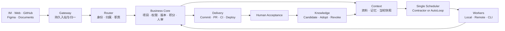

# Contractor

**把团队讨论、Agent 执行、版本交付和人工验收放进同一条可追溯链路。**

[](https://github.com/zhegong-996/suitme-collab/actions/workflows/ci.yml)
[](LICENSE)
[](package.json)

Contractor 是一个自托管的团队 Agent 协作工作台。团队可以从 IM、工作台、GitHub、Figma 和文档发起讨论与任务，由有权限的 Agent 或 Worker 执行；系统随后核对当版提交、CI、部署和人工验收，并把确认有效的做法沉淀为可复用知识。


## 解决的问题

- **讨论不丢来源。** 飞书、钉钉、企业微信及其他已配置渠道先持久入站，再按身份、项目、主题和引用关系归类。重复消息只处理一次。
- **执行不越过权限。** 项目和子项目独立授权，Agent、模型、设备、资料和额度在领取任务时重新核对。旧执行停止后才允许换端接续。
- **交付不把“执行完成”当“验收通过”。** 每个版本分别记录提交、PR、对应 SHA 的 CI、部署和人工检查。
- **经验不散在聊天里。** 已验收成果可形成知识候选，经负责人采用后进入现行版本；撤权会同步阻断原资料及其派生知识。

## 功能

| 模块 | 能力 |
| --- | --- |
| 身份与权限 | IM 扫码登录、账号绑定、平台角色、项目角色、成员移除、维护人交接和直接接口鉴权 |
| 项目与主题 | 项目树、子项目、主题、来源、成员、职责和跨渠道会话映射 |
| 任务与会话 | 项目任务、个人任务、待办、看板、列表、群聊式项目会话和原位置返回 |
| Agent 与 Worker | 平台 Router、个人 Agent、共享专家、技能版本、本机与远程执行端 |
| 交付与验收 | 分支、提交、PR、CI、部署、逐项检查、按版本打回和回归对照 |
| 知识与管理 | 资料授权、知识版本、来源关系、撤权、模型路由、Token/积分账本 |
| 插件与恢复 | 渠道、资料、检索、执行和交付适配器；持久入站、租约、回执补写、迁移与回滚 |

完整入口与业务规则见 [功能与模块手册](docs/PRODUCT-CAPABILITY-MAP.md)。

## 架构

Contractor 保持一个稳定的业务核心，并让变化较快的模型、渠道、检索、资料和执行能力从插件边界接入。



Super-agent 提供工单、委托和事件内核；Contractor 管理项目、权限、上下文、执行恢复、交付验收和知识账本。同一实例只启用一个调度器，默认支持 AutoLoop 兼容运行，也可在独立环境使用 Contractor 自研调度器。

[架构说明](docs/ARCHITECTURE.md) · [业务流程](docs/BUSINESS-FLOWS.md) · [数据模型](docs/DATA-MODEL.md) · [插件边界](docs/PLUGIN-ARCHITECTURE.md)

## 快速开始

环境要求：Git、Node.js 24.11+、npm。如果仓库尚未公开，需要对应的 GitHub 访问权限。

```sh
git clone --recurse-submodules https://github.com/zhegong-996/suitme-collab.git contractor
cd contractor
npm ci

export COLLAB_STATE_DIR="$PWD/.runtime/workbench"
mkdir -p "$COLLAB_STATE_DIR"
cp -n fixtures/workbench.example.json "$COLLAB_STATE_DIR/workbench.json"

node --import tsx src/workbench/server.ts init-owner product
npm start
```

初始化时输入独立口令，然后在 [http://127.0.0.1:4280/](http://127.0.0.1:4280/) 使用 `product` 登录。示例项目中的 Agent 默认停用；按需配置模型凭据和执行端。

[执行端接单指南](docs/QUICKSTART-RUNNER.md) · [配置说明](docs/CONFIGURATION.md) · [远程 Worker](docs/WORKBENCH-REMOTE-RUNNER.md)

## 仓库结构

```text
src/workbench/     业务 API、权限、路由、调度、知识和工作流
workbench/src/     React 工作台
upstream/          固定提交的第三方源码子模块
integrations/      GitHub 交付与 CI 示例
fixtures/          可公开的配置样例
scripts/           打包、来源审计和运维工具
tests/             单元、集成和真实链路回归
docs/              产品、架构、操作、运维与历史记录
```

## 开源来源

当前代码级复用均有固定版本和许可记录：

| 来源 | Contractor 中的用途 | 许可 |
| --- | --- | --- |
| Super-agent | 工单、委托与效果队列内核，以及部分飞书接入 | MIT |
| Agent AutoLoop | 兼容调度器、CLI Worker 和回滚账本 | MIT |
| Octop Gateway | 可选的多渠道连接与消息传输 | MIT |
| Octop Memory | 可选的授权候选检索与排序 | MIT |
| Octop Web | 2 个工作台组件适配 | MIT |

npm 依赖由 `package-lock.json` 固定版本和完整性。只有实际进入源码、构建产物或运行时依赖的项目才列入来源清单。

[完整来源清单](docs/SOURCES.md) · [第三方声明](THIRD_PARTY_NOTICES.md) · [来源锁定](sources.lock.json)

## 开发与验证

```sh
npm run check:docs
npm run audit:upstream -- --browser
npm test
npm run typecheck
npm run build:ui
```

提交代码前还应核对当前 CI 中的 Linux 执行隔离、两个调度器回归、Python 原生适配器和制品打包。真实账号、企业消息、运行数据库、令牌和项目私有附件不得进入仓库。

[贡献指南](CONTRIBUTING.md) · [安全策略](SECURITY.md) · [完整文档索引](docs/README.md) · [CI](.github/workflows/ci.yml)

## 状态

Contractor 当前为 `0.1.x`，核心链路和本地/远程执行已经过集成验证，公开接口和部署方式仍会继续迭代。生产使用前请在独立状态目录、测试仓库和测试账号中完成自己的权限、模型、渠道与验收配置。

## License

Contractor 原创代码使用 [MIT](LICENSE)。随附上游源码、适配组件、浏览器构建和可选执行工具继续适用各自的许可证。
