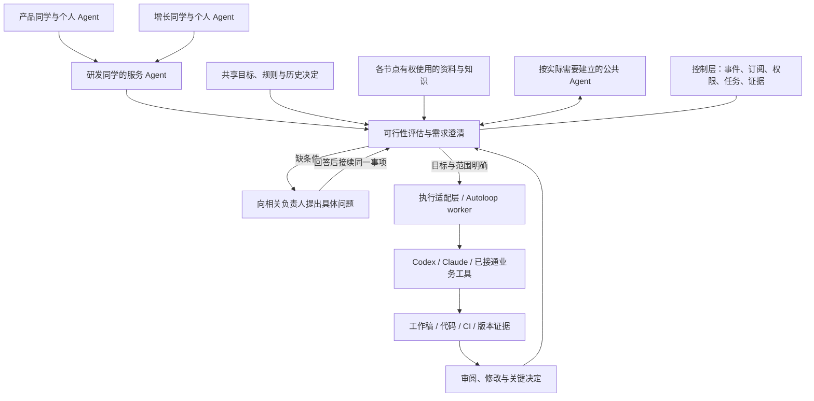

# 以个人 Agent 服务网组织协作

2026-11-05。产品方向来自用户本轮提供的玉伯访谈原文，作为产品需求基线；不把 YouMind 的经验当成 SuitMe 已经验证的组织效果。此前“部门知识库 + 审批 + 一个整理助手”的定位不足以覆盖这个目标。

## 产品主模型

组织中的人是有责任的节点，每个人有一个给同事使用的服务 Agent。服务 Agent 跟随负责人当前职责变化；Codex、Claude、CLI、MCP 是它可使用的执行工具。不同服务可以共用执行引擎，身份、资料范围和任务上下文分别绑定。部门名称和汇报树不决定系统功能模块。

个人 Agent 提供当前负责人擅长并愿意提供的服务，例如需求评估、澄清、交接、专业审阅。会议秘书等公共 Agent 由明确负责人按实际需要登记；登记名称不代表入会、录音、财务或外部工具已接通。

协作控制层负责“织”：找到服务、接续讨论、保存目标与决定、检查访问范围、跟进变化、委托执行、收集证据，把真实需要人的问题交给合适的人。任务、权限和版本是这张网的共同协议。

图中的跨真实员工协作是目标模型。目前真实登录仍只有本机负责人；尚未证明多个员工分别调用彼此 Agent 的完整生产链路。

## 当前已实现

| 对象或机制 | 实现 |
|---|---|
| 服务身份 | `AgentServices` 关联现有 Paperclip 身份，保存负责人、个人/公共类型、当前职责、服务内容、调用名、上岗状态及版本 |
| 个人与执行工具分开 | 服务资料身份是 `actorKey`，实际整理和工具调用由受限的原生 run 代为执行；模型不能选择另一个身份绕过权限 |
| 给 Agent 提需求 | 中文“团队 Agent”入口直接发起需求评估、工作稿准备或审阅，进入同一协作任务；请求重试复用同一任务 |
| IM 服务入口 | `/agent 调用名 需求`；当前仅已配对的唯一负责人。唯一绑定事项支持自然语言接续；多事项不猜测归属 |
| 当前职责迭代 | 职责及服务内容版本化；变更后旧任务停止沿用旧结果，负责人核对新职责后才能继续。身份改变仍须走原有交接与资料权限核对 |
| 评估与澄清 | 直接运行 Super-agent 的 `settingsPolicy`、`assessmentOutcome`，判断是否在已有委托和准备范围内；需要人时用 Autoloop `ask` 结束本轮 |
| 持续推进 | Agent 按需调用上下文、检索、记录、图谱、服务发现、执行证据、访问申请和复查工具；每轮最多 12 次 |
| 执行 | 协作事务与开发执行均使用原版 Autoloop `createWorker`。每个 worker 只接一个 Paperclip 原生运行，不启动另一套 hub/任务调度 |
| 事件与订阅 | 合并当前任务、所选资料、关联交付的有效变化；排除自身进度通知。授权、回复或证据变化后接续同一任务 |
| 有界复查 | 可约定现有资料/关联交付的复查，每次明确委托最多两次；不定时催促人的授权 |
| 可获取的执行证据 | 读取本任务此前原生运行、真实工具调用、关联交付及带代码指纹的平台测试记录；保留为版本化输入，避免让人重复搬运后台已有记录 |

服务注册复用 Paperclip 私有文档及原生修订；原生 Agent、任务、授权和运行仍是真源。登记服务不会创建资源 grant，也不会因职责变化自动扩大知识访问。

## 需要人的决定

资料授权、知识采用和最终验收仍由人决定。数据库变更、合并主干及发布等扩展动作，需要明确负责人和具体项目的授权；当前试点不自动执行这些动作。Agent 可以整理影响、提出方案、制作交接材料、跟进已有 CI 与预览，完成决策前的工作。

目标、输入资料、版本和接收身份未明确时，不能以自主性为由猜测。Agent 应先查自己有权获取的事实，仍缺失时问一个具体问题；不能让人重复提供系统本来能读取的材料。

## 尚未完成

- 员工独立登录、真实通讯录与个人 Agent 的归属映射。目前不能通过填写一个 ownerUserId 就冒充其他员工已上岗。
- 多个真实员工的 Agent 之间完整的委托、澄清、回传与责任协商。现有交接、权限和上下文工具提供基础，尚未把目录登记当作这条链路已完成。
- 企业业务系统的通用事件订阅和专用业务操作。没有默认扫描全公司讨论，也没有因为登记公共 Agent 而开放入会或财务权限。
- 轻量模型实际启用、自动语义知识图谱与长期记忆管线。按用户先前选择，暂不启用新模型服务。

## 组织状态

工作界面先呈现需要决定的事项、卡住的交接、缺少的上下文、Agent 已完成的准备与实际交付。负责人可修改、接管和停止。当前不做员工 KPI 排名、情绪推断或用 Agent 数量证明组织效率；“健康”体现为事项能否按清楚的责任、权限与证据继续流转。

参考：[玉伯访谈节目](https://www.xiaoyuzhoufm.com/episode/6ac8b67ce742e36efcc05e77)；本轮使用用户提供的组织与 Agent 上岗制原文。Super-agent 与 Autoloop 的精确代码复用和验证见 [来源记录](SOURCES.md)、[自主协作运行](AUTONOMOUS-COLLABORATION.md)。
