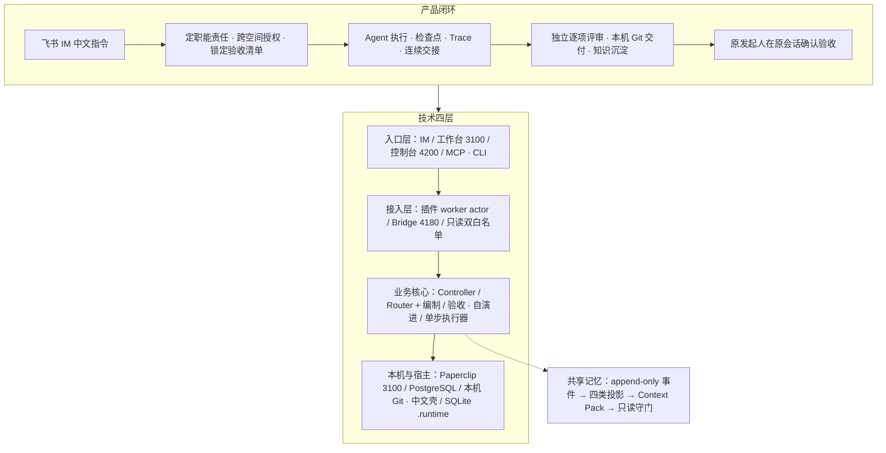

# 系统功能与架构图册 · 索引

> 2026-11-08 · 第二十六轮 P-8 之后（`34e9155`）

## 这个图册解决什么

`docs/SYSTEM-ARCHITECTURE.md` 和 `PROJECT-SUMMARY.md` 是权威口径，但都以文字和分散的 Mermaid 图为主，接手者很难一眼看懂「产品怎么跑、界面怎么分、技术怎么分层、记忆怎么沉淀」。本图册把四个视角收成**一页可离线打开的静态 HTML**：

**`docs/architecture-atlas.html`** —— 双击即可在浏览器打开，不启动服务、不加载外部资源、不写入任何运行数据；内置浅色 / 深色主题。

| 图 | 回答的问题 | 视角 |
|---|---|---|
| 1 产品主闭环 | 从一句中文指令到人签验收要走哪几步、哪几步必须人决定 | 产品 / 业务 |
| 2 用户与界面 | 四个界面各自能做什么、哪个才是唯一发起入口 | 用户 / 职责 |
| 3 技术四层 | 入口 → 接入 → 业务核心 → 本机与宿主，端口与唯一真源在哪 | 技术 / 分层 |
| 4 共享记忆分层 | 注入顶层 / 知识表示层 / 候选知识 / 事实源，以及只读守门的位置 | 技术 / 知识与治理 |

HTML 内另附：八个域的功能地图、成熟度三档、六条红线、本机端口与运行状态表。

## 一页总览（文字版）

四个人工决策点：定职能责任、跨空间授权、锁定验收清单、最终核可。**报告、模型判定、CI 通过、合并审批都不替代最后一步**；SUI-129 至今未核可。

## 口径来源与优先级

- 产品流程与角色：`docs/SYSTEM-ARCHITECTURE.md` 第 1 节、`PROJECT-SUMMARY.md` §3 / §4。
- 技术四层与真实接入状态：`PROJECT-SUMMARY.md` §2、`docs/SYSTEM-ARCHITECTURE.md` 第 2 节。
- 红线与端口：`HANDOFF/07-RULES-AND-BOUNDARIES.md`、`HANDOFF/05-VALIDATION-AND-COMMANDS.md`。
- 记忆分层与只读守门：`docs/REFERENCE-anthropic-agent-memory.md`、`docs/ADAPTATION-v0.6.md` 最新边界节（P-7 / P-8）。
- **冲突时优先级**：`docs/ADAPTATION-v0.6.md` 最新边界声明 → `docs/VALIDATION.md` → `docs/PRD-v0.6.md` §10C → `HANDOFF/06` → 本图册。图册是**导读**，不是权威口径。

## 维护约定

1. 架构、端口、白名单数量、成熟度口径变化时，同步更新 `docs/architecture-atlas.html` 与本文件；不要把「预备配置」画成「已启用」，也不要把「未接通」画成可点入口。
2. 每次改动后跑 `npm run atlas:check`：校验四张 SVG 的可访问性标签、CSS 变量定义覆盖、无外部资源依赖、无敏感内容。
3. 图册内的彩色卡片在深色主题下由 CSS 覆盖底色与文字色；新增卡片若使用新的硬编码颜色，须同步补 `@media (prefers-color-scheme: dark)` 规则。
4. 本图册**不是**任务发起入口，也不新增常驻服务；`.runtime/` 下的运行证据不入库。
