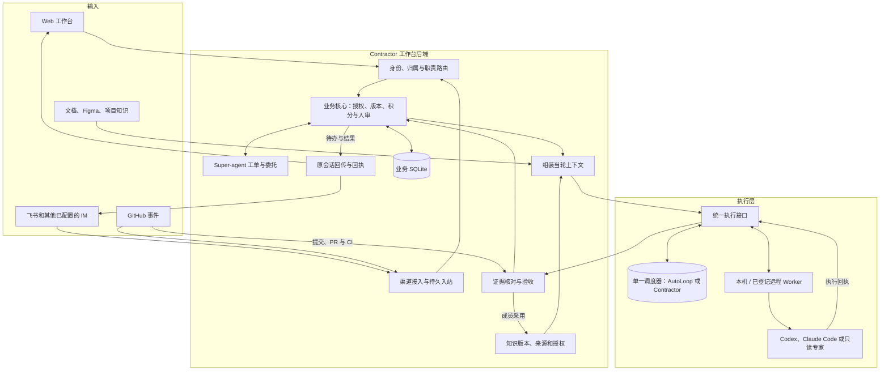

# Contractor 架构

## 输入、处理与输出

同一项目可以绑定多个资料来源和消息入口。已验证的渠道账号归到工作台成员，但原渠道的资源权限仍依各自平台。项目和子项目可独立授权，主题组织持续讨论，工单代表一项可交付的工作。相关项目和工单可相互关联。

飞书入口和知识索引可以独立运行。工作台通过持久日志接收入站事件，检索插件使用核心已经过授权的候选知识。索引故障只影响依赖检索的请求，工单列表、详情和验收使用业务账本。

## 谁决定什么

| 环节 | 规则和持久记录 | 主要代码 |
| --- | --- | --- |
| 渠道与身份 | 保存消息身份、修订和原会话引用。重复事件按来源去重。成员通过各渠道验证绑定，归属冲突交项目维护人。 | [渠道日志](../src/workbench/channel-journal.ts) · [渠道关联](../src/workbench/channel-links.ts) |
| 立项与派工 | 结合项目、主题和职责选择牵头 Agent。范围不明、缺少依据或存在多个候选时进入人工待办。工单、授权与项目设置均归工作台。 | [路由](../src/workbench/router.ts) · [业务编排](../src/workbench/collaboration.ts) |
| 上下文和权限 | 从主题讨论、确认依据、当版工单、资料引用和已采用知识生成当轮快照。领取、接续和交接时复核源版本及权限。 | [主题上下文](../src/workbench/topic-context.ts) · [执行上下文](../src/workbench/execution-context.ts) |
| 执行与回执 | 一个实例使用一个调度器。调度器管理队列、租约、必答卡和重试。已开始的执行须交回旧端停止证明才能换端。回执按运行和尝试结算 Token、积分及成果。 | [执行接口](../src/workbench/execution/contract.ts) · [回执账本](../src/workbench/receipt-journal.ts) |
| 交付与验收 | 工单版本绑定提交、PR、对应提交的检查和可选环境证据。打回后在原单产生新版本。人工验收依据当前版本。 | [交付证据](../src/workbench/delivery-evidence.ts) · [验收](../src/workbench/ticket-acceptance.ts) |
| 知识回流 | 当前验收产生知识候选。人工采用后成为现行版本，保留出处和替代关系。源资料授权影响现行检索和派生成果的读取。 | [知识](../src/workbench/knowledge.ts) · [权限](../src/workbench/knowledge-authority.ts) |

## 三个配置面

| 对象 | 谁配置 | 页面和设置 |
| --- | --- | --- |
| 个人 Agent | Agent 所有者和部署者 | 「Agent → 我的 Agent」接单开关、个人代办。启用专家库后可新建带个人职责、说明和技能的只读专家。CLI 引擎、凭据槽和可用模型在部署配置中登记。 |
| 项目路由 | 项目维护人 | 「项目 → 职责与路由」配置成员职责、按主题及职责牵头、决定人，以及支持的本机 Codex 主备模型。Router 根据配置和权限分派。 |
| Worker | 执行端所有者和项目维护人 | 在目标机器运行 `contractor connect` 并用本人账号选项目和 Agent。项目维护人设默认和备用设备。Worker 使用执行机自己的最小权限环境。 |

## 部署与扩展

工作台的 API 和前端来自同一个部署。启动时在 `platform-plugins.ts` 组装渠道、资料、检索、只读模型和交付能力。新增适配器实现对应接口并注册。工单的分工、权限、版本、验收和知识采用由业务核心维护。 [插件接口与状态](PLUGIN-ARCHITECTURE.md)

生产部署的远程执行端通过团队 HTTPS 地址接入，浏览器确认身份，执行机主动领取任务。运行数据放在独立的 `COLLAB_STATE_DIR`。自研 Contractor 调度器在独立环境下使用自己的调度 SQLite，AutoLoop 兼容部署沿用原账本。 [跨主机执行端](WORKBENCH-REMOTE-RUNNER.md)
