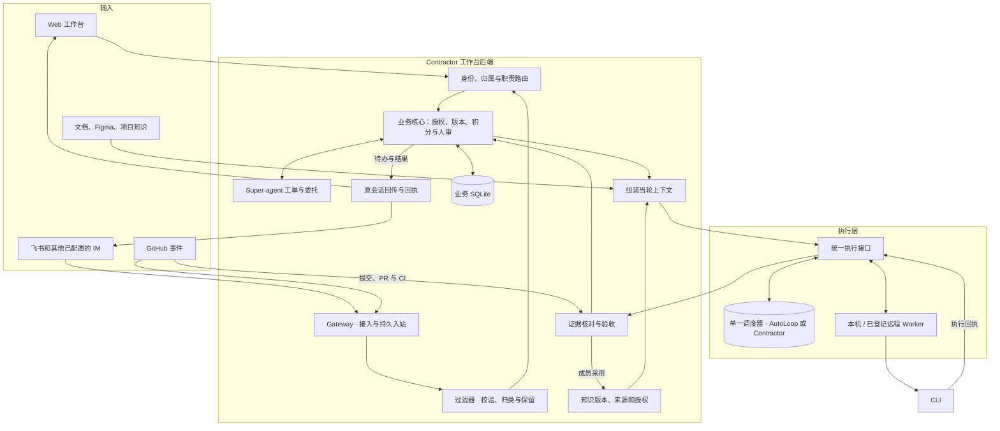

# Contractor 架构

[从业务流程读起](../README.md#一件工作怎样走完) · [各模块时序](BUSINESS-FLOWS.md) · [数据模型](DATA-MODEL.md) · [各模块规则与入口](PRODUCT-CAPABILITY-MAP.md) · [核心界面](WORKBENCH-FRONTEND-WORKSPACE.md)

## 输入、处理与输出

同一项目可以绑定多个资料来源和消息入口。已验证的渠道账号归到工作台成员，但原渠道的资源权限仍依各自平台。项目和子项目可独立授权，主题组织持续讨论，工单代表一项可交付的工作。相关项目和工单可相互关联。

飞书入口和知识索引可以独立运行。工作台通过持久日志接收入站事件，检索插件使用核心已经过授权的候选知识。索引故障只影响依赖检索的请求，工单列表、详情和验收使用业务账本。

## 模块如何接起来

| 模块 | 输入、决定与输出 | 主要代码 |
| --- | --- | --- |
| Gateway | 把渠道、连接、会话、话题、消息和发送者归一为入站地址。持久化后再处理，按渠道消息标识和修订去重。飞书可以补读授权的历史，其他通道按各自 API 能力恢复。出站保存原地址和确认记录。 | [入口](../src/workbench/intake.ts) · [渠道日志](../src/workbench/channel-journal.ts) · [投递回执](../src/workbench/channel-delivery-journal.ts) |
| 过滤与归类 | 校验当前绑定的项目和成员，跳过机器人自身事件与不可处理消息。按明确引用续单、触发工作或纳入主题反馈。未点名反馈先入箱，按配置的时间窗口归纳。可按内容归并摘要，每条作者、原消息和修订仍保留。归属冲突保留原消息交维护人处理。 | [渠道分流](../src/workbench/channel-workflow.ts) · [群反馈](../src/workbench/discussion-workflow.ts) |
| Router | 在已核实的项目和工单上，检查显式指定、主题、父主题和项目职责。唯一且在岗的候选可继续。多个候选、缺资料或待研发接单进入人的待办。Router 给出执行人和业务决定人，Agent、模型、设备和积分政策还要在领取时复核。 | [路由](../src/workbench/router.ts) · [委托工作流](../src/workbench/dispatch-workflow.ts) |
| 业务核心 | Super-agent 管工单、委托和任务事件。Contractor 管理项目树、关联资源、成员权限、子任务依赖和人审决策。工单状态、版本和资料范围由核心校验后落库，保留待办和审计。 | [项目目录](../src/workbench/project-directory.ts) · [权限](../src/rbac.ts) · [人审](../src/workbench/human-decisions.ts) |
| 上下文和权限 | 从主题讨论、确认依据、当版工单、资料引用和已采用知识生成当轮快照。领取、接续和交接时复核源版本及权限。 | [主题上下文](../src/workbench/topic-context.ts) · [执行上下文](../src/workbench/execution-context.ts) |
| 调度器 | 把委托和后续事件变成可领取的运行。保存队列、租约、延迟检查和人审等待。一张工单可以有多轮，每轮可有多个尝试。实例使用 AutoLoop 兼容调度器或 Contractor 独立调度器。 | [执行接口](../src/workbench/execution/contract.ts) · [Contractor 调度器](../src/workbench/execution/scheduler.ts) |
| Worker 与回执 | 已登记的本机或远端设备领取。执行适配器装配当前工作目录和会话，核对进程已停止后回传。代码任务只导入已授权路径且保持 Git 基线一致。回执按运行与尝试写入成果、Token、积分和通知入箱。调度已确认、业务落库失败时可重报补写。 | [本机 worker](../src/workbench/execution/worker.ts) · [远程连接](../src/workbench/device-client.ts) · [回执恢复](../src/workbench/execution-receipts.ts) |
| 交付与验收 | 工单版本绑定提交、PR、对应提交的检查和可选环境证据。打回后在原单产生新版本。人工验收依据当前版本。 | [交付证据](../src/workbench/delivery-evidence.ts) · [验收](../src/workbench/ticket-acceptance.ts) |
| 知识回流 | 当前验收产生知识候选。负责人可使用平台模型提炼可复用做法及适用条件，保留原始验收记录。人工采用后成为现行版本。索引仅排序当前有权使用的资料。授权变化会影响原资料、派生成果和使用关系的读取。 | [知识与版本](../src/workbench/knowledge.ts) · [授权](../src/workbench/knowledge-authority.ts) · [图谱](../src/workbench/knowledge-graph.ts) |
| 任务中心 | 工单动作与运行历史放在「工作」。在「会话」查找有权访问的项目讨论、主题和工单讨论。归档只影响当前成员的目录。 | [会话索引](../src/workbench/conversation-index.ts) · [前端入口](../workbench/src/main.tsx) |
| 过程复盘与回归 | 过程核对从对应执行尝试读取回执和成果。回归用例从已记录的成果与检查创建，基准和候选分别保留证据及配置版本。 | [过程核对](../src/workbench/process-review.ts) · [回归对照](../src/workbench/regression-review.ts) |

## 三个配置面

| 对象 | 谁配置 | 页面和设置 |
| --- | --- | --- |
| 个人 Agent | 成员 | 「个人设置 → 个人 Agent」维护自己的名称、指引、经验和轻量模型，进行私有咨询。项目 Agent 的职责与在岗状态继续在项目中管理。 |
| Router | 平台管理员配置模型，项目维护人配置职责 | 「平台管理 → Router 与知识提炼」为两种提炼任务选择同一模型。「项目 → 职责与路由」配置项目和主题的牵头及决定人。核心根据规则和权限派单。 |
| Worker | 设备所有者和项目维护人 | `contractor connect` 在本人账号登记执行机。所有者授权设备接单的项目，项目维护人设置主备。委托、会话和原工单恢复时选择适配该 Agent 的可用设备。 |

平台管理员另外维护成员、登录策略、模型服务和积分政策。资料负责人管理原始来源权限、候选采用和撤权。可改配置、存储位置和生效方式见 [配置手册](CONFIGURATION.md)。

模型整理通过 `assistant` 能力接入。路由建议只考虑当前已授权的接单候选。知识草稿从已验收的记录提炼做法和适用范围，人工复核后按现有版本逻辑采用。检索和来源权限继续通过知识核心及索引插件。这个边界吸收了按任务调用既有经验和将结构化记忆独立于会话上下文的做法。 [Superlinear 跨任务经验调用](https://www.superlinear.academy/c/share-your-projects/ai-a1eee1) · [Anthropic 记忆的组成](https://www.anthropic.com/research/components-of-agent-memory)

## 调度兼容与持久状态

| 工作阶段 | 执行接口中的记录 |
| --- | --- |
| 新任务、定时整理、补充 | 将确定的委托和到期事件放入指定范围。重复的入站事件用其原身份和修订去重。 |
| 领取、续租、执行 | 核对所选实例的调度协议和设备权限。把当前授权、模型和上下文冻结到本次尝试。 |
| 人工等待与定时接续 | 处理结构化的 `ask`、`notice`、`resolve`、`later` 和 `events` 回执。必答项都答完后再接续。停止旧端、换成员、续原单各自留痕。 |
| 完成与补写 | 调度确认与业务结算分别记录。重复回执只返回已有确认，实际任务进度和知识依赖下一层的交付审查。 |

默认兼容实例使用 `autoloop/hub.db`，独立 Contractor 实例使用 `dispatch/hub.sqlite`，项目和工单资料位于 `orchestrator.sqlite`。渠道入站及回传、运行快照、交付检查与凭据有各自的生命周期。停机迁移可以复制业务账本及已结算的调度状态，再用 Contractor 的最新账本回滚。 [能力范围与切换条件](RUNTIME-MIGRATION.md) · [插件和运行方式](PLUGIN-ARCHITECTURE.md) · [执行端恢复](WORKBENCH-REMOTE-RUNNER.md)

| 数据 | 谁写入和读取 |
| --- | --- |
| 渠道消息、修订及回执 | 接入服务在处理前落盘。独立飞书入口可用 `feishu-ingress/inbox.sqlite`，业务核心再按原消息与引用处理和去重。 |
| 项目、工单、验收、知识和积分 | 工作台在 `orchestrator.sqlite` 写入业务记录。Browser API 根据当前账号和项目授权读取。 |
| 领取、租约、等待和尝试 | 当前调度器写入自己的运行账本。Worker 保有本机工作目录、未交回的回执和停止证明。 |
| 已授权资料的检索结果 | 检索插件对工作台送来的候选做排序。原文、有效版本和来源权限仍来自业务核心或授权的源站。 |

## 部署与扩展

工作台的 API 和前端来自同一个部署。启动时在 `platform-plugins.ts` 组装渠道、资料、检索、只读模型和交付能力。新增适配器实现对应接口并注册。工单的分工、权限、版本、验收和知识采用由业务核心维护。 [插件接口与状态](PLUGIN-ARCHITECTURE.md)

生产部署的远程执行端通过团队 HTTPS 地址接入，浏览器确认身份，执行机主动领取任务。运行数据放在独立的 `COLLAB_STATE_DIR`。自研 Contractor 调度器在独立环境下使用自己的调度 SQLite，AutoLoop 兼容部署沿用原账本。 [跨主机执行端](WORKBENCH-REMOTE-RUNNER.md)
