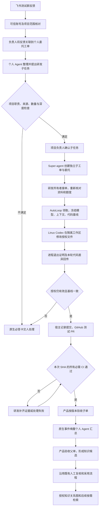

# 后端补齐与真实链路核验

日期：2026-11-16。基线：`9379607`。本轮只修改后端、回归测试和文档，不改前端。功能以已验证的适配器为界，不能将“能配置 Agent 名称”当成“所有 Agent 都能执行”。这是对[九项生产能力审计](PRODUCTION-CAPABILITY-AUDIT.md)的增量交付，不代表审计中的全部缺口已经关闭。

## 本轮落地

| 能力 | 后端行为 | 复用与实现位置 |
| --- | --- | --- |
| 引擎能力核实 | 根据引擎、隔离方式、模型和凭据配置决定能否执行、写代码、承担群整理；配置不支持时明确阻塞。实际凭据、设备在线状态仍在准备时检查 | `execution-capabilities.ts`；复用既有 Agent 配置及适配器 |
| 跨主机代码交付 | 原生 worker 领取冻结代码包，独立 Linux 工作区执行；旧进程退出后回传差异，宿主复核授权、哈希和路径再提交 | AutoLoop 原版 worker；Sandbox Runtime 原版；`code-bundle.ts`、`isolation.ts`、`remote-runner.ts` |
| 个人 Agent 转委托 | 项目配置可委托职责，Agent 提建议，负责人确认后建立独立子单；研发另行接单。子单验收后才唤醒父单汇总 | Super-agent 原版 Engine 建 Ticket/Mandate，AutoLoop 原版事件和运行；`delegations.ts` 只存关系，不调度执行 |
| 执行端状态 | 启用、暂停、丢失、退役；丢失不能视作已退出，退役不能直接重新启用，旧回执仍可交回 | 既有设备令牌、租约与停止证明；`devices.ts` |
| 知识关系后端 | 可见知识版本、来源修订、产生工单、使用工单、Agent 与所有者的关系；撤权节点及边一起消失 | Backstage 实际导入 entity ref 和关系常量；`knowledge-graph.ts`，既有知识授权与执行快照 |
| CI 配置 | 每个交付仓库可指定多项必需检查及 GitHub App ID；同 SHA 每次检查保留，按最新检查结果判定 | 既有 GitHub 交付接口；`github-delivery.ts`、`project-resources.ts` |
| 飞书本地订阅健康 | 定期查询官方 CLI 的 bus/consumer 状态，识别属于本订阅的子进程，两次失败后重连 | 官方 lark-cli；`feishu-events.ts` |

## 一条完整链路



实际联调中，飞书消息确实进入测试群和后台待办；负责人通过后端 API 确认关联并创建委托，不是飞书卡片一键完成。验收由测试脚本分别使用产品和研发账号执行，用于验证权限门禁，不代表真实产品负责人已验收业务功能。两个链路都使用测试资料和独立 HTML。

## 转委托配置与约束

项目配置示例：

```json
{
  "delegations": [
    {
      "from": "personal-product",
      "to": "delivery",
      "repository": "zhegong-996/desktop-tutorial",
      "maxChildren": 1,
      "maxDepth": 1
    }
  ]
}
```

`from` 为本项目登记的 Agent，`to` 为项目配置的职责；不是固定组织岗位。目标职责与 Agent、仓库交付范围必须有效。模型只能提出 `function/title/request`，不能指定命令、凭据或越过研发接单权限。

原版 AutoLoop 结果的 `events` 可包含：

```json
{
  "id": "store-reason-code",
  "type": "suitme.delegate",
  "subject": "store",
  "summary": "建议研发落实推荐理由",
  "detail": "{\"function\":\"delivery\",\"title\":\"推荐理由代码落实\",\"request\":\"落实已确认的推荐理由口径\"}"
}
```

稳定标识按父单和业务版本去重；同标识改内容会等待人处理。限制子任务数量、链深度和祖先 Agent 循环。父单不因 Agent 提建议就交付完成，也不因子 Agent 报 done 就继续汇总，必须经过子单验收。原生必答事项优先呈现，不会被“等待子单”遮掉。

自动提案仅支持当前有效、已采用且项目内可见的资料。受限资料不能隐式向子 Agent 扩散，转为原生询问，由人先明确范围。提案等待期间资料失效，待办隐藏正文并拒绝确认。已建立子单执行与验收仍复核上游授权链；父单结束或变更版本，后代停止接续并等待负责人。子单的来源并非全部可回流时，不复制成果正文给父 Agent。

这不是任意 DAG、自动负载均衡或跨项目自动拆解。关系账本不替代 Super-agent 与 AutoLoop，也没有引入另一套 LobeHub runtime。

## 交付验收配置

仓库资源的 `execution.requiredChecks` 可配置：

```json
[
  { "name": "collab-pilot", "app": "github-actions", "appId": 15368 },
  { "name": "security", "app": "github-actions", "appId": 15368 }
]
```

缺任一项不放行。匹配精确 SHA、检查名称和 App，重跑选择该项最新结果，保留以前的尝试。未配置时兼容原先的 `collab-pilot`。示例的第二项需要仓库实际提供，不能只在配置中写出来就视为通过。当前支持 Check Runs，不把 branch protection、commit status、部署或人工 review 自动等价为这些检查。

## 知识关系 API

`GET /api/project/:id/knowledge-graph` 返回 `nodes`、`edges` 和 `truncated`。节点先经过既有资料、派生来源及运行快照的授权判断。没有无权节点的标题、正文或悬空边。关系包括 `ownedBy`、`partOf`、`dependsOn`，以及 SuitMe 的 `supersedes`、`executes`、`derivedFrom`。保留具体知识修订、运行、尝试和工单业务版本。

这是基于真实记录的来源与使用关系图，不是模型抽取的业务实体图谱。当前最多 200 条可见知识、每条至多 20 条可见使用记录；超出知识数量会标记 `truncated`，使用记录仍沿用既有接口限制。尚未添加语义检索、实体字典或图谱前端，也未启用新的模型服务。

## 验证证据

| 场景 | 结果 |
| --- | --- |
| 跨主机代码链路 | 真实飞书消息、macOS 工作台、无共享挂载 Debian 执行端、真实 Codex。提交 `150781f6d2a4f449fc02aa6a5d1fd643540a0515`，测试 [PR #16](https://github.com/zhegong-996/desktop-tutorial/pull/16)。CI 通过后测试身份验收。缺 PR、错误 SHA、研发冒充产品验收均拒绝 |
| 个人 Agent 转委托 | 父单 `fe9dc8db5eb2862ecd551d47538b41ea`，子单 `b3d4b3abec0250de527add4e5df2e07e`。提交 `14bfaf87b0e679f53945d555cb154f07b90a7421`，测试 [PR #17](https://github.com/zhegong-996/desktop-tutorial/pull/17)。负责人重复确认仍只有一个子单，子单验收后父 Agent 实际再次运行汇总 |
| 实际调用与计量 | #17 共三个真实 Codex 运行：个人提案、远端执行、个人汇总。原生报告累计输入 92,970、输出 814；三个回执均未报价，金额未知，不能解读为免费 |
| 最新后端重启 | 对上述完成账本重启最新服务，产品、研发、旁观者三个测试账号读取授权图、待办和历史工单正常。伪造设备令牌携带大请求在读取结果前返回 401 |
| 本地回归 | `npm test`：55 项，54 通过、1 项 Linux 专属测试在 macOS 跳过。`npm run typecheck` 通过 |
| Linux 隔离 | Linux 专属测试在 Debian 实际运行通过：授权新文件可写，其余仓库文件只读，范围外目录不可读 |
| 飞书健康 | 官方 CLI 的真实订阅与状态查询成功，22 秒观察保持第一次连接且丢弃数为 0；故障与重连用可控 CLI 回归验证，不冒充真实远端 websocket 断网验收 |

两个 PR 保持 open，不合并或部署。测试平台账号分饰产品、研发、旁观者，模型登录来自已有授权测试凭据的独立工作区副本，不能称为三个真人、三个供应商账号的生产验证。

原始运行日志、消息 ID、账本及模型回执留在私有运行目录 `/private/tmp/suitme-gaps-live`、`/private/tmp/suitme-delegation-live`，不提交仓库。最新资料失效门禁及 HTTP 认证修正另经回归和最新服务接口复测，没有再把同一批真实外发消息重复发送一遍。

## 本轮发现与修正的问题

1. Linux 原版 Sandbox Runtime 会在写挂载后恢复读挂载。初次远端运行无法写入文件，曾出现失败与取消，共前四次未交付；调整为不互相覆盖的读写挂载后，同一工单第五轮成功。没有关闭隔离来绕过问题。
2. 官方飞书 CLI 的启动进程与实际 consumer PID 不同，直接比较 PID 会误报断线并反复重连。改为核对本订阅子进程祖先链；不接受同应用中另一个订阅“代为健康”。
3. 历史阅读权限不等于资料仍可用于新转委托。待办及确认入口改查当前有效来源，避免失效提案正文继续出现。
4. 远端代码包需要较大的结果请求；先验证配对设备，再读取有大小上限的请求。普通接口仍保留原有小请求限制。

## 后续后端顺序与未完成项

优先继续可靠性和资料边界，再做范围更大的自治能力；前端适配在这些后端契约稳定后推进。

1. 来源适配：飞书普通群文字的恢复补读与 Figma 指定节点的按版本导入已接入，见下方记录。仍缺未知或旧话题的回复补读、对丢失命令的人工接续机制、Figma 事件及源站权限同步、其他 IM。
2. 执行适配与治理：Cursor、ACP、WorkBuddy、豆包等逐个核实接口与隔离，组织级停止、Agent 灰度上岗、不可变 Skill/CLI 制品。不得沿用“CLI 开放所以全部支持”的假设。
3. 费用与生产运维：真实供应商账单/人工核价、金额硬上限、备份恢复、保留期、独立真人与供应商账号的并发压测。已有次数/时间额度和未知费用阻断不等于这些能力全部完成。
4. 知识：源站 ACL 变化同步、语义检索与实体抽取、跨任务确认与冲突处理。撤权可以阻止后续读取和派生回流，不能证明已离线设备物理遗忘之前收到的数据。
5. 协作扩展：完整代理收件箱、任意 DAG、负载调度、跨项目自动分解、统一预览/部署版本门禁。这些尚不能据本轮受控父子任务链宣称具备。

新增外部资料或模型服务仍遵循已有授权范围；本轮未接入新的付费模型服务，未读取未授权业务资料。

## 来源恢复与 Figma 节点接入

- 飞书订阅就绪后即触发授权补读，之后每分钟检查。补读复用现有项目、群授权身份、消息 ID 及整理游标。查询成功才推进游标，和定时整理串行更新同一群。查询保留两分钟重叠，允许补齐短暂迟到的消息。普通文字反馈仍按原定时批次整理。历史中的显式命令只补已登记的消息修订，未登记的命令需要人重新交办。
- 负责人通过 `GET /api/discussion/:project` 查看 `history` 的游标和最近状态。恢复采用现有三天整理窗口。群历史查询覆盖接口提供的根消息，话题回复可能需要独立查询。上游丢弃事件仍要按实际覆盖情况核对。
- 飞书实测在服务启动前向原测试群发送一条门店推荐理由反馈。工作台补读后按原消息 ID 保存一条待整理记录并推进游标，期间没有模型整理运行。普通成员看不到历史补读状态。重启同一账本并重复补读后，原消息和修订仍各保留一条。私有证据保存在 `/private/tmp/suitme-source-recovery-nNElrf/evidence.json`。
- Figma 已接配置校验、节点与版本限定、可见文本提取、知识候选导入与版本替代、按权限读取原修订的 PNG。独立后端仍需配置 REST 凭据。已通过 Figma 连接器读取现有门店原型节点。用受控 Figma 响应走真实工作台 HTTP 接口，验证负责人导入、采用与预览，普通成员返回 403，重复导入沿用原条目。 [资料接入与配置](KNOWLEDGE-VERSIONS.md)
- 修复设备生命周期 HTTP 接口只接受旧布尔值的问题，现支持状态枚举并继续兼容旧请求。
