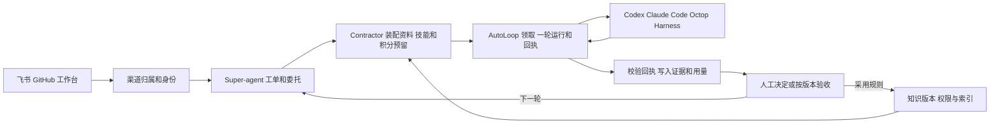

# Contractor 后端与执行链复盘

## 一条任务如何可信地完成

项目的工作可以跨工具和人员延续，模型进程会断线、失败或更换。因此业务授权、执行尝试以及交付证明需要独立持久化。一次真实的外部操作无法依靠租约保证恰好发生一次，GitHub 提交和通知要靠版本证据、幂等键以及重放对账核实。

## 三套执行链对照

| 系统 | 把什么作为执行的依据 | Contractor 可直接采用或借鉴之处 |
| --- | --- | --- |
| Super-agent | `Engine` 先持久化 Ticket、Mandate 和 Assignment。Executor 通过 port 异步取件、回告启动、资料送达和结束。 | 作为组织授权的唯一业务账本。人员确认、交接和工单的生命周期由它记录。 [Executor 接口](https://github.com/deepseek-ai/dsh-superagent-prototype/blob/8c32a9dc5d72c033816c6a8110b37f40cf94fba4/src/core/ports.ts) |
| AutoLoop | 事件归到规则和事项。Worker 领取一轮，将日志、进程和待发回执留在本地，按租约交回。需要人时当前轮结束。 | 继续作为唯一调度器。跨端接续保留原工单，按旧运行和尝试核对停止证据。 [执行协议](https://github.com/KKKKhazix/agent-autoloop/blob/ba8cf6d8cf24f9ce005958c15d88f2d9cff7f05d/docs/protocol.md) |
| LobeHub | Operation 持有运行快照与活跃租约。按步骤保存工具等待原因，异步回执通过状态条件更新和父级唤醒接续。独立解析设备和工作目录。 | 可借鉴明确的等待原因、端到端 Operation ID、不同执行端的存活判定，以及异步回执先入库再推进。 [租约](https://github.com/lobehub/lobehub/blob/a8424d204a7ed1eb36985ebdfa6eac8041615392/apps/server/src/services/agentRuntime/operationLease.ts) · [异步工具完成](https://github.com/lobehub/lobehub/blob/a8424d204a7ed1eb36985ebdfa6eac8041615392/apps/server/src/services/agentRuntime/AgentRuntimeService/executeStep/completion.ts) |

## 当前模块与部署边界

| 模块 | 当前后端形态 | 核对重点 |
| --- | --- | --- |
| 入口和身份 | 飞书监听、历史补读、卡片，GitHub 来源和账号绑定。Octop Gateway 接入飞书文本归一。 | 新 IM 的验签、历史补偿、跨平台多媒体和权限要分别验证。 |
| 项目与工单 | Super-agent Engine 与 Contractor 项目、主题、成员、跨渠道关联，运行于同一工作台进程。 | 保持同一事务内的归属、委托和路由；无人批准的消息保留证据。 |
| 执行与路由 | AutoLoop 独立 SQLite 账本。主机 worker 与远端 CLI 可分开部署，Octop Python 供受托只读运行。 | 旧端停止证明、上下文和授权复核、同一尝试恢复。 |
| 资源与专家 | 项目范围内的技能发布、共享、挂载、专家调用及模板复制，持久化在 Contractor SQLite。 | 固定版本、精确撤权及私有数据与凭据隔离。 |
| Token 和积分 | 路由前预留，按实际 Token 和冻结倍率结算。可按项目、整理、个人、执行及 Agent 查看。 | 测遥测缺失、取消、重复回执和费率变更。 |
| 交付与接受 | GitHub PR、提交、对应 CI 和人工验收独立记录。 | 再测试 CI 重跑、部署证据和回执延迟。 |
| 知识 | Contractor 保留审批、版本、来源和权限。Octop Memory 在已授权数据上做本次全文召回。 | 持久索引、租户隔离、撤权与备份要做单独压力和恢复测试。 |

## 优化顺序

1. **本机和群整理的回执恢复已接入。** 旧逻辑曾复现 AutoLoop 确认后漏写 Contractor 账本。现在先留待补写记录，使用原生租约的发放编号和已收回执摘要核验，再把成果或整理建议、Token、积分和通知入箱放在一个事务。相关执行链结清前等待，AutoLoop 仍是唯一调度器。 [回执补写](WORKBENCH-REMOTE-RUNNER.md#回执跨库恢复)
2. **工单提供具体阻塞原因和恢复动作。** 工单详情从待办、权限、AutoLoop 运行和交付证据投影 `recovery`，包含原因、下一步、负责人、原工单与版本，以及适用的运行编号和重试时间。当前成员只收到自己的待办编号。见下方恢复路径。
3. **飞书入口与 Octop 索引可独立运行。** 入口持久化收到的事件，工作台维护授权补读游标，索引经私有 Unix socket 对当前授权资料执行按请求检索。项目身份、委托、共享、额度及验收共同提交业务记录。[配置和启动方式](WORKBENCH-OCTOP.md#独立运行飞书入口和知识索引)
4. **子任务由人确认，各自经 AutoLoop 执行。** 在项目的 `delegations` 给主 Agent 配置多条目标职责。每条可用 `scope` 固定 `title`、`request` 和允许从本版主单挂载的 `material`。配置范围的职责是必需项。同一主单版本的同一受限职责只登记一次。子单在首次派工及接续时核对资料范围。所有必需子单验收且证据仍可读后，工作台向原主单提交一条汇总事件，Agent 汇总后由发起人验收。停止、漏派或失效的必需子单保持阻塞。

飞书群话题发起的只读主单采用原话题验收卡。卡面显示工单和版本，完整汇总经工作台权限查看。指定发起人可在卡片上验收，原话题回执和工作台共用同一待办。

### 工单恢复路径

| 阻塞原因 | 处理人和动作 |
| --- | --- |
| 必答事项、研发接单、资料访问 | 分别交给执行决策人、受托研发和资料所有者。通知由待办归属和 ID 去重。未绑定飞书时保留个人待办。 |
| 模型暂时不可用 | AutoLoop 按原运行的重试时间重新领取，执行前重验模型和资料授权。领取前的探测失败不计模型用量。模型授权变更或重试耗尽后，由执行负责人核对。 |
| 执行端离线、旧执行待停止、回执待补写 | 优先等原端或原回执。旧进程未验明停止时保持交接等待。重复调用接续接口复用当前排队或执行。 |
| 配额、资料来源、工作区或输出异常 | 展示对应原因。配额或工作区修复后可在原单接续，资料变化需重新核对授权，委托变化由负责人处理。 |
| 缺少验收证据或待 CI | 关联本版提交和 PR 后核对对应 CI。检查异常由交付负责人处理，证据齐备后由发起人验收。 |
