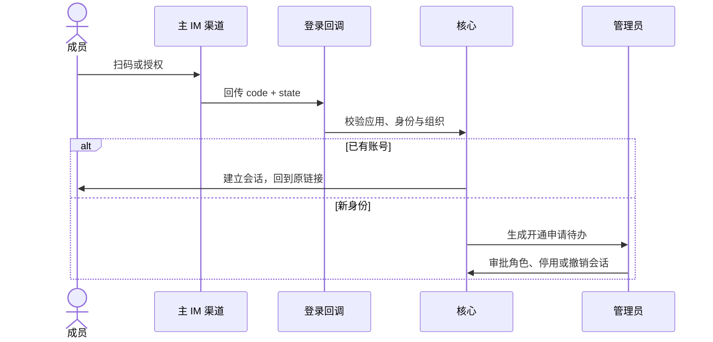
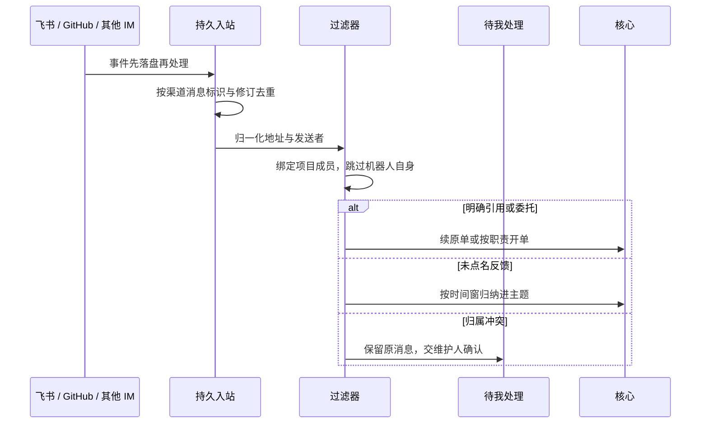
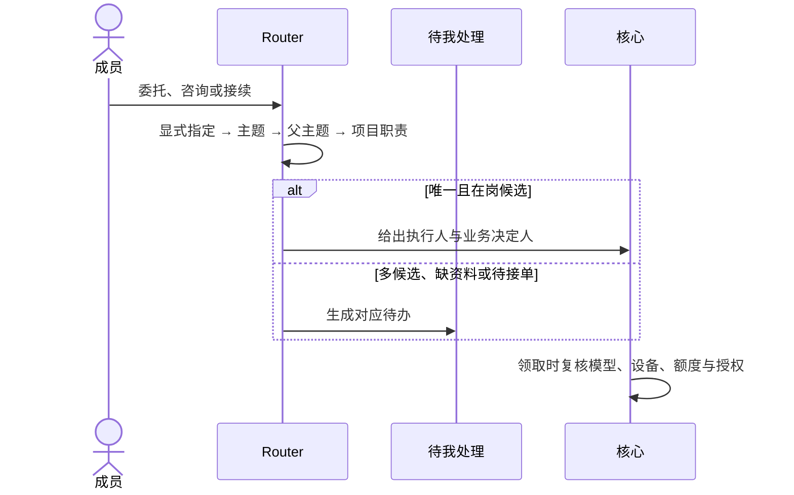
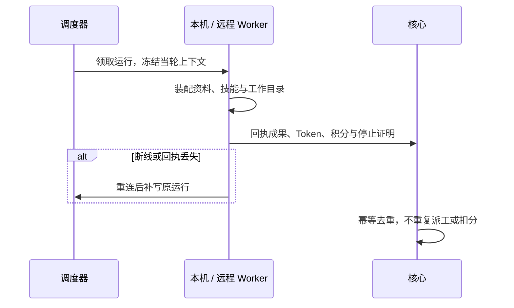
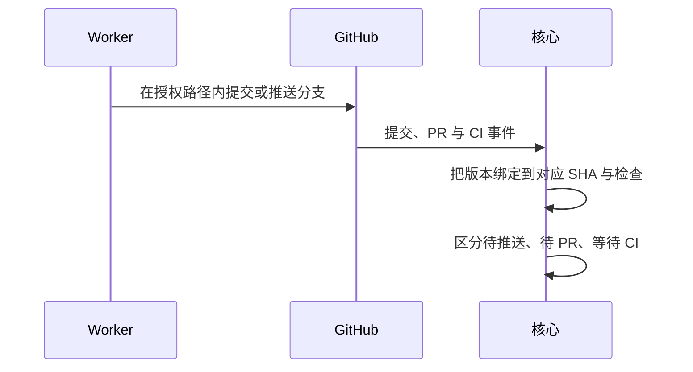
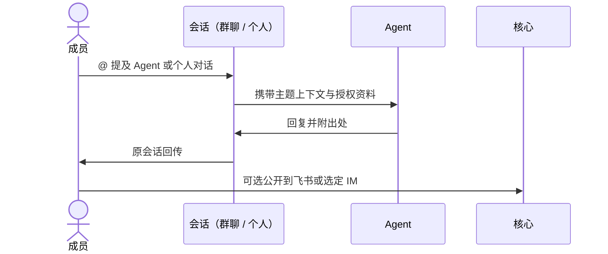
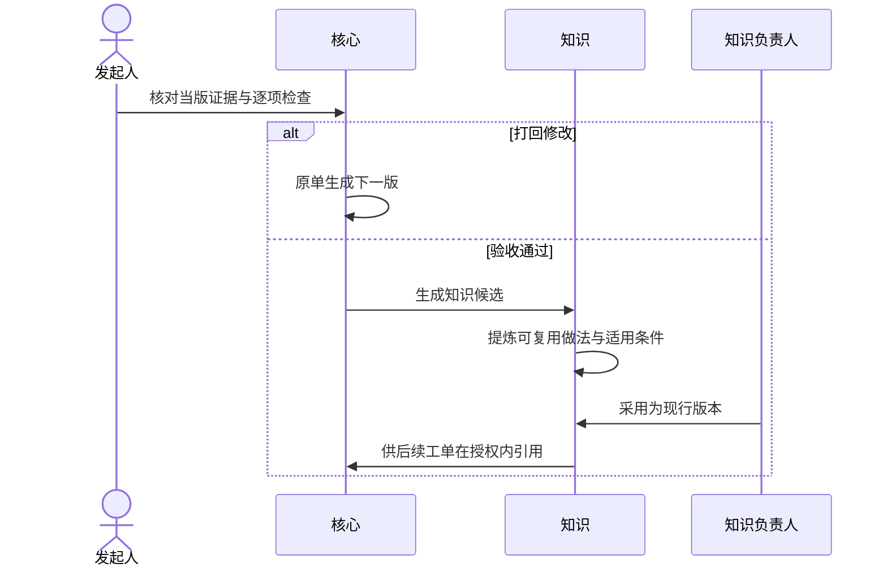
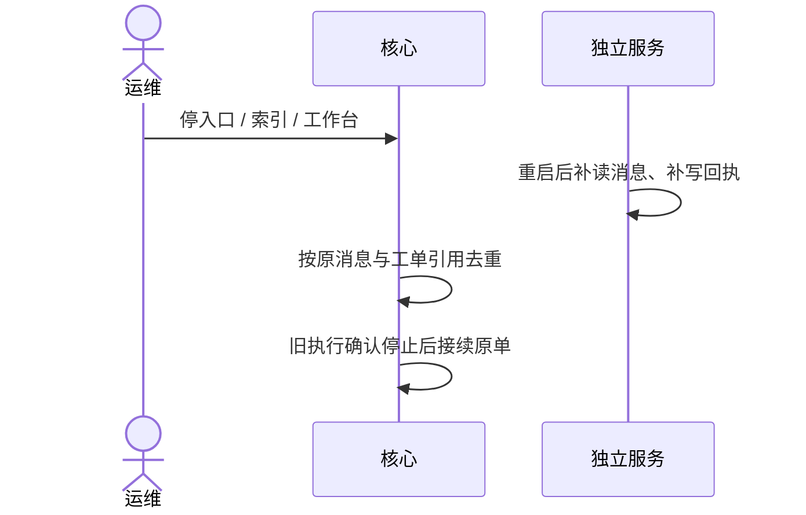

# Contractor 各模块业务流程

整条链路从「进来源」到「沉淀知识」见 [README 的一件工作怎样走完](../README.md#一件工作怎样走完)。本文把链路拆成可独立运行的模块，用时序图说明每个模块的参与方、决定和回传。图中的 `核心` 指 Contractor 业务核心（项目、权限、版本、积分、人审），`调度器` 是当前启用的单一执行调度器。

## 1. 登录、身份与平台角色

## 2. 渠道接入、过滤与归属

## 3. 发起协作与路由派工

## 4. Worker 执行与回执

## 5. GitHub 交付与 CI

## 6. 会话与 Agent 咨询

## 7. 验收与知识回流

## 8. 运维、恢复与部署

## 模块与代码对照

| 模块 | 时序图 | 主要实现 |
| --- | --- | --- |
| 登录与身份 | §1 | [im-login](../src/workbench/im-login.ts) · [permission-admin](../src/workbench/permission-admin.ts) |
| 渠道与过滤 | §2 | [intake](../src/workbench/intake.ts) · [channel-workflow](../src/workbench/channel-workflow.ts) |
| 路由派工 | §3 | [router](../src/workbench/router.ts) · [dispatch-workflow](../src/workbench/dispatch-workflow.ts) |
| 执行与回执 | §4 | [execution/scheduler](../src/workbench/execution/scheduler.ts) · [execution-receipts](../src/workbench/execution-receipts.ts) |
| 交付与 CI | §5 | [github-delivery](../src/workbench/github-delivery.ts) · [delivery-evidence](../src/workbench/delivery-evidence.ts) |
| 会话与咨询 | §6 | [conversation-index](../src/workbench/conversation-index.ts) · [topic-context](../src/workbench/topic-context.ts) |
| 验收与知识 | §7 | [ticket-acceptance](../src/workbench/ticket-acceptance.ts) · [knowledge](../src/workbench/knowledge.ts) |
| 运维与恢复 | §8 | [feishu-ingress-service](../src/workbench/feishu-ingress-service.ts) · [octop-index-service](../src/workbench/octop-index-service.ts) |
