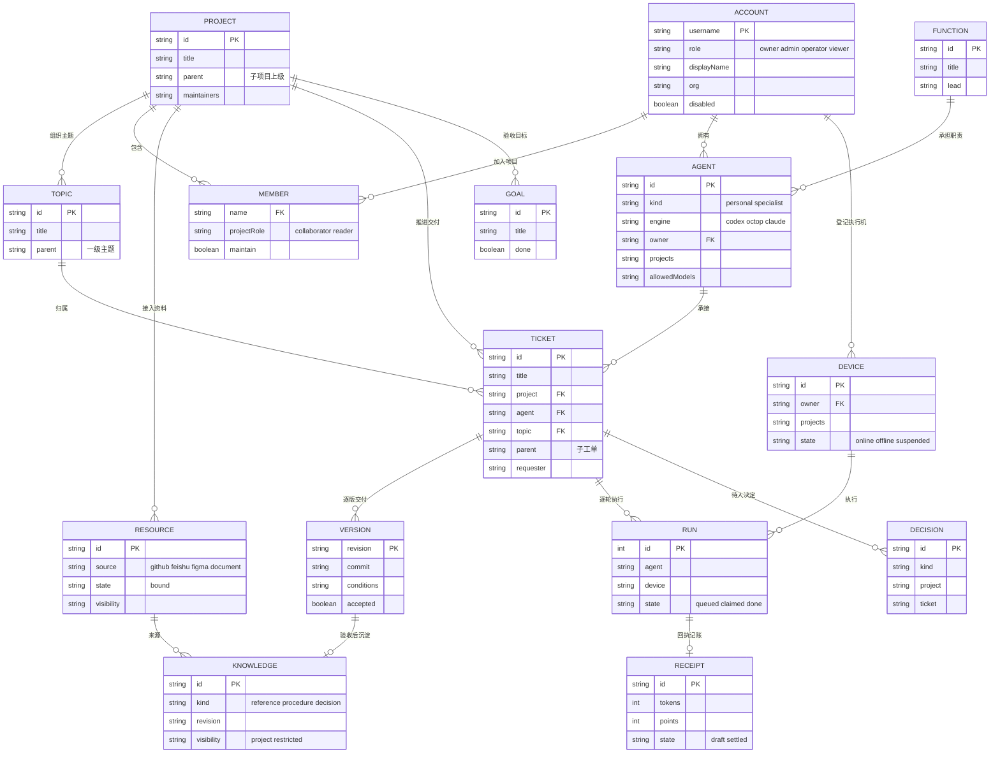

# Contractor 数据模型与实体关系

业务核心把「谁、在哪、干什么、到哪一版、能不能验收」写成可审计的记录。核心实体是账号、项目、主题、Agent、工单与版本，围绕它们有资料、运行、待办、知识和账本等关联记录。下面是简化实体关系图，字段只列出用于理解关系的部分。

## 核心记录与生命周期

| 记录 | 谁写 | 关键字段与变化 | 代码 |
| --- | --- | --- | --- |
| 账号与角色 | 平台管理员 | `role`、`disabled`、`imLogins`。主登录渠道校验到同一组织，跨组织拒绝。 | [console-auth](../src/console-auth.ts) · [rbac](../src/rbac.ts) |
| 项目与主题 | 项目维护人 | `parent` 构成项目树，`topics` 可再分子主题，`members/maintainers` 分权。 | [project-directory](../src/workbench/project-directory.ts) |
| 资料 | 资料负责人 | `source/externalId/state`，授权按资源、项目与成员判定。 | [project-resources](../src/workbench/project-resources.ts) |
| Agent 与 Worker | 所有者 | Agent 承担职责（`function`），设备登记后按项目授权接单。 | [agent-directory](../src/workbench/agent-directory.ts) · [devices](../src/workbench/devices.ts) |
| 工单与版本 | 业务核心 | 一张工单多版，每版绑定 `revision`、`commit`、CI 与部署证据。 | [ticket-revisions](../src/workbench/ticket-revisions.ts) |
| 运行与回执 | 调度器 + Worker | 一轮一个运行，多次尝试；回执写 Token、积分与停止证明。 | [execution-receipts](../src/workbench/execution-receipts.ts) |
| 待办 | 业务核心 | `kind` 区分授权、接单、验收、阻塞等决定，聚合到「待我处理」。 | [human-decisions](../src/workbench/human-decisions.ts) |
| 知识与版本 | 知识负责人 | `replaces` 指向被替代版本，`visibility` 控制可见范围。 | [knowledge](../src/workbench/knowledge.ts) |

## 三类账本

| 数据 | 文件 | 内容 |
| --- | --- | --- |
| 业务账本 | `orchestrator.sqlite` | 项目、工单、版本、验收、知识、积分。 |
| 调度账本 | `dispatch/hub.sqlite`（Contractor）或 `autoloop/hub.db`（AutoLoop） | 领取、租约、等待、尝试。 |
| 渠道账本 | `feishu-ingress/inbox.sqlite` 等 | 入站事件、消息修订与投递回执。 |
