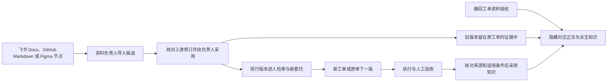

# 资料接入与知识版本

在项目的已绑定来源上配置正文接入。飞书 Docx 使用既有的用户授权和官方 CLI，保存文档修订号和当次读取的正文。GitHub Markdown 使用既有 GitHub CLI，先确定配置分支的提交，再按 Git tree 找到获准路径的普通文件，核对 blob 后保存正文和提交链接。Figma 按文件或分支及节点读取可见文本，冻结 Figma 返回的文件版本。三种接入使用现有 Backstage 资料引用、Super-agent 账本、AutoLoop 执行和项目 BM25 检索。



同一来源的版本有独立的知识条目和修订。导入同一快照返回同一条目。采用时再读一次真实来源，如果所审阅的候选已经落后，返回 409。通过后，在同一个账本事务内将指针从旧版指向新版。对于人工记录，可以新建一个带 `replaces` 的候选。对于验收形成的结论，在采用新候选时指定它替代的已采用版本。新版必须与原版本同项目、同所有者、同类型、同可见性，并且有有效来源。

知识所有者可以标记失效。失效没有替代项时，旧引用无法开新工单或进入下一版。新版被采用后，选中旧引用的新委托会解析到当前版本，多个指向同一版本的引用只装配一次。使用已替换或失效资料的派生结论也会退出当前检索，直到从有效来源重新确认。

工单每个业务版本在立项或开启下一版时锁定资料。已经派出的版本依约继续，已完成的运行快照保存原版本。原工单下一版会重查当前条目，受限资料需要新的版本授权。不再装配仅在旧资料版本下有效的成果或确认记录；涉及旧权限范围的修改理由只留在有权查看的历史中。

撤回工单授权会影响原始快照、历史成果正文和引用该授权代次的多级派生知识。后续批准产生新授权，不会恢复旧快照。专为历史成果补发的查阅许可仅用于该成果的人审。Figma 连接的有效读取权限也参与这条判断。可在可信本地项目配置中取消资料的正文接入，重载后该接入范围的快照停止供协作台读取。

## 后端入口

| 操作 | 入参和结果 |
| --- | --- |
| `POST /api/project/:project/knowledge-import` | `resource` 为项目内绑定的资料引用，GitHub 加传配置中的 `path`。资料负责人调用，返回 `id`、工作台 `revision`、状态和 `sourceRevision` |
| `POST /api/knowledge/:entry/publish` | 提交候选的 `revision`。验收生成的结论可附 `replaces: {id, revision}`，由两个版本的共同所有者确认 |
| `POST /api/knowledge/:entry/invalidate` | 所有者提供现行 `revision` 和 `reason`，旧版本退出现行检索 |
| `GET /api/knowledge/:project` | `q` 只检索仍可采用和有权读取的内容。没有 `q` 时可以用 `history=1` 核对有权限的历史条目 |
| `GET /api/knowledge/:entry/preview?revision=…` | 使用工作台修订号读取该次 Figma 原型的 PNG。服务端按原始 Figma 版本获取图片，调用前后都核对工作台权限 |
| `GET /api/project/:project/figma-sources` | 资料负责人查看自己的来源状态、最近核对时间、来源版本和候选编号。可用已有的 `knowledge-import` 入口立即核对 |
| `POST /api/channels/:event/resolve` | 负责人确认 `action=create` 时可附 `material` 选择已采用资料，渠道身份、项目归属和受限授权仍分别校验 |
| `POST /api/ticket/:ticket/revise` | 默认根据原单引用找到当前可用版本，可显式传入本版选用的 `material` |
| `GET /api/ticket/:ticket/runs/:run` | 正文可读时在 `materials` 中记录工作台知识版本及真实资料版本，`contents` 保留实际输入 |

在本机 `workbench.json` 的 `projects[].resources[]` 为已绑定资源加 `knowledge`。每种类型都需要 `owner` 和 `conditions`，`visibility` 默认 `restricted`。飞书用 `format=feishu-docx`，配置 `profile`、`appId`、`userOpenId` 和原本已登记的 Docx 链接。GitHub 用 `format=github-markdown`，配置 `branch` 和具体 `files`。既有普通链接仍可用。导入支持最多 12,000 字符的文本。

Figma 使用 `format=figma-node`。例如下列配置将项目内已登记的原型节点交给 `design` 管理。已有动态登记的同一节点由本机有正文授权的配置接管。

```json
{
  "source": "figma",
  "externalId": "FileKey/1:2",
  "label": "门店推荐理由原型",
  "url": "https://www.figma.com/design/FileKey/prototype?node-id=1-2",
  "state": "bound",
  "knowledge": {
    "format": "figma-node",
    "credential": "STORE",
    "owner": "design",
    "conditions": "仅用于门店推荐理由的试点验收",
    "visibility": "restricted",
    "preview": false
  }
}
```

凭据由部署方通过 `SUITME_FIGMA_STORE` 提供，使用已有节点访问权限且包含 `file_metadata:read` 和 `file_content:read` 的个人访问令牌。分支链接的 `externalId` 使用分支 key。链接带 `version-id` 会固定到该历史版本，省略时同步服务端最新版本。

服务启动时和每两分钟轮询文件元数据。相同文件和凭据在一轮内共用一次元数据请求。版本变化时读取指定节点，产生待审核候选。采用前仍重新核对真实版本，由资料负责人确认切换。

Figma 明确返回 401、403、404，或不再返回指定节点时，工作台使当前来源授权代次失效。同时隐藏依赖它的资料、派生知识、成果正文、运行快照及图谱节点。已有工单的版本、授权和验收账本保留。连接恢复后重新生成候选，旧代次的访问记录不会恢复。服务重启先核对来源再开放正文。限流或网络故障期间沿用最近一次核对，最多五分钟，超时暂停读取。这个机制核对的是工作台所用 Figma 账号的读取许可，成员授权继续由工作台管理。

`preview` 默认关闭。启用后才向 Figma 请求 PNG 渲染。图片只从限定的 Figma 图像地址读取，接口返回同源 PNG，临时外链和令牌留在服务端请求中。当前采用轮询，同步延迟取决于轮询间隔及 Figma 的接口限额。

## 门店推荐理由实跑

2026-11-15 在现有飞书测试群和私有 GitHub 测试仓执行。测试文档和提交均为虚构门店内容。由已授权操作者分别使用产品、研发、资料负责人和旁观者的平台测试身份，执行使用已接入的真实 Codex。工单 `e8d8c732ef170b62f98521ccf5589487` 源自真实群消息，项目负责人确认归属并选择两份资料。

| 验证 | 观察结果 |
| --- | --- |
| 第一版 | 飞书修订 3 和 [GitHub 第一版验收资料](https://github.com/zhegong-996/desktop-tutorial/blob/325a3e99af659724500d22b674ceec84294053bd/collab-pilot/store-reason-checklist.md) 由资料负责人采用。第 1 次真实运行读到两份资料并给出「先场景后事实」，由产品测试身份验收，再复核采用派生结论 |
| 待确认与替换 | 飞书修订 4 导入后，现行口径仍为修订 3。源站更新到修订 5 后，尝试采用修订 4 返回 409。资料负责人采用修订 5 及 [GitHub 第二版验收资料](https://github.com/zhegong-996/desktop-tutorial/blob/f5d8f4c82c90d4ff56bf0c29958f048e143ba52c/collab-pilot/store-reason-checklist.md) |
| 原单接续 | 第二版沿用同一张工单，取得独立的新版授权后，由第 2 次真实运行核对「先事实后场景」。实际装配和产出均使用新资料，旧版的受限标识未进入新上下文。产品验收后，新结论经复核取代旧结论 |
| 历史与撤权 | 旧口径被替换后，旧运行的上下文哈希和引用版本仍可核对。分别撤回第一、第二版的飞书资料授权后，对应快照正文、成果正文及派生知识停止返回，已验收元数据仍在。无授权旁观者没有读到任一份受限快照，撤权后的知识复用返回 409 |

此次测试仓用两次实际 Markdown 提交提供版本证据，验收针对两次资料核对成果。重载同一账本后，两版仍保持撤权，重复导入返回已采用条目。另通过后端验证了试点口径无替代失效，历史保留，新的复用请求返回 409。

本机 45 项回归全部通过，类型检查和固定上游检查通过。回归包括并发候选、跨项目隔离、多级派生、Git 路径校验和旧修改理由隔离。联调运行与证据存放在本机私有目录 `/private/tmp/suitme-knowledge-versions-live/`。
