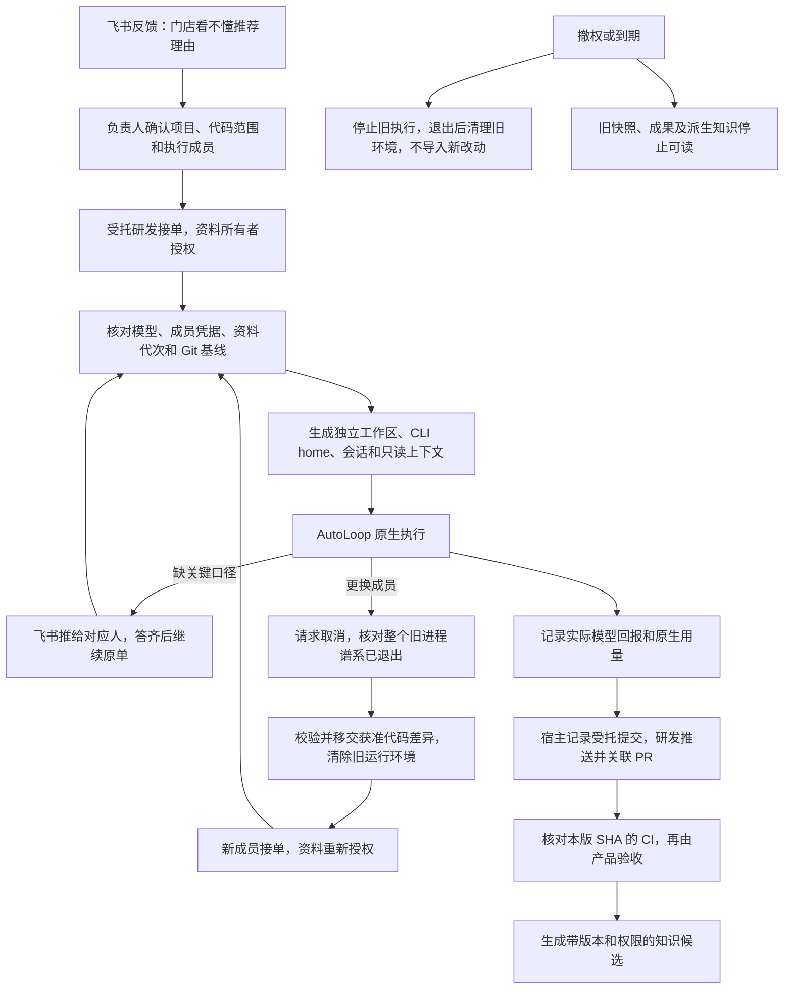

# 成员执行隔离与模型费用回执

本次仅调整独立工作台后端。Super-agent 继续维护工单和委托，AutoLoop 继续负责唯一的执行队列、租约、等待、重试与取消。新增的是其运行时本地插件 `suitme-isolated`，直接复用原版 Codex 参数生成和回执解析，用固定版本 `@anthropic-ai/sandbox-runtime@0.0.83` 建立操作系统文件与网络限制。

## 一张工单怎样换人

`src/workbench/isolation.ts` 不拥有独立调度队列。执行仍从 `openCollaboration` 的原生 worker 回调领取。只有旧 worker 及其已观察子进程停止，才可导入代码、清理旧环境或确认交接。交接差异无法核对时，取消本次交接并留在原单处理，不启动替代 Agent。

## 具体隔离什么

| 对象 | 规则 |
| --- | --- |
| 成员凭据 | 从当前运行实例的 `member-credentials/<owner>/<credential>.json` 读取；不回退到宿主或其他成员。仅接受普通文件、0600 权限，不接受符号链接 |
| 执行范围 | 由成员、Agent 配置、项目、工单、Assignment、资料修订及精确授权代次、凭据版本共同决定。换人、换配置或重新授权产生新范围 |
| 工作区 | 从受控 Git 副本复制工作文件，排除 `.git`、CLI 配置、Entire 数据、`.env` 和 `node_modules`；不是让 Agent 进入宿主共享 worktree |
| CLI home／会话 | 每个执行范围独立保存。只有同范围才沿用原生 session；跨成员、跨授权代次不恢复旧会话 |
| 输入 | 原版 AutoLoop 的上下文复制到本范围只读目录，提示中的文件引用同步调整。原生 worker 账本、其他任务记录、宿主登录目录不可读 |
| 子进程环境 | 清空宿主环境，只设置必要系统项、该次 HOME／CODEX_HOME／临时目录和只读上下文入口。不继承 GitHub、飞书、模型环境密钥、NODE_OPTIONS 或宿主插件配置 |
| 文件权限 | OS 沙箱默认拒读，只放行本范围、工具二进制和必要系统文件。工作区只允许写入委托路径。跨范围符号链接不能绕过；上下文不可改写 |
| 网络 | 使用同一沙箱的认证代理，只允许本 Agent 配置的服务域名；无自动放宽。Agent 不携带 GitHub 推送凭据 |
| 代码回收 | 停止后先核对全部改动路径、符号链接与原始文件哈希，再复制获准差异。宿主已有不同改动则停止交接；不能用旧快照覆盖新代码 |

macOS 的 Seatbelt 不能嵌套安装。Codex 的内层 `sandbox_mode` 在适配器中设为 `danger-full-access`，但该命令始终包在 SRT 的 OS 沙箱内部，实际权限由外层更严格的读写和网络规则限定。没有绕过 SRT 的回退路径，也不能只取内部 CLI 参数单独执行。原生任务仍记录业务上的 `read/edit` 范围，不能把内部 CLI 参数当成宿主无限权限。

此前完整的成员隔离验证使用 macOS Seatbelt。同主机代码执行使用明确配置的 Codex + OpenAI，Linux 使用可用的 bubblewrap、socat 和 ripgrep 等 SRT 依赖。远程只读执行支持独立的 Codex 运行目录，以及 Claude Code 加执行机的本地 Ollama。现有受控回归夹具用 `execution.kind=test`，仅 Node 测试进程可用。[远程执行范围与配置](WORKBENCH-REMOTE-RUNNER.md)

## 配置与迁移

参考 `fixtures/workbench.example.json` 的 `model` 和 `execution`。凭据文件名只来自本地可信配置中的引用，不接受 IM 文本、API 请求或工单内容指定凭据路径。生产启用时，应分别取得每位成员授权的登录材料并写入该成员自己的私有槽位，不能复制管理员凭据作为全员默认值。

未迁移的 Agent 可以被读取，但无法启动执行，负责人会收到配置阻塞。当前没有为未知 CLI 默默保留旧的共享宿主执行方式。测试实例使用一个已授权外部测试登录复制到两个内部测试成员的独立槽位，只证明边界和归因，不证明两个不同外部付费账号的结算。

Git 的提交、推送、PR 与 CI 核对继续走既有受托交付流程。Entire 的本地 Git hooks 保留；没有把宿主 Entire 配置或旧 CLI 会话注入隔离环境。只有实际存在且经核实的 Entire 检查点才可标记“会话已核对”；否则依据工作台的运行、委托人和精确提交记录归因。

## 每轮能追查的证据

`GET /api/ticket/:ticket/runs/:run?attempt=N` 增加 `isolation` 元数据；正文仍按原资料权限决定是否返回。范围哈希不能作为读取凭据或授权凭证。

`GET /api/project/:project/usage` 的 `attempts` 分别记录运行、尝试、所有者、委托人、模型、隔离范围、原生 token 数和结局。`modelReceipt.requested` 为明确配置的模型；`reported` 从该范围的 Codex 会话 `turn_context` 提取，`verification=session-reported` 表示 CLI 会话回报，不能当成服务商签名证明。模型回报不一致会阻断交付；没有可查会话时明确为 `requested-only`。

`billing.status=reported` 才有实际金额；CLI 没回报金额时为 `unreported`、`amount=null`。项目 `billing.knownAmount` 是已知小计，`totalAmount=null` 表示总额未知，避免把未知读成免费。既有预算检查继续阻止缺价后的下一次执行。没有把订阅费摊分、价格表推算或 tokens 直接冒充真实费用，也没有新增模型服务。

撤权无法收回已经合法读到的人脑信息或已经公开推送的 Git 代码。工作台撤销的是后续执行和访问：停止仍在运行的旧进程、不再恢复旧授权范围的会话、隐藏对应快照和派生成果。宿主操作系统管理员仍是可信边界，不是互相敌对租户的容器云。

## 验证范围

回归包括真实 Seatbelt 的跨成员／宿主文件拒读、符号链接、只读上下文、受托路径写入、宿主环境清空，及缺凭据不回退、生产拒绝测试模式、代码差异冲突不覆盖、模型回报可区分。原有 AutoLoop 必答、交接、撤权、通知和逐版验收回归继续运行。

2026-11-15 的真实联调使用四个独立平台账号：产品 `product`、研发 `engineering`、接替研发 `design`、资料所有者 `guard-observer`。由一个已授权操作者分饰测试身份，外部 Codex 账号不是四个真实用户。没有使用客户资料。

| 实跑项 | 证据与结果 |
| --- | --- |
| 飞书发起 | 测试群收到门店反馈，负责人确认并在同一项目补充代码目标和资料范围，关联工单 `e54accae1d92e639e4c104a0545f9f40`。代码目标配置由负责人完成，没有宣称任意群消息能自动取得代码权限 |
| 澄清接续 | 原版 Codex 发出必答卡，产品在飞书原话题选择“先场景后事实”。原单保留问答及两次执行之间的会话延续 |
| 真实取消／换人 | 第一位研发在写出 `handoff-draft-v1` 后进入工具等待。11:53:02.458 UTC 记录其执行及观察到的子进程已退出；接替成员获得独立批准后，11:53:05.899 UTC 才启动新会话。没有重建工单 |
| 交接上下文 | 接替成员收到获准的代码草稿和确认卡；新范围与旧范围不同，`resumed=false`，旧执行环境已清除。接替者继续修改同一文件，未把受限测试标记写入代码 |
| PR 与 CI | [测试 PR #15](https://github.com/zhegong-996/desktop-tutorial/pull/15) 只修改 `collab-pilot/index.html`，head 为 `1c5c7b05ca1c17bbbec9b164e58938580c39f47c`。[对应 SHA 的 collab-pilot 检查](https://github.com/zhegong-996/desktop-tutorial/actions/runs/43711184917/job/132802867904) 成功 |
| 版本验收 | 没有 PR 证据时拒绝验收；错误 SHA 返回 409，研发代替产品验收返回 403。产品测试账号在 11:54:58.955 UTC 签署第 1 版，保留成果修订、提交和 CI。不合并、不部署 |
| 撤权 | 第一成员及接替成员的资料授权分别撤回后，对应原始快照与派生知识不再返回。知识保留为候选，没有自动采用 |
| 撤权后的实际文件读取 | 子单 `69a85fb2aa83ba1e968e2db5fdc4ece6` 让同一 `design` 成员以新的范围、无该资料授权执行真实 Codex。旧上下文和旧登录文件仍真实存在于宿主磁盘；CLI 逐个执行 `test -r`，返回 `denied`、`denied`。不是只验证 API 隐藏或文件已经删除 |

本项目有 4 个运行、5 次实际尝试，均明确配置 `gpt-6.1-sol`，五份 CLI 会话回报均为同一模型。包含一次失败、一次被取消的重试，没有删去它们的资源记录。收到计量的四次尝试合计输入 171,106、输出 1,853 tokens；取消尝试没有回传 token 计量，因此这只是已知小计。五次均未回传金额，`billing.totalAmount=null`、`unpriced=5`，不能解释为免费或完整结算。

真实过程保留了环境兼容失败：只验证模型能回答，并不能证明工具可用；首次工具调用被重复 Seatbelt 安装拒绝。调整为强制外层沙箱后，真实 shell 执行成功且宿主登录仍不可读，再按原生五分钟重试接续同一工单。系统 CA 的显式读取配置通过真实模型调用验证；没有将沙箱改成无限制以绕过连接问题。独立连接诊断的临时模型调用不计入项目业务账本，不能把上述项目小计当作整个本次开发的服务商账单。

最终本机 `npm test` 为 43 项全部通过，`npm run typecheck`、`npm run audit:upstream` 通过。Seatbelt 测试在 macOS 真实运行；其他平台的该专用用例明确跳过。依赖审计无高等级记录，保留既有 Casbin 链的 3 项中等级记录；SRT 的 `zod/v3` 入口已通过 Zod 4.6.7 兼容导出验证。私有脚本和完整证据位于本机 `/private/tmp/suitme-member-isolation-live/`，不随代码提交。平台前端没有修改。
