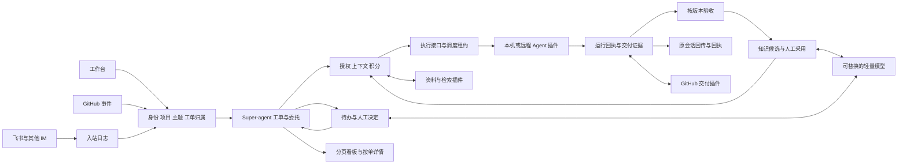

# Contractor 模块与插件

项目、主题、工单版本和参与人组成业务主线。核心决定谁能做、读取哪版资料、用哪个已授权模型和额度、何时需要人。插件做外部读取、检索、运行适配或收集证据。核心将经过核对的事实写入账本。



| 模块 | 归属和接口 |
| --- | --- |
| 工单与委托 | 原版 Super-agent Engine 和 SQLite Store。项目路由、成员角色及临时授权由 Contractor 核对。 |
| 执行与回执 | 统一执行接口负责领取、等待、恢复、租约和回执。默认使用 AutoLoop，独立环境可选择 Contractor 调度器。业务核心核对执行身份、额度和停止证明。各运行目录只启用一个调度器。 |
| 渠道 | `channel-journal.ts` 保存入站事件和投递证据。飞书内置、独立入口及 Octop Gateway 复用持久入站和确认协议。入口按租约消费，业务层按原消息和工单引用去重。 |
| 工单读取 | `/api/tickets` 按项目、主题、归属和状态查询，提供游标。`/api/ticket/:id` 提供详情。主题及工单讨论使用 `paged=1`、`limit`、`before` 读历史。旧的概览和消息读取端点仍可提供近期记录。 |
| 上下文 | `topic-context.ts` 区分近期主题讨论与人工确认依据。运行前限定同项目、同主题和当前授权，快照保存来源与修订。接续时重组上下文，相关资料撤回后隐藏派生成果。 |
| 资料与知识 | `sources` 能力读取受信来源，`memory` 能力为已授权的现行版本排序。知识正文、权限和来源版本由平台管理。 |
| 只读专家 | `expert` 能力读取技能声明、准备模型执行并提取回执。凭据取自成员执行配置，实际调用在该工作台的执行租约内。 |
| 交付与验收 | `delivery` 能力取得分支、Issue、PR、CI 及机器验收报告。工单当前版本、人工检查、签收及知识采用继续由核心校验。 |

## 启动时组装

`capabilities.ts` 定义 v1 接口。`platform-plugins.ts` 在工作台启动时组装各能力。以检索为例，适配器实现在 `plugins/`，`memory-providers.ts` 注册受信任的实现。配置文件选用适配器，部署重启后生效。候选知识和修订由核心授权与校验。工单、积分和验收由业务核心记账。执行租约由当前调度器记账。

`assistant` 负责模型调用。 `assistantHarness` 负责注册有版本的上下文组件和内置技能。两者都通过同一套能力接口在启动时注册。业务核心校验输入、模型可用性、输出格式和用量，核对实际派工、验收和知识采用。

## Agent 配置和运行

| 入口 | 可配置项 | 生效范围 |
| --- | --- | --- |
| 平台管理 → 平台 Router | 整理模型、每日调用上限。路由建议和知识提炼各有独立的提示词及挂载技能。 | 维护人请求路由建议、知识负责人整理验收候选。两种草稿共用模型，使用各自的配置。 |
| 个人设置 → 个人 Agent | 名称、简介、模型、提示词、已确认的个人经验、上下文开关、技能。 | 自己的会话。可用内置、团队和本人技能。 |
| 个人设置 → 我的 Worker | 执行设备登记和项目授权。 | 已获委托且有执行权限的项目工单。 |

技能库支持 Markdown 或 `SKILL.md`，保存正文形成不可变版本。挂载引用具体版本。发布下一版后，可以从技能库切换到新版本。停用技能会从后续装配中移除它，状态变化期间已开始的调用需要重新发起。团队技能由平台服务管理员发布，个人技能限本人。项目专家原有的项目资源权限独立生效。

模型调用由固定业务合同、配置提示词、已启用技能和经过范围检查的上下文共同组成。Router 的候选范围由项目职责与权限计算。知识提炼只读取已核对的验收候选。个人 Agent 可以切换本人经验和最近八轮会话。每次调用记录配置指纹及加载的技能、组件版本，个人会话另保留回复时的名称。

添加上下文插件时，在 `plugins/` 中声明稳定标识、组件版本、适用角色和默认状态，用 `platform-plugins.ts` 注册。组件输入取自调用方已经核对的上下文，工作台按返回的组件清单生成配置开关。模型服务的地址和凭据由受信任的部署配置提供。执行命令、工作目录和设备授权通过 Worker 管理。

```json
{ "plugins": { "memory": "weighted-terms" } }
```

`native` 为内置检索。使用 `octop` 时配置 Octop 的 Python 或独立索引连接。索引故障时需要检索的请求返回 503，工单查询、普通执行和验收仍可使用。`/health` 检查工作台就绪，`/health/integrations` 单独评估依赖。平台管理可查看渠道积压和当前插件。

配置了主备模型的本机 Codex 在领取时读取该成员对应服务商的目录。探测会读完分页，短时失败在原领取内再试一次，随后交由原运行排队重试。目录恢复后按最新项目路由和 Agent、平台授权选择模型。群整理使用同样的目录核对，期间保留原消息。

入口落盘后可在进程重启时接续。飞书可用经授权的历史补读恢复漏收。各 IM 的平台补发和回传能力由对应 API 决定。钉钉记录原会话临时回传凭据及有效期。渠道确认存在时补写业务回执，缺少确认且无法核实的投递标成未确认。

入口与 Figma 修订服务使用统一生命周期管理，工作台关闭时先结束这些任务，再关闭协作账本。既有 AutoLoop 运行目录继续由原运行时恢复。独立 Contractor 环境使用 `dispatch/hub.sqlite`。旧版设备配对、队列标记和历史验收报告通过兼容层读取，新页面、命令和配置使用 Contractor 名称。

Contractor 在启动时按作用域装配提示词、工具、模型、技能和运行上下文。配置页只展示当前部署已注册且有权使用的组件；每次调用保存配置指纹和实际组件版本。

CI 同时运行 Node 和 Python 原生适配器回归。`npm run package:source -- --committed` 检查发布范围与当前提交一致，再从已跟踪文件打包。默认命令可生成本地联调包。
