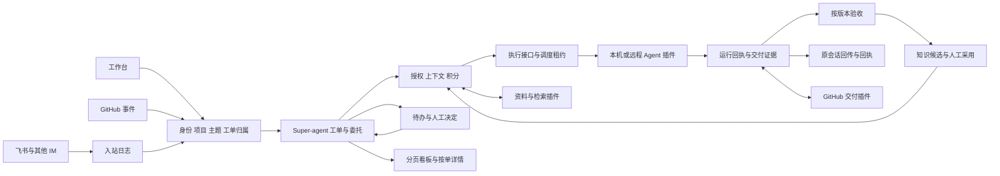

# Contractor 模块与插件

项目、主题、工单版本和参与人组成业务主线。核心决定谁能做、读取哪版资料、用哪个已授权模型和额度、何时需要人。插件做外部读取、检索、运行适配或收集证据。核心将经过核对的事实写入账本。



| 模块 | 归属和接口 |
| --- | --- |
| 工单与委托 | 原版 Super-agent Engine 和 SQLite Store。项目路由、成员角色及临时授权由 Contractor 核对。 |
| 执行与回执 | 统一执行接口负责领取、等待、恢复、租约和回执。默认使用 AutoLoop，独立环境可选择 Contractor 调度器。业务核心核对执行身份、额度和停止证明。各运行目录只启用一个调度器。 |
| 渠道 | `channel-journal.ts` 保存入站事件和投递证据。飞书内置、独立入口及 Octop Gateway 复用持久入站和确认协议。入口按租约消费，业务层按原消息和工单引用去重。 |
| 工单读取 | `/api/tickets` 按项目、主题、归属和状态查询，提供游标。`/api/ticket/:id` 提供详情。主题及工单讨论使用 `paged=1`、`limit`、`before` 读历史。旧的概览和消息读取端点仍可提供近期记录。 |
| 上下文 | `topic-context.ts` 区分近期主题讨论与人工确认依据。运行前限定同项目、同主题和当前授权，快照保存来源与修订。接续时重组上下文，相关资料撤回后隐藏派生成果。 |
| 资料与知识 | `sources` 能力读取受信来源，`memory` 能力为已授权的现行版本排序。知识正文、权限和来源版本由平台管理。 |
| 只读专家 | `expert` 能力读取技能声明、准备模型执行并提取回执。凭据取自成员执行配置，实际调用在该工作台的执行租约内。 |
| 交付与验收 | `delivery` 能力取得分支、Issue、PR、CI 及机器验收报告。工单当前版本、人工检查、签收及知识采用继续由核心校验。 |

## 启动时组装

`capabilities.ts` 定义 v1 接口。`platform-plugins.ts` 在工作台启动时组装各能力。以检索为例，适配器实现在 `plugins/`，`memory-providers.ts` 注册受信任的实现。配置文件选用适配器，部署重启后生效。候选知识和修订由核心授权与校验。工单、积分和验收由业务核心记账。执行租约由当前调度器记账。

```json
{ "plugins": { "memory": "weighted-terms" } }
```

`native` 为内置检索。使用 `octop` 时配置 Octop 的 Python 或独立索引连接。索引故障时需要检索的请求返回 503，工单查询、普通执行和验收仍可使用。`/health` 检查工作台就绪，`/health/integrations` 单独评估依赖。平台管理可查看渠道积压和当前插件。

入口落盘后可在进程重启时接续。飞书可用经授权的历史补读恢复漏收。各 IM 的平台补发和回传能力由对应 API 决定。钉钉记录原会话临时回传凭据及有效期。渠道确认存在时补写业务回执，缺少确认且无法核实的投递标成未确认。

入口与 Figma 修订服务使用统一生命周期管理，工作台关闭时先结束这些任务，再关闭协作账本。既有 AutoLoop 运行目录继续由原运行时恢复。独立 Contractor 环境使用 `dispatch/hub.sqlite`。旧版设备配对、队列标记和历史验收报告通过兼容层读取，新页面、命令和配置使用 Contractor 名称。

DeepSeek Harness 的 Agent Loop 依赖已注册的模型、工具和会话服务，Provider 卸载时负责回收资源。Contractor 采用同样的核心与可替换能力边界。当前插件由部署代码组装，运行时工作区沿用平台预先授权的执行端。 [Agent Loop](https://github.com/deepseek-ai/deepseek-harness/blob/fcc0ad462172522aaf5c93a7b2e01f6b9f0b0159/packages/core/agent-loop/src/index.ts) · [DeepSeek Provider 生命周期](https://github.com/deepseek-ai/deepseek-harness/blob/fcc0ad462172522aaf5c93a7b2e01f6b9f0b0159/packages/llm/llm-deepseek/src/host.ts)

CI 同时运行 Node 和 Python 原生适配器回归。`npm run package:source -- --committed` 检查发布范围与当前提交一致，再从已跟踪文件打包。默认命令可生成本地联调包。
