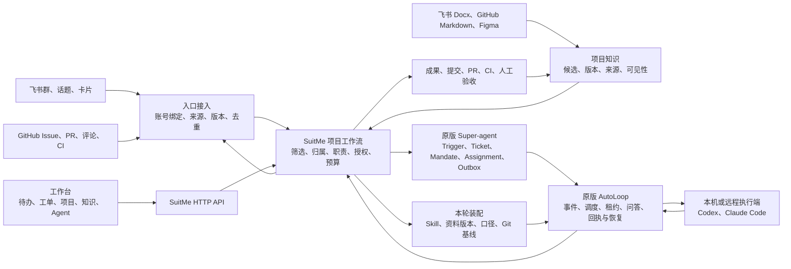
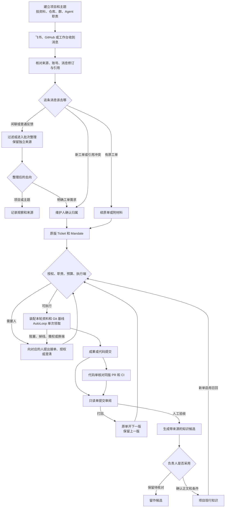

# SuitMe 协作台功能与架构核对

2026-11-16 · 基于 Super-agent 独立分支的当前后端、React 工作台源码、已保存的联调账本和测试结果。文档中的页面设计为后续适配合同。

当前产品围绕项目组织工作。人把飞书、研发仓库、文档和原型挂到项目，把持续讨论放到主题，把有交付责任的事项落成工单。Agent 按项目职责读取经授权的上下文，执行端按本轮委托领取。人决定归属、权限、关键口径、最终验收和知识采用。

## 1. 系统架构

| 层 | 运行方式与所有权 |
| --- | --- |
| Web/API | React + Vite 前端与 Node HTTP API。工作台进程默认监听回环地址；需要团队访问时，配置 HTTPS 入口。UI 的类型从后端返回值派生。 |
| 协作台账 | `orchestrator.sqlite` 使用 Super-agent 原版 Store 和 Effects，保存原生票据、委托、决定、Outbox，以及项目、资料、批准、交付和采用业务记录。SQLite 启用 WAL。 |
| 执行台账 | `autoloop/hub.db` 由 AutoLoop 保存事件、运行、卡片、租约与回执。SuitMe 准备上下文、校验授权与交付，AutoLoop 负责调度。运行目录和远端待回执保存在各自执行环境。 |
| 接入与配置 | 项目及 Agent 的可信配置来自 `workbench.json` 与本机配置。飞书使用官方 CLI，GitHub 使用仓库 API、Git 和已授权的 CLI，Figma 使用配置的只读来源。业务消息无法指定可执行文件、凭据或任意写入路径。 |
| 复用关系 | Super-agent 与 AutoLoop 使用固定提交。DeepSeek Harness 提供上游依赖。前端复用了 Paperclip 的部分壳组件。LobeHub 对照用于注意力筛选、上下文装配和运行治理设计。资料目录和提交归因分别复用 Backstage 实体引用和 Entire 可核对证据。 [锁定版本](../sources.lock.json) · [第三方声明](../THIRD_PARTY_NOTICES.md) |

这两份 SQLite 是实际运行数据，不是页面样例数据。当前部署形态仍是以单个工作台实例为单位的项目级隔离。多实例共享数据库、高可用、组织级 SSO 和管理后台未做生产验收。

## 2. 一次业务如何走完

项目、子项目、主题和工单分别承担不同的定位。一个项目可有多个渠道和资料入口。项目可作为其他项目的父项目或关联项目。主题用于聚合持续讨论，一张工单可以拥有子工单、关联工单和多个交付版本。**关系与授权分别核对**。把工单连到相关项目，也需要执行者具备对应项目权限。

门店推荐理由的两个话题都来自已绑定的飞书群。文案是只读单，第 1 版保留在本单版本历史，第 2 版由本机 Claude Code 重跑后验收。小屏是代码单，家豪在飞书接单，Codex 产出代码，PR #18 在提交 `07dfb644` 的 CI 通过后由发起人在飞书验收。两张单各自产生一个知识候选，确认采用后再分别被新单引用。主题是它们的共同入口，每个执行和验收仍绑定到自己的工单。

## 3. 功能清单、具体规则和目前的问题

「实跑」指该路径曾用真实渠道、模型、仓库或成员动作验证，具体范围见该行。「回归」指本地测试或受控依赖响应。「代码」指核对实现和接口。前端一列描述源码支持范围，浏览器体验和联调证据按已验证记录注明。

| 功能 | 后端规则与数据 | 已有界面 | 证据或主要缺口 |
| --- | --- | --- | --- |
| 成员与项目权限 | 登录后按项目成员、维护人、委托角色、资料所有者、Agent 所有者与仓库贡献者判定。项目外读详情返回 404，受限资料只返回允许的字段。 | 登录、项目成员、连接与账号 | 实跑和回归覆盖项目外及非验收人。管理员、组织和租户尚缺生产级生命周期。 |
| 多渠道账号绑定 | 飞书按应用命名空间与用户 ID，GitHub 按站点与用户 ID。收到账号持有证明后绑定。历史事件按发言时与现行权限判断。提交人、推送人、Agent 和委托人分字段留痕。 | 领绑定指令、确认及解绑 | 实跑过本人在两边证明，以及解绑后不接后续事件。没有直接根据头像、分支前缀或昵称推定账号归属。 |
| 项目、主题、关联 | 建项目可选父项目，主题可配置子主题，工单支持父子和关联。派工规则可按主题及职责。关联项目目前主要通过可信配置维护。 | 新建项目、主题、加成员和已登记 Agent，工单关联 | 结构和权限有回归。没有跨组织权限管理、自由关系编辑及跨项目自动拆单。 |
| 资料目录 | 支持多仓库、飞书群和文档、Figma 节点及一般链接。按规范化来源建立项目级引用。区分讨论、资料、交付目标。 | 项目资料登记、绑定 | 同一事件来源只能主动路由到一个项目，跨项目联系仍用显式授权和关联。普通链接只登记出处。 |
| 消息入口与去重 | 保留渠道对象、原消息、线程和编辑版本。显式引用与已绑定来源汇合，冲突由维护人处理；撤回按单条来源，重复反馈仍保留各发言人。 | 连接与账号、项目群反馈、工单来源 | 真实共同工单、评论、标签和指派等有历史验证。其他 IM、无引用跨渠道同义识别仍有限。 |
| 飞书补读与收集 | 实时订阅与游标补读结合；已知话题可跟进，命令漏收转人工核对并重验原消息。普通反馈批次筛选，定时按授权项目组织。 | 项目反馈列表和处理结果 | 实跑过重连回原话题。历史边界受窗口、飞书接口权限及已识别线程限制。 |
| 筛选和立项 | 入口先验身份和项目范围，再决定续单、记项目、记主题、另开或过滤。没明确引用、来源冲突、职责不唯一时推给负责人。 | 待我处理，支持处理方式、项目、主题、Agent | 已实跑。待办确认页目前没有提交 `target`，因此飞书来源立代码单须走已支持该字段的后端入口。 |
| 工单与讨论 | 同主题可有多张互不串联工单；同单承载补充、明确追问、交接和多个版本。浏览器讨论可同步飞书原话题。 | 工单详情和项目讨论 | 两个真人飞书账号的卡片和两张真实执行单已验证。群内所有对话与任意 Agent 多方会话仍超出已验证范围。 |
| 职责及派工 | Agent 是个人或专项服务，按项目和主题配置能力与所有者；无唯一职责走人工。工作台把工单交给 AutoLoop，一个租约关联一次实际领取。 | 项目 Agent、个人 Agent、发起协作 | 已有真实 Codex 和 Claude Code。职责配置、Skill、模型路径主要在可信配置，Agent 构建/灰度管理界面尚弱。 |
| 受控转委托 | 父 Agent 只能在声明的范围提议子单，有去重、深度和数量限制，负责人确认后建立并派出，子单验收后回填父单。 | 可在待办和工单找父子关系 | 已用真实 CLI 和测试 PR 走通一条链。任意依赖图、抢占/负载策略和跨项目自主链未有。 |
| 上下文装配 | 组装本轮 Skill、工单与讨论、已确认口径、授权资料修订、可用前版、当前 Git 基线，并保存内容哈希和 manifest。执行前、回传、回看重新核权。 | 工单上下文和运行详情 | 实跑可从快照查实际模型和依据。资源范围大时会截断/限量。发生撤权只能阻断后续读取和采用，无法证明离线设备已经忘记。 |
| 访问申请与撤权 | 权限绑定工单、资料版本、Agent、所有者与授权代次。执行和复查权限分开；新授权不复活旧授权代次。资料负责人授予、撤销。 | 工单权限页、待办 | 本地回归和飞书/真实执行有历史验证。飞书、GitHub、Figma 源站 ACL 的全量实时同步仍需按连接器核对。 |
| 核心人工操作 | 归属找维护人，代码接单找有仓库资格的执行端所有者，必答找执行决策人，访问找资料负责人，最终验收找原发起人。原卡校验当前操作者、状态与版本。 | 待我处理、工单行动区、飞书卡片 | 真实接单和验收回调可重放，未新增派工或重复结果。知识采用有工作台审核入口，本轮批准经人确认后操作后端，飞书没有通用知识采用卡。 |
| 执行端注册 | Agent 所有者浏览器确认项目和执行端，持久化设备身份。设备上报在线状态和最近心跳，支持暂停、丢失、退役及原租约收尾。 | Agent 设备页、独立连接确认页 | 曾用本机与 Debian 真实联调。前端设备按钮主要调用旧 `active` 兼容字段，高级生命周期缺适配。 |
| 执行引擎 | 本机 Codex 支持受限工作区，远端 Codex 支持只读和精确写入，Claude Code 支持 Ollama 或已登记 DeepSeek 的只读执行。CLI 名称、本机登录、模型服务、设备能力分别管理。 | Agent 和设备可查看登记信息、用量 | 真实 Codex、Claude Code 已验证。Cursor、WorkBuddy、豆包、ACP 等不能仅凭登记进入生产执行。 |
| 阻塞、取消与交接 | 必答未齐继续等；停止、切换、断线均保留旧租约和运行；旧环境确认退出后才发替补，后续重装配授权。 | 工单详情可停、答、交接、接续 | 回归和真实执行端有验证。丢失的机器无退出证明时应持续等待，生产进程隔离/容器治理需加强。 |
| Git 工作区和交付 | 核对仓库、授权基线、工作区和路径，记录委托提交、PR head、GitHub 审查及提交匹配的 CI。产品可发委托，研发所有者接单，合并由 GitHub 权限控制。 | 关联分支或 PR、版本交付和 CI | PR #18 精确验收真实通过。代码状态计算额外硬找 `collab-pilot`，和可配置检查存在冲突，其他仓库的自定义检查可能无法进入可验收。 |
| 打回和版本 | 工单 ID 不变，按 `result.revision` 开下一版。旧运行、成果、理由、验收和 CI 历史保留，权限变化时历史正文可隐藏。 | 工单第几版、版本详情和打回 | 文案第 1、2 版实跑。原单换只读执行端的新版 `device` 选择器尚待接到界面。部署结果与真实线上版本的统一门禁未完成。 |
| 知识候选与采用 | 验收产生候选。待核对候选不可进入召回；所有者确认标题、正文和适用条件后采用。知识修订和来源工单成果修订分别保存。支持替代、失效和源授权校验。 | 知识页已有待确认、核对、采用、失效和历史；复核窗口可改正文/条件 | 本轮两个候选经人明确确认并采用。前端待接标题新版字段。手工直接新增属于独立写入路径，当前已有项目写权限的成员可创建现行知识。 |
| 知识检索与使用记录 | 当前项目内公开、已采用且来源仍有效才进入默认召回。创建工单选 `recall`，固定规则先考虑，相关知识取最多三条。挂进执行快照和被模型明确引用各有记录。 | 知识搜索、检索试查、用过的记忆、运行快照 | 本轮真实模型回用两条并引用。召回现为词项匹配，匹配覆盖及候选数量仍有限；未接语义检索与业务实体词典。 |
| 知识来源与关系图 | 图谱 API 按权限投影来源、原工单、知识修订和回用。成果的 `citations` 返回引用知识的精确修订及源验收快照。 | 知识详情有基础出处与使用记录 | 来源关系图已有码和回归，暂无图谱界面。新版结构化出处需要在知识详情与成果区共用组件。 |
| 正文和原型接入 | 飞书 Docx、GitHub Markdown、Figma 节点配置来源及负责人，按源修订导入候选、采用或替代。Figma 可同步及做权限探测。 | 接入资料、知识详情和可用的预览 | Docx 与 GitHub 有历史证据。Figma 的源站读取、修订和撤权逻辑有受控响应测试，独立服务以真实 Figma 凭据联调仍未完成。 |
| 观测和经验 | 单独记录验收后的效果观测，包括指标、单位、基线、实测值和证据。符合条件可形成经验候选，后续创建关联单复用。 | 工单观察、经验复用 | 有试点联调。真实转化、自动归因及组织级度量尚未接入。 |
| 用量、预算和审计 | 平台整理、个人代理和项目执行分池，按运行与尝试记账。记录模型、Token、已知金额与缺价，硬上限依据真实可核对账目阻断后续运行。 | Agent 用量、项目预算、设备与回执 | 有实际模型回执。缺统一供应商对账和金额补录，不能把 Token 或未知金额当作实付，也未验证单轮生成按金额截停。 |
| 运维和连接健康 | 原生 Effect outbox、飞书双订阅健康、GitHub 拉取、执行端心跳及多处按 ID 幂等。单实例保存业务账本与执行账本。 | 部分页面显示错误与重试，`/health` 可核对 | 未完成 SSO、高可用、全链路告警、备份演练和多团队并发压测。本轮曾出现一次 GitHub 轮询失败，复用使用既有验收快照，独立 GitHub 查询留存同一 head。 |

主要实现入口见 [HTTP API](../src/workbench/server.ts)、[协作与权限](../src/workbench/collaboration.ts)、[执行和停止核对](../src/workbench/autoloop.ts)、[GitHub 证据](../src/workbench/github-delivery.ts)、[知识存储](../src/workbench/knowledge.ts) 和 [当前前端路由](../workbench/src/navigation.ts)。

## 4. 知识回流的接口与本轮验证

1. 原发起人验收绑定的成果修订。代码单的历史验收同时保存提交和当时通过的检查。验收创建候选，正文先是工作记录。
2. 对候选调用 `POST /api/knowledge/:id/review`，提交候选修订、标题、正文和适用条件。返回复核后的 **知识修订**。再以这个知识修订调用 `/publish`。非所有者或旧修订请求失败。重复采用拒绝并保留原记录。
3. 新工单调用 `POST /api/ticket` 并选择 `recall: true`。服务端按项目、采用状态、可见性和有效来源选资料。作为显式权限材料挂入的引用继续用原授权路径。
4. `GET /api/project/:id/recall` 返回命中知识的修订与 `acceptedSource`。运行快照记录当时实际装配的知识、适用条件和源验收依据。Agent 原样写入知识引用标识后，成果详情返回 `result.citations`。出处由后台按已验收修订计算。前端可展示这些字段，避免从模型正文猜测版本。
5. `GET /api/knowledge/:id/uses` 可区分当时已装配、由检索召回和被模型实际引用。用历史引用自己的修订判断 `cited`，后续换版不会把历史引用算成未使用。

本轮在同一测试账本里核对了以下行为。

| 步骤 | 结果 |
| --- | --- |
| 采用前 | 两条候选，研发身份检索为零。未经复核直接采用返回 409，非所有者复核或采用返回 403。 |
| 采用后 | 产品确认两条正文与适用条件后各发布一次。文案来源为原工单第 2 版与飞书原消息。小屏来源为原工单第 1 版、飞书原消息、[PR #18](https://github.com/zhegong-996/desktop-tutorial/pull/18) 的 `07dfb644` 和[同提交的成功 CI](https://github.com/zhegong-996/desktop-tutorial/actions/runs/43820623052/job/133142635098)。 |
| 新单 | 新建一张只读复用工单。重复发起使用同一 nonce，只得到同一张。实际本机 Claude Code 执行一次，读取了两条采用知识和准确出处，输出引用了两条。 |
| 版本隔离 | 新单的执行快照中没有第 1 版文案的 `Conclusion`，现行知识和知识历史也搜不到它；它仍在原工单历史。小屏验收记录没有变化。 |
| 输出边界 | 模型输出了通勤与小屏建议，但摘要正文没有列齐来源版本。接口的两条 `citations` 提供完整核对依据。新单用于验证复用，尚未人工验收或再次沉淀。 |

知识来源有三种不同的版本标识。**工单第几版**是人能辨识的业务轮次，**成果修订**绑定发起人验收，**知识修订**绑定后来确认的可复用表述。代码来源还带 **Git SHA 与 CI 检查 ID**。原飞书群链接和根消息 ID 单独保存，群链接打开群，根消息 ID 用于定位原话题。

## 5. 和原文档九个点的对照

| 原文档 | 当前落点 | 待补 |
| --- | --- | --- |
| 9.1 跨来源项目身份 | 项目引用目录、账号证明、明确引用归属 | 通用连接器及跨项目来源映射治理 |
| 9.2 话题版本与 Git | 消息修订、工单版本、基线、提交、PR、同 SHA CI | 修复代码验收状态的固定检查名，补部署级证据 |
| 9.3 分工 | 按项目和主题配置职责与负责人 | 在工作台编辑职责、负责人和规则版本 |
| 9.4 个人、平台、专项 Agent | 三类执行预算、个人代办、专项派工、受控转委托 | 代理收件箱、灰度、面向团队的服务能力管理 |
| 9.5 Skill、上下文、运行分离 | 内容寻址装配、冻结权限、独立执行端、运行回执 | 不可变 Skill/CLI 制品、生产容器和跨版本治理 |
| 9.6 飞书群协作 | 实时订阅、已知话题补读、卡片和原处接续 | 更多 IM、复杂群参与、断连与重放可观测性 |
| 9.7 人类判断沉淀 | 验收候选、复核、适用条件、版本、来源、检索与回用 | 候选冲突治理、成熟度、业务实体图谱与语义检索 |
| 9.8 积分与 Agent 管理 | 次数、时长、模型用量与三种额度 | 供应商对账、组织结算、灰度、返工与效果指标 |
| 9.9 项目树和指挥权 | 父子项目、主题、子单、关联和明确委托权限 | 跨组织治理、并发调度和优先级规则版本 |

## 6. 前端从后端对象和动作出发

页面可沿用现有的六个入口。每个页面先说明当前要处理的工作、能操作的对象和依据，低频配置和诊断放在原对象详情中。

| 当前入口 | 首要用法与后端合同 | 适配优先点 |
| --- | --- | --- |
| 待我处理 | `needs-you` 按当前人返回可处理决定，领受入口、必答、授权、研发接单和验收。保存决定/本轮标识，完成后重新拉取。 | 飞书立项选择授权的交付仓库和合格执行 Agent，明确续单和另开；冲突时保留输入。 |
| 协作工单 | `ticket/:id` 返回归属、行动权限、待答、来源、版本、CI 与验收。版本详情独立显示 `runs/:attempt` 和知识引用。 | 区分 Agent 已完成、待交付证据、待产品验收、已验收。用 `result.citations` 展示出处；只读新版提供合适设备。 |
| 知识与记忆 | `knowledge/:project` 为目录，`recall` 为任务试查，`uses` 查回用。正文、条件、可见性、知识修订和 `acceptedSource` 同屏。 | 把候选复核和采用分开显示，支持编辑标题。知识出处标清工单第几版、提交与 CI。历史视图按实际失效或替代状态筛选。关系图围绕已保存的来源与回用。 |
| Agent | 显示职责、所属项目、所有者和当前可派性。把设备状态、模型回执、个人/项目额度作为同一 Agent 的详情。 | 前端能力判断以回传数据为准。当前发起页仍用引擎名字把 Cursor 当作代码候选；应以实际隔离支持和目标仓库权限过滤。 |
| 项目 | 项目与主题显示活动、资料、当前职责及工单关系。消息整理按项目/主题去向处理。 | 前端项目关系、主题、工单保持可定位，不强制把项目资料折进某张单。群连接恢复、Figma 修订和权限状态都应使用各自的后台状态。 |
| 连接与账号 | 展示已验证绑定与可用连接。能说明当前工作身份、外部账号、仅供交付或可收消息、外部访问权限。 | 给出绑定、现场确认和撤销；在网络不稳定时展示远端状态并保留决定草稿。 |

前端验收按可操作结果验收。发起人能从飞书原话题进入原工单，维护人能处理冲突，研发能看到本版提交与 CI，资料所有者能看到授权对象和期限。知识页面必须能看到「为什么这条可用、是哪一版、哪里验证过、后续被谁用过」。返回时保留项目、筛选、展开项及滚动位置。窄屏优先保留当前版本、来源与关键动作。

### 进入前端之前需要核对的后端决策

- **交付门禁优先。** CI 配置和运行状态应共享一套检查名单和匹配方法，新增非 `collab-pilot` 仓库测试。确认现有 PR 的历史验收快照继续可查，预览/部署另有明确证据。
- **授权与能力数据优先。** 让创建、续版、回流页面拿到统一的服务能力、可领取设备、仓库资格、允许动作和失败原因。页面不通过引擎名字、岗位名字或链接可见就授权行为。
- **版本和出处优先。** 以本次 `acceptedSource` 和 `citations` 为实例合同。可见范围变化、冲突修订、失败回退和重复操作要有可预期反馈。
- **大规模运行前核对。** 当前多处以同一实例全量读表和定时轮询。需要基于真实并发和组织隔离要求设计分页、增量、备份和恢复，再决定是否迁移存储。知识 BM25 会按可见条目重新投影，先测数据量和查询速度，再调整检索实现。

现有交付与边界的证据见 [后端补齐记录](BACKEND-COMPLETION-2026-11-16.md)、[工单与交接](WORKBENCH-ITERATIONS.md)、[资料与知识版本](KNOWLEDGE-VERSIONS.md) 和 [跨主机执行端](WORKBENCH-REMOTE-RUNNER.md)。
