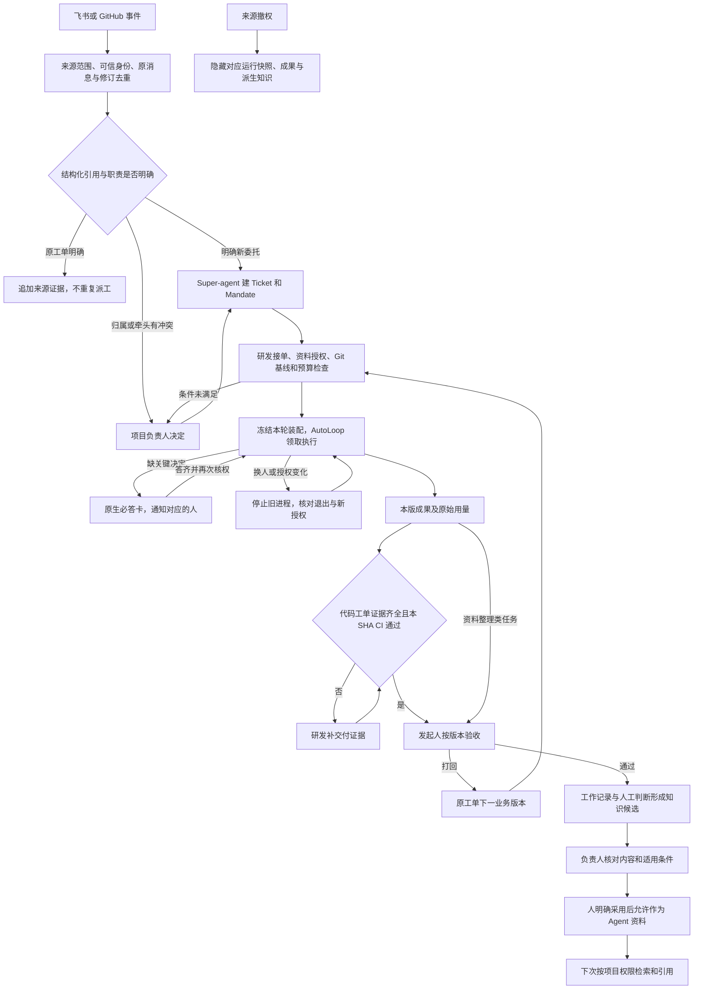

# 对照《Super-agent 项目详细解读》的实现核验

> 2026-11-16 增量更新：远端 Codex 代码交付、受控 Agent 转委托、设备生命周期、授权知识关系图、可配置 CI 及飞书本地订阅健康已补齐并验证，详见[后端补齐记录](BACKEND-COMPLETION-2026-11-16.md)。下文保留 11 月 15 日审计现场；其中“远程工作区／Linux 未验收”“没有转委托协议”“CI 只认固定检查”的历史结论以增量记录为准，其他未关闭缺口仍有效。

核验日期为 2026-11-15，比较基线为 `dd23e0d`。输入是用户提供的 HTML 文档，SHA-256 为 `a116e265e48cbbebe43db058695dfb62aef9eb61543fbc110f39f366f8a3365e`。核验以保留后的独立工作台源码、原版依赖、实际运行和权限结果为准。文档第 9 章是产品目标，不能把其中的“设计方向”当成已实现能力。

当前是能跑通指定协作链路的单机后端。九项生产能力均已有部分基础，仍没有任何依据把整个系统标成生产能力全部完成。

## 九点逐项核对

| 文档项 | 现有代码与本轮补齐 | 仍缺的能力 |
| --- | --- | --- |
| 9.1 跨来源项目身份 | Project 独立于仓库。飞书群、多个仓库、文档和 Figma 引用可登记在同一项目。渠道绑定核对账号，归并依赖结构化引用，冲突交负责人。代码见 `project-resources.ts`、`channel-links.ts`、`receiveChannel` | Figma 目前主要是文件／节点入口，没有原型修订事件适配器。其他 IM、任意业务系统的来源适配未接齐。新来源统一 `would_attach` 灰度模式未提供。不能声称所有来源都已读取正文 |
| 9.2 话题及代码版本 | 消息保留已观察修订。工单业务版本与执行轮分开，开工核对远端基线，明确确认后才 rebase。每版输出、提交、PR、对应 SHA 的 CI 和人工验收分别存证，同 SHA 的重跑结果保留 | 没有对每一条入口消息都采集事件发生当时的远端 SHA。轮询无法补出平台没有返回的中间编辑。预览／部署环境版本尚未成为统一验收门槛。CI 当前只认配置流程约定的 `collab-pilot` |
| 9.3 分工路由 | 项目和主题的 `dispatch` 规则可配置职责、牵头 Agent、决策人。重叠职责由负责人决定。产品委托代码工作后，受托研发确认并另查资料授权 | 没有职能 lead 内部的自动任务图编排或能力／负载匹配。目前是单 worker、单执行并发。职责名称来自配置，不应恢复产研／增长／销售／职能的固定模块 |
| 9.4 个人 Agent 和专项 Agent | Agent 有明确所有者，每次运行记录发起人、原渠道身份、实际 Agent 与所有者。允许调用同事的服务、退回、换人。机器人消息不能直接变成普通真人委托 | 个人 Agent 还不是完整代理收件箱。没有自主转委托协议、跨 Agent 授权链、链级跳数／防环和 LobeHub 式父子运行回填。当前“多人协作”主要由人委托和交接驱动 |
| 9.5 装配与无状态运行 | 保存实际发送给 AutoLoop 的 Skill／上下文／执行配置三份快照。后续已补成员级 Codex 工作区、凭据、会话及 OS 读写隔离；没有明确模型和成员凭据不能启动。每轮冻结配置并记录 CLI 会话回报的实际模型，换人重核授权并使用新会话。详见[成员执行隔离](MEMBER-EXECUTION-ISOLATION.md) | 仍未接远程可迁移工作区和容器多租户。当前隔离实跑为 macOS Codex，其他 CLI 尚未完成适配，Linux 原生执行未验收。外部 Skill 文件包及 CLI 二进制没有完整制品镜像 |
| 9.6 飞书协作 | 显式命令、原单追问、账号绑定、群讨论定时整理和原生 AutoLoop 等待已接。订阅退出有健康状态和自动重连。无人点名的反馈先归纳，开工仍受授权与人工路由约束 | 按钮式卡片操作尚未接完。带决定编号的 `/答` 用于机器人单聊；群聊需原话题 `/答 序号`，混用入口目前缺少明确提示。普通消息到达范围受飞书权限影响，部分由已授权账号补读。没有保证断线区间每条消息均自动补回，也未接多机器人社交礼仪和其他 IM |
| 9.7 判断沉淀知识 | 验收生成带出处和适用条件的知识候选，所有者复核后采用。新增飞书 Docx 和 GitHub Markdown 正文接入、人工确认替代、失效、历史证据与多级派生撤权。原单两版的真实来源和 Codex 证据见[资料接入与知识版本](KNOWLEDGE-VERSIONS.md) | 自动抽取仍以结构化工作记录为主。语义关系抽取、语义检索、跨次确认提高可信度、可交互知识图谱和源站 ACL 实时同步仍待验证或接入 |
| 9.8 费用及 Agent 治理 | 复用 AutoLoop 的累计用量，本轮保存每次尝试的原始计量与固定归因。取消、撤权、交付失败也保留已发生消耗。项目预算检查把缺失报价和缺失回执当未知，阻止下一次执行，并给负责人待办。群整理同样检查 | 没有统一计价／币种换算、按人或职责的硬配额、积分结算及真实绩效评估。CLI 只在回执报价，无法保证本轮生成途中按金额截停。没有完整 Agent 灰度生命周期或组织级一键全停。现有停用逐 Agent 生效 |
| 9.9 项目结构与指令权 | 项目／子项目／关联项目、主题／子主题、父子工单和关联工单可分别定位。父级或关联关系不自动授予成员与资料权限。代码写入资格落在具体仓库和受托人 | 没有 DAG 依赖调度、自动跨项目拆解或统一的角色×资源×动作管理界面。`priority` 目前影响展示排序，不能称为版本化执行优先级。合并权限依赖 GitHub 自身保护规则，工作台没有接管生产发布 |

## 七个阶段现在怎样衔接

Super-agent 的原版 Engine、Store、事务与出站 Effects 仍负责立项、授权、工单状态和回执。AutoLoop 的原版 Runtime、worker、卡片、事件合并、重试和进程生命周期仍是唯一执行调度。新增快照、知识候选和计量记录都是对既有执行的证据投影，没有另起调度器。

LobeHub 借鉴的是冻结配置、按当前运行装配上下文和预算作为停止条件。当前没有导入它的完整 runtime、supervisor 或 taskGraph。Backstage 只复用来源引用模型，Entire 只对本机 CLI 提供的检查点作核对，不能拿两个名称来表示已经复用了它们的完整产品。

## 本轮改动的可检查边界

### 运行装配

`GET /api/ticket/:ticket/runs/:run?attempt=1` 返回该次运行的装配索引，有权时才返回正文。运行号和工单不匹配返回 404。历史记录没有快照时返回 `recorded: false`。未获授权或授权已过期／撤回时不返回 `contents`。只恢复成果查阅的许可不能读取整份原始执行上下文。

Skill、context 和 runtime 分别以内容哈希寻址，读取时再算哈希。执行命令只留指纹，不把参数、访问令牌、原生会话标识或进程环境作为接口数据返回。快照保存在当前实例的私有 SQLite 中，不提交代码仓库。

该快照是宿主传给原版 worker 的装配输入。AutoLoop 还会添加其原生协议，CLI 还可能使用自身配置。它能支持追查和接续，不能承诺不同模型再次运行会得到相同答案，也不能证明执行端已物理遗忘撤回的资料。

### 从人工判断到候选知识

验收接口仍可提交人工整理的 `body` 和 `conditions`。没有手写结论时，自动生成本单工作记录，标为 `draft.needsReview`，保存已确认卡片编号、确认者、时间、运行及业务版本。

`POST /api/knowledge/:id/review` 接收当前 `revision`、核对后的 `body` 和 `conditions`，生成新候选修订，并保留旧修订。旧 revision 无法发布新版。`publish` 是后续独立动作。候选所有者可以查看待审材料，其他成员和执行资料装配不能把待审候选当作已采用知识。

没有改前端，新增复核动作目前通过后端接口调用。现有前端不会提供新候选的完整复核流程。

### 用量与预算

`GET /api/project/:id/usage` 返回现有原生累计量、`unpriced` 和逐次 `attempts`。每次尝试记录原始 `usage`，并固定委托人、Agent、所有者、职责与配置模型。金额只计实际回传的值，未知不能当作免费。缺失历史回执不能被新一轮成功报价掩盖，进入重试也不能排除上一尝试的未知费用。停用群整理不移除历史消耗。

当项目配置 `budget` 时，已知金额达到上限，或存在无法核对的尝试，下一次执行会阻塞。没有配置预算的项目保留当前行为并显示缺价。当前没有人工补账或组织积分结算入口；缺价项目需要核对执行端计量及可信本机配置后再恢复，单纯点重试不能跳过检查。

### 本次核查排除的误报

最初怀疑受限问题标题可能从 `Report.question` 泄露。原版 `Assignments.report` 把问题存到独立 Attention，Assignment 的 Report 只有状态、概要和时间。新增真实原生流程回归未复现泄露，未将其记为已修复漏洞。

## 验证记录

旧版本基线 38 项回归通过。本轮 40 项回归、类型检查及上游锁定校验通过。新增综合用例实际启动原版 AutoLoop 和受控 CLI，覆盖装配与 worker 输入一致、配置变更不覆盖旧快照、快照篡改、三种身份查询、候选未审不能发布、候选旧版本不能发布、撤权后已采用知识失效、取消保留用量、缺价阻止后续执行；另检查重试时上一尝试缺回执的边界。

费用数值回归使用明确标注的测试计量适配器，不把夹具报价当成真实供应商账单。受限标题和既有换人／必答／迭代测试也继续通过。运行测试需要核对本机进程，受限沙箱中的 `ps EPERM` 不计为业务失败或通过。

本轮真实通道核验于 2026-11-15 19:08（北京时间）完成：

| 验证 | 实际结果 |
| --- | --- |
| 飞书 → Codex 原生澄清 → 原话题答复 → 接续 | 同一工单 `763a328c2a8df17029a568328213a753` 有两次真实 Codex 运行。查询快照的上下文与原版 worker 的实际 `context.json` 完全一致，包含已确认的“先场景后事实” |
| GitHub 补充关联 | 测试 Issue #14 的真实评论 回到原单；当时仍只有一张工单、两次运行，没有第三次重复执行 |
| 验收 → 候选 → 复核 → 采用 | 不手写结论也生成带卡片出处的候选。未复核直接采用返回 409；非所有者复核返回 403。所有者确认适用条件并采用后，另一项目成员可检索 |
| 受限资料与撤权 | 另建一个明确的受限资料子单，资料负责人授权后进行第三次真实 Codex 执行。无授权旁观者拿不到快照正文；撤权后，原发起人也拿不到快照和已采用派生知识 |
| 真实用量与缺价 | 三次执行回传原生累计输入 196,718、输出 2,453，没有金额报价。`unpriced=3`，金额字段的 0 只是已知小计，不代表免费。启用测试项目预算后，新工单在开工前阻断，负责人收到真实飞书通知，新增模型调用为 0 |

本轮运行的是资料整理任务，没有新建代码 PR。此前 PR #10、#11、#12 及其 CI 只作为历史交付证据；代码交付门槛由本轮全量回归继续检查，不能冒充重新进行了一次线上 PR 验收。产品、研发、资料负责人及旁观者为一个操作者分别登录的内部测试身份，并非四位真实外部参与者。真实调用使用现有 Codex 服务与虚构门店资料，没有启用新模型服务。

联调保留了脚本自身的失败记录：先误以为明确引用需要手动建单，再误把单聊答复命令发在群里；修正预期和回复位置后沿用原工单。测试服务重启后旧登录 Cookie 返回 401，重新登录后继续核验。没有用直接修改业务账本来伪造这些步骤。私有运行证据保存在本机 本机私有证据目录，不提交登录文件或消息正文。

## 依赖核查

首轮远端 CI 的安装日志另报告了现有依赖告警。核对注册表及公告后，将直接依赖 Zod 从 4.4.3 升至 4.6.7，修复其受限集合校验可能耗尽内存的问题；公告修复范围为 4.6.6 起。[Zod 公告](https://github.com/advisories/GHSA-mrhx-c7xc-m3w5)

仍保留 Casbin 依赖链的 3 项中等级审计记录（Casbin 汇总以及 csv-parse、minimatch 两项底层记录，并非三个独立漏洞）。csv-parse 公告要求启用 `columns` 与 `group_columns_by_name`；当前 Casbin 文件适配器读取可信本地策略，没有这两个选项。minimatch 公告的触发条件为 `optimizationLevel >= 2`；当前 RBAC 模型使用 `keyMatch`，没有使用 `globMatch`。这是当前调用路径核对，不是对所有未来用法的安全保证。[csv-parse 公告](https://github.com/advisories/GHSA-8cw4-87c7-c6xx)、[minimatch 公告](https://github.com/advisories/GHSA-g3hv-75wg-m249)

Casbin 当前版本仍限定 csv-parse 5.x、minimatch 10.x，公告修复分别在 7.x 和 11.x。没有通过强制跨主版本覆盖或退回旧 Casbin 来制造零告警结果。后续更新其依赖范围或增加新策略导入方式时，须重新核对这两条路径。上游三个项目的固定版本没有改变。

升级后 40 项回归、类型检查、上游校验再次通过；依赖审计为 0 项高等级、3 项中等级。重新载入同一真实联调账本，快照、知识检索及撤权仍生效，执行次数仍为 3，没有再次调用模型。

## 后续顺序

1. 成员工作区、凭据、会话隔离及模型／费用回执已开始按 [成员执行隔离](MEMBER-EXECUTION-ISOLATION.md) 落地，先验收 macOS Codex 的真实链路，再按相同标准扩展其他 CLI 与 Linux。不能把第一种执行端通过视为所有执行端已通过。
2. 知识失效／替代及常用正文接入已完成第一条真实链路，见[资料接入与知识版本](KNOWLEDGE-VERSIONS.md)。其余来源正文、关系图谱和语义检索在后续扩展。
3. 建立受控子 Agent 委托协议，在已有授权、计量和上下文边界上增加任务依赖与回填。
4. 明确需要的项目级并发和人回复优先策略，再扩展执行规模与管理界面。

完整产品尚需上述工作。继续保持 Super-agent 的工单授权与 AutoLoop 的执行账本职责分离，优先复用可验证的能力，避免以新增模块名称代替实际接通。
