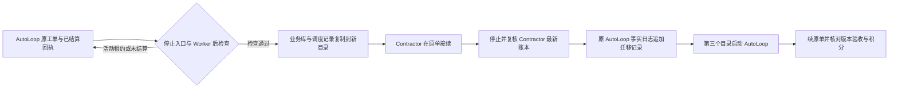

# Contractor 调度器与 AutoLoop

这份说明对照 Contractor 目前的执行接口与仓库固定的 AutoLoop `ba8cf6d8cf24`。两条路径共用同一个 Super-agent 工单、项目权限、执行上下文、积分和验收账本。每个工作台只启用一个调度器。已有部署默认使用 AutoLoop。 [执行接口](../src/workbench/execution/contract.ts) · [AutoLoop 固定版协议](https://github.com/KKKKhazix/agent-autoloop/blob/ba8cf6d8cf24f9ce005958c15d88f2d9cff7f05d/docs/protocol.md)

## 能力对照

| 能力 | AutoLoop 兼容运行时 | Contractor 自研运行时 | 对工作台的影响 |
| --- | --- | --- | --- |
| 入站规则和去重 | 核心支持独立来源、通配类型和规则分组。工作台从受信配置生成分派规则。 | 按工作台投递的来源和事件类型匹配，以来源与事件编号去重。 | IM、GitHub 和工作台消息先经统一 Gateway 与业务 Router，选用哪个调度器都按原引用接续。 |
| 事件累积与并发 | 同规则、同事项的事件可并入已排队轮次。上游允许配置分组和并发。 | 按工单执行范围和规则并入队列，同时限制同一范围和同一规则的活动轮次。 | 工作台的原单、交接及跨单访问继续由业务核心判断。独立 AutoLoop 的并发组需要单独核对。 |
| 工单和工作目录 | `autoloop/hub.db` 保存事实日志和可重建投影。上游 Worker 保存自己的运行目录。 | `dispatch/hub.sqlite` 直接用 SQLite 事务保存队列、运行、卡片及回执索引。 | 工单和工单讨论在 `orchestrator.sqlite`，两套 Worker 进程目录不能直接互换。 |
| 领取与断线 | 工作台按设备和运行保存已领工作。上游独立规则在设备仍在线、单轮五分钟未上报时可标为 `unknown` 并释放分组容量。 | 两分钟无本轮心跳标为 `unknown`，仍占用原范围。匹配的原执行端可继续确认或交回执。 | 工单交接仍须拿到原执行端的停止证据。活动、失联或仍等待停止证明的租约须在原运行时结清。 |
| 暂停等人与待办 | `ask`、`notice`、`resolve` 相互关联，工作台在原版领取事务里加上未答问题的检查。 | 自研队列直接排除尚有必答问题的事项。 | 同样由已授权的决定人答复。在工作台内的待办保留原卡片和工单编号。 |
| 会话与接续 | 上游 Codex 等插件可以尝试原 CLI 会话，Worker 支持续不上时另开会话。 | 同一授权范围内可接本机 Codex 会话。平台按当前资料授权重新装配原工单和确认记录。 | 项目话题、讨论和已确认口径可迁移。离线演练保留历史 CLI 会话编号，目标按授权重新装配并创建会话。远程执行继续使用每轮独立会话。 |
| 回执和额度 | 调度器保存回执摘要及去重记录，原版支持按规则发出后续事件。 | 调度器记录每次领取的序号、租约和已接收结果。后续业务动作由 Contractor 核对。 | 业务回执日志按运行与尝试保留结果、Token 和积分。只有已结算回执可随本次演练迁移。 |
| 失败重试和停止 | 五分钟起退避，最长一小时。上游包含连续失败、失联和取消的通知，以及回执格式修补。 | 同样按五分钟至一小时退避。对停止、失败和模型恢复由工作台业务待办反馈。 | 本次迁移让已经领取过的重试留在原运行时结清。上游运维提示和 CLI 自修补行为仍有差异。 |
| 群整理和延后复查 | 支持上游规则时区、Cron 以及延后复查，可以带回原 Worker 会话。 | 群整理使用 Asia/Shanghai 的五字段 Cron，错过只补最近一次。延后复查在自研账本登记，由工作台装配资料。 | 演练保留下次群整理游标，已到期的整理与未到期的延后复查先在原运行时结清。 |
| 定制和运维 | 上游有独立 HTTP、卡片通道、插件协议、状态页和 `agent-autoloop why` 事实链。 | 工作台内使用自己的渠道协议、执行证据、健康监控和后台日志。执行端包可单独使用自研协议。 | 以工作台的任务、验收和回传作为验证范围。独立 AutoLoop 的脚本、插件、`/v1` 和裸卡片链接另行盘点。 |

AutoLoop 独立分发还提供脚本安装、独立来源凭据和规则配置。Contractor 调度器替代的是工作台内的执行协议。 [AutoLoop 插件接口](https://github.com/KKKKhazix/agent-autoloop/blob/ba8cf6d8cf24f9ce005958c15d88f2d9cff7f05d/docs/plugins.md) · [Contractor 调度器](../src/workbench/execution/scheduler.ts) · [工作台兼容层](../src/workbench/autoloop.ts)

## 离线迁移与回滚



### 1. 确认停机点

先在测试副本暂停新入口，停止工作台、独立飞书入口和执行端。若服务要用已发生的回执恢复，先在原运行时重新上线该执行端或等待自动补写。确认无 `claimed`、`unknown`、未结算回执、设备接单记录和预留额度。未领取的工单可继续排队，原单的必答事项可以留在等待状态。等待重试的旧尝试、未处理的群整理、尚未触发的复查和已有 Git 工作树需要先在原运行时收尾。迁移工具会检查这些条件和写入锁。

为现有 AutoLoop 部署保存独立备份。基础 `ledger backup` 会拦截任何排队运行，如需保留未领取且等待答复的队列，使用下面的迁移命令，并另行保管完整的原状态目录。原工作台的 Git 工作树、成员凭据槽和 CLI 工作区需要由部署者另行管理。 [备份工具](../src/workbench/ledger-backup.ts)

### 2. 生成并启动 Contractor 演练目录

命令接收绝对路径。源目录和新目录应并列，目标路径在执行前应不存在。本轮以有独立测试资料的 workbench 实例为范围。命令只生成新目录，启动和切换入口由部署者另行安排。

```sh
npm run ledger -- migrate-runtime /absolute/path/autoloop-test /absolute/path/contractor-test
CONTRACTOR_PAUSE_NOTIFICATIONS=1 COLLAB_STATE_DIR=/absolute/path/contractor-test npm start
```

配置保存为 `executionRuntime: "contractor"`。数据库保留工作台账户、工单、主题历史、原卡片编号、已答事项、版本、已结算停机证明和用量。原 AutoLoop 调度账和签名密钥放在新目录的 `runtime-archive/autoloop/`。归档像原工作台状态一样属于私有运行数据。

按目标工作台的配置重新提供需要的模型凭据。新浏览器登录后可打开原工单。工作区和 CLI 会话正文留在原路径，所以本轮从有权读取的工单和已确认依据重建上下文。测试走同一个隔离 HTTP 端口时，原进程应保持停止。

执行端连接有调度协议检查。旧包带旧协议访问新实例会返回 409。部署者需要先停旧执行再确认目标协议下的设备配置和项目路由。原单仍指定旧设备时，可在工作台走原单交接。使用相同且已验证的设备身份和当前协议时，已结算回执重放可以返回此前确认，改写回执会被拒绝。当前工具没有自动更新执行机上的配对文件。

### 3. 在产生新工作后回滚

同样停止当前的工作台、入口和执行端，再从 **Contractor 最新状态** 生成第三个目录。恢复原 AutoLoop 事实日志时追加一份迁移记录，接回 Contractor 期间的新运行、待办和已结算回执。工单业务账本也是切换后最新的一份。

```sh
npm run ledger -- migrate-runtime /absolute/path/contractor-test /absolute/path/autoloop-rollback-test
CONTRACTOR_PAUSE_NOTIFICATIONS=1 COLLAB_STATE_DIR=/absolute/path/autoloop-rollback-test npm start
```

回滚要求 `contractor-test` 由前一节的迁移生成，归档里有原 AutoLoop 账本。新建的纯 Contractor 实例没有这个回滚起点。回滚后的 `runtime-archive/dispatch/` 保留已停机的 Contractor 调度账。重新登录后核对原工单、待办、原主题、最近一次成果或回执、每轮 Token 与积分。新编号应在源账本编号之后继续分配。

## 门店推荐理由验证

版本化回归启动真实工作台进程与两个调度器，在临时目录中用执行协议夹具重复下面的路径。运行结果来自工作台 API、两套 SQLite 账本及积分记录。 [可运行的往返用例](../tests/workbench-runtime-migration.test.ts)

```sh
node --import tsx --test tests/workbench-runtime-migration.test.ts
```

| 场景 | 核对结果 |
| --- | --- |
| AutoLoop 领取后断开，尝试迁移 | 被活动租约检查拦住。重启原工作台后，同一设备领回相同运行和租约。 |
| 原调度器已收回执，积分写入故障 | 迁移因回执未结算被拦住。原调度器恢复后补写原回执，两个必答都回到同一单。 |
| 答一项后切换 | Contractor 保留原主题讨论、待办、卡号和预排队运行编号。未答完时不领取，答完两项后只领取原排队运行。 |
| Contractor 产生新的待办后回滚 | 该待办回到 AutoLoop 原单，确认后继续同一单的新运行，所得正文由原发起人按版本验收。 |
| 重放和积分 | 源和目标各重复提交已结算回执或已答问题。三次合法执行累计 300 Token、0.300 积分，每轮只有一条结算。 |

另在 macOS 隔离环境实跑了三段本机 Codex，依次使用 AutoLoop、Contractor 与回滚后的 AutoLoop。原单先确认 320px 和 360px，切换后追加 280px 的确认。回滚后 Codex 根据已保存的主题记录和两个答复列出三档验收规则，原工单完成验收。账本保留三次执行，共计 80,841 Token、80.841 积分。上述实跑使用虚构的门店资料，设备协议与故障注入使用上面的自动化用例。

本次范围是独立工作台中的只读委托、待办与执行账本。现有团队工作台、生产渠道、在途代码工作树、跨主机 CLI 会话正文和独立 AutoLoop 配方需要各自的切换验证。 [执行端恢复手册](WORKBENCH-REMOTE-RUNNER.md)
