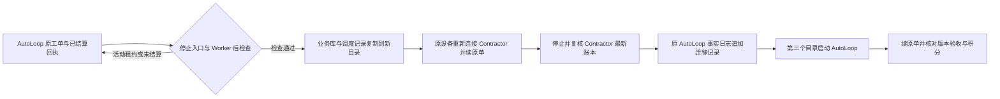

# Contractor 调度器与 AutoLoop

这份说明对照 Contractor 目前的执行接口与仓库固定的 AutoLoop `ba8cf6d8cf24`。两条路径共用同一个 Super-agent 工单、项目权限、执行上下文、积分和验收账本。每个工作台只启用一个调度器。已有部署默认使用 AutoLoop。 [执行接口](../src/workbench/execution/contract.ts) · [AutoLoop 固定版协议](https://github.com/KKKKhazix/agent-autoloop/blob/ba8cf6d8cf24f9ce005958c15d88f2d9cff7f05d/docs/protocol.md)

## 能力对照

| 能力 | AutoLoop 兼容运行时 | Contractor 自研运行时 | 对工作台的影响 |
| --- | --- | --- | --- |
| 入站规则和去重 | 核心支持独立来源、通配类型和规则分组。工作台从受信配置生成分派规则。 | 按工作台投递的来源和事件类型匹配，以来源与事件编号去重。 | IM、GitHub 和工作台消息先经统一 Gateway 与业务 Router，选用哪个调度器都按原引用接续。 |
| 事件累积与并发 | 同规则、同事项的事件可并入已排队轮次。上游允许配置分组和并发。 | 按工单执行范围和规则并入队列，同时限制同一范围和同一规则的活动轮次。 | 工作台的原单、交接及跨单访问继续由业务核心判断。独立 AutoLoop 的并发组需要单独核对。 |
| 工单和工作目录 | `autoloop/hub.db` 保存事实日志和可重建投影。上游 Worker 保存自己的运行目录。 | `dispatch/hub.sqlite` 直接用 SQLite 事务保存队列、运行、卡片及回执索引。 | 工单和工单讨论在 `orchestrator.sqlite`，两套 Worker 进程目录不能直接互换。 |
| 领取与断线 | 工作台按设备和运行保存已领工作。上游独立规则在设备仍在线、单轮五分钟未上报时可标为 `unknown` 并释放分组容量。 | 两分钟无本轮心跳标为 `unknown`，仍占用原范围。匹配的原执行端可继续确认或交回执。 | 工单交接仍须拿到原执行端的停止证据。活动、失联或仍等待停止证明的租约须在原运行时结清。 |
| 暂停等人与待办 | `ask`、`notice`、`resolve` 相互关联，工作台在原版领取事务里加上未答问题的检查。 | 自研队列直接排除尚有必答问题的事项。 | 同样由已授权的决定人答复。在工作台内的待办保留原卡片和工单编号。 |
| 会话与接续 | 上游 Codex 等插件可以尝试继续原 CLI 会话，无法接续时另开会话。 | 同一授权范围内可接本机 Codex 会话。平台按当前资料授权重新装配原工单和确认记录。 | 项目话题、讨论和已确认口径可迁移。离线演练保留历史 CLI 会话编号，目标按授权重新装配并创建会话。远程执行继续使用每轮独立会话。 |
| 远程设备和代码工作区 | 兼容 Worker 领取远程代码包，回交改动和停止证明。 | 自研 Worker 使用 Contractor 的领取和回执协议，共用原有代码包校验、提交和验收。 | 双协议执行端可在原地址用原配对重新上线。迁移从已记录的提交重建 Git 工作树，并核对授权范围内的未提交改动。 |
| 回执和额度 | 调度器保存回执摘要及去重记录，原版支持按规则发出后续事件。 | 调度器记录每次领取的序号、租约和已接收结果。后续业务动作由 Contractor 核对。 | 业务回执日志按运行与尝试保留结果、Token 和积分。只有已结算回执可随本次演练迁移。 |
| 失败重试和停止 | 五分钟起退避，最长一小时。上游包含连续失败、失联和取消的通知，以及回执格式修补。 | 同样按五分钟至一小时退避。对停止、失败和模型恢复由工作台业务待办反馈。 | 本次迁移让已经领取过的重试留在原运行时结清。上游运维提示和 CLI 自修补行为仍有差异。 |
| 群整理和延后复查 | 支持上游规则时区、Cron 以及延后复查，可以带回原 Worker 会话。 | 群整理使用 Asia/Shanghai 的五字段 Cron，错过只补最近一次。延后复查在自研账本登记，由工作台装配资料。 | 演练保留下次群整理游标，已到期的整理与未到期的延后复查先在原运行时结清。 |
| 定制和运维 | 上游有独立 HTTP、卡片通道、插件协议、状态页和 `agent-autoloop why` 事实链。 | 工作台内使用自己的渠道协议、执行证据、健康监控和后台日志。执行端包可单独使用自研协议。 | 以工作台的任务、验收和回传作为验证范围。独立 AutoLoop 的脚本、插件、`/v1` 和裸卡片链接另行盘点。 |

AutoLoop 独立分发还提供脚本安装、独立来源凭据和规则配置。Contractor 调度器替代的是工作台内的执行协议。 [AutoLoop 插件接口](https://github.com/KKKKhazix/agent-autoloop/blob/ba8cf6d8cf24f9ce005958c15d88f2d9cff7f05d/docs/plugins.md) · [Contractor 调度器](../src/workbench/execution/scheduler.ts) · [工作台兼容层](../src/workbench/autoloop.ts)

## 离线迁移与回滚



### 1. 确认停机点

先在测试副本暂停新入口。保留原调度器和执行端连接，直到在途执行交回停止证明和回执。远程代码单有未提交改动时，先让原轮在停止后交回代码差异，确认差异已回收到工作台的工单目录。重连或自动补写成功后，再停止执行端、独立飞书入口和工作台。

迁移工具检查工作台写入锁、`claimed` 和 `unknown` 运行、未结算回执、设备接单记录及预留额度。已领取过的重试、待处理群整理和延后复查先由原运行时结清。未领取的工单可继续排队，必答事项可以留在等待状态。

将完整的原状态目录另行备份。需要保留未领取且等待答复的队列时，使用下一节的迁移命令生成新目录。成员凭据槽和 CLI 会话正文由部署者另行保管。 [备份工具](../src/workbench/ledger-backup.ts)

### 2. 生成并启动 Contractor 演练目录

命令接收绝对路径。源目录和新目录应并列，目标路径在执行前应不存在。本轮以有独立测试资料的 workbench 实例为范围。命令只生成新目录，启动和切换入口由部署者另行安排。

```sh
npm run ledger -- migrate-runtime /absolute/path/autoloop-test /absolute/path/contractor-test
CONTRACTOR_PAUSE_NOTIFICATIONS=1 COLLAB_STATE_DIR=/absolute/path/contractor-test npm start
```

配置保存为 `executionRuntime: "contractor"`。数据库保留工作台账户、工单、主题历史、原卡片编号、已答事项、版本、已结算停机证明和用量。原 AutoLoop 调度账和签名密钥放在新目录的 `runtime-archive/autoloop/`。归档像原工作台状态一样属于私有运行数据。

代码工单以原分支、冻结基线、最后记录的提交和授权路径重建独立 Git 工作树。工具比较原工作树和目标的代码差异与文件哈希，核对远程代码轮次的停止证明。暂存区有改动、存在授权范围外的修改、Git 合并或变基尚未结束，或原仓库、提交和工单记录对不上时，迁移会停止。工作台使用受限代码包的大小和路径规则核对差异。目标工作树生成自己的 `.git`，原 Git 管理文件、钩子和工作区凭据留在各自原位置。 [代码迁移实现](../src/workbench/development-migration.ts) · [代码包约束](WORKBENCH-REMOTE-RUNNER.md)

部分克隆可能只有当前文件，缺少历史里的 Git 对象。离线迁移会报出工单和首个缺失对象。先用原工单工作树和已授权的远程仓库补齐对象，再重跑迁移。迁移过程本身不联网拉取对象。

按目标配置提供所需模型凭据。重新登录后用原工单核对待办和上下文。接续代码单时，工作台检查远端基线。基线已变化时，研发须确认新的 SHA，工作台再从已授权仓库取回该提交并变基。本地仍有未提交改动或变基冲突时，保留原工单等待研发处理。

保留执行端本地目录、原团队地址和 `--profile`，使用支持两套协议的执行端包，并运行原 `contractor connect <团队地址>` 命令。执行端只有在原接单进程停止、工作台已结清设备租约且两套本地回执目录均无未结清记录时，才用原配对更新协议。旧版本执行端可先安装新版双协议包。工作台入口在同一地址只启用一个实例。接单和回执仍校验当前协议，已结算的同内容回执重放返回原确认。 [执行端操作](WORKBENCH-REMOTE-RUNNER.md)

### 3. 在产生新工作后回滚

同样停止当前的工作台、入口和执行端，再从 **Contractor 最新状态** 生成第三个目录。恢复原 AutoLoop 事实日志时追加一份迁移记录，接回 Contractor 期间的新运行、待办和已结算回执。工单业务账本也是切换后最新的一份。

```sh
npm run ledger -- migrate-runtime /absolute/path/contractor-test /absolute/path/autoloop-rollback-test
CONTRACTOR_PAUSE_NOTIFICATIONS=1 COLLAB_STATE_DIR=/absolute/path/autoloop-rollback-test npm start
```

回滚要求 `contractor-test` 由前一节的迁移生成，归档里有原 AutoLoop 账本。回滚后的 `runtime-archive/dispatch/` 保留已停机的 Contractor 调度账。用双协议执行端在原地址连接，再核对原工单、待办、原主题、最新 Git 提交、版本验收、执行回执以及每轮 Token 和积分。新编号从源账本编号之后继续分配。

## 门店推荐理由验证

版本化回归启动真实工作台进程与两个调度器，在临时目录中用执行协议夹具重复下面的路径。运行结果来自工作台 API、两套 SQLite 账本及积分记录。 [可运行的往返用例](../tests/workbench-runtime-migration.test.ts)

```sh
node --import tsx --test tests/workbench-runtime-migration.test.ts
```

| 场景 | 核对结果 |
| --- | --- |
| AutoLoop 领取后断开，尝试迁移 | 被活动租约检查拦住。重启原工作台后，同一设备领回相同运行和租约。 |
| 原调度器已收回执，积分写入故障 | 迁移因回执未结算被拦住。原调度器恢复后补写原回执，两个必答都回到同一单。 |
| 答一项后切换 | Contractor 保留原主题讨论、待办、卡号和预排队运行编号。未答完时不领取，答完两项后只领取原排队运行。 |
| Contractor 产生新的待办后回滚 | 该待办回到 AutoLoop 原单，确认后继续同一单的新运行，所得正文由原发起人按版本验收。 |
| 重放和积分 | 源和目标各重复提交已结算回执或已答问题。三次合法执行累计 300 Token、0.300 积分，每轮只有一条结算。 |

另在 macOS 隔离环境实跑了三段本机 Codex，依次使用 AutoLoop、Contractor 与回滚后的 AutoLoop。原单先确认 320px 和 360px，切换后追加 280px 的确认。回滚后 Codex 根据已保存的主题记录和两个答复列出三档验收规则，原工单完成验收。账本保留三次执行，共计 80,841 Token、80.841 积分。上述实跑使用虚构的门店资料，设备协议与故障注入使用上面的自动化用例。

### Debian 远程 Codex 代码单实跑

在独立工作台使用专用测试仓和一台 Debian 13 arm64 执行机，使用同一配对从 AutoLoop 迁入 Contractor，再从 Contractor 的最新账本回滚。两轮实际模型均为 `gpt-6.1-sol`。验收由隔离环境的产品测试成员完成。

| 环节 | 实测结果 |
| --- | --- |
| 停止和迁移 | 旧执行仍在领取状态时，迁移被拦住。拿到 `exited` 停止回执后，保留冻结基线 `b4c239c2`、已回收到工作台的未提交 CSS 和原必答事项。 |
| 原设备续单 | 同一设备通过原配对连入 Contractor，工单 `666a7bdf` 继续等答复。答复后只新增一轮，Codex 保留首轮 CSS 并从原基线生成提交 `0d6616eb`。 |
| 交付和验收 | 基线 CI 在 280px 处测得正文仅 228px。新提交的浏览器 CI 测得 280px、320px、360px 下正文分别为 244px、268px、308px，三档均能换行且无横向溢出。使用旧 SHA 的核对和验收请求被拒绝。产品测试成员按新提交验收原单第 1 版。 |
| 回滚和回执 | 原设备再次用原配对上线。回滚保留原单第 1 版、验收人、PR、CI、代码提交与两个原运行编号。两份真实回执重放后仍为两条结算，共 85,884 Token 和 85.884 积分，分两轮计 43.894 和 41.990 积分。 |

本轮保留了专用测试 PR 及证据，现有测试工作台继续运行原配置。 [测试 PR #20](https://github.com/zhegong-996/desktop-tutorial/pull/20) · [基线 CI](https://github.com/zhegong-996/desktop-tutorial/actions/runs/44646201912) · [验收对应的 CI](https://github.com/zhegong-996/desktop-tutorial/actions/runs/44647182529)
