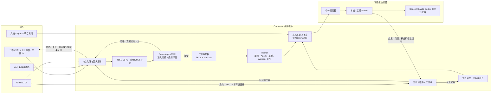

# Super Agent 思路与 Contractor

Contractor 不是把几个模型接进聊天软件，而是把 DeepSeek 开源的 [dsh-superagent](https://github.com/deepseek-ai/dsh-superagent-prototype/tree/8c32a9dc5d72c033816c6a8110b37f40cf94fba4) 研究原型所表达的工作方式，落到一个企业团队可以配置、运行、恢复和验收的产品里。

上游最重要的原则不是“让 Agent 尽可能多做”，而是：

> 尽可能少占用人的注意力，尽可能给出有效价值。

这句话同时约束产品、Agent 和通知。Agent 只在被明确要求，或团队预先写好的规则允许时接单；只在人必须行动、能使用结果或需要知道失败时说话。安静工作、结构化提问、回到原会话和留下可核实结果，都是这条原则的具体实现。

## 从聊天机器人到工作系统

早期 IM Bot 常见链路是“消息进入 → 模型回答”或“消息进入 → 调一个工具 → 回复”。它适合问答，却很难承担真实的团队工作：

- 消息没有稳定身份，重放一次就可能重复派工。
- 聊天内容同时被当成需求、权限和命令来源。
- Agent 的一次会话被误当成一张工单，断线后不知道该续哪项工作。
- 多个人、多个 Agent、多个执行设备之间没有统一的任务和授权状态。
- “Agent 说已完成”容易被误当成“人已经验收”。
- 群通知、私聊、待办和结果各存一份，用户要自己拼接上下文。
- 知识沉在聊天记录里，下一次任务既找不到出处，也无法可靠撤权。

Contractor 把这些能力拆成稳定的业务机制，再把变化较快的模型、IM、资料和执行端做成插件。Super Agent 是工作主线的组织方式，Contractor 的业务核心负责回答四个现实问题：**为什么允许做、应该谁做、做到哪一步、以什么证据算完成。**

## 一条工作怎样成为可追踪任务

Super Agent 的核心对象不是一段聊天，而是一项有边界的工作：

| 对象 | 回答的问题 |
| --- | --- |
| Source | 消息从哪里来，这个入口被允许接收什么？ |
| Trigger | 哪一条不可变事件值得进入系统？ |
| Thread | 这些事件属于同一个话题、Issue 或会话吗？ |
| Eval | 这条事件是在讨论、补充原单，还是应当产生新工作？ |
| Decision | 接受、续原单、忽略、观察，还是交给维护人？ |
| Ticket | 这项工作的业务状态和最终责任是什么？ |
| Mandate | 依据哪一版策略、由谁、允许做到哪一步？ |
| Assignment | 这一次交给哪个 Agent、模型和设备执行？ |
| Report | 本轮产生了什么成果、问题、用量和停止证据？ |
| Acceptance | 哪一版成果经谁核对后正式通过？ |

会话可以结束、模型可以失效、设备可以断线，但 Ticket、Mandate、版本和验收仍在。换 Worker 时接续的是原工作，不是重新问一遍需求。

## “任务筛选过滤”不是一道模型提示词

Contractor 的过滤是一个分层漏斗。确定性检查先保护边界，模型只在已被允许的范围内做语义判断。

| 层级 | 检查 | 典型结果 |
| --- | --- | --- |
| 来源边界 | 渠道是否启用，消息是否来自机器人自身，是否符合该来源的接收范围 | 不接收、记录但不处理 |
| 事件去重 | 渠道、会话、消息、修订和原始回执身份 | 重复事件复用原记录 |
| 可信身份 | IM 账号是否已绑定成员，是否属于当前组织和项目 | 拒绝越权或进入身份待办 |
| 项目归属 | 群、话题、Issue、子项目和主题的已验证映射 | 归入正确项目或标记归属冲突 |
| 用途归类 | 是否明确引用原单、是否要续单、是否是未点名反馈、是否只是讨论 | 续原单、开新单、主题归纳、人工核对 |
| 准入 Gate | 发起人是否在允许范围，是明确请求还是推断请求，当前策略允许哪种强度 | 准入、仅观察、忽略 |
| 规则评估 | 内容是否命中团队启用的工作规则，证据是否足够 | 给出可解释的接受或忽略建议 |
| 执行校验 | Agent、模型、Worker、仓库、资料、额度和项目权限是否同时有效 | 派工或进入对应待办 |
| 输出校验 | 版本、提交、CI、部署、验收人、渠道回执是否匹配 | 回传或保持待确认 |

这里有三个不能混用的边界：

1. **IM 内容是任务数据。** 聊天里提到路径、仓库、账号或“已授权”，不能自己改变执行范围。
2. **模型可以研判语义，不能授予权限。** 身份、项目、资料、设备和额度由可信配置与业务核心决定。
3. **自动接受不等于自动执行到底。** 推断需求可以只记录“本来会做什么”，团队确认规则稳定后再开启自动接单。

## Router、个人 Agent 与 Worker

Super Agent 把“想清楚谁来做”和“真正去做”分开。Contractor 沿用这条边界，并把职责配置化：

| 角色 | 谁拥有 | 主要职责 | 不能做什么 |
| --- | --- | --- | --- |
| 平台 Router | 平台 | 解释规则、判断归属、组织摘要、选择获准的候选 | 不直接占用成员设备，不扩大 Mandate |
| 个人 Agent | 成员 | 保存个人方法、经验与判断，承担只读咨询或个人代办 | 不天然获得成员全部项目权限 |
| 项目 Agent / 共享专家 | 项目或资源所有者 | 在特定职责和技能版本内提出建议或完成专项工作 | 不能跨项目读取资料或携带私有凭据 |
| Worker | 设备所有者 | 领取本轮运行，装配当轮上下文并执行 | 不能自行改工单、权限、验收或积分规则 |

Router、个人 Agent 和 Worker 都可以配置，但不是同一种对象。Router 是平台级调度职责，个人 Agent 是成员的能力与经验载体，Worker 是可插拔执行资源。真正执行时，业务核心会把三者在同一轮运行中重新核对。

## 飞书通知与确认为什么不同

通知的目标不是让 Agent“存在感更强”，而是减少团队协调成本。Contractor 按下列规则处理飞书和其他 IM：

- **先确认一次，再保持安静。** 收到明确请求后确认接下来做什么；执行中不持续推送过程。
- **有事才说话。** 需要决定、发生阻塞、结果可用或确认失败时才再次通知。
- **回到原位置。** 回复进入原群话题、原单聊或工作台会话，不在另一个私聊重新解释上下文。
- **待办集中，结果归话题。** 个人待处理尽量汇总到按项目、主题分组的卡片；具体交付结果回到对应话题卡，避免每张工单都新建一个机器人私聊。
- **卡片只呈现当前动作。** 接单、补充资料、授权、选择 Agent、按版本验收等确认项绑定具体工单、版本和操作人。
- **重复点击不重复派工。** 回调先持久化，再按稳定事件与动作标识幂等处理；旧回执迟到、服务重启和重复投递不会多开单、多扣分或重复通知。
- **群共享与工作台权限分开。** 群卡默认只显示处理状态和工作台入口；只有显式允许对群共享，且资料来源满足要求时，才展示结论和出处。工作台完整回复仍按项目权限读取，GitHub、Figma 原页继续由各自平台鉴权。
- **确认不是执行完成。** 必答项问清后继续原单；真正完成仍要经过成果证据和人工验收。

这种交互把“通知”从广播变成工作状态的一部分。飞书负责到人、到原话题和快速确认，工作台负责完整上下文、权限与追溯，外部源站负责自己的原始权限。

## 对比以前的做事方式

| 早期做法 | Contractor / Super Agent |
| --- | --- |
| 一条消息直接触发一次模型调用 | 先持久入站、去重、核对身份与项目，再研判是否形成工作 |
| 所有消息都交给模型判断 | 确定性 Gate 先管允许范围，模型负责有限范围内的语义判断 |
| 一个通用 Agent 同时聊天、派活和执行 | Router、个人 Agent、Worker 和共享专家分工，权限与用量分开 |
| Agent 会话断线就重新开始 | 工单、授权、版本和上下文可恢复，换端前先证明旧执行停止 |
| 谁在群里说话都能改变执行目录 | 执行路径、仓库和权限来自本地可信配置，IM 内容不能提权 |
| Agent 回复“完成”就是结束 | 成果绑定提交、CI、环境证据和人工验收；Agent 完成不等于业务验收 |
| 每个话题单独私聊催办 | 个人待办集中成层级卡片，结果回原话题并提供工作台同一条回复入口 |
| 通知重放可能重复打扰 | 入站、出站和确认都有幂等记录，已送达但回执丢失时可对账 |
| 经验留在聊天记录和模型记忆里 | 验收后生成带来源、适用范围和版本的知识候选，人工采用后才生效 |
| 模块靠几条长期分支隔离 | `main` 保持可运行，短期 PR 同时修改跨模块契约、迁移和测试 |

这套方式的好处是：团队不必持续盯着 Agent，出了问题知道卡在谁那里，换设备不丢任务，任何结论都能回到原消息和验收版本，下一项工作还能复用已经确认过的经验。

## “Contractor / 包工头”这个名字

正式产品名是 **Contractor**，中文内部可以直白地理解为“包工头”。这个名字来自它在系统中的位置，而不是从模型能力命名。

包工头不亲自完成所有工种，也不替业主决定什么叫合格。他的价值在于：

- 听懂业主真正要交付什么，确认范围和边界；
- 根据项目安排合适的工种、工具和执行设备；
- 管住资料、场地、权限、额度和先后顺序；
- 记录谁接了活、做到哪一步、中途为什么停；
- 对交付物做核对，组织人验收并留下可追溯凭证；
- 把这次有效的做法变成下次可以复用的经验。

系统中的 Router 像调度与工头，个人 Agent 像带着经验的专业人员，Worker 像散落在不同电脑或云端的施工队，业务核心像合同、项目台账和验收办公室。模型只是现场的智力工具，不会因为“更聪明”就自动获得权限，也不会替人签字验收。

这也是为什么产品不叫一个又一个 Agent 的名字。Contractor 的职责是把多人、多个 Agent、多个入口和多种交付证据组织成一项可负责的工作。

## 必须长期守住的产品不变量

- 一个实例只有一个执行调度器。
- 项目、工单、权限、版本、积分、验收和知识采用由业务核心统一掌管。
- 一张工单只有一个业务真相，IM、待办、看板、会话和详情只是不同入口。
- 执行租约、版本状态和业务状态分别记录，不用一次模型回复冒充全部事实。
- Agent 结束不等于验收通过，验收事实和知识采用也不能互相替代。
- 重复入站、迟到回执、重复确认和重试都不能重复派工、扣分或通知。
- 换成员、换 Agent 或换设备时重新核对资料权限与额度。
- 知识的召回受当前资料权限约束，撤权同时影响原资料和由它派生的内容。
- 人负责最终业务判断；系统负责让判断发生在正确版本、正确权限和完整证据上。
