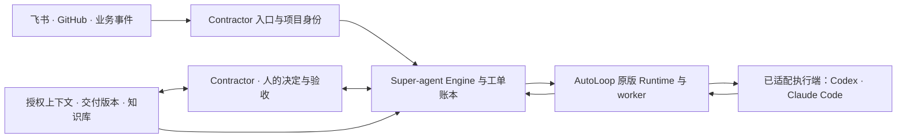

# Contractor · Super-agent 迁移

Contractor 是独立的协作产品，包含团队工作台、项目、个人与专项 Agent、交付验收和授权知识库。迁移基于 GitHub `main` 的 `a44380604c9cfd1f67beb2701fceb2e3245a666b` 独立分支。设计输入是《Super-agent 项目详细解读》第 9 章、《Autoloop 项目详细解读》，以及玉伯关于每个人都有一个可被同事调用的 Agent 的访谈。

## 系统边界

| 责任 | 采用方式 |
| --- | --- |
| **工单与权责** | 基于 [Super-agent 原版 Engine、Store 和 Effects](https://github.com/deepseek-ai/dsh-superagent-prototype/tree/8c32a9dc5d72c033816c6a8110b37f40cf94fba4)。原版持有 Thread、Decision、Ticket、Mandate、Assignment、Report 和出站回执。Contractor 在入口绑定项目、核验外部身份、按资源限制权限，在出口做业务验收。 |
| **后台执行** | 完整引入 [AutoLoop 原版 Runtime、内核和 worker](https://github.com/KKKKhazix/agent-autoloop/tree/ba8cf6d8cf24f9ce005958c15d88f2d9cff7f05d)。Super-agent 批准的 Assignment 映射为原版执行事件，执行回执归回该 Assignment。AutoLoop 的运行号只指一轮执行。人补充信息后由原版卡片机制接续，任务、授权和历史仍归原工单。 |
| **产品交互与编排** | 借鉴 [LobeHub](https://github.com/lobehub/lobehub) 的来源信号归并、规则优先过滤、冻结运行配置、parked 和子 Agent 返回后的恢复、资源库入口。工作台以协作现场为主，展示来源、进行中的执行、待决定事项、交付证据和已引用知识。成员通过可上岗的个人或专项服务找到彼此的 Agent。 |
| **存量与切换** | 旧 Paperclip 宿主仍持有其身份和工单。Super-agent 工作台使用独立 SQLite、测试会话和测试仓库。迁移时逐项目、逐入口确认写入所有者，每个工单有唯一可写业务账本。 |

## AutoLoop 能力接入清单

“完整接入”要求在 Contractor 中保留能力和可追溯证据。原版源码到位、适配到产品、通过真实通道验证是三个独立的交付检查项。

| 原版能力 | Contractor 接入要求 | 首条链范围 |
| --- | --- | --- |
| 标准事件、事件源插件、去重、同主题合并 | 入口可信身份、Webhook 验签、显式项目绑定，授权工单映射原生执行 lane | 飞书单聊与显式工单事件。GitHub/GitLab/HTTP 等入口留待接入 |
| 声明式规则、热更新、Skill、并发隔离 | 绑定可信配置，支持按项目看生效版本、止停、错误与回退 | 原版规则和单并发 worker。配置界面待接 |
| cron、定时复查 `later`、事件链 `events`、跳数限制 | 定时与后继事件仍经过项目、归属和 Mandate；受控配置启用 | 原版内核保留。试点关闭自动外发与跨任务派生 |
| CLI/ACP 插件、远程 worker、会话恢复 | 上游提供 CLI/ACP 扩展点。工作台按执行端分别核验隔离、权限、续跑与停止；ACP 尚待独立适配，当前可用范围见[执行端说明](WORKBENCH-REMOTE-RUNNER.md) | 使用真实 Codex、原版会话续跑 |
| 卡片、`ask`、`notice`、`resolve`、原生等待和回复 | 在协作台展示卡片，并接原渠道；回答绑定回复者与工单 | 原版卡片和选择记录通过飞书原话题文字回复接续。按钮及其他通道待接 |
| 重试、失败回执修复、回收、断线保护、追加日志 | 留存尝试与恢复证据，将重试中、待人工和不可确定状态正确呈现 | 原版执行内核运行，异常分支依靠原版测试。首轮服务验证走正常路径 |
| 交付插件、发布核对、CLI/MCP 管理与用量统计 | 将交付策略、CI、预览、合并发布与人的审批分开；接入状态、停用、费用与组织治理 | 复用现成 GitHub PR 和同提交 CI 预览。原版交付插件、多通道与组织治理待接 |

## 九项生产能力与交付标准

| 解读章节 | 需要补齐 | 生产验收 |
| --- | --- | --- |
| 9.1 跨来源项目身份 | Project 实体、带来源的显式引用、待确认关联；借鉴 LobeHub 外部信号 ID | 飞书、GitHub、Figma 的重复事件稳定归档；只凭相似正文无法跨项目归并 |
| 9.2 话题与代码版本 | 原话题追加历史、触发时远端 SHA、分配 base、PR head、CI、预览版本 | 首条链记录触发与开工版本，漂移阻断，业务验收必须命中同一完整 SHA |
| 9.3 可配置分工 | 全局只决定准入和职能，职能内选择具体 Agent | 两种不同组织结构通过配置运行，只有各自 Mandate 所允许的读写生效 |
| 9.4 个人、路由与专项 Agent | 个人委托、代理收件箱、能力与权限版本；借鉴 LobeHub 的唤醒守门和子任务回填 | 多个成员可委托对方的 Agent，运行可追溯到本人，Agent 互发消息不会循环拉起 |
| 9.5 运行装配 | Skill、上下文引用和模型配置分离；借鉴 LobeHub 的冻结配置和 parked | 能根据版本清单解释一次运行，停进程后按授权复核恢复。首条链复用原版 context.json、卡片与会话 |
| 9.6 飞书群协作 | 群话题、身份映射、显式触发、卡片去重，普通讨论由廉价规则过滤 | 群内只有符合配置的 Agent 响应，原人原话题恢复，重复事件既不重复派单也不重复追问 |
| 9.7 上下文与知识 | 候选带出处、适用条件、版本、责任人与上游授权；进入检索前由人采用 | 同源知识在真实读取链上分权查询，撤权后原文、检索、派生可见性同时收回。首条链用试点资料复用现有记忆索引和撤权投影 |
| 9.8 配额与 Agent 管理 | 按人、项目和职责归集费用，注册 Skill、生命周期、灰度与停用 | Agent 停用后拒绝新执行，存量运行可排空或取消，并可解释每笔用量 |
| 9.9 项目树与命令权 | 层级负责上下文聚合；授权落在具体任务与资源，带版本的权限与优先级可追溯 | 子任务不会隐式继承父级权限，多来源身份在组织规则下得到一致的授权决定 |

其余产品界面沿用 Contractor 的中文工作台、资源列表与知识引用交互，逐步解开宿主接口。复用许可及声明见 [第三方声明](../THIRD_PARTY_NOTICES.md)。LobeHub 当前仅纳入设计机制和交互参考。

## 首条真实迁移链

1. 在既有飞书测试机器人单聊用 `/pilot-superagent` 发起一项测试工作。源适配器校验聊天和本人身份，保留原消息，Engine 只产生一张 Ticket。
2. 原版 AutoLoop 启动本机 Codex 做只读澄清。结果生成一个原生问题卡片，进程结束。测试回复进入原工单，原生卡片把下一轮接回同一个 Codex 会话。
3. Codex 只交付静态预约页，运维端沿用 GitHub 交付适配器。核对 PR、对应提交 CI 及从 Actions 下载的静态预览。
4. 发起人用完整提交号确认验收。确认写入独立账本，依据原答复和 PR 生成知识候选。采用后检索试点条目，再验证执行身份对同源原文和派生知识的权限同时收回。不会变更原飞书资料的外部 ACL。

### 试点与现行入口

该次试点使用单独的飞书单聊、测试仓库与本地账本。历史提交 `a7b8b1f7c97cf3fe4cba6894e14590448c0d8ae7` 的 `src/superagent-pilot` 记录当时的入口。当前复跑从[工作台说明](WORKBENCH.md)配置独立实例。工单账本、AutoLoop 日志和交付文件保存在忽略目录中。部署时需按执行身份隔离原版 worker 和 CLI 的会话目录。

### 联调记录 · 2026-11-14

- 飞书测试单聊实收发。Engine 产生工单 `2b66b264d80a2265bfdaddfa8688e5d7` 和一个 Assignment。回执生成原生问题卡片后进程退出。原话题收到真实测试回复后，AutoLoop 自动开第二轮并恢复第一轮 Codex 会话。
- 测试 PR #4 的提交为 `fad5df8b945c0da07f83713233bf67fe43336ca3`。Actions 运行 按该提交生成预览。预览文件的 Git blob 与远端一致。浏览器确认标题、演练提示与按钮反馈。
- 平台回归 822 项通过；固定版 AutoLoop 回归 352 项通过，2 项上游用例跳过。以该 PR 的真实预览为输入，在隔离副本验证了候选先审后收录、执行身份命中 1→0、撤权后原文拒绝及所有者仍可检索。发起人的验收、知识采用和撤权以独立测试账本收到的实际操作为准。
