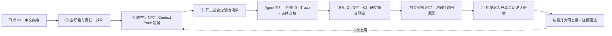
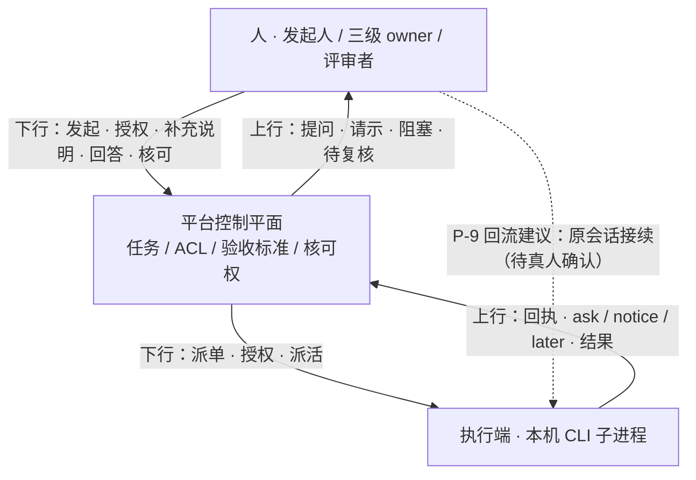
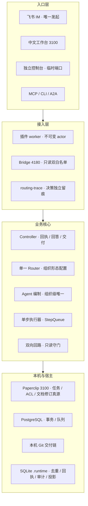
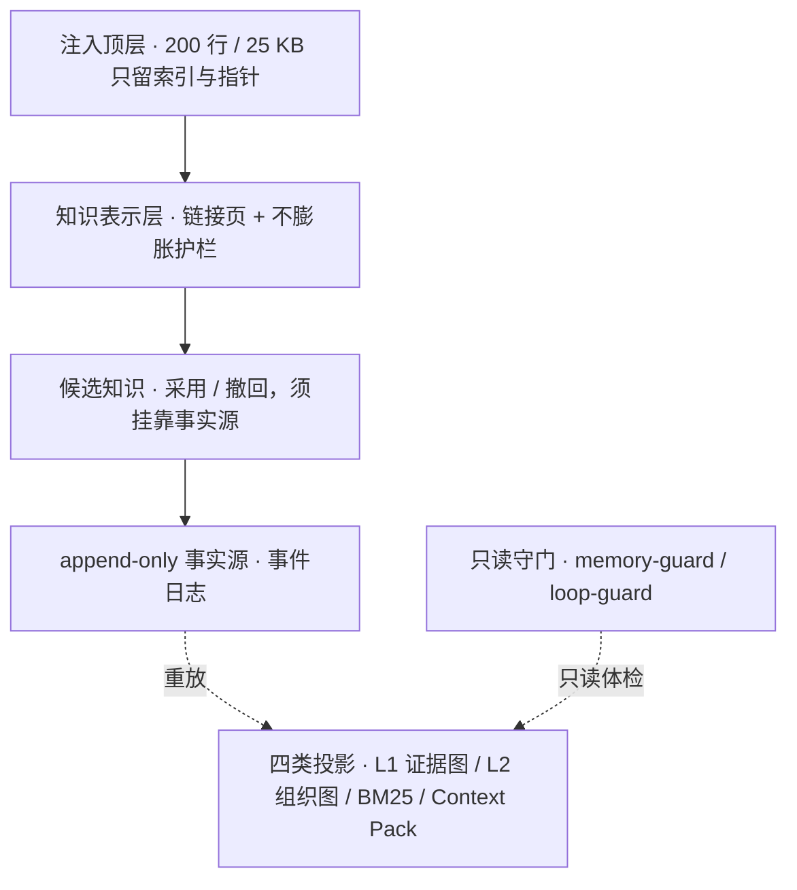

# SuitMe 协作台 · 功能、系统架构与技术架构

> **版本**：2026-11-08（北京时间）· 第二十七轮 P-9 之后 · 共 27 轮迭代
> **代码基线**：以 `git rev-parse HEAD` 为准；成稿时 `HEAD = origin/main = 3b0188d`（第二十七轮 P-9），本文提交后会前进，本地与远端始终保持一致。
> **本版取代旧版**：此前本文件按轮次追加补记，最新只到第二十二轮 P-1，功能地图、端口、验证数字与当前代码均已脱节。本版**原地重写为一份自足的最新说明**，不再保留逐轮流水；历史过程见 `docs/ADAPTATION-v0.6.md`（最新边界节）、`docs/VALIDATION.md` 与 `HANDOFF/03-WORK-LOG.md`。
> **定位**：本机试点系统，包含开发与联调记录，**不是已部署到全体员工的生产系统**。
> **权威口径优先级**：`docs/ADAPTATION-v0.6.md` 最新边界声明 → `docs/VALIDATION.md` → `docs/PRD-v0.6.md` §10C → `HANDOFF/06` → 本文。本文描述「现在是什么」，设计定稿（不等于全部实现）仍以 `docs/ARCHITECTURE-v0.6.md` 为准。

---

## 0 一页速读

**一句话定位**：把人的目标、授权和验收标准翻译成任务与证据，把执行交给外部 Agent，再把结果与请示带回给人，**由人做最终核可**。平台不是透明管道，是持有任务 / ACL / 验收标准 / 知识采用权 / 核可权的控制平面。

| 项 | 当前值 |
|---|---|
| 迭代 / 单测 | 28 轮 · `npm test` **532/532** |
| 任务发起入口 | **仅飞书 IM**（唯一），7 条中文指令 → 任务单 |
| 默认底座 / 执行模式 | `paperclip` / `loop`（`local-pg` 与 `step` 真跑过但未启用为默认，可逐字回退） |
| 上游 | 7 个固定 submodule + 1 个 npm 直接依赖；另有 `protocolReferences`（Runner）与 `conceptReferences`（OpenMausBot / Anthropic）**只借思想，不是第 8 个上游** |
| 确定性链路 | `modelCalls=0`（模型调用只发生在被启动的本机 CLI 子进程里，进 `usage` 与回执） |
| 最新一轮 | P-10 漏洞修复与飞书回答接进 HITL 台账：`src/hitl-bridge.ts` + 五个真实缺陷修复，`npm run loop:smoke` 17/17 |

**三条最容易误读的边界**：
1. **全绿 ≠ 生产可用**：真人业务单「确认验收 SUI-129」至今未发生；报告、模型判定、CI、合并审批都不替代它。
2. **流转自动化 ≠ 决策自动化**：两条方向自动接通、自动唤醒、自动带回结果；验收 / 放行 / 授权 / 核可的决定权不下放给执行端。
3. **只读体检 ≠ 写入链改造**：`memory-guard` / `loop-guard` 只报缺口、不拦截业务、不改任务状态；真实业务单未在单步链跑过时如实报 `bidirectional:false`，不编造事件跑绿。

---

## 1 产品与用户视角

### 1.1 谁在哪个界面做什么

| 界面 | 职责 | 边界 |
|---|---|---|
| 飞书 IM | **唯一发起入口**；追问、补充说明、通知回写、最终核可 | 纯文本 + 工作台链接，无交互卡片；不新增网页发起入口 |
| 中文工作台（Paperclip 插件 `/SUI/knowledge-workspaces`） | 授权、留痕、审阅、签字、五个主 tab | 处理与观察面，不承担发起 |
| 独立控制台 `console/` | 六视图只读状态（任务 / 组织 / 网络 / 记忆 / 治理 / 执行） | **19 项只读白名单**，写动作一律 403，密钥不出服务端，P-5 起改拉分页摘要 |
| MCP / CLI / A2A SDK | 给 Agent 与脚本的接入面 | 16 个出站工具，验收确认 / 任务发起 / 越权 / 撤权 / 删除一律不暴露 |

### 1.2 角色与不可下放的职责

组织级 owner（职能注册表，组织级唯一）· Workspace owner（数据归属与跨空间授权审批）· 职能 owner（起草验收清单、联签、兜底）· 发起人（目标边界、原会话验收、叫停回滚）· 承接人（执行责任，能力依据来自真实 Task / 制品）· 独立评审者（逐项判定，须支持视觉输入，不得是产出模型）· 资料负责人（单条资料采用与撤回）。

**跨空间授权的审批方是目标 Workspace owner，不是申请方主管**。验收标准不得由承接人自定，最终核可不得交给模型或报告。

### 1.3 端到端主闭环与四个人工决策点



四个人工决策点即 `①②③④`。**Agent 完成 ≠ 业务验收**。链上证据由 `trace-view` 回放，交付前强制逐条自查（C-6），成本按 Task 归集。

---

## 2 最新功能地图（截至 P-9）

### 2.1 八个功能域

| 域 | 主要能力 | 状态 |
|---|---|---|
| 发起与派单 | 7 条中文指令、单一 Router、两种组织形态、组织级 Agent 编制 | 已实现 + 真跑 |
| 授权与资料 | 默认隔离、按用途限时授权、按主体精确撤权、Context Pack 裁剪 | 已实现 + 真跑 |
| 验收与责任 | 开工前锁定清单、逐项报告、独立评审、交付前强制自查、三级 owner | 已实现；独立视觉评审链因 4190 停机未接通 |
| 执行与交接 | A2A SDK 真接单、在岗交接、单步执行器跨进程续跑、PG 队列 | 已实现，但 `step` 默认未启用 |
| 共享记忆 | append-only 事实源、四类投影、增量 checkpoint、撤权 lineage、知识候选→人签→撤回 | 已实现 + 真跑 |
| 治理与自演进 | 治理台账（独立于 B1）、候选改进工程闸门、人审、灰度回滚、四项效果对比 | 已实现 + 真跑 |
| 观察与评估 | 独立只读控制台、服务端分页摘要、冻结基线 / golden diff / 纯评分器 / 双臂旗标 / 出站工具面断言 | P-5、P-8 落地 |
| 双向协作回路 | 上行 / 下行判据、就近配对、回流建议、只读 `loop-guard` | **P-9 最新** |

### 2.2 生产项交付索引

| 轮次 | 交付 | 一句话 |
|---|---|---|
| A → B1 → B2 | 统一契约、共享记忆主干、读取链切换 | 事实源与投影分离 |
| C-0 ~ C-6 | PG 宿主、独立控制台、单一 Router、Agent 编制、按配置评估、自演进闭环 | 分步收口，严格不并行 |
| P-1 | 长程循环单步化（`step-execution` / `loop-pump` / `step-runner`） | 默认 `loop` 可逐字回退 |
| P-5 | 控制台只读快照服务端分页裁剪 | 真实 HTTP 509 KB / 4.02 s → 5.7 KB / 0.076 s |
| P-6 | 移植 Runner 两块协议（HITL 成对留痕、队列送达证据）与四项借思想 | MIT 固定提交，TS 重写，7 个上游不变 |
| P-7 | 参考 Anthropic agent memory 落成五条知识沉淀规则守门 | 网页文章仅借思想，登记 `conceptReferences` |
| P-8 | 查漏补缺：守门只读接真实数据；取长补短：行为基线六项 | 修掉三个真实缺陷，人审冻结基线 |
| P-9 | 双向协作回路与上游协议真实耦合 | 纠正参考方向，把回流接进三个执行链节点 |
| **P-10** | **漏洞修复与飞书回答接进 HITL 台账** | **修掉五个真实缺陷；显式「回答」路由进成对台账，恒 advisory** |

### 2.3 功能成熟度三档

- **已跑通且有回归证据**：发起 / 派单 / 上下文与知识 / 验收 / 交付 / 治理主干、B1 / B2 记忆、11 步真实浏览器走查、全套隔离真跑（当前 532/532）。
- **真跑过但未成为默认 / 未接生产**：`local-pg` 与 `step` 模式、单步 HITL 台账、Cognee 原生 cognify、远端工具沙箱。
- **只有契约或预备配置**：外部模型端点、多机切换 / Redis、金额成本账本、SSO / 真实员工入驻、公网服务发现、生产发布、L1–L5 自主度。

---

## 3 系统架构：双向协作回路

### 3.1 两条相反方向的移动（P-9 核心）



- **下行（人 → 执行端）**：`/collab` 发起、`enable-collaboration-im`、补充说明、回答、批准接续、复核、核可、驳回。
- **上行（执行端 → 人）**：进度、提问（`human_question` / `ask_user_questions`）、请示、阻塞、回执、结果。
- **完整回合** = 上行 → 人侧应答 → 执行端带着应答继续。只有下行是推送，只有上行是失联，**答完却没有回流是半条回路**。

### 3.2 四个真实耦合点（不是孤岛模块）

| 方向 | 复用的上游部分 | 接进的执行链函数 |
|---|---|---|
| 上行 | Autoloop 回执 `ask / notice / later / outcome`（经 `resultFrom()` 解析） | `src/controller.ts` `receipt()` → `fromAutoloopReceipt()` → `loop.upstream` 审计留痕 |
| 下行 | 同一协议的 `continuationPolicy:'wake_assignee'` + 补充说明 | `controller.reply()` → `mapFollowupToAnswer()` → 追加 comment、`phase='ready'`、wakeup/retry 自动启动下一轮 |
| 下行 | Super Agent 飞书 IM 事件归一化 | `src/collaboration-intake.ts` `ingest()` → `loop.downstream` 留痕；`delegate()` 唤醒不变 |
| 闭合 | Runner `human_response` 回流语义 | `src/hitl-bridge.ts`（CLI `step:answer` 与飞书显式「回答 <问题编号> <选项>」共用判据）→ 成对台账 + `bridgeAnswerToResume()` → 独立 append-only `resume-proposals.jsonl` |

`src/collaboration-loop.ts` 是这一层的一等契约（纯函数、零 IO / 零模型）：下行 8 类 / 上行 6 类；`loopReport()` 判出完整回合、未应答上行、**答完不回流**、回执无人复核、单向推送段；`attachImplicitReplies()` 让真人直接回一句「继续」也按时间就近配对；`dedupeLoopEvents()` 防同消息双留痕双计、`toLoopAt()` 统一 ISO / epoch 时间；`assertLoopAdvisory()` 焊死只读。只读 action `loop-guard` 汇总真实留痕（含 `ledgerHealth` 坏行与撞号计数），三处白名单同步。**P-10（第二十八轮）**：飞书显式「回答 <问题编号> <选项>」经 IM 绑定校验后直接路由进 HITL 成对台账——恒 advisory，隐式回答宁可不路由，回答仍不排后续步骤、不等于验收。

### 3.3 回路红线

回执 ≠ 验收，回答 ≠ 放行，续跑建议恒为 `autoExecute:false / requiresHumanApproval:true / notAcceptance:true`；「确认验收 任务编号」是核可而非回答，`mapFollowupToAnswer()` 明确拒收；核可只由原发起人在原会话完成。**流转自动化不等于决策自动化**——这是产品定位，不是缺陷。

---

## 4 技术架构

### 4.1 四层分层



**两条不可动摇的工程约束**：① 身份链不可伪造——插件 worker 从宿主取不可变 actor，UI 参数不能指定操作人；② 任务不双写——Paperclip + PostgreSQL 是唯一任务 / ACL / 文档修订真源，本地 SQLite 只做去重、回执、审计与投影。

### 4.2 端口与服务

| 端口 | 服务 | 状态 |
|---|---|---|
| 3100 | Paperclip 宿主 + 中文工作台 + 中文壳 | 运行中（默认底座） |
| 4180 | Bridge 服务端（workspace action / 只读体检） | 运行中 |
| 临时端口 | 独立控制台 `console-server`（`console:smoke` 时拉起） | 按需，非常驻 |
| 4190 / 4192 / 4194 / 9418 | 视觉评审 / 预览 / Git 协议服务 | **保持停机**，不擅自重启 |

### 4.3 三类状态，互不混写

| 类别 | 落点 | 规则 |
|---|---|---|
| 知识事实（B1） | `.runtime/memory/events.jsonl` + 路由留痕 | append-only，幂等 id / lineage / 撤权 / 增量与全量 checksum 对照 |
| 治理事实（C-6） | `src/evolution-ledger.ts` 独立台账 | 与 B1 并列而非合并，合并会改写既有重放证据 |
| 执行态（P-1） | PostgreSQL 步进队列 | 按 `runId / runToken` 与前两者互引，会话快照写回 checkpoint |

**确定性链路**：`modelCalls=0`，`assertDeterministic()` 非零即拒绝；设备端词向量与 L2 抽取不调模型。平台不自己推理、不自己写代码——实际执行交给被 `spawn` 的本机 CLI，其模型调用走 `usage` 与回执。

### 4.4 共享记忆分层与只读守门



P-7 五条规则：知识必须能回到原始事件、知识地图链接完整且不超过原始语料、顶层只留索引、离线整理只提建议、外部参考本身按候选沉淀（走同一条「候选 → 人签 → 撤回」链）。P-8 把守门以**只读 advisory** 接到真实 B1 事件与本地知识索引；真实 22 条知识记录缺事实源挂靠时如实报 `gapRecords:22`，**绝不编造事件 id 跑绿**。

### 4.5 上游复用的三个层次（用户关心的「耦合」）

| 层次 | 内容 | 是否引入代码 |
|---|---|---|
| **代码级**（运行时加载未修改上游源码） | `src/upstream.ts` 动态加载 Super Agent 的 `feishu-trigger.ts` / `feishu-channel.ts`、Autoloop 的 `worker/contract.ts`（`readMessage` / `resultFrom`）与 `worker/agents.ts`、DeepSeek Harness 的 `serialization.ts`；`acceptance-interop.ts` 复用 acceptance 报告 schema | **是**，`controller.receipt()` 的 `resultFrom()` 就是上游函数 |
| **协议级**（TS 重写语义） | Runner 的 `ask_human → human_question → human_response` 成对留痕、队列累计确认 / 至少一次通知 / 投递就绪；P-9 补上 `human_response` 的回流语义 | 否，按 `protocolReferences.runner`（MIT `a42d1331`）登记 |
| **概念级**（只借思想） | OpenMausBot 的行为基线 / 双臂旗标 / 出站工具面；Anthropic memory 分层规则 | 否，按 `conceptReferences` 登记，不是 submodule / 第 8 个上游 |

**不直接复制代码的原因**：Runner 是 Rust + GPUI 桌面栈，OpenMausBot 是 TypeScript 大仓且 `enterprise/` 为独立专有许可，Anthropic 是网页研究文章没有开源代码许可证。R7 六步登记（固定提交、许可证原文、NOTICES、lockfile integrity、SOURCES、审计脚本）已对代码与依赖执行；**7 个上游、gitlink 数量与 npm 依赖均未增加**。

### 4.6 评估与守门（P-8）

冻结快照 `freezeTraceSnapshot()` / `diffGolden()` / `scoreSnapshot()` 以字节序排序保证跨机器可复现；`armFlags()` 给出样本不足 / 两臂无区分 / 臂内波动过大三类旗标；`assertOutboundTools()` 硬断言 16 个出站工具不含验收确认、任务发起、越权、撤权、删除、绕过授权；`assertDecisionTraceIsolation()` 守住决策留痕不与业务写入共用 id。**基线变更必须人审并写 `humanReview`**，真跑脚本不得自动改写。

---

## 5 真实接入状态与如实边界

**已接通且有证据**：飞书 IM 发起与补充说明唤醒、回执与 `ask_user_questions`、本机 CLI 子进程执行、PG 事务与步进队列、独立控制台六视图、MCP 16 工具、A2A 接单、本机 Git 交付链、共享记忆与撤权、只读体检。

**真跑过但未成为默认**：`config.execution.mode=step` + `host.provider=local-pg`（`steps:smoke` 54/54，真实子进程跨进程续跑）；单步 HITL 台账（`loop:smoke` 16/16，隔离临时目录）。**真实业务单从未在 step 模式跑过**，`loop-guard` 因此如实报 `bidirectional:false` 与四个耦合点计数 0。

**明确未做 / 待拍板**（`HANDOFF/08`，13 条中 8 条待拍板）：外部模型端点与凭据、SUI-129 真人验收、飞书部门 scope 授权、国内 / 海外外部服务接通、已取消服务长期状态、「pi」指代、OpenMausBot (b) 五项、Anthropic 写入链改造四项。另有：回答后自动排后续步骤、飞书回答直写 HITL 台账、`step` 切真实业务单——这三项会把「回答」变成「放行」，不擅自推进。

**刻意不做（红线，不是缺陷）**：网页 / 桌面发起入口、云端自动派单、无人值守最终验收、五级自动审批、自动确认知识、TTL 物理删除、金额成本账本、把一次性大输入包与每会话注入层混用、引入第 8 个上游、重启已取消的服务。

---

## 6 验证与命令

```bash
npm test                    # 532/532（基线）
npx tsc --noEmit            # 类型检查
npm run build:workspaces    # 插件与工作台构建
npm run build:chinese-shell # 中文壳与国内适配
npm run test:responsive     # 425px 响应式
npm run test:walkthrough    # 真实浏览器 11/11
npm run console:smoke       # 独立控制台六视图，failed: []
npm run loop:smoke          # P-9/P-10 双向回路 17/17
npm run guard:smoke        # P-8 冻结基线 + 真实 HTTP 22/22
npm run memory:hierarchy    # P-7 记忆分层 16/16
npm run steps:smoke         # P-1 单步执行 54/54
npm run audit:upstream      # clean:true，7 个上游不变
npm run atlas:check         # 图册自检 11/11
git diff --check
```

本机服务验证需在干净环境执行：`NODE_OPTIONS=`（清空文件代理）+ `NO_PROXY=127.0.0.1,localhost`。全套真跑报告落在 `.runtime/*.json`，**均不入库**；`git status` 应干净，`HEAD = origin/main`。

---

## 7 文档索引与权威口径

| 想看什么 | 文件 |
|---|---|
| **本版：功能 / 系统架构 / 技术架构（最新）** | `docs/SYSTEM-ARCHITECTURE.md`（本文件） |
| 项目总览（产品功能架构、业务流程、依赖协议） | `PROJECT-SUMMARY.md` |
| 可视化导读（四张图，可离线打开） | `docs/architecture-atlas.html` · 索引 `docs/ARCHITECTURE-ATLAS.md` |
| 最新实现边界 / 逐轮验证记录 | `docs/ADAPTATION-v0.6.md` 最新边界节 · `docs/VALIDATION.md` |
| 接手总纲 / 分步清单 / 命令与排障 | `HANDOFF.md` · `HANDOFF/00-START-HERE.md` · `HANDOFF/05-VALIDATION-AND-COMMANDS.md` |
| 与上游 Agent 平台的六环节能力对比 | `docs/REFERENCE-capability-comparison.md` |
| 外部参考评估 | `docs/REFERENCE-openmausbot.md` · `docs/REFERENCE-anthropic-agent-memory.md` |
| 来源、许可与合规 | `sources.lock.json` · `docs/SOURCES.md` · `THIRD_PARTY_NOTICES.md` · `docs/OPEN-SOURCE-COMPLIANCE.md` |
| 产品架构定稿（不等于全部实现） | `docs/ARCHITECTURE-v0.6.md` · `docs/PRD-v0.6.md` |

**冲突时以 `docs/ADAPTATION-v0.6.md` 最新边界声明为准**；本文件是「现在是什么」的说明，不替代设计定稿，也不替代逐轮验证记录。
