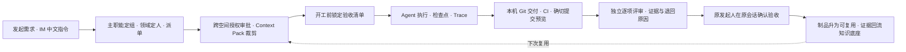
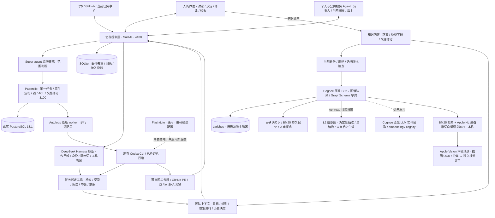

# SuitMe 协作台：架构、功能与接入状态

核验日期：2026-11-05（北京时间），第十轮补充产品与业务架构于 2026-11-07。依据本机运行服务、数据库只读查询及固定版本源码。当前是本机试点，包含开发和联调记录；不是已经部署到全体员工的生产系统。

> **文档分工**：本文件描述「现在是什么」；`ARCHITECTURE-v0.6.md` 是产品架构定稿（不等于全部已实现）；`ARCHITECTURE-OPTIONS-v0.7.md` 是三种收敛方案、主流架构分析与未实现能力清单。判断「哪些还没做、该用哪个开源项目补」以 v0.7 方案为准。

## 产品与业务架构（业务视角，第十轮补）

> 下一节 `当前架构` 是技术分层；本节回答「给谁用、按什么流程跑、哪些功能真的能用」。依据 `PRODUCT.md`、`docs/PRD-v0.6.md` 与本机实测，不把预备配置说成已启用。

**一句话定位**：小规模、高信任、以知识与软件产出为主的团队，需求从 IM 发起，按用途授权专业资料、连续交接，成果交付到本机 Git 或专业知识空间，**由人验收**。现有底座像一个很靠谱的工单系统，v0.6 要补的是「一个组织」：除了「这单跑完没有」，还要回答**谁对什么负责、凭什么算做对了、AI 依据什么做的**。

### 渠道与界面形态（产品形态本身，不是临时界面）

| 位置 | 职责 | 现状 |
|---|---|---|
| 飞书 IM | 发起、追问、通知回写、最终核可 | **当前唯一接通的会话渠道**；纯文本 + 工作台链接，无交互卡片 |
| 中文工作台 | 授权、留痕、审阅、签字 | Paperclip 插件式单页 `/SUI/knowledge-workspaces`，5 个主 tab，不新建独立 app |
| 非 IM 接入端 | Agent / 脚本接入 | CLI、MCP、A2A SDK、本地工作台 API |

约束：一个语义对象两种表达（会话侧文本与工作台侧结构化记录字段不丢）；会话入口不承担工作台职责，工作台也不承担发起职责。第十轮前端重构只拆源码模块，**不改路由、不增 tab、不改上游 UI**。

### 角色与职责（三级 owner 口径不能混）

| 角色 | 管什么 | 不可下放 |
|---|---|---|
| 组织级 owner | 职能注册表、转移授权策略（组织级唯一） | 职能 ID 稳定性、责任链 |
| Workspace owner（数据归属方） | 验证等级策略、汇报拓扑、跨空间授权审批 | 系统安全底线、高风险动作签字 |
| 职能 owner | 起草 Acceptance Plan、联签、兜底责任 | 验收标准不得由承接人自定 |
| 发起人 | 设目标与边界、原会话验收、叫停、回滚 | 最终核可不能交给模型或报告 |
| 承接人 | 执行责任；能力依据须来自参与过的 Task / 产出过的制品 | 不得凭自述认领 |
| 独立评审者 | 逐项判定，须支持截图 / 录屏等视觉输入 | 不得是产出模型 |
| 资料负责人 | 单条资料的采用与撤回 | 私有资料不得自动进入共享 Wiki |

跨空间授权的审批方是**目标 Workspace owner**，不是申请方主管。

### 端到端业务闭环

青色的四个人工决策点在文字版里对应：`B` 定职能与责任、`C` 授权审批、`D` 锁定验收标准、`H` 最终核可。**Agent 完成 ≠ 业务验收**，合并审批、CI 通过、模型判定、验收报告都不替代 `H`。每条链上的可回放证据由 `trace-view` 提供，成本归集到 Task。

### 功能地图（5 个主 tab，二级视图长在 tab 内）

| 主 tab | 二级视图 / 主要动作 | 业务目的 |
|---|---|---|
| 我的工作 | 需要你决定、Agent 进展、最近沉淀 | 人只面对一个入口，不逐系统找待办 |
| 协作 | 任务详情（进展 / 上下文 / 协作与交接 / 知识沉淀 / 验收与责任）、访问申请 | 派单、限时授权、工作稿、逐项验收、过程流水 |
| 知识 | 内容与图谱、检索与记忆、关系与状态、知识字典 | 结构化事实 + 正文 + 来源版本；L2 组织图草稿人审后生效 |
| Agent | 服务目录、成员与归属、职责版本 | 每人一个供同事使用的服务 Agent，职责随工作版本化 |
| 设置 | 模型与代理、服务与架构、空间与权限、组织规则、国内服务 | 预备配置与真实状态分开显示；未接通服务只有说明没有入口 |

用户在会话里看到的只有 7 条中文指令（发起协作 / 查看进度 / 补充说明 / 确认验收 / 代码交付版确认验收 / 验收不通过 / 转交），源自 `src/user-language.ts` 的 `USER_HELP`，工作台帮助与报告直接引用它避免文案漂移。

### 功能成熟度三档（对外表述口径）

| 档位 | 范围 | 证据 |
|---|---|---|
| 已跑通、可回归 | 中文指令、派单与交接、限时授权、Context Pack、知识候选→采用/撤回、开工前锁定清单 + 逐项报告 + Trace、本机 Git 交付全链（clone/push/CI/合并审批/固定提交预览）、组织映射 3 人导入、国内服务实时探测 | 283 项单测、11/11 真实浏览器走查、`delivery:demo` 真跑 |
| 预备配置，**不等于启用** | 模型三档策略（不存 Key、不接外部网关）、Cognee 原生 LLM / embedding / cognify 管线、L2 组织图草稿（待人工审阅）、飞书部门 scope 授权命令（需本人在飞书确认） | 设置页明确标注「保存但未启用」 |
| 未接通 / 未发生 | 企业微信 / 腾讯文档 / 钉钉 / 国内代码托管 / 公有云 CI / Slack、GitHub、Linear、Notion、Vercel、Zapier；全员 SSO 与真实员工入驻；生产发布；真人在真实业务单「确认验收」（SUI-129 仍未核可）；4190 视觉端点与 4192 报告服务当前停机 | 「国内服务」页逐项标注状态来源与接通步骤 |

### 业务红线（不得因重构或新功能冲掉）

1. Paperclip + PostgreSQL 是唯一任务 / 成员 / ACL / 文档修订 / 审计真源，SQLite 只做映射、幂等与接入投影。
2. 默认隔离、按用途放宽：临时授权绑定「本任务 + 指定执行身份 + 期限」，可撤销；权限挂数据上而不挂身份上。
3. 资料授权、知识采用与撤回、最终验收由人决定，模型不得自批。
4. 制品状态（草稿 / 已验收 / 可复用）与验证等级（L1–L4）是两个独立维度，不合并成一个字段。
5. 运行时状态、凭据、真实姓名与 `open_id` 只落 `.runtime/`，不进仓库；测试通过不等于真实业务 journey 通过。

## 当前架构

## 真实接入状态

| 服务或能力 | 本机已核实 | 实际边界 |
|---|---|---|
| Paperclip | 0.3.1，health ok，3100 | 唯一业务任务与运行核心；local_trusted 本机管理员模式 |
| PostgreSQL | 18.1，数据库 paperclip，54329，实际 SQL 读取及持久化 | 任务、项目、Agent、授权、文档、修订与审计；不是内存假数据或 PGlite |
| SuitMe bridge / SQLite | 4180 health ok，真实本地数据库 | 飞书事件、去重、发件箱、接入记录与任务投影；不取代主业务库 |
| 飞书 | 专用测试机器人与事件监听已连通 | 白名单测试单聊；文档/历史讨论已按明确任务许可实测，旧任务授权到期或撤销后不继续使用 |
| GitHub | 测试仓库 PR、CI 与带 SHA 的本机预览已实测 | 不表示业务仓库已合并或生产部署 |
| 协作与开发执行 | 真实 Codex CLI + 原版 Autoloop worker；SUI-74、SUI-81、SUI-85 已运行 | 协作按证据调用工具、提问等待并接续；开发 PR #3 已交付且 CI 通过。旧项目访问失败不通过扩大授权解决 |
| 服务 Agent | 原生成员归属、Harness 构建、A2A 子任务、澄清、回传与取消；独立 3110 实例具有三套 operator 账号和三个资料身份 | 业务与成员为模拟角色；主实例仍为本机管理员模式，不能替代真实员工生产验证 |
| 其他 Agent | 通用 CLI / MCP / 人工接单接入合同 | 注册名称不等于云端自动执行已验证；WorkBuddy、豆包等逐端核实 |
| 模型设置 | 轻量、通用、编码三档与动态执行身份绑定已保存到私有原生文档 | 仅预备配置，不存 API Key；**不接入任何外部 / 云端模型网关**。例外是两套 macOS 设备端能力：Apple NaturalLanguage 词向量（recall 语义加权）与 Apple Vision（截图 OCR / 分类，独立视觉评审），均只监听 `127.0.0.1`、不外发业务材料、不下载模型 |
| Cognee + Ladybug | 固定 1.6.6；持久 chunk、BM25 检索、原文概念与关系候选、人审图版本、原版图谱 | 已确认知识持续索引，当前权限和版本前后复查；**Cognee 原生** LLM / embedding / cognify 与向量语义检索仍未启用；另有不写入 Cognee 的 Apple NL 设备端词向量用于 recall 加权 |
| 知识字典 | Cognee 原生 GraphSchema / reducer / JSON Schema 转换 | 概念、定义、文本/数字/布尔/日期/枚举/关系；按空间配置，尚未驱动自动抽取 |
| Wiki 插件 | 原版插件已安装，本地 Markdown 目录 | 自动摄取关闭，未把共享 Wiki 空间字段当作可靠私有 ACL |
| 存储与部署 | PG、SQLite、版本图及配置均为真实本机持久化 | 没有接对象存储、向量服务、Redis、SSO 或云数据库 |
| 备份 | PostgreSQL 本机备份正常 | 异机恢复未验证；SQLite、图文件、配置与 Wiki 文件还需要联合备份恢复验证 |

## 上下文、知识与记忆

上下文不是审批记录的集合。每次执行组合目标、当前负责人、来源及修订、已获准原文、已确认知识、工作稿、决策、GitHub 版本证据与缺口。范围由任务用途、参与者、原生权限和临时委托决定；公司组织划分由配置迭代，四个早期专业空间只是种子。

- **资料层**：飞书保留实时引用，内部内容使用 Paperclip 文档与原生修订。非结构化正文与有类型的事实字段共同版本化，可编辑、搜索、筛选、审阅和撤回。
- **知识引擎层**：直接集成 Cognee 的 DataPoint、Ladybug、来源追踪、图谱渲染与 GraphSchema。图引擎、字典模型和序列化不重写；SuitMe 只负责现有身份、确切资料版本和原生权限的衔接。
- **当前图层**：已确认内部知识按当前修订持续建立文档、字段、片段和关系索引；Agent 按原文和字典准备概念关系，人审后进入图谱。按来源修订物理隔离；旧修订、过期权限或已验收任务不能用来读取当前上下文。生成图不会确认候选，也不会复活旧授权。
- **当前记忆与后续扩展**：Cognee 原版 BM25 已用于获准来源和已采用概念的持久检索；另有 Apple NaturalLanguage 设备端 300 维中英文词向量（`scripts/apple-embedding.swift`、`src/semantic-recall.ts`）对 recall 结果做语义加权——设备端计算、不下载模型、不写 Cognee、不外发材料，与 Cognee 原生管线无关。跨来源自动消歧、**Cognee 原生** embedding 语义检索与 LLM cognify 管线仍未启用；按用户选择不接入任何外部 / 云端模型服务。

生命周期为来源 → 获准用于本任务 → 工作稿 → 人审候选 → 确认/采用 → 可复用知识。一次任务中出现过不代表可以成为长期记忆；模型不能自行批准授权、采用知识或最终验收。临时访问也不包含将别人的资料永久发布为知识的权限；专业负责人在其有权负责的空间审阅采用。修改内容后进入新的候选修订，确认不能跨版本沿用。

图谱投影与字典目前分别版本化；保存字典不自动迁移旧事实。外部飞书原文当前不进入图处理接口，SUI-54 的私有工作稿未被采用或导入。权限变更后当前接口拒绝读取，并在交付前复查；这不等同于已经实现所有外部副本的物理删除与远程缓存清理。

方案比较、精确复用文件、许可证和启用边界见 [知识引擎集成](KNOWLEDGE-ENGINE.md)。不再计划自行创建一套 knowledge_objects / schemas / relations 作为新的知识引擎。

## 人和 Agent 的协作

人从飞书或后台提出目标；协作助手在既有任务中归纳上下文、准备资料申请、列出缺口、制作工作稿和交接材料。低风险整理按委托推进；授权、知识采用、最终验收由人决定。执行端换手时沿用任务、已确认的输入、检查点和 GitHub 证据，Paperclip 管签出与运行，避免另开一套调度。

个人 Agent 的服务身份与 Codex 等执行引擎分开。职责随当前工作版本化；变更后旧任务暂停沿用旧结果，负责人核对范围后继续。服务登记不会扩大资料权限。详见 [个人 Agent 服务网](AGENT-SERVICE-NETWORK.md) 和 [实际运行合同](AUTONOMOUS-COLLABORATION.md)。

个人模型的三档配置记录提供商、模型标识、凭据环境变量名与输入输出预算，并绑定现有执行身份。保存预备策略不会修改既有运行、加载 Key 或向新的服务发送资料。成员到独立 Agent 身份的适配已实现，使用原生 active membership 与真实通讯录校验；主实例部署仍只有本机负责人；另外的隔离认证实例用于三虚拟成员演练，尚未组织真实员工全员登录。当前不能宣称每位员工都有上线运行的轻量代理。

## 当前页面

- 我的工作：人的待决事项、Agent 进展与最近沉淀。
- Agent：服务目录、成员归属与飞书配对；直接找服务 Agent 提需求，职责设置按需展开。
- 协作任务：目标、负责人、上下文、授权、工作稿、交接、版本证据与验收。
- 知识：检索与记忆、动态知识空间；内容、图谱与字典；结构化字段与正文、来源、版本、关系候选与人审。
- 授权申请：同一任务中的资料、接收身份、用途、期限和处理记录。
- 设置：模型与代理的预备配置，真实服务、存储和知识引擎状态。
- v0.6 增补（P3~P4，2026-11-06）：协作任务详情新增「验收与责任」（开工前锁定清单、逐项评审报告、独立评审就绪状态、**验收报告与自查标准**、Transfer 授权卡片、跨空间授权、统一过程流水与成本）；知识新增「关系与状态」子视图（L2 组织图边状态、Context Pack，**以及 L2 自动抽取状态与全局关系数**）；设置新增「组织规则」只读子视图（职能注册表、授权策略、政策、注意力、Watchdog、本体、**L2 抽取状态**、**飞书组织映射**与组织信号，共 10 段）。**主导航仍为 5 个 tab**，未新建独立界面，全部经 `/workspace/v06-*` 只读 action 消费；执行链路的注意力预算与 Watchdog 已在 `runtimeGuard.enforce`（默认开启）下从「只观测」切到实际生效，人工介入 / 结果 / 验收 / 授权等必达通知由 `protectHumanNotifications` 保护，不被低价值通知抑制。第四轮已做 1280 / 425 Chrome headless 布局走查（`npm run test:responsive`）与上游适配边界审计（`npm run audit:upstream`，清单见 `docs/UPSTREAM-ADAPTERS.md`）；第五轮完成真实宿主实例 5 tab + 3 个 v0.6 视图的全流程浏览器走查（`npm run test:walkthrough`，10/10 通过）与本地演示页；第六轮补上用户语言层（会话里全中文指令，旧英文命令只作内部兼容）、按开工前锁定清单的确认验收路径、飞书真实成员只读组织草案与只绑 loopback 的本机中文验收报告服务，两个新增只读视图仍挂在原有 tab 内，走查复跑 10/10 通过。

常用宿主文案通过构建期 AST 中文词典覆盖；只改展示文案，保留路由、API 值和用户内容，上游源码不变。深层原生页面、原生认证页面和插件动态文案仍有未翻译部分，不宣称所有页面已经完整中文化。

## 集成后再完善

1. 将已适配的原生成员登录与个人代理归属部署给实际同事，验证多人共同使用；补全组织映射及联合备份恢复。
2. 在用户选定服务后启用轻量模型网关与 Cognee 原生管线，验证真实资料的引用、关系、冲突、撤权与成本；不因无 Key 路径存在而下载运行模型。
3. 根据真实知识规模补全文档附件、全文/语义混合检索、跨来源消歧和图编辑；优先原版模块，先验证权限隔离再打开共享。
4. 产品闭环经用户验收后，才整理冗余适配、替换不合适的上游界面与优化复用代码，保留来源及升级路径。

## 前端模块分层（第十轮重构）

`plugins/knowledge-workspaces/src/ui/` 原先由一个 527 行、35 个顶层声明的 `index.tsx` 承担全部职责（UI 原语、任务详情、设置、页面壳），并且 `v06-panels.tsx` 自带一份重复的 `useRead` 状态机。第十轮按职责拆分，**零路由变化、零 tab 变化、零上游改动**：

| 层 | 文件 | 职责 |
|---|---|---|
| 入口 | `index.tsx` | SDK 的 `uiEntry` 固定指向它，只再导出 `WorkspacePage` / `WorkspaceSidebar` |
| 基础设施 | `foundation.tsx` | `UI` 契约、中文文案字典、`useDraft` / `retained` 草稿状态、`Button` / `Badge` / `Details` / `Icon` / `RecordBody`、URL 协议白名单、`ActionError` |
| 异步契约 | `async.ts` | `useRead`（只读状态机，v0.6 面板与业务视图共用）、`useActionFeedback`（写操作就地反馈） |
| 视图 | `forms.tsx`、`domestic-services.tsx`、`settings.tsx`、`task-detail.tsx`、`spaces.tsx` | 表单、国内服务清单、设置、任务详情、知识空间各自独立 |
| 页面壳 | `workspace-page.tsx` | 宿主 action 通道、轮询、5 tab 路由与视图装配 |

依赖单向：`foundation` / `async` 无内部依赖 → 视图层 → `workspace-page` → `index`；`tests/frontend-structure.test.ts` 守卫这套边界。写操作不再静默吞错：两个高频表单用 `useActionFeedback` 就地提示，其余统一经 `UI.report` 上报页面错误条；只有后台轮询与 `invoke` 的 rethrow 保留有注释说明的静默 catch。外链统一经 `safeHttpUrl` / `safeLoopbackUrl` 校验，「未接通不放入口」的链接出口全前端仍只有一处。

## 实现指针

`src/agent-services.ts` 管服务与职责版本；`src/coordination.ts` 调用 Super-agent 原版策略；`src/assistant-runner.ts`、`src/runner.ts` 使用 Autoloop 原版 worker；`src/assistant-tools.ts` 暴露任务绑定工具；`src/workspaces.ts` 管任务授权、交接和人审；`src/context.ts` 管执行上下文；`src/knowledge.ts` 管原生内容与确认；`src/graph.ts` 和 `scripts/cognee-graph.py` 衔接 Cognee；`src/ontology.ts` 保存字典模型；`src/model-settings.ts` 保存预备模型策略；`plugins/knowledge-workspaces/src/ui` 是中文工作台。

## 多人协作与持续记忆适配更新

本轮直接复用 Paperclip 的真实成员与角色，官方 A2A 1.3.0 的处理器与传输，Cognee 的持久图和原版 BM25。服务任务、上下文、成果和已确认知识已经接通；不是新增独立审批台或第二个调度器。当前原生 authenticated 登录与实际团队入驻仍待配置，不通过填写虚拟成员证明全员可用。完整合同、接口、前端结构和验证边界见 [多人服务与团队记忆](TEAM-NETWORK-MEMORY.md)。

知识层现支持已确认资料持续索引、权限过滤的中文检索、概念关系候选与采用、当前字典/来源变动失效。前文“后续记忆层”中 BM25 与人审关系已经落地；**L2 组织图已连 Cognee L1 只读投影做确定性自动抽取**（`src/org-extraction.ts`，零模型调用、带逐字原文证据、草稿待人审），**Cognee 原生**自动 LLM 实体抽取、embedding 与向量语义检索继续关闭；本机 Apple NL 设备端语义加权不在此列。验收侧已接入真实本机视觉语义评审：Apple Vision 设备端 OCR + 图像分类经 `http://127.0.0.1:4190/v1/chat/completions` 提供，`LocalModelVisionAdapter` 只允许本机 http 直连、拒绝代理与外发；新验收流程通过 `config.acceptance.mode=independent` 开启，本机实例已开启并在 SUI-129 上跑通 2/2 逐项判定，报告可导出为 `lobehub/acceptance` 格式的 bundle。仓库默认仍可 `legacy` 一行回退。

## 三成员隔离实例

新增模拟实例使用原版 Paperclip authenticated 模式、独立 PostgreSQL 与独立状态目录，工作台 3110、桥接 4181。它不修改主实例的成员、飞书白名单或真实项目资料。三个业务角色均非管理员；正向申请、授权、委托、知识采用与验收通过前端操作，原生 API 权限矩阵另行验证。运行方式及复用边界见 [Agent 构建](AGENT-BUILDING.md)。

## 本机只读总览（第七轮）

`scripts/acceptance-report.ts serve` 在 `127.0.0.1:4192` 额外提供 `/overview`：`src/acceptance-report.ts` 的 `renderOverviewHtml` 只渲染纯数据，脚本侧用 `node:http` 直连探测 3100 / 4180 / 4190 / 4192 的实时状态，读取 `.runtime/config.json` 的验收配置与 `.runtime/org-mapping-draft.json` 的**成员计数与布尔值**（成员明细不进页面），中文指令清单直接引用 `USER_HELP` 避免文档漂移。该页不写任何状态、不调用业务写接口，也不依赖 bridge 的身份令牌；`4190` 视觉端点停机时只显示离线，不会伪装成结构式评审通过。

## 国内环境适配与本机代码交付（第八轮）

`config.delivery.provider` 默认 `local`：`src/github.ts` 导出 `DeliveryAdapter`（`prepare / publish / inspect / preview`），`src/local-git.ts` 以本机裸仓库 + 本机合并请求记录 + 本机 CI（提交存在、允许路径、与 main 无冲突）+ 确切提交预览实现同一契约，`src/server.ts` 按配置注入 `Controller`，`github` 适配器保留供已有部署回退，业务验收红线未动。`scripts/delivery-server.ts` 只绑 `127.0.0.1:4194` 提供中文交付台，并在 `127.0.0.1:9418` 起 `git daemon` 供 clone / pull / push；合并审批与通知记录落 `.runtime/git/deliveries/`，不改写业务任务状态。

前端适配分两层：`src/shell-domestic.ts` 在构建期精确收敛上游侧栏的技能库 / 连接服务入口，运行时通过同源 `suitme-domestic.js` 过滤**数据驱动且未连接**的海外集成卡片；`scripts/build-chinese-shell.ts` 先收敛再翻译，`install-upstream.ts` 与 `up.ts` 保证中文壳默认生效。插件设置的「国内服务」由只读 `service-status` 统一提供数据（见下节），**只有实测接通才渲染链接**，未接通项只做文字说明，不留空壳入口。

## 服务状态真实性与前端体验修复（第九轮）

`src/service-status.ts` 是国内服务清单的唯一数据来源。`collectServiceStatus()` 用 `node:http` 并发直连 loopback 探测 3100 / 4190 / 4192 / 4194，绕过可能失效的环境代理；`buildServiceStatus()` 是纯函数，负责把结果组装成逐项 `state / detail / url / setup / source`。只有 `state==='connected'` **且** `safeLoopbackUrl()` 校验通过的条目才带 `url`；未接通项只有原因与可照做的步骤，没有 `url` 字段，因此前端不可能渲染出空壳链接。交付台还额外校验 `scope=loopback-only`、`provider=local-git` 与端口，防止端口被别的服务占用时误判。Paperclip 的 `/health` 是 SPA HTML 回退而非 JSON，探测按「200 + `<html`」判定在线，其他任意 200 不算接通。

前端「国内服务」页改为完全数据驱动：按本机 / 国内 / 海外分组，显示状态来源（区分实时探测、进程内判定与飞书监听器事件推断），每 15 秒在页面可见时自动刷新，提供手动刷新、加载态与独立的错误态；探测失败不再被静默显示成「未接通」。设置页的两个读请求改为分别降级，任一失败不会让另一块永久停在「正在读取」，模型配置保存失败有就地提示，成员视图禁用仅操作员可用的保存按钮。`system-status` 里写死的 `vectorSearch: true`、`automaticExtraction: false` 与只看 `visualReviewer.mode` 的评审者文案，改为从 `config` 派生并明确区分「已配置」与「端点在线」；`service-status` 同步补进服务端只读白名单与成员只读白名单。

`scripts/build-chinese-shell.ts` 在每次构建前从 `public/sw.js` 恢复 `dist/sw.js` 的原始占位符，修复上游 `closeBundle` 就地 stamp 后重复构建必失败的幂等问题；`tests/v06-services.test.ts` 的 `at` 改为相对当前时间，去掉固定日期导致的「过 8 小时就必然失败」的时间炸弹。

宿主侧栏的「技能 / 连接服务」链接带公司前缀（实测 `/SUI/skills`、`/SUI/apps`），构建期 4 条规则覆盖不到这种运行时拼接的路径；运行时脚本改用 `ROUTE = /^\/(?:[A-Za-z0-9_-]+\/)?(skills|apps)(\/|$)/`，同时隐藏链接与其 `li` 容器，并在真实浏览器走查中断言这两个入口已隐藏、插件页与面包屑不受影响。自动刷新失败静默保留上次结果并在状态行标注，只有手动刷新或首次加载失败才提示，避免瞬时网络抖动弹出误导性的红色错误框。
