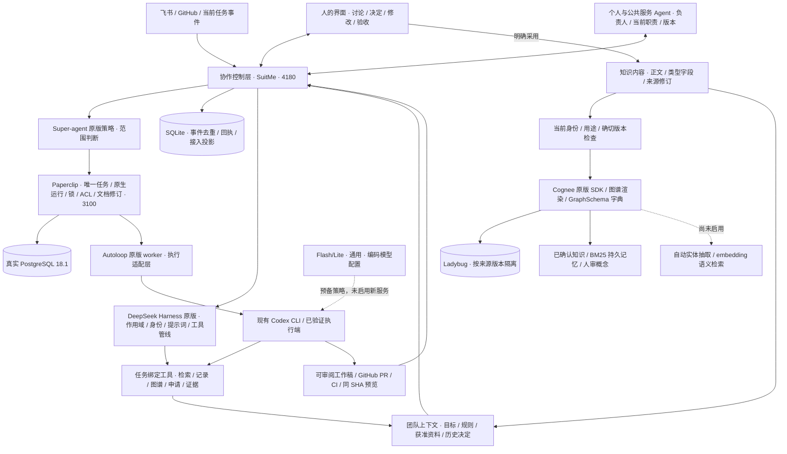

# SuitMe 协作台：架构、功能与接入状态

核验日期：2026-11-05（北京时间）。依据本机运行服务、数据库只读查询及固定版本源码。当前是本机试点，包含开发和联调记录；不是已经部署到全体员工的生产系统。

## 当前架构

## 真实接入状态

| 服务或能力 | 本机已核实 | 实际边界 |
|---|---|---|
| Paperclip | 0.3.1，health ok，3100 | 唯一业务任务与运行核心；local_trusted 本机管理员模式 |
| PostgreSQL | 18.1，数据库 paperclip，54329，实际 SQL 读取及持久化 | 任务、项目、Agent、授权、文档、修订与审计；不是内存假数据或 PGlite |
| SuitMe bridge / SQLite | 4180 health ok，真实本地数据库 | 飞书事件、去重、发件箱、接入记录与任务投影；不取代主业务库 |
| 飞书 | 专用测试机器人与事件监听已连通 | 白名单测试单聊；文档/历史讨论已按明确任务许可实测，旧任务授权到期或撤销后不继续使用 |
| GitHub | 测试仓库 PR、CI 与带 SHA 的本机预览已实测 | 不表示业务仓库已合并或生产部署 |
| 协作与开发执行 | 真实 Codex CLI + 原版 Autoloop worker；SUI-74、SUI-81、SUI-85 已运行 | 协作按证据调用工具、提问等待并接续；开发 PR #3 已交付且 CI 通过。旧项目访问失败不通过扩大授权解决 |
| 服务 Agent | 原生成员归属、Harness 构建、A2A 子任务、澄清、回传与取消；独立 3110 实例具有三套 operator 账号和三个资料身份 | 业务与成员为模拟角色；主实例仍为本机管理员模式，不能替代真实员工生产验证 |
| 其他 Agent | 通用 CLI / MCP / 人工接单接入合同 | 注册名称不等于云端自动执行已验证；WorkBuddy、豆包等逐端核实 |
| 模型设置 | 轻量、通用、编码三档与动态执行身份绑定已保存到私有原生文档 | 仅预备配置，不存 API Key；新模型请求固定关闭，尚无新模型网关 |
| Cognee + Ladybug | 固定 1.6.6；持久 chunk、BM25 检索、原文概念与关系候选、人审图版本、原版图谱 | 已确认知识持续索引，当前权限和版本前后复查；新增 LLM/embedding 与向量语义检索仍未启用 |
| 知识字典 | Cognee 原生 GraphSchema / reducer / JSON Schema 转换 | 概念、定义、文本/数字/布尔/日期/枚举/关系；按空间配置，尚未驱动自动抽取 |
| Wiki 插件 | 原版插件已安装，本地 Markdown 目录 | 自动摄取关闭，未把共享 Wiki 空间字段当作可靠私有 ACL |
| 存储与部署 | PG、SQLite、版本图及配置均为真实本机持久化 | 没有接对象存储、向量服务、Redis、SSO 或云数据库 |
| 备份 | PostgreSQL 本机备份正常 | 异机恢复未验证；SQLite、图文件、配置与 Wiki 文件还需要联合备份恢复验证 |

## 上下文、知识与记忆

上下文不是审批记录的集合。每次执行组合目标、当前负责人、来源及修订、已获准原文、已确认知识、工作稿、决策、GitHub 版本证据与缺口。范围由任务用途、参与者、原生权限和临时委托决定；公司组织划分由配置迭代，四个早期专业空间只是种子。

- **资料层**：飞书保留实时引用，内部内容使用 Paperclip 文档与原生修订。非结构化正文与有类型的事实字段共同版本化，可编辑、搜索、筛选、审阅和撤回。
- **知识引擎层**：直接集成 Cognee 的 DataPoint、Ladybug、来源追踪、图谱渲染与 GraphSchema。图引擎、字典模型和序列化不重写；SuitMe 只负责现有身份、确切资料版本和原生权限的衔接。
- **当前图层**：已确认内部知识按当前修订持续建立文档、字段、片段和关系索引；Agent 按原文和字典准备概念关系，人审后进入图谱。按来源修订物理隔离；旧修订、过期权限或已验收任务不能用来读取当前上下文。生成图不会确认候选，也不会复活旧授权。
- **当前记忆与后续扩展**：Cognee 原版 BM25 已用于获准来源和已采用概念的持久检索。跨来源自动消歧、embedding 语义检索与原生 LLM cognify 管线尚未启用；按用户选择不接入新模型。

生命周期为来源 → 获准用于本任务 → 工作稿 → 人审候选 → 确认/采用 → 可复用知识。一次任务中出现过不代表可以成为长期记忆；模型不能自行批准授权、采用知识或最终验收。临时访问也不包含将别人的资料永久发布为知识的权限；专业负责人在其有权负责的空间审阅采用。修改内容后进入新的候选修订，确认不能跨版本沿用。

图谱投影与字典目前分别版本化；保存字典不自动迁移旧事实。外部飞书原文当前不进入图处理接口，SUI-54 的私有工作稿未被采用或导入。权限变更后当前接口拒绝读取，并在交付前复查；这不等同于已经实现所有外部副本的物理删除与远程缓存清理。

方案比较、精确复用文件、许可证和启用边界见 [知识引擎集成](KNOWLEDGE-ENGINE.md)。不再计划自行创建一套 knowledge_objects / schemas / relations 作为新的知识引擎。

## 人和 Agent 的协作

人从飞书或后台提出目标；协作助手在既有任务中归纳上下文、准备资料申请、列出缺口、制作工作稿和交接材料。低风险整理按委托推进；授权、知识采用、最终验收由人决定。执行端换手时沿用任务、已确认的输入、检查点和 GitHub 证据，Paperclip 管签出与运行，避免另开一套调度。

个人 Agent 的服务身份与 Codex 等执行引擎分开。职责随当前工作版本化；变更后旧任务暂停沿用旧结果，负责人核对范围后继续。服务登记不会扩大资料权限。详见 [个人 Agent 服务网](AGENT-SERVICE-NETWORK.md) 和 [实际运行合同](AUTONOMOUS-COLLABORATION.md)。

个人模型的三档配置记录提供商、模型标识、凭据环境变量名与输入输出预算，并绑定现有执行身份。保存预备策略不会修改既有运行、加载 Key 或向新的服务发送资料。成员到独立 Agent 身份的适配已实现，使用原生 active membership 与真实通讯录校验；主实例部署仍只有本机负责人；另外的隔离认证实例用于三虚拟成员演练，尚未组织真实员工全员登录。当前不能宣称每位员工都有上线运行的轻量代理。

## 当前页面

- 我的工作：人的待决事项、Agent 进展与最近沉淀。
- Agent：服务目录、成员归属与飞书配对；直接找服务 Agent 提需求，职责设置按需展开。
- 协作任务：目标、负责人、上下文、授权、工作稿、交接、版本证据与验收。
- 知识：检索与记忆、动态知识空间；内容、图谱与字典；结构化字段与正文、来源、版本、关系候选与人审。
- 授权申请：同一任务中的资料、接收身份、用途、期限和处理记录。
- 设置：模型与代理的预备配置，真实服务、存储和知识引擎状态。

常用宿主文案通过构建期 AST 中文词典覆盖；只改展示文案，保留路由、API 值和用户内容，上游源码不变。深层原生页面、原生认证页面和插件动态文案仍有未翻译部分，不宣称所有页面已经完整中文化。

## 集成后再完善

1. 将已适配的原生成员登录与个人代理归属部署给实际同事，验证多人共同使用；补全组织映射及联合备份恢复。
2. 在用户选定服务后启用轻量模型网关与 Cognee 原生管线，验证真实资料的引用、关系、冲突、撤权与成本；不因无 Key 路径存在而下载运行模型。
3. 根据真实知识规模补全文档附件、全文/语义混合检索、跨来源消歧和图编辑；优先原版模块，先验证权限隔离再打开共享。
4. 产品闭环经用户验收后，才整理冗余适配、替换不合适的上游界面与优化复用代码，保留来源及升级路径。

## 实现指针

`src/agent-services.ts` 管服务与职责版本；`src/coordination.ts` 调用 Super-agent 原版策略；`src/assistant-runner.ts`、`src/runner.ts` 使用 Autoloop 原版 worker；`src/assistant-tools.ts` 暴露任务绑定工具；`src/workspaces.ts` 管任务授权、交接和人审；`src/context.ts` 管执行上下文；`src/knowledge.ts` 管原生内容与确认；`src/graph.ts` 和 `scripts/cognee-graph.py` 衔接 Cognee；`src/ontology.ts` 保存字典模型；`src/model-settings.ts` 保存预备模型策略；`plugins/knowledge-workspaces/src/ui` 是中文工作台。

## 多人协作与持续记忆适配更新

本轮直接复用 Paperclip 的真实成员与角色，官方 A2A 1.3.0 的处理器与传输，Cognee 的持久图和原版 BM25。服务任务、上下文、成果和已确认知识已经接通；不是新增独立审批台或第二个调度器。当前原生 authenticated 登录与实际团队入驻仍待配置，不通过填写虚拟成员证明全员可用。完整合同、接口、前端结构和验证边界见 [多人服务与团队记忆](TEAM-NETWORK-MEMORY.md)。

知识层现支持已确认资料持续索引、权限过滤的中文检索、概念关系候选与采用、当前字典/来源变动失效。前文“后续记忆层”中 BM25 与人审关系已经落地；自动 LLM 抽取及向量语义部分继续关闭。

## 三成员隔离实例

新增模拟实例使用原版 Paperclip authenticated 模式、独立 PostgreSQL 与独立状态目录，工作台 3110、桥接 4181。它不修改主实例的成员、飞书白名单或真实项目资料。三个业务角色均非管理员；正向申请、授权、委托、知识采用与验收通过前端操作，原生 API 权限矩阵另行验证。运行方式及复用边界见 [Agent 构建](AGENT-BUILDING.md)。
