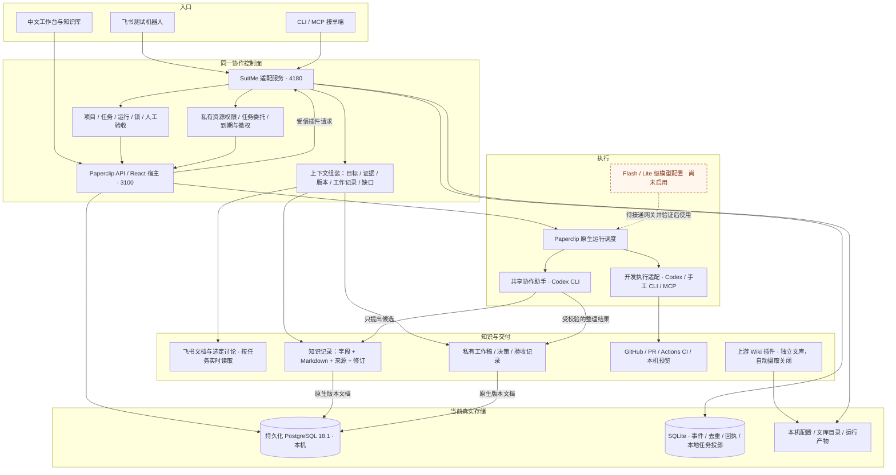

# SuitMe 协作台：架构、功能与接入状态

核验日期：2026-11-05（北京时间）。以运行中的本机系统、数据库只读查询和当前源码为依据。图中的“待接入”是设计目标，不表示已连接。数据库数量包含开发、联调和真实试点记录，不代表生产业务规模。

## 当前运行架构

Paperclip 继续拥有原生任务、运行、锁、资源权限、文档修订与审计。适配层保存接入事件和工作流投影，不另建一套 Agent 调度器。SQLite 中的任务映射与原生记录存在双写和恢复工作，不能宣称所有状态都已统一在一张业务数据库中。

## 实际接入状态

| 组件 | 核验结果 | 边界 |
|---|---|---|
| Paperclip / SuitMe 服务 | 两个本机服务均运行 | 单机部署，非公网团队服务 |
| PostgreSQL | 实际 SQL 查询确认 18.1，持久化存储 | 本机嵌入式管理的完整 PostgreSQL，不是外部云数据库，也不是内存假库 |
| 数据内容 | 核验时 70 个原生任务、121 份文档、29 次运行、13 个 Agent 注册项 | 包含历史联调；注册项不等于已接通模型或真实员工 |
| SQLite | tasks、events、receipts、outbox、audit 均有真实记录 | 事件和任务投影仍在本机，需纳入整套备份恢复 |
| 飞书 | 真实 IM 接续、原处回复、指定 docx 与选定消息读取已验证 | 当前使用管理员已登录用户的任务级委托；未验证完整组织 ACL 同步和员工独立登录 |
| GitHub | 真实仓库、提交、PR/CI 与试点预览已有链路 | 平台代码交付与具体业务功能验收分别记录；未接生产部署平台 |
| Codex | 共享事务助手有真实成功运行 | 模型参数未明确绑定；开发身份另外保留了历史 setup_failed，不能用助手成功代表全部执行身份健康 |
| Claude Code / WorkBuddy / 豆包工作 | 有原生身份、手工接单或 CLI/MCP 适配位置 | 不能把身份可选当成云端自动执行服务已接通 |
| Flash / Lite 模型 | 本轮新增分层、身份绑定、凭据变量名和额度预备配置 | 按用户决定不启用新服务；未做真实 API 调用、效果或费用验证 |
| 知识库 | 私有版本文档、字段、正文、来源、确认/撤回、按任务引用 | 目前不是通用业务对象数据库；字段只支持文本、数字、布尔值 |
| Wiki | 上游插件已安装，目录健康，维护操作数为 0 | 自动摄取关闭，没有自动同步私有工作上下文 |
| 检索 | 权限过滤 + 关键词与查询词排序 + 按需扩展正文 | 未接 embedding、向量库或重排模型；不能称为完整语义 RAG |
| 附件 / OCR / 多模态入库 | 尚未形成知识库处理管线 | 正文编辑不等于 PDF/图片/音视频内容管理已经完成 |
| 备份 | 原生数据库本机备份健康 | 异机恢复、SQLite/配置/附件的联合恢复未验证 |
| 云端数据库 / S3 / Redis / SSO | 本轮未接入 | 无须为画架构图先安装；按实际部署和规模补齐 |

## 人的代理与模型分层

一个成员的代理应是持续存在的委托身份：归属、职责、可用工具、任务、授权和上下文均独立。模型是这个身份使用的算力，可以共享服务，不应把模型账号或一段全公司聊天当成成员身份。

| 层级 | 适用任务 | 约束 |
|---|---|---|
| 轻量事务 fast | 摘要、分类、字段提取、整理待办、交接草稿、检索结果归纳 | 一次调用优先；结构化输出校验；输入和输出额度；缺证据不编造 |
| 复杂分析 standard | 跨来源冲突、方案比较、研究与复杂拆解 | 有证据、次数和预算上限；升级前说明原因；不自动扩大资料范围 |
| 开发执行 code | 改代码、运行检查、提交工作成果 | 复用 Codex/Claude Code/CLI/MCP；独立工作目录、执行锁、明确交付证据 |
| 程序规则 | 权限判定、事件去重、状态迁移、预算闸、版本校验 | 由服务端执行，不消耗模型猜测确定规则 |

本轮模型页面保存的是**预备策略**，保存在 Paperclip 私有文档、带原生修订号。只允许记录凭据环境变量名称，不收集或回显密钥。保存不会改变既有 CLI、启动新调用、延长资料授权或切换进行中的任务。当前仍只有本机管理员，真实成员到代理的归属、多人身份管理和模型网关尚未完成。

将来启用时必须记录实际 provider/model/策略修订、处理方、任务授权版本、用量和失败原因；不能只记录一个“fast”别名。既有任务不能因修改默认模型而悄悄换处理服务。超时先查原调用，不以更换服务绕过资料许可或重复执行。

候选服务应在启用前核对账号可用性、地域、模型 ID、结构化输出与预算；当前官方模型目录可参考 [Gemini 模型](https://ai.google.dev/gemini-api/docs/models)，方舟凭据应按[官方 API Key 指引](https://www.volcengine.com/docs/82379/1541594)管理。本轮没有启用任何候选服务。

## 结构化与非结构化怎样结合

一个知识条目同时包含这些部分，避免维护两份互不相通的数据：

| 部分 | 当前实现 | 后续扩展 |
|---|---|---|
| 身份与治理 | ID、公司/空间、类型、适用范围、候选/确认/撤回、有效期 | 可配置内容模型、负责人、标签和受众策略 |
| 结构化事实 | 文本、数字、布尔字段；编辑保留真实类型 | 日期、枚举、对象关联、表格、字段校验与模板版本 |
| 非结构化内容 | Markdown 正文、原文链接、任务工作稿 | 附件、PDF/图片解析、段落锚点和多模态材料 |
| 证据 | 原任务、来源、来源版本、引用范围、原生修订 | 字段/段落级证据、冲突和影响分析 |
| 使用 | 按身份和任务过滤后给 Agent，写入本轮输入清单 | 全文与语义混合检索、严格权限分区的索引失效 |

目前结构化元数据序列化在原生 Markdown 文档的受控 JSON 区块中，正文与之共同版本化。它已能保存类型，但还没有专门的 JSONB 字段索引、领域实体关联与 SQL 分析视图。下一阶段按通用 `knowledge_objects / schemas / relations / source_revisions` 建模，空间、字段和权限配置化；不建立写死的“产研表、增长表、销售表”。

生命周期：外部来源 → 获准检索 → 任务工作稿 → 人审候选 → 确认/采用 → 可复用知识。外部原文和工作稿不会因为出现过就自动成为公司知识。修改已确认内容后重置为待确认；基于旧版本的确认和输入证据失效。撤权/删除需要同时覆盖原文、片段、索引、缓存和派生记录的使用资格；合法保留的任务历史只向当前有权的审阅者开放。

## 页面结构与本轮落地

- 我的工作：人的待决事项、Agent 进展、已确认知识入口。
- 协作任务：目标、上下文、授权、交接、工作稿和验收记录。
- 知识库：动态空间、标题/字段/正文搜索、状态/内容形态筛选、类型、有效期、字段编辑、正文编辑、来源、版本、确认/撤回。
- 授权申请：同一任务上的材料、接收身份、用途、时限和处理历史。
- 设置：模型与代理的预备策略；服务、存储和架构的真实状态。

原生宿主的主导航、待办、任务与配置的常用文案使用构建期中文词典。通过语法树只替换界面展示文案，保留路由、API 状态值、数据身份和用户内容。上游源码及许可证不改写；插件自身的文案仍由插件维护，尚未覆盖的深层页面和动态文案需继续按真实使用路径补齐。

## 接下来按依赖补齐

1. 多成员登录及成员—代理归属，部署、密钥和联合备份恢复；把当前只支持本机管理员的限制去掉。
2. 明确服务后接通轻量模型网关，做摘要/提取等真实任务评测；将预备策略变为经验证的运行策略，增加路由和成本证据。
3. 通用内容模型、对象关联、附件处理和全文检索；保留原生版本与权限，优先复用 Wiki 编辑/文库能力，隔离能力验证前不复制私有资料。
4. 在真实内容规模和检索评测证明必要后，增加 embedding/向量混合检索；同时验证撤权与索引失效。无需提前新增独立调度器或一整套重型服务。

## 实现指针

- `src/workspaces.ts`：空间、资料、授权、交接、内容修改、知识采用与验收。
- `src/knowledge.ts`：结构化字段 + 正文、签名确认和版本。
- `src/context.ts`：权限过滤、来源版本与输入清单、关键词检索、工作记录。
- `src/assistant.ts`、`src/assistant-runner.ts`：原生运行中的协作事务模型。
- `src/model-settings.ts`：仅保存预备配置，不包含模型 API 调用。
- `src/store.ts`：SQLite 接入事件、回执和本地投影。
- `scripts/build-chinese-shell.ts`、`src/shell-locale.ts`、`locales/shell.zh-CN.json`：可重现的中文宿主构建覆盖层。
- `plugins/knowledge-workspaces/src/ui`：中文工作台、知识内容管理、模型和服务设置。
