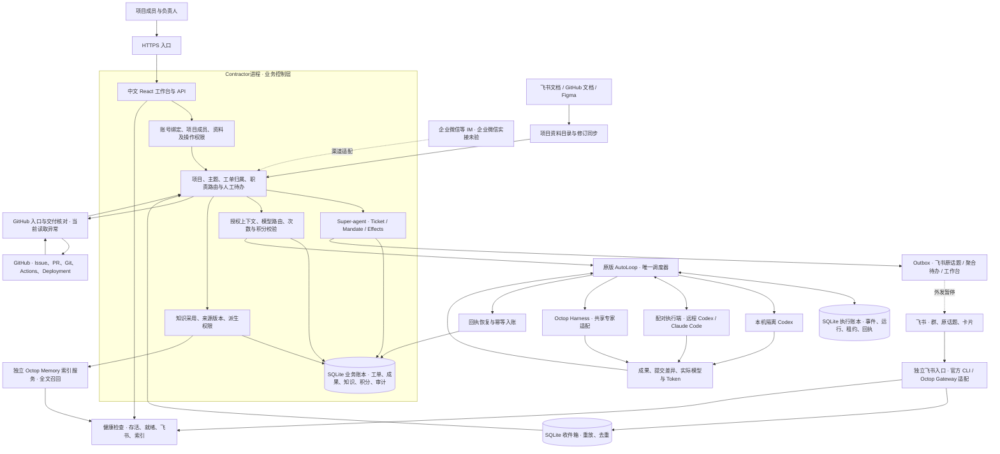
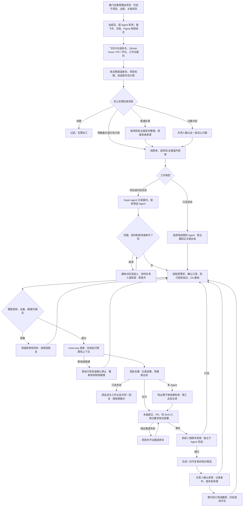

# Contractor · 系统架构与功能复核

后续版本已接入项目仓库同步状态、部署验收页面和积分管理页面。部署结构与新一轮证据见 [按项目组织的架构](WORKBENCH-PROJECT-ARCHITECTURE.md)。本报告保留该批修复前的核对记录。

2026-11-17。现有测试工作台后端版本 `baef89509f93678b`，该版本清单的 70 个源码文件与当前工作区一致。系统已覆盖从项目、委托、执行到验收和知识回用的主要业务链。当前最明显的断点在 GitHub 实时连接、部署验收页面和积分管理页面。飞书入口、知识索引与积分账本已运行，外发通知目前处于暂停状态。

## 一、现在实际运行的系统

Super-agent 管工单和委托，AutoLoop 管执行、租约与回执，Contractor 管项目关系、权限、上下文、积分和验收。飞书入口、知识索引已经是独立进程。数据库仍由单工作台写入业务 SQLite，AutoLoop 使用自己的执行账本，备份包含两份账本。Octop 的知识索引按查询构建授权资料的临时全文索引。Backstage 用于资料及关系标识，Entire 用于提交归因，Paperclip 用于部分前端组件。LobeHub 提供交互与运行治理参考。

## 二、门店推荐理由从创建到知识回用

同一主题下，文案和小屏换行是两张独立单。PR #18 的三次交付是原小屏单的三个版本。第 3 版已有真实验收记录，系统保留本版提交 `41abe3272ea7` 的两次 CI 以及旧版证据。新咨询可按授权检索现行规则并点回来源版本。工作台能显示 PR 和 CI 链接，外部原页仍由 GitHub 权限决定。

## 三、六项问题现在是否解决

| 模块 | 现行行为与证据 | 仍缺什么 |
| --- | --- | --- |
| 登录安全 | 改口令后旧 Cookie 跨进程失效，旧 Cookie 401 和新口令可登录已做切换验证。本次重跑对应测试，并在运行服务核对匿名工单请求为 401。成员身份、凭据代次及项目权限分别核对 | 现行是本地账户、进程内会话与失败次数控制。SSO、MFA 和完整组织账号生命周期未接入 |
| 飞书入口 | 独立收件箱，先持久化、处理成功再确认。未处理回调不再被三天清理，保留重放与去重。本次消息与卡片订阅均就绪，积压和超期均为零。历史有停机补读、原话题接续和真人卡片验证 | 补读依赖授权、时间窗口和已知话题。离线时未收到的卡片点击不能靠群历史重建。通知外发暂停，本次未新增点击或发送 |
| 知识检索 | 已移除最近 96 条的预筛，全部授权现行候选分批进入一次全文排名。既有 201 条演练覆盖旧资料。本次实际项目检索命中两条，授权图谱接口返回 32 节点、84 条关系 | 运用的是全文检索和业务来源关系。语义检索、业务实体图谱可视化、全量持久索引及大库性能仍缺 |
| 服务监控 | 进程存活和业务就绪已分开。独立索引异常会标为不可用。已实测停索引时工单仍可读，恢复无需重启工作台。本次运行中飞书和索引就绪 | GitHub 的新连接失败还只进后台日志。卡片状态、入口逾期数量虽已展示，未统一进入就绪判定或告警。尚无跨依赖监控与值班告警 |
| 积分控制 | 后端已启用，按模型倍率、项目总池、用途池、Agent 池预留并按实际 Token 结算。实跑记录 6.233 分，历史不追扣，重复回执只结算一次，换模型或换端仍受总池限制 | 前端额度页仍读次数和时限接口，尚未显示积分开关、倍率、预留或超限。本轮现行配置只读核实；CLI 单轮超预留按实入账并约束后续派工 |
| GitHub 交付适配 | 已有同 PR 多版、指定 CI 名及 App、同 SHA 重跑、旧 SHA 拒绝和真人分版验收证据。本次实际读取 PR #18 的三版交付和四次 CI 历史。部署后端会按当版 SHA、指定环境和最新成功状态重验 | 当前后台 GitHub 轮询反复失败，本机同一 `gh api` 探测出现 TLS 握手超时。部署门禁仅有受控 API 回归，浏览器验收表单缺 `deployment.id/statusId`，真实 Deployment 联调未完成 |

## 四、全模块覆盖

| 模块 | 已具备的功能 | 验证状态或剩余缺口 |
| --- | --- | --- |
| 组织、身份与权限 | 飞书及 GitHub 账号持有证明、成员/维护人/资料负责人/仓库贡献者、记录人和委托人分别留痕 | 已有真人飞书双账号和项目权限验证。只有父项目权限不能自动看子项目。独立多租户治理还待补 |
| 项目与主题 | 项目及子项目、关联项目、主题及子主题、父子工单及关联。按项目配置职责 | 数据及权限有回归、真实测试群子主题接续。自由编辑项目关系、跨项目自动协作尚有限 |
| 多源资料 | 飞书群和文档、GitHub 多仓、Figma 节点、普通链接可挂同项目，区分讨论、依据、交付目标 | 飞书与 GitHub 有实跑。Figma 源版本和 ACL 有受控接口验证，独立服务还缺真实凭据联调 |
| 接入与整理 | 飞书入口、GitHub Issue/评论/PR 变化、账号归一、版本留存、撤回、重复反馈归纳与每条来源留存 | 飞书主入口实跑过。GitHub 即时读取当前异常。企业微信路由回归通过，缺真实机器人 |
| 归属与立项 | 原单接续、另立子单、记项目或主题、忽略。显式引用冲突由人单条改挂 | 回归与历史实跑，无法确定归属时需要负责人 |
| 人与 Agent 协作 | 个人 Agent、项目职责 Agent、平台整理、主题咨询署名、共享技能/专家、按需委托研发 | Codex、Claude Code 及共享专家有历史实跑。跨项目自动拆解、任意任务图、负载调度未证实 |
| 人的决策与通知 | 必答、接单/拒单、授权、范围确认、交接、验收、采用；指定人处理，按钮幂等 | 真人验收与无权点击已有证据。群卡默认只显示状态和入口；当前外发暂停 |
| 执行与恢复 | 本机隔离、远程配对、工作区/会话/凭据隔离、断线重连、撤权、停旧换端、回执补写 | 历史有真实 Codex/Claude 与 Debian 证据；本次 macOS 回归跳过 Linux 专属项。Cursor、WorkBuddy 等未证明能作为同等受控执行端 |
| 多 Agent 子任务 | 各子单独立授予资料权限，必需结果齐备才汇总；撤权重做受影响子单，迟到回执不覆盖新版 | 已有真实运行与受控撤权回归，主单、子单成果按各自版本留痕 |
| 模型、用量与积分 | 项目/Agent/用途的授权模型路由，冻结倍率，实际模型和 Token 回执，个人/平台/执行分池 | 当前只读证实启用。新一轮真实用量来自 gpt-6-luna；其他倍率与平台池没有在本次复查再调用 |
| 交付与版本 | 基线、工作区、成果、提交、同 PR 多版、CI、部署门禁、打回及版本验收 | PR/CI 有实跑，GitHub 当前异常，部署 UI 和真实部署待补 |
| 知识与观测 | 结构化条件/出处/版本加非结构化正文；候选、采用、替代、历史、撤权、全文检索、来源与使用关系；可记录效果观测 | 实际规则已回用。当前有知识列表、详情、候选页和依据跳转。业务实体字典、图谱页面和自动效果归因还待补 |
| 数据与审计 | SQLite 双账本、回执幂等、停止写入后备份、完整性及摘要核对、恢复演练 | 有真实账本副本恢复证据。单写实例，未验证自动异机恢复与生产并发 |
| 工作台前端 | 中文项目、主题、待办、工单、版本、知识、Agent、连接与额度入口 | TypeScript 与前端构建通过。积分、部署证据、知识图谱仍缺页面适配，本轮没有重新验收浏览器交互 |

## 五、下一批优先顺序

1. 恢复 GitHub 实时读取，将各仓最近成功时间、失败原因和游标推进纳入健康状态。用测试仓重新核对 Issue/PR 补拉、同 SHA CI 和验收，避免健康接口就绪时交付已经断开。
2. 把部署证据选择接入验收页，展示环境、部署、状态、SHA，并用真实测试环境验证部署失败、旧 SHA 和最新成功状态。
3. 把现有额度管理页接到积分接口，显示启用、已用、预留、超限及实际模型。当前 10 分的个人和平台池只能接纳预留不超过 10 分的模型配置，例如 0.1× 路线预留 3 分。0.5× 和 3× 路线分别预留 15、30 分，选到这两路会在对应低额池被拦截。
4. 再补真实 Figma 源站修订/撤权、可观察的渠道积压和知识图谱页面。生产扩容前做真实团队并发、异机恢复和依赖故障告警演练。

## 验证记录

本次重跑 85 项测试，84 通过，1 项 Linux 专属项在 macOS 跳过。类型检查、差异检查和前端构建通过。对当前运行服务做了健康、匿名工单拒绝、内部成员知识检索、图谱、积分状态及原交付证据的只读复核。外部 GitHub 探测失败已单列。其他外部闭环沿用相应历史记录。

代码入口：[认证](../src/console-auth.ts) · [飞书收件箱](../src/workbench/feishu-inbox.ts) · [知识索引](../src/workbench/octop_index.py) · [服务状态](../src/workbench/server.ts) · [积分账本](../src/workbench/token-points.ts) · [验收表单](../workbench/src/work.tsx)。

历史证据：[现有工作台切换](TEST-WORKBENCH-CUTOVER-2026-11-17.md) · [积分实跑](POINTS-CONTROL-2026-11-17.md) · [跨主机执行与来源接入](BACKEND-COMPLETION-2026-11-16.md)。
