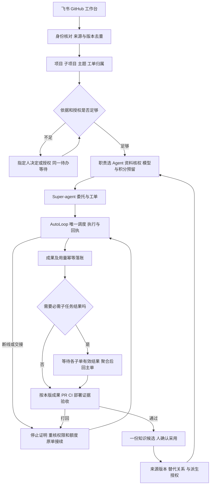

# 全系统后端核验 · 2026-11-17

后续修复状态：本报告发现的前四项已在后端源码修复，并通过统一回归和隔离串联验证。下文问题复现保留为修复前证据；当前结果见 [四项后端修复与验证](BACKEND-FOUR-FIXES-2026-11-17.md)。积分单轮上界与前端部署验收字段不在此修复批次内。

本轮覆盖整个后端，并检查已有工作台与后端的关键契约。结论是受测业务主链能闭环，现有自动回归全部通过，但另行设计的边界用例复现了跨模块缺口，尚不能据此认定已具备完整生产运营能力。

本轮没有修改业务实现或前端源码，没有发送飞书通知、调整 GitHub 权限、启动新模型执行或修改原测试工单。真实账本的恢复与重放均在隔离副本进行。副本服务已停止，源账本的工单、成果、知识、授权、账目及通知表摘要保持一致。

## 验证范围与证据

| 验证层 | 本轮执行 | 结果 |
| --- | --- | --- |
| 自动回归 | `npm test`，37 个测试文件，78 个顶层测试 | 77 通过，0 失败，1 个 Linux 沙箱测试在 macOS 跳过。一个顶层测试往往包含多个业务步骤，不代表只有 77 个断言 |
| 静态与构建 | `npm run typecheck`、`git diff --check`、`npm run build:ui` | 通过。构建成功不等于浏览器交互全部验收 |
| 上游来源 | `npm run audit:upstream` | Super-agent、AutoLoop、DeepSeek Harness、Octop 三个项目及 Paperclip 来源锁定校验通过 |
| 真实数据恢复后的 HTTP 串联 | 用备份命令复制现有真实测试账本，启动当前源码的隔离服务，以四个测试账号调用接口 | 72 检查点通过，0 失败。覆盖两个项目、正反权限、隐私、出处、重启及重放 |
| 新边界验证 | 实际认证类、入口数据库、积分模块，以及隔离 HTTP 服务中的 97 条合成知识、缺失索引服务 | 复现下面五项后端行为；与已有回归区分记录 |
| 现有测试服务 | 读取 4629 的健康接口 | 飞书消息、卡片订阅均报告 ready。此结果不能证明索引、模型和 GitHub 同时健康 |

本轮没有新发消息、重新跑 PR 或重新调用模型。因此不把历史飞书、GitHub、Codex、Claude Code 实跑记录算作今天重新完成的外部端到端验证。

本地证据位于 `.runtime/system-review-2026-11-17/`，不进入 Git：

- `regression.log` 是本轮全量测试输出。
- `http-verified.json` 记录 72 项当前服务的 HTTP 检查及结果。
- `boundary-findings.json` 记录新边界的实际结果。
- 复核脚本为 `.runtime/full-system-review-1117.mjs` 与 `.runtime/full-system-boundaries-1117.mjs`。后者使用合成边界资料，前者使用真实测试账本副本；脚本中的本地路径需随环境调整。

## 模块覆盖

| 模块 | 当前已验证的关键逻辑 | 本轮结论与剩余边界 |
| --- | --- | --- |
| 身份与授权 | 多渠道绑定、成员/Agent 授权分离；匿名拒绝、异项目互访拒绝、私有咨询对同项目其他成员隐藏 | 回归与 HTTP 通过；另发现口令修改未失效旧会话 |
| 项目与主题 | 父子项目、主题、工单归属；关联不等于授予权限；其他项目成员不能越权写入或改额度 | 回归及双项目 HTTP 通过；未进行真实组织的大规模并发压测 |
| 飞书/Gateway 入口 | 原消息去重、修改版本、引用归属、同话题接续、原话题回复、独立收件箱断线恢复 | 回归通过，历史有真实飞书证据；另发现超过三天的未处理回调会被清理 |
| 筛选与人工立项 | 闲聊过滤、半天整理、模糊引用交人判断、同来源不重复建单 | 回归通过；本轮没有重新发群消息。模型语义判断质量不是这些确定性回归的充分证明 |
| 职责与派工 | 项目配置职责、产品委托研发、研发接单/拒接、原单接续 | 回归通过，仍由原版 AutoLoop 唯一调度；优先级/容量调度及开放式任务图不属于已完成能力 |
| 执行端与交接 | 注册沿用原设备、旧执行停止证明、换端重查资料和模型、隔离工作区、回执补写 | 回归通过；本机 Seatbelt 实测通过，Linux 本轮跳过；没有新增真实设备安装 |
| 多 Agent 子任务 | 必需结果未齐不汇总、受影响子单重跑、旧回执拒绝、重复授权不重派 | 回归通过；恢复后的主单第 2 版仍精确引用规则子单第 1 版及交付子单第 2 版 |
| 人工决定与通知 | 必答未齐继续等、旁人不能批准、重复卡片回调幂等、群卡默认仅状态/入口 | 回归通过；本轮没有外发通知，未重做真人点击 |
| 交付与验收 | 工单、运行、commit、PR、同 SHA 的 CI 重跑绑定；旧版本拒绝验收；部署环境和状态核对 | 回归通过；GitHub Deployment API 为受控响应，真实部署仍缺验证；工作台提交验收缺少部署字段 |
| 知识与记忆 | 人工采用、替代、来源版本、子单出处、原资料及多级派生撤权、恢复后继续隔离 | 回归及真实数据 HTTP 通过；另发现 Octop 只取前 96 条候选、部分入口检索结果不一致 |
| 技能与共享专家 | 挂载版本、授权代次、复制模板不复制私有资料或凭据、受托执行 | 回归及目录权限接口通过；本轮未新调用共享专家 |
| 模型与 Token/积分 | 明确允许的备选模型、冻结倍率、按运行/尝试结算、跨池限制、迟到与重复回执 | 回归与账本恢复通过；单轮超预留真实行为已复现，不具备统一的生成途中 Token 硬上限 |
| 独立服务与恢复 | 工作台/入口写锁、备份前清场、双 SQLite 完整性、摘要校验、恢复后的去重/撤权 | 回归及真实账本恢复通过；健康接口缺少索引依赖状态。当前仍是单工作台写实例，未证明高可用或异机灾备 |
| 前后端适配 | 类型和打包、验收请求字段对照 | 未修改前端；仅确认契约缺口，没有宣称完整浏览器验收通过 |

## 本轮复现的问题

### 1. 口令更新后旧会话继续有效，优先修复

在隔离副本用 `ConsoleAuth.login` 登录，再调用 `changePassword`，原 Cookie 仍被 `sessionFromRequest` 接受。当前会话通常可保持到两小时到期或进程退出。

原因见 `src/console-auth.ts:194`。口令修改只更新账户文件，没有让此前签发的会话失效。若口令更新由另一进程执行，仅清除当前进程的 Map 也不足够。

建议在账户上记录凭据/会话代次，签发和每次验证时核对；改口令推进代次，使其他进程已有会话一并失效。补一次跨实例的实际登录验证。

### 2. 未处理飞书回调超过三天会被清理，优先修复

往真实收件箱模块插入一条未确认处理的卡片回调，推进测试时钟到三天后执行 `prune`，删除 1 条，剩余 0 条。

原因见 `src/workbench/feishu-inbox.ts:66`。清理只按接收时间执行，没有区分未处理消息与可丢弃历史。入口服务会周期性调用清理。消息历史补读也不能等价重建一次按钮点击。

建议未处理事件先进入可审计的失败/人工接续状态，保留原事件及去重标识。为持续失败的同话题事件保留处理顺序，并明确解除阻塞的人工路径。原始正文的留存期限与业务回执的恢复证据分开管理。

### 3. Octop 检索仅纳入最近 96 条，结果与另一检索入口不同

通过隔离工作台接口创建 97 条已采用的合成资料，把独有词放在第一条。`/api/octop/<project>/recall` 查不到，`/api/project/<project>/recall` 经兜底能查到。

原因见 `src/workbench/collaboration.ts:1316`。取候选时先按时间截为 96 条，再做全文匹配。通用检索有额外兜底，Octop 入口没有同等召回范围。通用入口在 Octop 已返回其他匹配项时也不执行兜底，因此不能把这条兜底当成全库检索保证。

建议统一检索策略，先在所有当前授权资料中检索，再按相关性和上下文预算限制结果。分页或受控增量索引均可，查询时仍须重新核权。当前索引服务每次用请求资料构建内存数据库，尚不是完整的持久化大规模知识索引。

### 4. 索引服务不可用时，工作台仍报告健康

隔离配置指向不存在的索引 socket。工作台 `/health` 返回 HTTP 200 且 `ready=true`，随后知识检索返回 HTTP 503。

原因见 `src/workbench/server.ts:220`。就绪检查关注工作台与飞书消息订阅，没有把索引依赖状态纳入结果。

建议分开提供进程存活、功能就绪与各依赖状态。索引异常可标记知识功能降级，不需要把仍可用的工单功能一并停掉；运维监控必须能看出差异。

### 5. 积分限制属于派工准入，单轮可能超过预留

合成边界设项目 1 积分，预留 1,000 Token；运行回执报 10,000 Token，最终记 10 积分，后续新任务被拒绝。这项行为已有文档说明，本轮确认它是实际边界，不能当成硬上限已实现。

原因见 `src/workbench/token-points.ts:101`。它按回执实耗结算，不控制所有外部 CLI 的生成过程。

建议保留如实记账，增加支持能力分级。支持运行中计量的执行端可追加预留和中止，不支持的执行端显示允许的单轮上界及超额策略。不要用少记 Token 来维持表面额度。

### 6. 开启部署验收门禁后，现有工作台按钮不能完成请求

后端验收需要 `deployment.id`、`deployment.statusId` 与本版 SHA 匹配。工作台在 `workbench/src/work.tsx:368` 仅发送 revision、commit、正文及条件。已有后端回归证实缺部署选择会被拒绝，因此这里属于前后端契约未适配。

建议后续前端直接呈现后端提供的环境、部署与状态快照，提交明确版本；后端继续二次核对。普通只核对 PR/CI 的任务不受此项影响。本轮只记录，不改前端。

### 7. 旧能力报告已不能代表当前实现

`PRODUCTION-CAPABILITY-AUDIT.md` 仍有未接卡片、积分或子任务回填等历史表述，而当前已有对应实现和验证。`FEATURE-VERIFICATION-2026-11-16.md` 的测试数量和部署门禁描述也属于当时结果。

这些历史证据应保留，但需要一个当前能力矩阵作为索引，并标明验证日期、源码版本、证据等级与未完成项，避免用旧报告判断今天的能力。

## 串联关系与下一步

建议把下一轮合为一个修复批次，优先处理旧会话失效、未处理回调留存、全范围知识检索和依赖健康。额度的单轮策略单独定义清楚，部署字段在前端适配阶段接好。每项增加一个能复现故障的回归，再统一运行全套检查，不需要逐模块反复向人请求确认。

仍缺外部条件或新实跑的部分有真实 GitHub Deployment 状态变更、真实 Figma 修订及源站 ACL 撤销、企业微信机器人、Linux 执行隔离、本轮新飞书消息和模型运行，以及生产规模并发/异机灾备。历史已有的飞书及 Codex/Claude 实跑保持其原有证据效力，但不扩展到这些尚未验证的情形。
