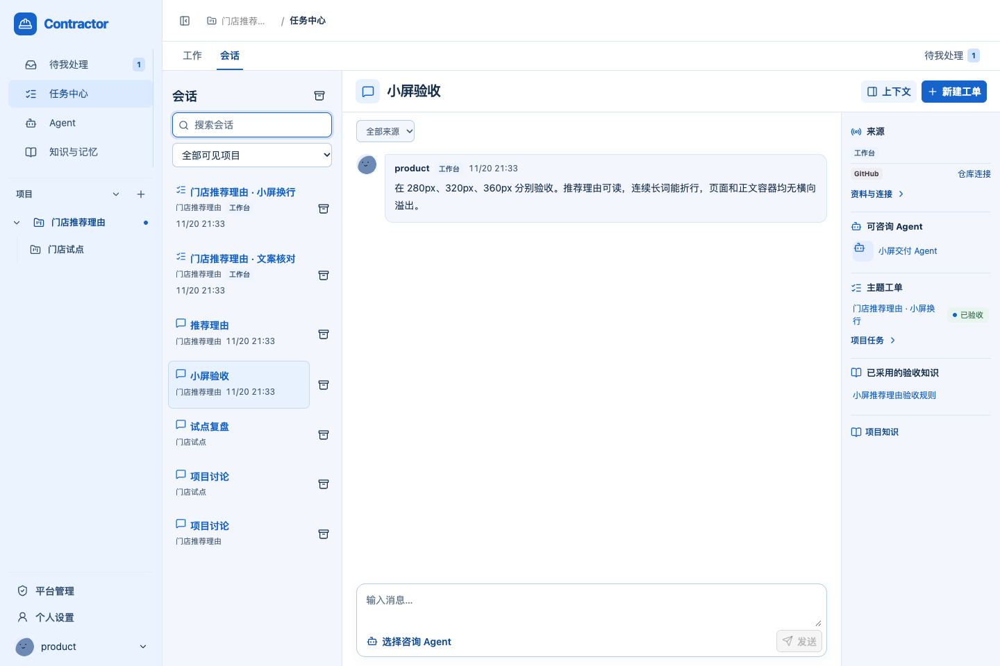
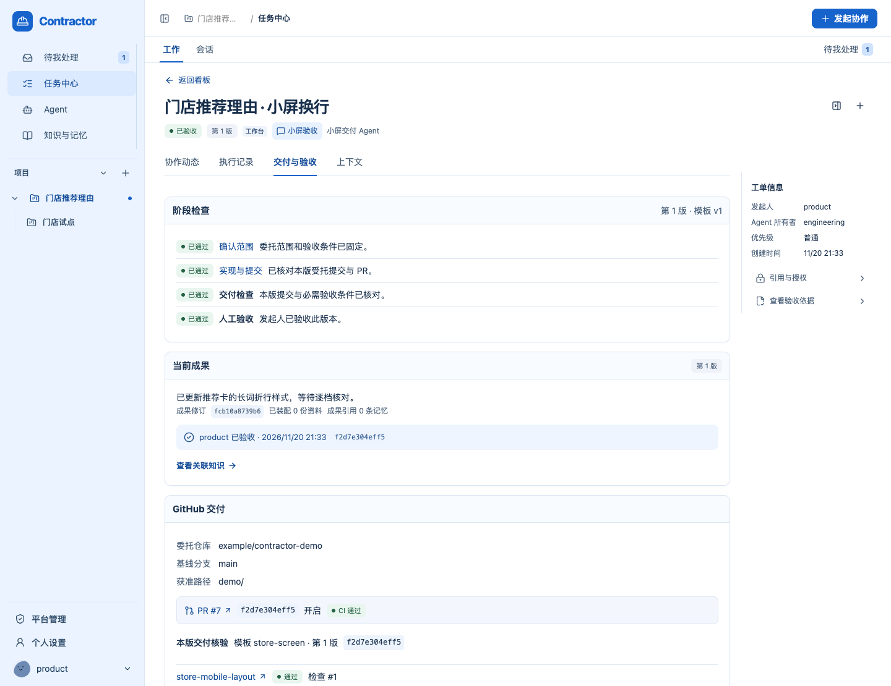
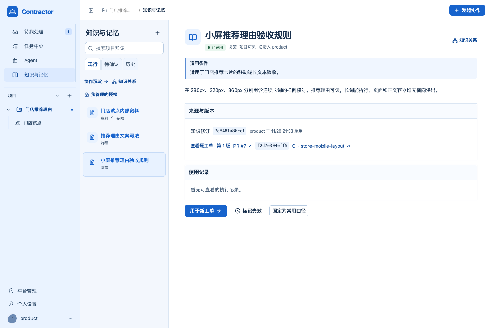
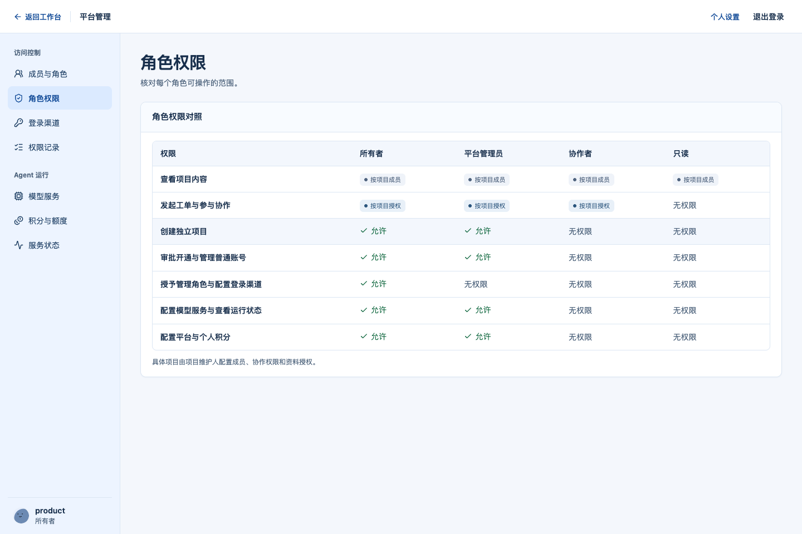
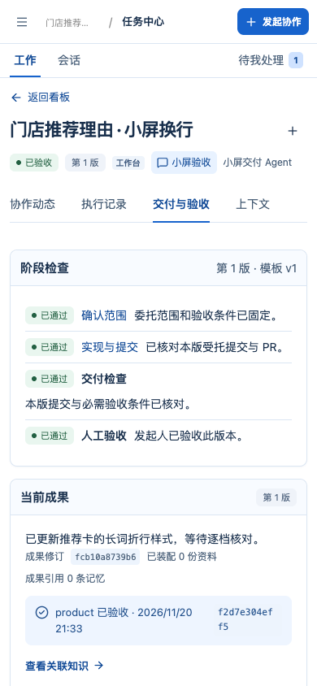

# 工作台界面与操作

以「门店推荐理由」项目说明常用操作。下方是隔离实例的实际工作台截图。使用演示账号、模拟 GitHub 回执和测试执行器。

[整体流程](../README.md#一件工作怎样走完) · [模块及业务规则](PRODUCT-CAPABILITY-MAP.md) · [配置手册](CONFIGURATION.md)

## 先看需要自己决定的事

进入「待我处理」。工单待接、Agent 追问、资料审批和待验收随当前账号变化。每条工单待办标有编号与版本，点进去定位到对应处理动作。验收链接保留当时的交付修订，原单进入下一版后仍可回看当时的证据。处理后从详情返回待办，列表和看板随工单一起更新。

## 从看板找工单

打开「任务中心」。用「项目任务」「我的任务」切换范围。看板按状态或优先级分组，列表便于搜索并查看父子工单。模糊搜索、主题和状态筛选可组合使用。点卡片进入工单，返回看板后继续使用原筛选。项目概览的近期工单和主题顶部的「工单」指向同一份工单。

要发起代码委托时点「新建工单」，填写标题和要做的事，展开「代码交付」选择仓库。执行 Agent 下拉框随仓库筛出合格的人选，改变 Agent 时保留仓库。仓库模板要先确认主题依据时，提交前必选主题。提交后，由有仓库资格的研发接单。在工单「上下文」确认主题依据，再由 Agent 领取。

## 在会话里续聊

打开侧栏「会话」，选择「个人会话」或「项目会话」。从待办的「与我的 Agent 对话」也能进入个人会话。在「个人设置 → 个人 Agent」设置名称、允许的模型、工作指引和本人确认的经验。个人会话和回复只对本人开放，可以在左侧切换历史会话，打开后向前翻阅完整记录。续聊时会向已配置模型提交最近八轮已回答的对话片段。

「项目会话」也可从项目或主题名称进入。选中主题后可查看原讨论、可咨询 Agent、工单、资料入口和已采用的规则。只读咨询从会话发起，需要执行的工作在主题内开单或接到原单。归档只改变自己的目录。

从会话进入工单后，即使切换到「执行记录」或查看该轮交付，仍可用「返回会话」回到进入前的位置。搜索和归档筛选继续保留。工单标题旁的主题链接可直接跳到工单自己的讨论。

## 查看执行、成果与验收

工单属性和处理动作放在同一详情。属性栏显示项目、主题、状态、当前版本、发起人、负责 Agent 和待处理人。窄屏可在标题旁打开属性。当前账号需要验收时，可从协作动态进入当版交付。

| 工单页签 | 用法 |
| --- | --- |
| **协作动态** | 查看当前卡点和处理人，接单、退回、答复、停止或交接。「工单讨论」按时间显示已关联的渠道消息和工作台发言，可按来源筛选和打开原消息。 |
| **执行记录** | 选择执行轮次或尝试，核对委托人、Agent、设备、模型、上下文、回执及成果链接。 |
| **交付与验收** | 打开当版成果、PR、提交和 CI，逐项核对。选择历史成果可查看当时的验收。打回后在原工单开启下一版。 |
| **上下文** | 查看原要求、已确认的主题依据和使用的资料。需要受限资料时按工单申请，临时授权到期后重新核对。 |

工单讨论中的「仅在工单内留言」只记录在工作台。已有飞书原消息且具备协作权限时，点「公开回复到飞书」才向原话题投递，正文旁显示待送达、已公开或未送达。已挂回的回复提供原消息链接。飞书补读取得消息在话题内的位置后会补齐精确跳转。只读成员可以查看项目内获准的讨论和验收证据。

代码交付的可验收状态来自后端。配置的证据到齐后，发起人才能签收当前版本。CI 和 GitHub 原页链接仍由 GitHub 校验访问权限。 [交付与验收规则](WORKBENCH-DELIVERY-TEMPLATE.md)

## 把验收结论变成知识

打开「知识与记忆 → 待确认」。验收形成的候选在这里等负责人核对标题、正文、适用条件和范围。确认采用后到「现行」可查。需要替代或失效时在知识条目处理，历史引用仍指向对应修订。

「来源与版本」能跳到当时的工单版本，也能核对 PR、提交和 CI。使用记录显示知识何时被装配及是否在成果中引用。需要受限资料时，从相关工单提出申请。 [知识沉淀与权限](KNOWLEDGE-VERSIONS.md)

## 找 Agent、设备和项目配置

「Agent」可搜索项目 Agent 或查看「我的 Agent」。打开 Agent 查看负责人、职责、运行引擎、默认模型、相关工单与用量。启用专家库后可挂载技能和选择共享专家。设备页显示接单状态，符合条件的所有者可以连接或管理自己的设备。 [连接执行端](WORKBENCH-REMOTE-RUNNER.md)

| 能力 | 日常入口 | 配置位置 |
| --- | --- | --- |
| 个人 Agent | 「会话 → 个人会话」与本人配置的 Agent 续聊。「Agent → 我的 Agent」可查看项目已分配的个人代办。 | 在「个人设置 → 个人 Agent」选择平台允许的轻量模型。项目维护人在「职责与路由」设置项目内代办可用的主备模型。 |
| 平台任务路由 | 从会话、工单或渠道发起。按主题、职责和授权匹配牵头人，歧义转人工待办。 | 项目维护人在「职责与路由」设置成员职责和决定人。群整理可单独配置主备模型。 |
| Worker 执行 | 在会话或发任务时选择执行环境，在工单「执行记录」查看具体尝试。 | 设备所有者连接本机或云主机，项目维护人设置默认和备用设备。执行机检查对应的 CLI 与自己的凭据。 |

只选一位咨询 Agent 时，会话输入框旁可选本次的执行设备。原工单的运行中交接从工单操作发起，收到停止证明后才能由新设备接续。

| 角色 | 配置入口 | 可执行的操作 |
| --- | --- | --- |
| 项目参与者 | 项目、任务中心、个人设置 | 查看获权项目、讨论、发起委托、使用个人 Agent 或绑定本人渠道。 |
| 项目维护人 | 项目 → 项目设置、职责与路由、资料与连接 | 管成员、交接维护人、安排职责和主备设备，配置可用资料与项目规则。 |
| 平台管理员 | 平台管理 | 按角色权限管理成员、登录渠道、模型、积分和服务健康。 |
| 资料负责人 | 知识与记忆 → 我管理的授权 | 核对申请、设置临时授权、撤回授权、采用与替换知识。 |

## 在手机上核对当前结果

窄屏优先展示当前会话、工单或知识正文。从左上角导航换项目。打开外部来源时使用自己的源站账号。无权查看的内容在直链和接口上执行同一套权限判断。

## 验证范围

演示实例通过浏览器核对了以下操作。

- 四种角色可见的菜单和直链访问，包括平台所有者、子项目维护人、普通成员和项目外账号。
- 看板加载与空态、会话返回和筛选保留、仓库与 Agent 联选、模板必选主题。
- 从知识来源回到原成果版、查看 PR 与 CI 证据，以及 390px 窄屏下的交付详情。

渠道准备、模型登录和部署环境由部署者配置。各模块自动化回归见 [GitHub CI](../.github/workflows/ci.yml)。
