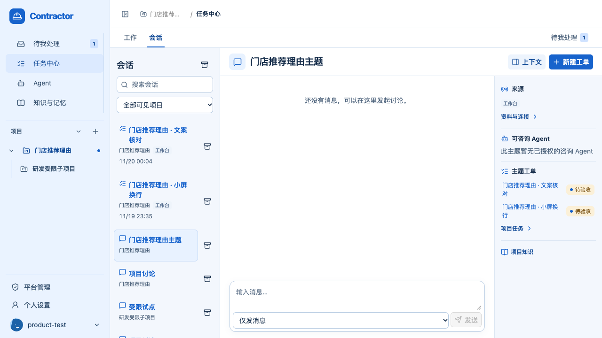
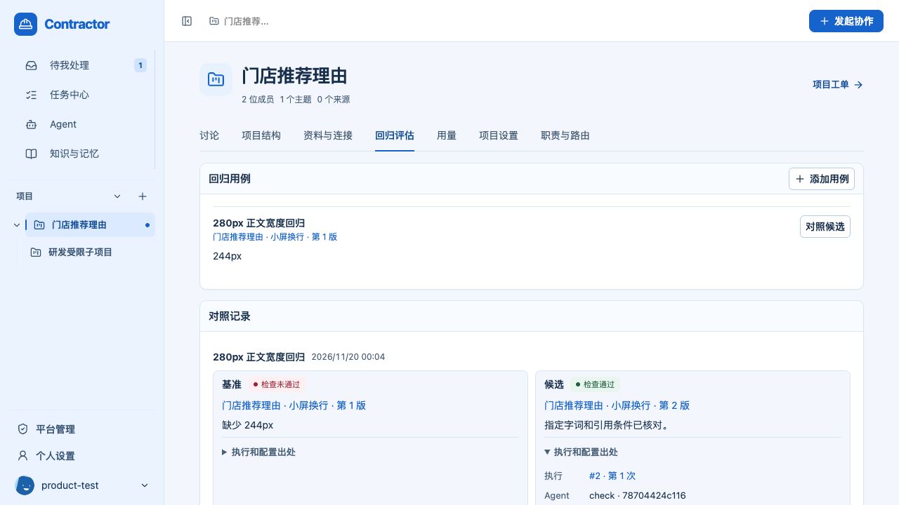

# 工作台页面与操作

Contractor 的前端使用 React 和 Ant Design。项目、会话、工单、执行、证据和知识各自保留深链接，页面根据当前账号、项目角色和数据权限显示可用操作。

| 页面 | 主要操作 | 能追溯到什么 |
| --- | --- | --- |
| **待我处理** | 处理待确认委托、研发接单、必答、资料授权、交接和版本验收 | 具体工单、版本和当前等待原因 |
| **任务中心 → 工作** | 看板按状态或优先级分组，列表筛选项目任务、我的任务、主题和状态。可开新单、进入父子工单或接续原单 | 项目、主题、协作动态和工单全部版本 |
| **任务中心 → 会话** | 按项目或标题搜索，打开项目、主题和工单讨论。归档和恢复只影响当前成员自己的列表 | 原主题、独立工单、来源渠道、完整的 Agent 回答及引用 |
| **工单详情** | 查看协作动态、执行记录、交付与验收、上下文。当前角色可接单、补答、交接、重新核验、打回或验收 | 精确的执行尝试、当轮模型与上下文、提交、PR、CI 和知识 |
| **项目** | 查看项目树和主题，管理成员、来源、渠道、群反馈、职责与路由。维护人可以在回归评估记录基准与候选 | 人员与执行端配置、证据归属、规则和任务 |
| **Agent** | 在项目和个人 Agent 之间切换。按权限启停、使用共享专家与技能、挂载版本、连接执行端 | 所有者、职责、已授权项目、设备和用量 |
| **知识与记忆** | 查看现行、候选和历史。资料负责人采用、替代或失效条目，成员可搜索、查看来源与知识关系 | 原资料修订、当时的工单版次、授权和使用运行 |
| **平台管理与个人设置** | 管成员、角色、登录、服务状态与积分政策。成员管理个人资料和绑定身份 | 变更审计、渠道状态和本人设置 |

## 从门店主题到交付

在门店推荐理由主题里，文案核对和小屏修正各开一张工单。只读咨询可以选择主题内已授权的 Agent。需要改代码时，产品确认范围，研发接单，在工单「上下文」确认本版依据。每轮执行从「执行记录」查看，验收进入「交付与验收」。

在启用分阶段检查的仓库交付中，需求证据、对应版本的提交和 CI、产品核对项目逐项显示。打回后继续看同一条工单，第 1 版和第 2 版保留不同的证据链接。在「项目 → 回归评估」可从已存在的成果版本建立用例，并点回两边的执行和配置出处。

有项目权限才能读取工作台正文，跳转到 GitHub、Figma 或飞书时继续按源站账户权限读取。无权限的链接和接口与菜单采用同样的后端判定。移动端专注于当前会话或工单详情，可以直接返回目录。 [配置位置和权限](CONFIGURATION.md)
