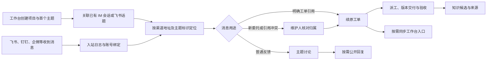

# 项目与 IM 会话

项目、子项目、主题和工单由 Contractor 保存。每个渠道使用自己的会话地址关联同一套项目结构。交付、测试和验收继续记录在对应工单的版次上。成员能在工作台阅读自己获准访问的讨论，并在明确选择渠道时把回复或工单入口同步回去。



## 从工作台开始

1. 选择「新建项目」。可以同一步填写首个主题，也可以在「项目结构」补建子主题。子项目的成员和权限单独设置。
2. 在「资料与连接」关联渠道。在独立项目中，飞书群默认选择「只接已关联的话题」。同群可以服务多个项目。维护人需要管理权限和已获准的会话地址。
3. 从主题点「发起」。表单核对项目牵头、执行端、模型、额度和当前 Git 基线。待确认的派工进入维护人的待办。代码单可以选用已登记的可信交付配置，由在原项目和当前项目都有资格的研发负责。仓库仍由源站授权，导入配置只用于当前项目的代码交付。
4. 在「协作动态」选择「同步工单入口」，或在主题讨论选择公开回复。工单入口只包含通用提示和需登录的工作台链接。讨论框的默认动作保存在工作台。

## 渠道地址怎么对应

| 渠道 | 归属依据 | 工作台往外发送 |
| --- | --- | --- |
| 飞书 | 应用、群、话题根消息。可粘贴已有话题链接，也可在已批准的群里发布新话题。 | 发布入口或回复原话题。保留群和根消息的回执。 |
| 钉钉 | 连接与群会话。跨项目共用一个群时，为每个主题使用独立标识。 | 在启用了主动发群消息权限的群里发布入口或回复。既有咨询沿用原消息的回传地址。 |
| 企业微信 | 连接与群会话。跨项目共用一个群时，沿用相同的主题标识规则。 | 通过已连上的机器人向所选群回传。 |
| Telegram、Discord | 连接、会话以及适配器提供的原生话题地址。 | 已批准的群或频道可发送。 |
| QQ、微信 | 连接及其可接收的会话。 | 依赖相应适配器的原会话回复能力。需原消息凭据或客户端上下文的渠道不提供主动发布按钮。 |

钉钉和企微的共享群示例为 `[主题:mobile] 360px 下还有横向滚动`。标签只在该连接、该会话内有意义。未标记的消息只会进入设有唯一默认主题的会话。同一工单需要明确续接时，可以发 `/协作 auto [工单完整 ID] 补充说明`。工作台内的一般讨论和各渠道普通反馈仍各有来源和作者。

飞书关联已有话题时优先核对源站。若机器人缺少历史读取权限，可以在原话题 @机器人一次。系统会留存该事件的群和话题坐标，供维护人在平台完成关联。配置了历史读取授权的原项目继续走既有补读流程。新关联默认接收此后由渠道交付的事件，渠道未交付的历史需要相应的源站读取能力。

## 配置、权限与回执

- 飞书从 `feishu.allowedGroups` 选择可用群。主题绑定按 `(应用, 群, 根消息)` 唯一。群下多个项目各用自己的话题。已绑定的根消息可以在资料页点回。
- 钉钉、企微等通过 `octop.channels[].allowedConversations` 登记可供工作台配置的原生地址。既有 `routes` 继续生效。OAuth 登录、身份绑定、项目访问和 IM 群权限各自独立。

```json
{
  "id": "retail-dingtalk",
  "kind": "dingtalk",
  "credential": "retail-dingtalk",
  "allowAccountBinding": true,
  "allowedConversations": [{ "chat": "原生群会话标识", "label": "门店反馈群" }]
}
```

- 同一渠道消息和工作台发送请求均有稳定标识。收到重复消息时沿用原记录。收到修改时更新可核对的飞书文本修订。发送前重新核对项目成员、目标路由及工单资料范围。已发送但回执不明的请求显示待核对，避免再次向群发送。
- 主题讨论保留来源，可供工单确认成依据。知识采用、版本验收和角色权限继续由业务核心掌管。待验收版可以交接给有权查看本版成果的在岗成员，原发起人仍留在工单记录里。
- 团队部署将 `COLLAB_STATE_DIR` 指向持久目录或卷。状态页会提示系统临时目录。运维通过 [账本备份与恢复](WORKBENCH.md#账本备份与恢复) 演练，再切换服务。执行机凭据、Git 工作区及外部读取权限按各自路径保管。

渠道实现参考 [飞书消息资源](https://open.feishu.cn/document/server-docs/im-v1/message/intro) 和 [钉钉机器人消息](https://open.dingtalk.com/group)。
