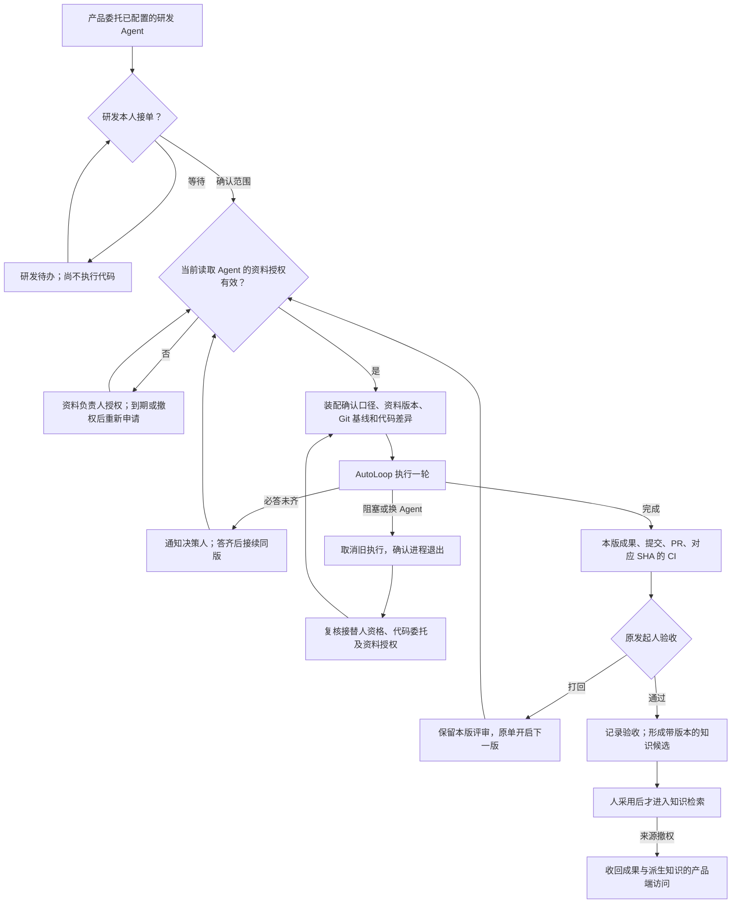

# 原工单的交接、恢复与多轮交付

本轮只接后端。Super-agent 仍持有 Ticket、Mandate 和 Assignment，AutoLoop 仍持有执行轮、问答、重试与 CLI 会话。新增的业务版本是同一工单内的交付版本，不是第二套任务或调度器。

## 后端契约

| 动作 | 输入与约束 | 记录 |
| --- | --- | --- |
| 产品委托代码任务 | 原有 `POST /api/ticket` 的 `target` 选择项目已配置仓库；执行 Agent 所有者必须是交付成员。产品无需成为交付成员 | 发起人、受托 Agent、代码目标、待接单决定 |
| 研发接单 | `POST /api/ticket/:id/approve-development`；只允许当前或待交接 Agent 的所有者，且仍有该仓库交付资格 | `developmentApproval` 绑定 Agent 与目标摘要。换到另一人须另行确认；产品不能批准、挂 PR 或分支 |
| 交接 | 原有 `handoff`；必答先答齐，旧执行及观测到的子进程确认退出后才安排替换 | 原生新 Assignment、新执行范围；旧运行和答复留存 |
| 阻塞接续 | `POST /api/ticket/:id/resume`：`nonce`、当前 `version`、`reason`，可选完整 `baseSha` | 幂等接续请求、旧执行停止证据、新 Assignment；保持业务版本 |
| 验收打回 | `POST /api/ticket/:id/revise`：精确成果 `revision`、`reason`、`kind: rejected` | 不可覆盖的打回记录；同 Ticket 与 Mandate 开启下一版。重复提交不重复派工 |
| 验收后继续优化 | 同一接口，`kind: continued` | 已通过版本的验收及知识出处保留；当前验收和交付选择清空 |
| 重审到期成果 | 完成但未验收时，`resume` 或原有 `access` 重新向资料负责人申请 | `purpose: review`、精确成果 hash；仅恢复该成果查阅，不启动 Agent，也不能充当下一版执行授权 |
| 最终验收 | 原有 `accept`；原发起人提交当前成果修订及代码 SHA | 重新读取 GitHub PR 和对应 SHA 的 CI，核对本单运行提交、分支、仓库及基线后写入版本化验收 |

`resume` 不替代必答事项，不复活被人停止的委托，也不扩大原工单范围。换目标、额外资源或新业务范围继续走原有新单／子单入口。重复接续按请求 nonce 去重。

## 交接实际带走什么

- `task.confirmation`：从 AutoLoop 原生已答卡片读取问题、选项或文字答复、答复人、时间、来源运行与业务版本。按接替 Agent 当前授权重新检查来源；不复制另一位成员的整份 CLI 历史。
- `task.code-state`：同工单独立工作区的基线 SHA、起始提交、分支、变更路径、受托路径内 diff、未跟踪文件的路径与 hash。较大 diff 标记截断，执行端仍可在已核验工作区读取原文件。
- `task.previous-output` 与 `task.continuation`：上一版仍获准读取的成果，以及本次打回或继续优化的明确意见。
- 每轮 manifest 固定本次 Agent、所有者、委托人、配置、实际资料与授权申请编号、确认卡片编号及代码快照；装配后、运行中和接收结果时再检查授权。

已提交内容沿用本单受托记录中的最新提交；未提交内容保留在同一工作区。远端基线移动时阻塞，只有仓库交付成员能提供精确的新 `baseSha`。有未提交改动时不自动 rebase；干净工作区可按明确确认的 SHA rebase，冲突即 abort。未知 HEAD、范围外改动和不可核对的旧执行都继续阻塞，不自动覆盖或强推。

## 版本与知识

`work.version` 表示业务版本；AutoLoop `run` 表示执行轮。同版澄清、重试、授权恢复和交接可以有多个 run。`workbench_output` 保存各成果，`workbench_review` 追加 accepted／rejected／continued 记录；已有原生执行账本不变。

`GET /api/ticket/:id` 增加 `versions`，包含成果修订、运行、版本及评审；正文与评审原因按来源授权隐藏。PR 的历史快照仍用现有 `workbench_pull_version`。下一版不能使用上一版的成果修订或 CI 通过验收。验收后产生的知识以 `ticket@outputRevision` 和 `PR@SHA` 指向具体版本，后续改版不会把旧知识误指为新结论。知识采用仍由人操作，检索仍复用现有记忆索引。

资料执行授权与成果查阅授权分别记录。执行授权到期后，新批准产生新代次；旧结果不会因下一次执行获准而自动复活。已完成待验收成果可申请单独的查阅许可，批准后重新通知原发起人验收。撤回该许可后，该成果与其派生知识再次隐藏，验收事实和审计仍保留。

## 开源复用位置

| 来源 | 本轮采用方式 |
| --- | --- |
| [Super-agent Engine](https://github.com/deepseek-ai/dsh-superagent-prototype/blob/8c32a9dc5d72c033816c6a8110b37f40cf94fba4/src/core/engine.ts) | 直接调用现有导入的原版 `receive`、`attach`、`retryTicket`、`report` 与原版事务 Store／Effects。下一版用独立内部触发器 attach 到指定 Ticket，避免共享群话题扇出唤醒其他工单 |
| [AutoLoop](https://github.com/KKKKhazix/agent-autoloop/tree/ba8cf6d8cf24f9ce005958c15d88f2d9cff7f05d) | 继续直接用原版 Runtime、worker、cards、事件合并、取消和重试。交接包从原生卡片及执行记录装配，无新增执行队列 |
| [LobeHub ServerContextBuilder](https://github.com/lobehub/lobehub/blob/a8424d204a7ed1eb36985ebdfa6eac8041615392/apps/server/src/modules/AgentRuntime/adapters/ServerContextBuilder.ts) | 借鉴按当前运行输入重新装配上下文的机制，适配到 SuitMe 的资料授权与原生 AutoLoop context；没有导入 LobeHub 第二套 runtime |
| [Acceptance](https://github.com/lobehub/acceptance/tree/f720feb862bdbe3acc653bdedc297e20e08be1ae) | 延续已固定源码的多轮、保留历史证据的契约；新增的 review 表只记录 SuitMe 人工验收事实，不启动其云端验收服务 |

## 验证与边界

自动回归覆盖：确认口径交接、停止先于替换、失败接续及重复请求、同话题多单不被误唤醒、打回与三版历史、旧知识的版本出处、授权到期重审、查阅许可不能启动执行、产品不能替研发接单或关联代码交付。另用真实本地 Git 仓库验证多轮提交、未提交差异快照、基线漂移、明确确认后的 rebase 及冲突回退。Git 测试只把 fetch 指向本地 bare 仓库，不把它宣称为远端 CI 证据。

测试身份沿用一位操作者分别登录的 product、engineering、design；不是三位独立真人。模型与 CLI 仍沿用本机登录，没有启用新模型服务。本轮不改前端、不合并或部署测试 PR、不切换主流程。执行端已接收过的本地文件和 CLI 历史不因产品端撤权而物理消失，生产执行环境隔离仍需单独补齐。

## 真实联调记录 · 2026-11-15

飞书测试群发起反馈父单 `6619d79408b9f05abf4135ae3119720b`；产品在该主题下委托研发子单 `3c9c26b55f8dce572836764c7d0580f4`。下表后续步骤始终在这张研发子单完成。产品、研发和接替研发分别登录 product、engineering、design 测试账户；本轮仅在测试配置中将 engineering、design 列为交付成员，product 没有代码交付资格。

| 验证 | 实际结果 |
| --- | --- |
| 产品委托研发 | 产品发起成功；替研发批准、关联分支与 PR 均返回 403。engineering 本人接单后才启动 Codex |
| 人工口径 | 真实 Codex 提出原生 ask，机器人发送真实飞书私聊；产品测试身份用 `/答` 确认两句、先场景后事实，卡片编号 12 |
| 撤权与重启恢复 | 运行 51 已生成部分页面，撤权后 Codex 及工具子进程停止。重启后端、重新申请并由资料负责人批准，运行 52 用新 CLI 会话继续，manifest 保留确认卡 12；同版仍只有一个 Assignment |
| 换成员交接 | 运行 52 在 `07:16:02.778Z` 记录退出；接替成员确认代码委托并获得自己的资料授权后，`07:16:04.770Z` 完成交接，`07:16:07.226Z` 才启动运行 53。其 context 带原确认口径、部分页面路径与 hash，交付保留原注释及第一句 |
| 第一版打回 | 运行 53 生成 `a94e477e5a785de923d99b636cef1c4d84c8326b`；[第一版 CI](https://github.com/zhegong-996/desktop-tutorial/actions/runs/43689353394) 成功。产品指出第二句缺少现场试穿提示；原单开第二版，重复打回没有增加 Assignment |
| 第二版交付 | 运行 54 生成 `57f1630818d673a39de3648011ca7b78c5e04ad7`，父提交是第一版，仍为 [同一 PR #11](https://github.com/zhegong-996/desktop-tutorial/pull/11)。[第二版 CI](https://github.com/zhegong-996/desktop-tutorial/actions/runs/43689547285) 成功；PR 仅改 `collab-pilot/index.html` |
| 完成后重申查阅 | 撤销接替 Agent 的执行授权，成果隐藏；新建 `review` 申请向资料负责人发送真实飞书通知。批准后恢复精确第二版成果，运行数保持五；接替研发替资料所有者批准返回 403 |
| 验收与回流 | 旧修订、旧 SHA 均不能验收第二版。产品测试身份按第二版 SHA 和检查 `132737067833` 签署；候选经明确采用后能检索。撤回查阅许可及剩余临时执行许可后，成果与派生知识均不再返回，历史验收保留 |
| 跨渠道补充 | [本人 GitHub 评论](https://github.com/zhegong-996/desktop-tutorial/pull/11#issuecomment-6891003341) 和真实飞书补充回到同一工单，未新增运行 |

研发子单共五个原生运行（澄清、两次被取消的接续、第一版交付、第二版交付），三个 Assignment（原委托、换成员交接、第二版）。飞书入单父单另有一次真实 Codex 梳理。最终没有运行中、失联或排队中的执行，临时资料授权全部撤回。

`npm test`：837 项通过；`npm run typecheck`：通过。到期时间使用本地时钟夹具验证，真实通道执行的是主动撤权、重新申请和服务重启恢复；基线漂移与冲突回退使用真实本地 Git 验证，没有把它算作远端实跑。联调账本与消息证据归档于忽略目录 `.runtime/backend-iterations-live/`，不提交 GitHub。
