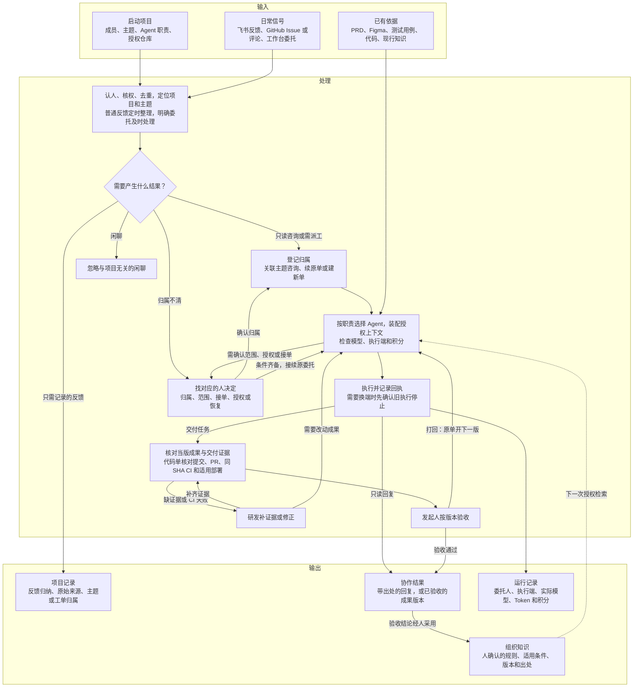
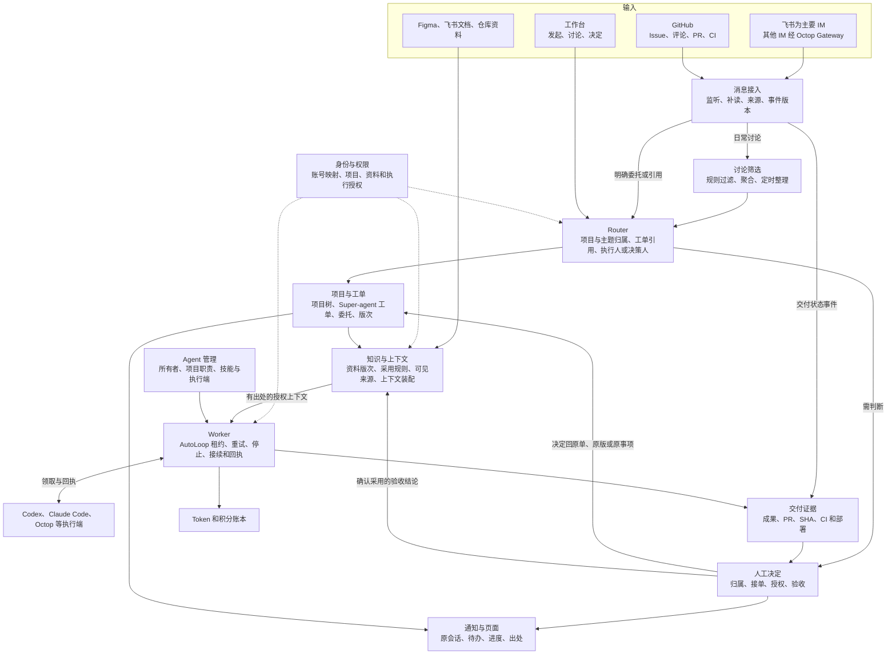
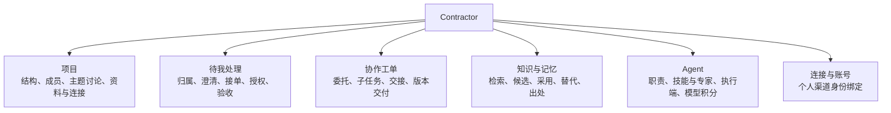

# Contractor按项目组织的架构

项目和主题提供共同上下文，工单跟踪独立交付，工单版本记录验收证据，知识保存经人采用的结论。下面用门店推荐理由串联业务流程、功能入口和系统责任。

## 业务流程 · 输入 → 处理 → 输出

闲聊在判断后过滤。只需记录的反馈保留来源并挂到项目或主题。需要执行时才创建或接续工单。知识候选来自已验收的成果，由负责人确认是否采用。

| 对象 | 负责什么 | 门店推荐理由的落点 |
| --- | --- | --- |
| 项目与主题 | 定义讨论、资料、成员、Agent 职责及可交付仓库的范围 | 门店推荐理由主题下同时讨论文案与小屏换行 |
| 工单 | 保存独立委托、接单人、权限、交接和待办 | 文案只读单和小屏代码单各有负责人和交付结果 |
| 工单版本 | 冻结成果与当次提交、CI、部署和验收 | 同一小屏单的三版可使用同一个 PR，提交和验收逐版留痕 |
| 知识 | 保存经人采用的结论、适用条件、来源和替代关系 | 后续咨询默认检索现行小屏规则，历史版本仍指向当时证据 |

## 系统架构

| 模块 | 接收 | 交出 | 当前代码边界 |
| --- | --- | --- | --- |
| 消息接入与筛选 | 飞书及其他 IM、GitHub 事件，来源和版本 | 去重后的明确请求、可聚合讨论、交付状态、待补读事件 | `intake.ts` 管连接和消费，飞书进程负责持久收件箱，`discussion.ts` 负责规则过滤、聚合和来源版本 |
| Router | 项目和子项目、主题、账号映射、消息引用、项目职责 | 续原单、新单、项目或主题记录、转人判断所需依据 | `router.ts` 管引用、人员与 Agent 的选择，重新核对整理时的参考归属。`channel-workflow.ts`、`discussion-workflow.ts` 分别把决定落到原消息和原单，`dispatch-workflow.ts` 管待确认委托与立项 |
| 项目与工单 | 路由决定、人工判断、执行和交付事件 | 稳定的项目、主题、工单及版次，供执行恢复和验收引用 | `project-directory.ts` 管项目、主题、成员和维护人。`work-records.ts` 保存原生工单的项目状态映射，`ticket-revisions.ts` 管版次接续 |
| 人工决定 | 归属冲突、接单、资料申请、执行追问、验收 | 带项目、工单和处理人的决定，支持待办转交和去重 | `decision-workflow.ts` 管待办创建、关闭与移交，飞书与网页共享权限和处理状态 |
| Worker | 已通过委托、授权、上下文及额度约束的执行请求 | 执行、停止证明、成果、回执与用量，每次可回到原单与版次 | `worker-claims.ts` 管领取、重领和停止请求，`execution-context.ts` 渲染本轮上下文，`handoffs.ts` 管停机证明后的交接，`execution-receipts.ts` 管回执与补写。AutoLoop 持有原生租约与运行状态 |
| 身份与权限 | 人、Agent、外部账号、项目关系与资料授权 | 是否可查看、发任务、执行、审批、发布及理由 | 项目级准入统一用 `project-directory.ts`。资料、成果和派生知识访问统一用 `knowledge-authority.ts`，渠道绑定、平台角色和登录各有独立组件 |
| Agent 管理 | 所有者、项目职责、技能或专家版本、模型授权、设备登记 | 当前可用 Agent 与执行资格，供 Router 和 Worker 使用 | `agent-directory.ts` 管登记、在岗、Agent 版本，`model-routing.ts` 校验当轮主备模型。设备与 Octop 技能共享有独立组件，积分独立预留和结算 |
| 知识与上下文 | Figma、文档、仓库的修订，已采用结论、授权和工单历史 | 现行及历史知识、知识关系、按当前权限装配的可追溯依据 | 知识资料、关系、索引、来源权限各有入口。验收生成带来源的候选，由人确认采用后才进入现行检索 |
| 交付、通知与用量 | 运行回执、GitHub 证据、人的决定 | 当版可验收证据、原话题回传、个人待办、项目积分账本 | `delivery-evidence.ts` 管 PR 版本与同 SHA 的 CI 各次重跑，`ticket-acceptance.ts` 同一事务存下验收与知识候选。通知与积分消费原决定或原回执 |

飞书入口和 Octop 知识索引保留独立进程。各业务模块可先共享进程与数据库，由模块分别管理自己的写入和业务规则。工单归属和去重仍用现有事务。AutoLoop 保持唯一执行调度，模型路由决定可用模型，积分模块负责预留及结算。工作台和飞书通过相同的后端操作读取状态、处理待办和回到原始出处。

### 门店推荐理由怎样跨模块流转

飞书群里出现未点名的「门店反馈推荐理由看不懂」，接入模块保存原话题、发言人和消息版本。过滤后进入已配置的定时整理。已有同功能工单的反馈可挂回原单，仍需确认是否改动范围的反馈进入对应负责人的待办。多个来源指向不同工单时，Router 保留冲突和来源，由项目维护人选择归属。

GitHub 上已有小屏修复 PR 时，PR、提交及 CI 变更进入交付证据模块，只有明确的工作请求进入工单路由。Figma 原型修订进入项目资料的版本同步，后续工单按授权读到指定版本。文案与小屏可在同一主题里并行，分别交付和验收。被采用的结论带工单版本、原始资料或 GitHub 证据回到知识模块。

### 模块交接与数据归属

- 渠道原消息通过 `ChannelRequest` 交给路由。定时整理通过批次快照和 `Proposal` 交给 Router，归属判断再次核对当前引用、身份与项目权限。写入模块负责对同一条消息去重，并在同一事务内写入工单关联或人工待办。
- 执行端只领取 AutoLoop 发出的任务。Worker 在准备运行前重新核对资料、成员和设备，从已授权的材料生成上下文快照。接续原单保留已确认的口径与获准使用的上一版成果。换人、换端按旧执行的停止回执继续推进。
- 同一次执行通过运行、尝试和租约匹配回执。原生回执已确认时，补写同一份成果及用量。有待补写记录的工单暂不另领。交付验收重新核对实际 PR、提交、CI、部署要求和验收人的当前权限。
- 工单和版次仍使用同一个业务账本。仓库读入、知识搜索与上下文装配使用各自的模块接口。工作台读取协调层聚合的状态，`collaboration.ts` 保留流程装配、部分渠道返回、跨模块的 read model 和执行适配工作流。已有飞书入口与索引继续单独运行。

## 功能模块划分 · 用户去哪里完成工作

| 功能模块 | 主要输入 | 模块负责的输出 | 界面或能力边界 |
| --- | --- | --- | --- |
| 项目 | 成员、职责、来源和反馈 | 项目/子项目、主题、资料范围、归档反馈 | 已有项目结构、讨论和资料页。仓库同步放在对应资料旁 |
| 待我处理 | 需要某位成员判断的事项 | 有处理人、处理结果和时间的决定，供原项目或工单接续 | 网页统一待办，飞书按已配置方式提供原话题或聚合入口 |
| 协作工单 | 委托、项目授权和业务证据 | 处理进度、子单、交接、成果及验收历史 | 项目主题容纳多张单，提交、CI 和部署按工单版本核对。真实部署验收仍待补验 |
| 知识与记忆 | 已验收结论、导入资料和人工编写规则 | 现行条目、历史、可回溯来源、供 Agent 使用的授权上下文 | 已有目录、采用和来源跳转。知识关系可从知识页查看，查询按当前权限过滤 |
| Agent | 项目职责、成员的 Agent、技能、模型及额度 | 可调用的 Agent 和执行端、实际用量与积分账目 | 执行端和额度已有界面，已有技能与专家共享入口，复杂职责与模型路由编辑仍有配置边界 |
| 连接与账号 | 成员的飞书、GitHub 账号证明 | 已核实的跨渠道身份映射 | 个人账号绑定在这里；仓库与哪个项目关联由项目模块管理 |

运维横跨全部模块。健康、备份恢复、日志与通知开关由维护人员操作，渠道和模型故障在对应业务处提示原因。

## 本次接通的页面和接口

- **项目 → 资料与连接。** GitHub 仓库显示同步状态、错误类别和最近成功时间。仓库状态按项目权限返回。同步完成才推进游标，失败保留原位置。健康接口反映仓库故障，存活接口和正常项目读取仍可用。
- **工单 → 交付与验收。** 在同一版本旁显示当前 PR、CI、目标环境、部署和提交。提交验收时绑定服务器提供的部署 ID 和状态 ID。服务器再次核对对应环境和 SHA。知识及工单历史可回看验收所用部署。需部署确认的飞书待办沿用工作台验收入口。
- **Agent → 额度管理。** 默认展示积分是否启用、模型倍率、池上限、已用、预留、超限及实际回执。管理员配置模型兑换和倍率，池管理者调整对应积分上限。原有次数和时限收进同一页的次级区。

## 验证与当前边界

模块化版本 `a07366ffd515ccd9` 已切换到测试工作台。切换前备份测试账本和工作台制品，核对了 9 张受保护工单、积分账本和待发通知。飞书入口、GitHub 连接和知识索引均处于就绪状态，通知外发保持暂停。

- 本轮全量回归共 87 项，86 项通过，1 项 Linux 专属用例在 macOS 跳过。类型检查和差异检查通过。新增并发回归覆盖 GitHub 校验期间撤销验收资格，验收写入和知识候选均被拦截。
- 在真实测试工作台发起「门店推荐理由」小屏只读咨询 `494b7113`。两次并发提交归入同一咨询，只生成一次 AutoLoop 运行 `43`。实际 Codex 回复包含 280px、320px、360px 的现行规则及交付出处，关联 PR #18、提交 `41abe327` 和该提交的成功 CI。无项目权限的账号读取被拒。验收历史及通知队列未变化。
- 这次真实调用由工作台发起。其他 IM 的真实联调和真实部署版本验收仍待单独验证。

### 上轮交付适配验证

工作台版本 `4ace74fa9469198a`。切换前备份真实测试账本和前端制品。运行服务的飞书和知识索引就绪。通知外发仍暂停。

- 86 项回归，85 通过，1 项 Linux 专属测试在 macOS 跳过。类型检查、前端构建和差异检查通过。
- 受控 GitHub 响应覆盖 TLS 失败、同步恢复、交付阶段限流及游标一致性。真实测试仓起初读取失败，后来在现有工作台自动恢复，两轮完整轮询成功、游标前进，健康接口恢复 200。实际读回 PR #18 及提交 `41abe3272ea7` 的两次成功 CI。网络前段出现间歇故障，稳定性仍需观察。
- Chrome 查看了运行中的积分额度、实耗回执、模型倍率表单及仓库从异常到恢复的状态。研发成员可读积分，不能编辑策略或池上限。部署验收使用隔离的浏览器样本，捕获的请求包含本版成果修订、提交 SHA、部署 ID 和状态 ID。测试仓实际 Deployment 列表为空，过期状态拒绝和部署验收走受控 GitHub 回归。
- 切换核对 9 张受保护的已验收工单及积分账本、通知队列保持一致。本轮未签署真实工单验收。
