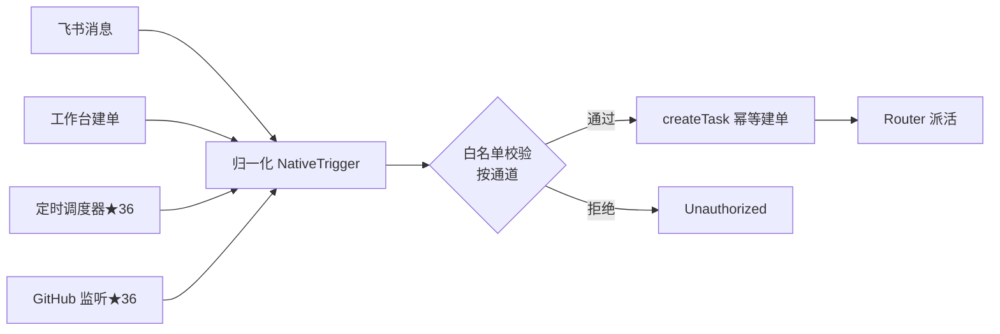

# SuitMe 业务流程

> 版本口径：第三十六轮（2026-11-09）。以「一次真实任务」为主线讲清全部业务流程。
> 每个流程都标注：谁发起、谁拍板、留什么痕、哪些事 AI 永远不做。

## 流程 1：发起任务（四个入口，同一归宿）



- **飞书**：`/collab SUI-42 接续` 或自然语言补充说明；个人 Agent 用 `/agent <服务> <需求>`。
- **工作台**：3100 界面建单（本地操作者身份）。
- **定时调度器**（★36）：例程到点自动建单，automation actor 留痕，任务卡片写明「由例行计划自动发起，不是新的人工需求」。
- **GitHub 监听**（★36）：推送/议题/PR 事件转任务，标题带 `[GitHub]` 前缀；首次启用只记基线，不冒出历史任务。

**幂等纪律**：四个入口都走 `requestKey` 幂等——同一次发起（同槽/同事件指纹）至多建一个任务。

## 流程 2：执行与挂起（autoloop 核心）

```
领取任务(step 队列原子领取)
  → 逐步执行(每步状态外置 PG, 崩溃后另一进程可接棒)
  → 遇到需要人拍板的事?
      ├─ 否 → 继续执行(受 maxStepsPerRun 熔断保护)
      └─ 是 → 提问卡片(飞书+工作台) → 进程退出(挂起零消耗)
                    ↓
          人在任一通道回答 → 成对台账落账
                    ↓
          自动续跑闸(重新验证台账, 不盲信入参) → 排回接续步骤
```

**关键点**：
- 挂起期间不烧任何 token（没有人付空转的钱）。
- 回答 **不是验收**——续跑闸只恢复执行，确认验收永远另走流程 4。
- 一次 tick 若触发多子调用尚未逐次拆分（`executionView().missing` 如实标注，不假装做到）。

## 流程 3：到点唤醒复查（★36）

```
对任务预约复查(wake-schedule: taskId + at + note)
  → events 表落账 wake:{taskId}:{at} = scheduled
  → 主循环 tick 每次扫描到点的预约
  → 触发一轮复查委托: "到点复查：按约定复查任务进展；已完成的小结，
     阻塞的列出需要人拍板的点；本条由定时唤醒触发，不是新需求"
  → 审计 wake.review-triggered；任务完成则如实标 skipped-accepted
```

**适用场景**：交付后想两天后复查线上表现、审批流等外部回复约定明天再问、低峰期执行的计划任务。

## 流程 4：交付与验收（红线所在）

```
Agent 产出代码 → 本机 Git worktree 分支(路径白名单+禁符号链接)
  → CI(本机 collab-pilot) → 通过
  → 独立评审(评审者 ≠ 产出模型; 视觉证据做结构核对, 不猜图像内容)
  → 逐项验收报告(一条链接 :4192)
  → 原发起人在原会话「确认验收」 ← ★唯一验收出口, 任何自动化不能碰
      ├─ 通过 → 合并(审批齐全才 auto-merge) → 发布预览 → 知识入库
      └─ 打回 → 只退未过项 → 打回原因沉淀进团队记忆(C-6)
```

**GitHub 监听与交付的关系**：监听只产生任务；动代码仍按 `delivery.provider` 走（默认本机 Git，不推 GitHub）。PR 类事件的指令明确写「评审与合并走审批链，不要自动放行」。

## 流程 5：知识沉淀与复用

```
验收通过的知识条目 → 知识空间(分区权限)
  → L1 图谱投影(零模型, 只读)
  → autoCognify: 正文外发 DeepSeek 抽取 + 本机 fastembed 向量 → Cognee 图谱
  → 语义检索(cognee-search, owner/admin) 随任务复用
打回的教训 → 团队记忆(候选改进 → 真人批准 → 生效)
跨空间资料 → 申请 → owner 审批 → 有期限授权 → 到期/撤权沿 lineage 阻断
```

## 流程 6：通知与注意力预算

```
任何要触达人的消息 → outbox
  → 护栏判定(注意力预算)
      ├─ 低价值/自进展 → 抑制(留审计, 不打扰)
      └─ 人类必达(提问/验收/授权/PR) → 必送达
            ├─ 飞书(主通道)
            └─ 钉钉/企微镜像(★36, 同一预算, 不给补充通道开小灶)
                 · 飞书正常：sent + 镜像副本
                 · 飞书关停：镜像可达 → mirrored；否则保持 pending 等恢复
```

## 流程 7：定时例行任务（★36）

```
配置例程(scheduler.routines) → 每日 09:30 晨报 / 每周日 18:00 健康检查(cron)…
  → 主循环 tick 判定: daily 必须已过 at 时刻; interval 按槽; cron 按五字段匹配
     （cron 带 30 分钟补跑窗口，进程晚启动仍补一次，超过窗口不追昨天的班）
     ★ 真实教训: 初版漏了"已过 at 时刻"判定, 凌晨启动会把当天 09:30
       的例程提前跑掉——上线首日即发现(审计 routine.triggered 多了 2 条),
       修复后补了回归用例("early boot must not pull the slot forward")
  → 时间槽幂等占位(routine-tick:{id}:{slot}) → 建任务 → 委托执行
  → assistant 不可用? 任务照建(工作台可见) + 审计如实记录, 不假装已跑
```

## 谁拍板什么（权限速查）

| 决定 | 唯一有权者 | 自动化能否代劳 |
|---|---|---|
| 确认验收 / 核可 / 放行 | **原发起人（原会话）** | ❌ 永远不能 |
| 回答执行中的提问 | 被问的人（成对台账验证） | ❌（回答也不是验收） |
| 批准候选改进 | 真人 | ❌ |
| 跨空间资料授权 | 目标空间 owner | ❌ |
| 发起任务 | 人（任一入口）或自动化（留痕） | ✅ 定时器/监听器可以 |
| 触发复查 / 汇总状态 | — | ✅ 只读汇总类可以 |

## 一天的时间线（示例）

| 时间 | 发生什么 |
|---|---|
| 09:30 | 定时器自动建「晨报」任务：汇总待验收/进行中/受阻清单 |
| 09:32 | 晨报任务完成，通知经注意力预算送达飞书（+钉钉镜像） |
| 10:00 | 你在飞书看到晨报，回复一个追问 → 自动续跑闸恢复执行 |
| 14:00 | Agent 交付代码 → CI 通过 → 独立评审 → 验收报告链接发给你 |
| 14:30 | 你确认验收 → 合并 → 发布预览 → 知识入库 |
| 15:00 | GitHub 监听发现新议题 → 自动建任务 → Agent 跟进 |
| 18:00 | 定时器建「健康检查」任务：知识库与交付流水线巡检 |
| 次日 09:00 | 昨天预约的 wake 到点 → 自动复查该任务验收准备情况 |
