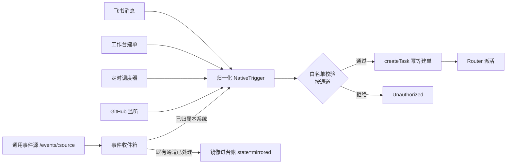

# SuitMe 业务流程

> 版本口径：第四十轮（2026-11-09）。以「一次真实任务」为主线讲清全部业务流程。
> 每个流程都标注：谁发起、谁拍板、留什么痕、哪些事 AI 永远不做。

## 流程 1：发起任务（六个入口，同一归宿）



- **飞书**：`/collab SUI-42 接续` 或自然语言补充说明；个人 Agent 用 `/agent <服务> <需求>`。
- **工作台**：3100 界面建单（本地操作者身份）。
- **定时调度器**：例程到点自动建单，automation actor 留痕，任务卡片写明「由例行计划自动发起」。
- **GitHub 监听**：推送/议题/PR 事件转任务，标题带 `[GitHub]` 前缀；首次启用只记基线。
- **通用事件源**：`POST /events/:source`，逐来源密钥 / token，指纹幂等，**只收事实不开工单**；
  来源通过 `claims(source)` 单向归属——一个来源只有一条路径，避免同一事件建两单。

**幂等纪律**：六个入口都走 `requestKey` / 指纹幂等——同一次发起（同槽/同事件）至多建一个任务。

## 流程 2：派活（1 跳还是 2 跳，由配置决定）

```
新需求 → Router.planRoute(配置, Agent 注册表)
  ├─ flat（默认）      → 1 跳：人 / Personal Agent → 执行者
  └─ layered           → 2 跳：人 → 业务域主管 → 执行者
       条件：主管已登记 ∧ 在岗 ∧ 绑定 supervisor 职责 ∧ 范围覆盖该域 ∧ 派活已提交
       任一不满足 → 降级为 1 跳，原因写进 plan.degraded（不静默）
  自环守卫：调用方 / 主管 / Personal Agent 与承接人撞车 → 写一条 rejected 决策并拦截
  人签红线：最终验收两跳时只有最后一跳 requiresHumanSignature=true
  → 每个 hop 写同一份 append-only Trace（可重放、可审计）
```

## 流程 3：直通（同会话补充说明）

```
同一个人在同一条会话继续说话
  → passThroughDecision
      ├─ 唯一在办任务 + 绑定匹配 → 直接接续原任务（不建单、不过 Router）
      ├─ 多条在办任务           → 要求指明任务号
      ├─ 只绑定已验收任务       → 不复活，按新需求走
      ├─ 显式指令（验收/退回/转交/查进度/建单） → 回主链路
      └─ 成员归属不符           → 拒绝（鉴权失败不静默降级）
```

**红线**：直通只少建一张单，**不多给一份权**——决策结构里没有 scope / permissions 字段。

## 流程 4：执行与挂起（autoloop 核心）

```
领取任务(step 队列原子领取)
  → 逐步执行(每步状态外置 PG, 崩溃后另一进程可接棒)
  → 遇到需要人拍板的事?
      ├─ 否 → 继续执行(受 maxStepsPerRun 熔断保护)
      └─ 是 → 提问卡片(飞书+工作台) → 进程退出(挂起零消耗)
                    ↓
          人在任一通道回答 → 成对台账落账
                    ↓
          自动续跑闸(重新验证台账, 不盲信入参) → 排回接续步骤
```

**关键点**：
- 挂起期间不烧任何 token。
- 回答 **不是验收**——续跑闸只恢复执行，确认验收永远另走流程 6。
- 一次 tick 若触发多子调用尚未逐次拆分（`executionView().missing` 如实标注）。

## 流程 5：到点唤醒复查

```
对任务预约复查(wake-schedule: taskId + at + note)
  → events 表落账 wake:{taskId}:{at} = scheduled
  → 主循环 tick 每次扫描到点的预约
  → 触发一轮复查委托（明确写「本条由定时唤醒触发，不是新需求」）
  → 审计 wake.review-triggered；任务完成则如实标 skipped-accepted
```

## 流程 6：交付与验收（红线所在）

```
Agent 产出代码 → 本机 Git worktree 分支(路径白名单+禁符号链接)
  → CI(本机 collab-pilot) → 通过
  → 独立评审(评审者 ≠ 产出模型; 视觉证据做结构核对, 不猜图像内容)
  → 独立审码(命中密钥 / .env 即拦预览, 独立报告, 不替代人签)
  → 逐项验收报告(一条链接 :4192) + 只读工作台
  → 原发起人在原会话「确认验收」 ← ★唯一验收出口, 任何自动化不能碰
      ├─ 通过 → 合并(审批齐全才 auto-merge) → 发布预览 → 知识入库
      └─ 打回 → 只退未过项 → 打回原因沉淀进团队记忆
```

**GitHub 监听与交付的关系**：监听只产生任务；动代码仍按 `delivery.provider` 走（默认本机 Git）。
PR 类事件的指令明确写「评审与合并走审批链，不要自动放行」。

## 流程 7：知识沉淀与复用

```
验收通过的知识条目 → 知识空间三分区
  ├─ personal 个人区：只有归属者本人可改，管理员可总览
  ├─ team     协作区：operator 及以上 / worker 与 supervisor 档（限自己业务域）
  └─ org      组织区：admin 及以上 / supervisor 档（限自己业务域）
  → 状态机 candidate →(人审确认)→ confirmed →(撤回)→ withdrawn
  → 可复用闸：confirmed + 有确认人 + 同公司 + HMAC 一致 + 未过期
  → L1 图谱投影(零模型, 只读) → autoCognify(正文外发 DeepSeek + 本机向量)
  → 语义检索(cognee-search) 随任务复用
打回的教训 → 团队记忆(候选改进 → 真人批准 → 生效)
跨空间资料 → 申请 → 目标空间 owner 审批 → 有期限只读授权 → 到期/撤权沿 lineage 阻断
```

## 流程 8：通知与注意力预算

```
任何要触达人的消息 → outbox
  → 护栏判定(注意力预算)
      ├─ 低价值/自进展 → 抑制(留审计, 不打扰)
      └─ 人类必达(提问/验收/授权/PR) → 必送达
            ├─ 飞书(主通道)
            └─ 钉钉/企微镜像(同一预算, 不给补充通道开小灶)
                 · 飞书正常：sent + 镜像副本
                 · 飞书关停：镜像可达 → mirrored；否则保持 pending 等恢复
```

## 流程 9：定时例行任务

```
配置例程(scheduler.routines) → 每日 09:30 晨报 / 每周日 18:00 健康检查(cron)
  → 主循环 tick 判定: daily 必须已过 at 时刻; interval 按槽; cron 按五字段匹配
     （cron 带 30 分钟补跑窗口，进程晚启动仍补一次，超过窗口不追昨天的班）
  → 并发: 未显式配置时按密度缺省（interval ≤ 60 分钟串行，daily/cron 不限）
  → 时间槽幂等占位(routine-tick:{id}:{slot}) → 建任务 → 委托执行
  → 拿不到并发配额 → 不静默跳过：events(routine-blocked) + 审计 + status.blocked
  → assistant 不可用? 任务照建(工作台可见) + 审计如实记录, 不假装已跑
```

## 谁拍板什么（权限速查）

| 决定 | 唯一有权者 | 自动化能否代劳 |
|---|---|---|
| 确认验收 / 核可 / 放行 | **原发起人（原会话）** | ❌ 永远不能 |
| 回答执行中的提问 | 被问的人（成对台账验证） | ❌（回答也不是验收） |
| 批准候选改进 | 真人 | ❌ |
| 跨空间资料授权 | 目标空间 owner | ❌ |
| 发起任务 | 人（任一入口）或自动化（留痕） | ✅ 定时器/监听器/事件源可以 |
| 触发复查 / 汇总状态 | — | ✅ 只读汇总类可以 |
| 组织区知识增删 | admin 及以上 / supervisor 档 Agent | ❌ 自动化不能代替人审 |

## 一天的时间线（示例）

| 时间 | 发生什么 |
|---|---|
| 09:30 | 定时器自动建「晨报」任务：汇总待验收/进行中/受阻清单 |
| 09:32 | 晨报完成，通知经注意力预算送达飞书（+钉钉镜像） |
| 10:00 | 你在飞书追问一句 → 直通接续原任务（不新建单） |
| 10:05 | 需要你拍板 → 提问卡片 → 进程退出（零消耗） |
| 10:20 | 你回答 → 自动续跑闸重新验证 → 接着干 |
| 14:00 | Agent 交付 → CI → 独立评审 → 独立审码 → 验收报告链接 |
| 14:30 | 你确认验收 → 合并 → 发布预览 → 知识入库 |
| 15:00 | GitHub 监听发现新议题 → 自动建任务 → 分层派活给主管 |
| 18:00 | 定时器建「健康检查」任务：知识库与交付流水线巡检 |
| 次日 09:00 | 昨天预约的 wake 到点 → 自动复查该任务验收准备情况 |
